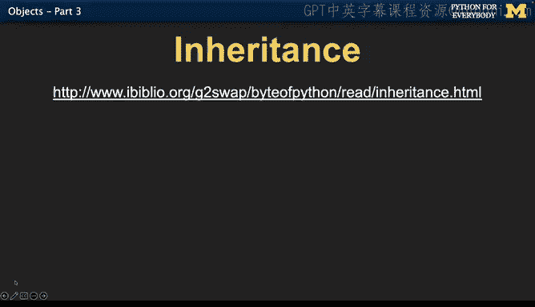

# 密歇根大学《给所有人的Python课》课程4：《使用数据库进行Python编程》｜python-databases｜ - P9：09_01_03_对象生命周期.zh_en - GPT中英字幕课程资源 - BV1PP411W7H1

So now we're going to talk about object lifecycl and like I said。

 we've been talking about this all long， but now we're going to be a little more formal about it。

So objects are created， used and discarded， and you don't have to think about this too much because it's just done。

Autoomatically。This is a concept in computer science that we call garbage collection and that is when you're done with an object and you want to clean things up and you want to get the memory back so。

We have special blocks of code that we as the object creator can say，" you know what。

 I want to be involved in the moment of creation and I want to be involved at the moment you're throwing this away。

I mean， we use constructors a lot。 That's the under under in it。 You see that all the time。

 Destructors， we tend not to worry too much about what happens when we're going away because usually all we're doing is the memories being given back to the system and so it's not like usually we have to do something unless your object is really create is really complex and like has some kind of scarce resource。

 perhaps that you've got in it like a database connection again， that's super advanced stuff。

 I just want to talk about constructs instructors now。

 not that we're going to use them at all in this class literally。

But when you start talking to databases， you know， and you're creating connections and those things。

 that's where a constructor might be， there might be some scarce resource that is connected to something on another computer or something that you do want to give back or something the operating system has that you do want to give back。

So the primary purpose of the constructor is to set up some instance variables to have the proper initial values right so I was calling it it's constructed and then it's initialized。

The code that gets called is the constructor code。Yeah。This is the object orient term as constructor。

But I think of it as the initializer， right， it's like because the construction happens before the init is called。

 so the world calls it constructor and pretty no one's going to be mad at you for calling_ underscore a knit。

 the constructor。And so there you go， and so in this one we've got a class party animal。

 the party method is the same I just added a print statement to the constructor so we can kind of see when that happens。

😊，And a print statement， which is already there in the party method and then。

I have now added a double underscore Dell double underscore。 Now， the interesting thing here。

Is that's also the same as that there's a Dell paren function looking like thing。

 which actually is a shortcut。ToCall this Dell method。 And again， it's。

 it's a syntax transformation because you actually can call Dell on an object in Python。

 and it calls this Dell method。So all we did in here。

 just I'm trying to track how it's created and destroyed。

 And this destruction might be counterintuitive to you。 So that's why I'm to going to do this。

 So we've got instrumented a construction message， a method message and a deor message。

 So we create a n equals party animal， which， which constructs the object and calls the init method to initialize it。

Then we call Anne party twice。And then this is the part that's a little weird。We say A N equals 42。

 Now， right before that A N equals 42 statement， A N held an object。

 That's what it was kind of technically， it's pointing to an object。

 But A N was an object in our world。 And when we say A N equals 42。It's gone， the object is gone。

And that were actually， what happens is this Python is like， well， Aan was a party animal object。

 And now I'm going to put a 42 in there。 But right before I put that 42， and。

 I better get rid of that object。And so you have caused the deor to be called by overriding A N that used to have an object in it。

I think that's kind of cool。Now， you don't have to know about this because theres there's memory inside of the party animal object that we we're not going to。

 But as soon as AN doesn't have a reference to it， as soon as AN is not looking at it anymore。

 we want that memory back。 And again， you know， not this is like 12 bys of memory， it doesn't matter。

 But if there's millions of these things， like millions of strings that you're creating and deleting and using the same variable over and over again。

 Python is carefully reclaiming the memory every time you overwrite， you know， with a variable。

And so so if you look at the output and you see the construction， it starts。

 which is that first line A equals party animal。 Then you see party method get called twice so far one。

 so far2 and then。When we're assigning it to 42， poof。

 like out of the mist comes this I am destructed。And the instance variable self dot x is still two。

But like a moment later， poof。That object is gone。 It's been garbage collected。

 It's been reclaimed by the object system。 It's been reclaimed by Python， and can be used。

To create new objects。And then at the end， we just print out A N contains A N， which is 42。

 And so we implicitly are calling the deor。 Again， we didn't have any work we wanted to do in this de in our party animal class。

 and so。All I want to do is print it， so you could see that there is a life cycle of creation。

 initialization， execution， and then destruction， delocation， garbage collection。

So in object our programming， a constructor in a class is a special block of statements called but an object is created again I hope by now that's kind of intuitive。

Many instances， we create lots and lots of objects。

The class is the template for making these objects。

 we can distort each distinct object in its own variable， and we call this having multiple instances。

 and each instance each object has its own copy of the instance variables so let's take a look at this。

So in this code。We go back to what we had before。 We have added in the in another variable self dot name。

 And we're seeing that constructors can have parameters。

 So the constructor can have a parameter that then we copy into the instance variable， Se dot name。

 It's really the instance variable name。 Se happens to be our alias to the instance itself。

 And the dot means within。 I like to read that as name within self is how I kind of think of that。

 And then we print that we've constructed it。 And we have our party animal。

 and that's kind of the same except we do print out the same the name。

And then what we're going to do is we're going to make a party animal with a name of Sally and store that in the variable S so that constructs a party animal puts in Sally and x equals 0 name equals Sally。

And then we call the party Me on the Sally object， and then we call J， make party animal with Jim。

 we're going to make a new one。And we're going to store that one in J。

So then the constructs called again。This time， Z is Jim and self do name is Jim。

 and we call J dot party， which calls the party method in the J object and S dot party。

 which calls the method in the S object。 So let's kind of track this through。 So at the moment。

 we're calling party animal Sally。 we're like make a thing。Then call an it。And that will make x be0。

 the instance variable x be0， and the instance variable name be Sally。

And then we call S stop party and that increments the X attribute in the S object to be1。

And then we say， now， let's take that template and build another object。But this time。

 we're going to put Jim in is the name and x is automatically 0。

 The same initializer was called as part of the construction of this。

 And so it x equals 0 name equals Jim。 So now you're beginning to see how。

The purpose of the code we write in double underscore a knit double underscore that purpose。

Is to get the things set up。And we've got two variables we've got to put them in there， okay。

 and then we can use them。And then we call J dot party。

 which adds one to the J instance of our party animal， gets added to one。

 And we still have both of these things， right， So J still exists and S still exists。

 We call the S party。 And then X becomes 2。 right。 And that instance。 So this is the idea of。

 And again， I'm only showing you2。But there could be millions。

 And so you could have millions of strings， and each of those strings is a different instance and has different attributes。

 but the same methods， generally。

So up next， we're going to go the last little sort of like， oh， you can do this too。

 it's called inheritance， and inheritance is basically our way of reusing code。

 defining one object and then creating an object that extends that object and add new capabilities。

