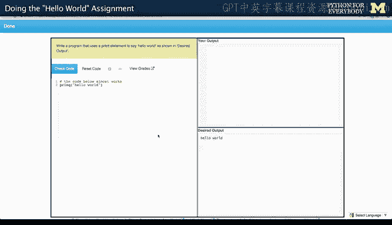
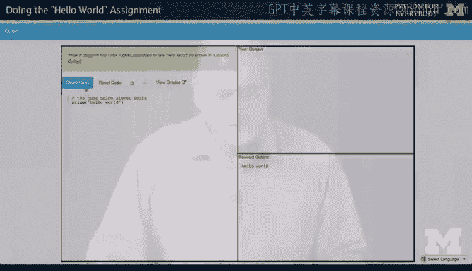
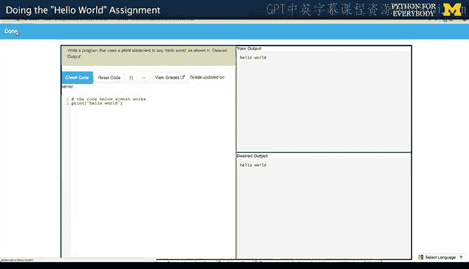

# 密歇根大学《给所有人的Python课》课程1：《编程入门指南（使用Python进行开发）》｜python｜ - P9：09_03_01_演示：完成Hello World作业.zh_en - GPT中英字幕课程资源 - BV1214y117Mk

So welcome to our first assignment， our first assignment， of course。

 like in all decent programming classes is printing hellello world now we're going to use the autograr for this and so here we are and let me scroll down we have a demonstration and it's kind of meta because that's the demonstration I'm doing right now。

It's not all that meta so here's an assignment and assignments are a little bit different when you click them because there's the honor code and you have to type your name and hit this checkbox to sort of point out that you're a human and that you're the right human etc。

 and then it's going to launch the tool when you press open tool here in a new window and here we go and so basically this is a Python simulated environment it's only good enough to do the first 10 chapters but it's great now。

The idea that I have is that you will actually write the Python on your computer using a real text editor like Adam。

 and then you'll just paste the code in here to get graded。

 But we understand that if you're using an iPad or something else like that that that this might be the only way that you're going to do it。

 Or if you're in a school or something and they've only got Chromebooks， it's okay。

 you can do but at some point like by chapter 11， you need to have Python， but that's okay。

 So some of the buttons that you're going to see here。

You won't see these are the teaching assistant and configuration buttons。

 but you will see the check code and the reset code button。

 And so what you often find when you get this is I give you some code that is sort of partially there in this particular one it has a mistake And so I'm going to run it。

 say check code and this actually submits the code to Python and it'll run and in this case it's got an error name error print Q is not defined online too and of course the the bug here is says please correct your code and rerun the bug here is that's supposed to be a T not a Q saying that's just a powerful So this first program is really quite easy。

And so it also shows you in the autograder， the desired output。

 and so we'll do check code and this is going to work。 and youll see this little spinner。

 that is the autograder sending your grade back to Coursera so that get it gets back in your courseursera gradebook and if that you don't see that then you got a problem or you can go back and check it in Coursera。

 but that is the moment where it's decided that you've done a good job。 Now。

 one thing about this is that once your grade has been set in Coursera。

 you can play around here and mess around and it doesn't like send back bad grades。

 it only sends back good grades， these are all pass fail so you either have 100% or 0% and if you later mess it up。

 you still keep 100% for your grade So it's not like the last grade that you sent it's actually you know the high grade。

 which is really it's pass fail so it's a 0% or 100%。

 But the other thing that you'll notice is if I make a mistake in the output it's not。

I'm going to update the grade。 And so I'm I'm going make it。 So the desired output is hello world。

 And so if I check the code now， it's going say， please correct your code and rerun it。

 It points over here in a mismatch because this is the output of your program。

 this is the output it wanted to have happen Okay and so that's that's what happens， right。

 Now the other thing that you will notice。 And I can't really demonstrate on this first one。 is。

There is a bit of static analysis that this autograder does to your code。

 and it's like you should have used a force statement in this problem or you should have used the input statement in this problem。

 et cetera， et cea， et cetera。 and so。That also can catch you if you sort of。

Are supposed to compute something， but you just print out the answer。

 and so it's not just enough to match the output， you have to match the output and it does a little bit of looking at your Python code to make sure your Python code makes some sense。

Another thing that's cool about this is this viewgrades button that you don't see that we the teaching assistant and teaching staff see if you're having problems on an assignment。

 you don't have to put your code in the forum you can simply talk to a teaching assistant in the forum and they can come into the assignment and they can actually see your exact code sitting in the auto grader they can even run your code and so it's a much better way to exchange code with the teaching assistant then sort of posting code in the forums in the very last course we do let you post code in the forums but in the first forum we don't I know that's frustrating to people but working code makes it too easy for people to just like cut and paste it because people' like oh let me just finish this assignment and if you don't struggle on the first few assignments and understand them then you won't actually understand the fifth or sixth assignment and so taking a shortcut by borrowing code from someone else is really just cheating yourself and if you put bad code in the forum that's even worse。

You know say my code is broken and it doesn't work and then students will be like， well。

 I'll just take your broken code and and so we just，Don't like putting code in the form。 And so。

That's basically the idea。 Let me finish this and get it back correct again。

 so I print out the right output so it runs it。 You can have a syntax error， which I showed you。

 you can have an output error， but if the syntax is right and the output is right and you pass all the static checks。

 then it sends the grade back to Coursera and your grade is updated on Courra。

 and then you just click the done button when you're all done and you're back in Coursera。

 So I hope that was helpful to help get you through writing your first assignment for this class。

