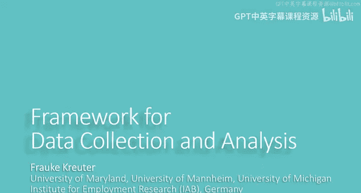
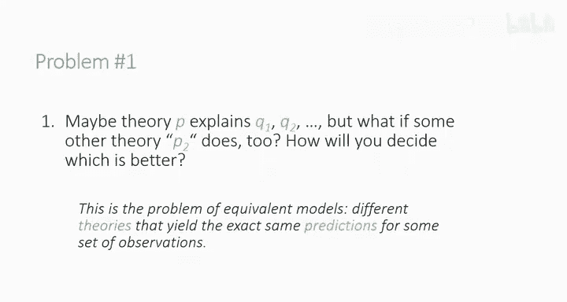
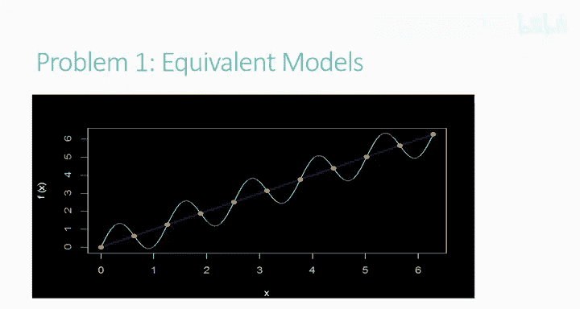
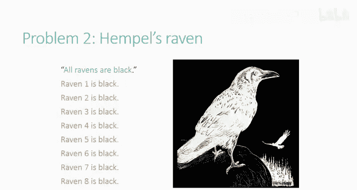
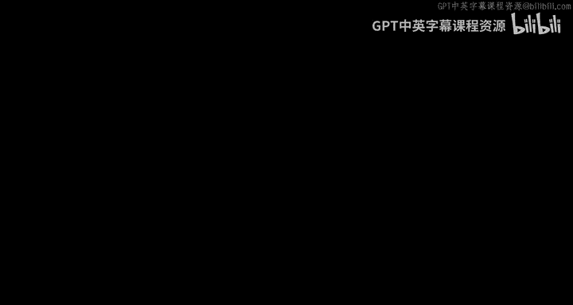

# 密歇根大学《调查数据收集和分析（第1课：框架）｜Survey Data Collection and Analytics》 - P10：9_归纳推理的局限性.zh_en - GPT中英字幕课程资源 - BV1pi421U7Zm

Welcome to Module2 of a Framework for data collection and Ana。

In the first module。We introduced to you two different ways to classify data。One。

 we call organic and found data， the other one we call design data。 Now。

 no matter which of these two。You work with， we said you need to understand the data generating process。

Today we're going to talk a little bit。More about why it might make sense to really think about design data。

And why it will be hard to do。Inference from any type of data in particular， organic and found data。

If you don't have a specific research question and hypothesisthe in mind。

 and one that you really closely align with what you want to do。

So why do we think about design and the research question？Take a look at this little picture。

 It might be familiar to you。But maybe not。 What do you see。Some of you might say， well。

 I see a duck。Others might say，I see a rabbit。And it has exactly that， you know？

People can see different things with different objects。

And that same thing can be true when you look at data。Without。Something that guides your observation。

 it can be quite difficult to make the right inference。So let's look at this more formally。

Here we have three observation， Q U1， Q2 and Q3。And you would observe all of them in the sense that you know you assume when this happens。

 you observe Q1， Q2， Q3， and now you think okay， then my theory must be true about this relationship between P and Q。

The problem is。It's really hard， if not impossible， to make up explanation from known infection。

When you do that， or this principle of doing that is called induction。

But it has some issues and they are now be a discussion again as we are swamped with data in this data deluge。

Which is that there's a tendency to affirm the consequence that only see what you already。

Expect to see。And not necessarily learn what really is in your data。So。

The two problems that you see were。You should have in mind when you attempted to do an induction。

Is that there could be a number of equivalent models。That explain the data that you have。

If you only come up with one explanation after the fact。

Or even if you come up with the idea of alternative models。

You won't necessarily have the right data to test the different ones this can happen both in design and organic data。

 but in design data you can plan differently and I'll show you an example in a minute how that works。

And then， we have。An infinite number of observation that we presumably would need to do。

 So let's look at the first problem here。Maybe theory P explains the occurrence of Q1， Q2。

But what if there's another theory， P2， that does also explain that theory？

Take this picture， for example， here we have in orange， the dots in the graph。

Those are the observation， the data points that we have。There are two theories。

 one indicated by a blue line between x and F function of x。

 that's the relationship that we assume to be true。Would perfectly explain the data， right。

 or describe that relationship between F and F of x。But。The sinus curve that you see here。

 the green line also would perfectly describe these。

Be a relationship that is conform with the data points that you observe。

So how if all you have are these orange data points。

 how can you know which one of the two is the true one right。

 you don't know which theory you're even。

Had you thought about these relationships in these theories ahead of time。

 you could have made sure that you collect data。Where the blue and the green lines do not overlap where they're different。

And therefore， having that observation， you then could distinguish between these two theories。

 which are the ones。Actually， explain you。Real world phenomena。

 So that's the problem of equivalent and models。The second problem is often demonstrated with Hammp's Raven。

 this famous sentence in philosophy of science all Ravens are Black。You would observe the first one。

 it's black， the second one， it's black， the third one it's black and so on， all the way down。

 and you know it could be that as long as you watch and you observe。

That's what you say。 you always see black ribbon， but that doesn't mean that all rans are black。

 right， it could be that once you start looking， there is another one coming， right。

And Raven might be gone by then。

