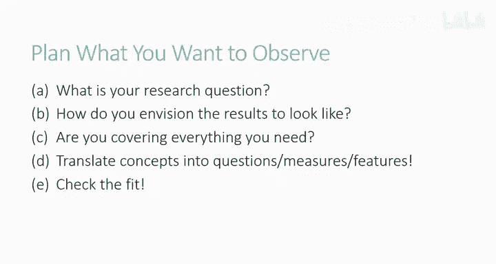
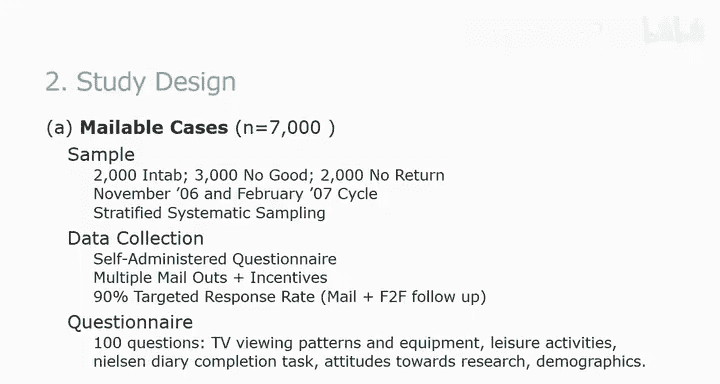
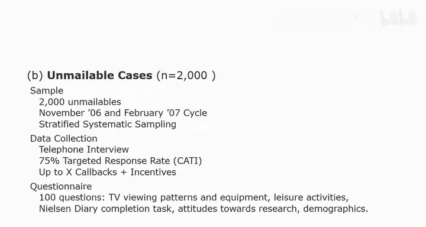
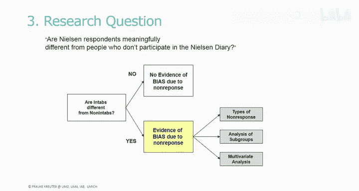
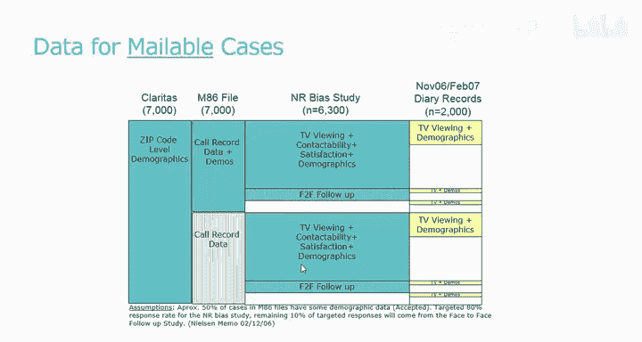

# 密歇根大学《调查数据收集和分析（第1课：框架）｜Survey Data Collection and Analytics》 - P11：10_观察目标规划.zh_en - GPT中英字幕课程资源 - BV1pi421U7Zm

So it's important no matter which data source you plan on using。

That you really know what your research question is and if you test a theory that you plan for collecting data points that would rule out alternative explanations。

That you really know， okay， this is the only thing that explains the observations that I've seen here。

In the experiments we talked about before。This is a little easier to do because you keep everything constant。

 hopefully， and then you vary the treatment effect and there you look at the relationship between the treatment and something else。

But if you just look you in the descriptive case or in the predictive case or if you try to do causal inference for observational data。

 then this is even more important。Now， one good way to do this is。To stop。

This kind of thinking by envisioning how your results should look like。Meaning。

 you make an analysis plan。Really specifying ideally every table， every graph。

 every piece of the report that you will be writing afterwards。

And then making sure you collect data or you create new data。not making them up to yourself。

 but collecting them in a designed way or generating variables that are out of the material that you have。

So that you really can do what you plant in your analysis plan。That means that you have to。

 if you do this exercise， actually， you can also make sure that you really translate or see that all concepts that you talk about are translated into features in the data set。

So let me give you an example of what I mean here， This is a study prepared by。Le in media research。

At the request of the Council of Research Excellence。

The focus here was on nonres and nonrespon bias in Newelsen media research services， Nielsen。

Ask respondents。To fill out the diary on the TV viewing behavior。

And then install little recording devices。To actually log the tuning behavior。

 so when TV is on of which turn is on， you can see that there。But not everybody participates。

 There's an issue of nonres。 and the question is。What who it was for this project here would have been any meaningful difference between those that cooperated and those that did not。

The study are designed for that particular。Research question was have consisted of two sets of data。

 those where a mailing address was available， in this case a sample of 7，000。

Which was composed out of three different groups， 2000 inTs， let's Newston speak for respondents。

3000 that did return something， but it wasn't of good quality。

And then 2000 that didn't return anything。Now those aren't the actual numbers。

 but this is the subs sampleample that was then used for the study。

So almost 10 years ago that this study was done， so it's easy to talk about it。

 everything disclosed on the website anyway， and by now many different ways of measuring viewing anyway。

The data collection， is a self-addministered questionnaire。

 multiple mailouts and the target was to really get 90% of all respondents in this specific nonres study。

 so they're really trying to get everybody incentivized to participate here。

Question had about 100 questions， don't need to worry about that for this purpose。

And then of course， there were cases that did not have addresses and here phone numbers were used。

You know， feel that there were about 2，000 cases。

So the research question in this example was， again。

 is there meaningful difference between people who participate and who do not and if you focus on the diary itself？

Then， you know， you can。I have as a first step in your Na plan， okay。

 do we see an evidence of bias and analyzing that at first in the different types of nonrespon？

Then an analysis of subgroups that are meaningful for news in this case and a multivariate analysis。

This is。An idea of how the data structure looks like and in order to evaluate the nonrespon bias。

You need information on respondents and non respondents。In。You know， the initial。Survey there。

Wouldn't be information on the non respondents because。They didn't participate but。

You know there are other types of data like the PAada we mentioned before， in this case。

 call record data that Nielsen collects when they try to recruit people to be part of the study。

Or data from commercial vendors that can be linked via geo code to each of the addresses to then do analysis between。

Respondents and non respondents， and then of course， nonres study itself。

 which here hopefully gets all the information on respondents and non respondents。

Through this extended effort。

This was the plan ahead of time and also this analysis example was the plan ahead of time to determine a the sample size enough。

 but also to make sure that all。Reporting requirements in all graphs can be actually delivered at the end of the study here。

You see the three or actually two important subgroups ins and non ins or respondents and nonresents and the total and an outcome variable hours of TV viewing right and every reporting。

Requirement or desire was to report the average hours of TV viewing for inTep and non inTs。

And these numbers here are made up， you know， this is just some arbitrary figure， but creating。

Mock graphs and mock tables like that will help you to know， okay。

 I do need these pieces of information and I need them with a certain position。

I have had actually seen several surveys。People forgot to ask simple questions like gender because they。

You know， such an obvious one， they wanted to analyze the data by different gender categories。

 but if the variable was not in the question here that piece of information won't be in there so the same here if this critical information on interverse is nonint is no on the file or。

And so either from the records prior that you link up or through the questionnaire then。

This you know what to go from here。