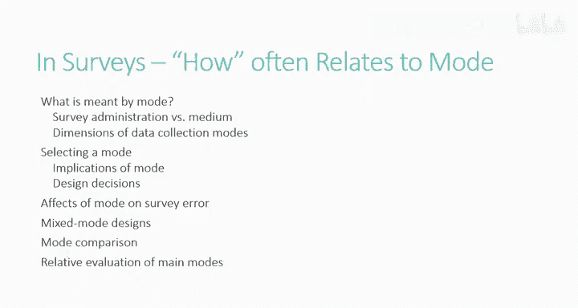
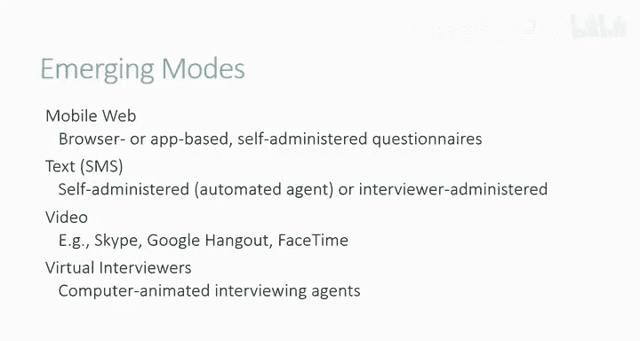

# 密歇根大学《调查数据收集和分析（第1课：框架）｜Survey Data Collection and Analytics》 - P12：11_数据收集方案设计.zh_en - GPT中英字幕课程资源 - BV1pi421U7Zm

In surveys， the how often relates to mode。 So when we。Wonder about how to do a data collection。

How to plan moving forward。One key question at the beginning is which mode of the data collection should be used。

Will introduce here a few different modes and some thoughts on selecting a mode。

And how these different modes can affect survey error will need to be mixed。

Some of this will be discussed in more detail in our course on data collection。Face to face。

 web and telephone here it's just a broad overview so that you know what's going on in that particular course。

So。When we think about data collection， we think about method or mode as having one of the highest impact decisions that you make when you plan your research design。

Highest impact because it's heavily related to any era in the data collection and any cost。

 it can be very cheap。To just ask whoever is available or to just collect data on the web from whoever is posting something on the web。

But that does not at all mean that you have the right quality of your data to make the kind of analysis that you want to do。

So the decision on which mode to pick， which data source to pick。

With methods of data collection use should be guided by theory and empirical evidence， hence。

 the course I just mentioned， data collection， online telephone and face to face。

Now the question is what does mode really mean traditionally mode was restricted to face to face or personal visit surveys？

Mail or postal services。And then later on， telephone surveys。In recent years。

 there has a wide variety of additional modes that came to pass。Of course。

 that has something to do with the transition from paper to computing。You still see in this graph。

That M Cooper and。Fred Conrad traditionally used in their course on data collection。That we have。

Mail， telephone and face to face。Service， but。With the computer assistedness。

 they span across a wide variety of formats， let's look at mail in principle mail。

 self- administered and writing something you could in a computerized format， send the disc by mail。

 you can send your survey over email or program it as a web instrument。Likewise， with the telephone。

 you can still have a person calling。And conducting a computer aided telephone interview。

 that's the Aconm Kati。Or you could go all the way in the optimization and have an inactive voice that is recorded in response to the。

Enreries that someone gives on the phone and by now， many of us have seen this。Lunch companies。

 airlines， even offices often do that。Likewise， on face to face。Traditionally。

 you would have an interview come with a questionnaire to be filled out。

Either administer through the interview or。Maybe even self administered。

 but the interview is still present。And if you add a computer to that mix。

 then you have a computer aided personal interview copy， very traditional。But the other formats too。

 you could have the interview visiting the respondents and having them hand over a laptop。

To the respondent putting headphones on the respondent's ear。And half what's called an audio cai。

 an audio assisted computer assisted self interview。Same with the video。

The acronyms that you saw on the previous table are listed again here so that you know what they mean。

They're many more appearing faster than we can record these classes。

 but it's always good to sort of think us like， okay， is there an interview involved or not。

 and what is the medium， is this paint paper， is there computer involved or something else？

And because， you know， these groups， they do have an effect on cost and errors and the course on。

The different modes of data collection and how to do those data collections will give you more insights into this。

Spning across the landscape， there are of course， many more emerging modes that can be of interest to you。

One is anything that has to do with mobile web data collection。

 so increasingly you see browser based applications。

 self administered questionnaires that are somehow part of a mobile device that people carry with them。

S have been done via text or SMS messages， they are also self administered usually。

Although if there's an interview on the other side， it is one form of interviewer administered mode。

But then there are also interesting other elements。

 like interviews via Skype or Google Hangout Facetime。

 any of these products that are available for video conferencing。

 And even virtual your interviewers is an emerging mode that Fred Conrad is doing research with at the University of Michigan。

 where computer animated interviewers workers as agents in this interview。

