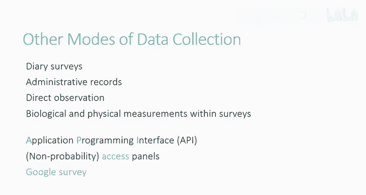
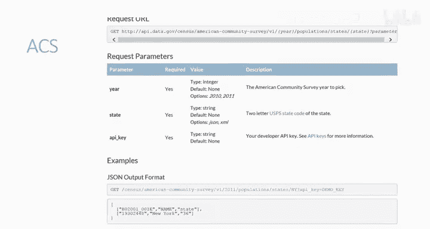

# 密歇根大学《调查数据收集和分析（第1课：框架）｜Survey Data Collection and Analytics》 - P13：12_新型调查模式.zh_en - GPT中英字幕课程资源 - BV1pi421U7Zm

Other modes of data collection include diary service as we saw within the Milmedia research。

The use of administrative records codes， we covered that extensively in module1。

Or direct observations of some form。One piece that I want to allude you to though is。

The increase possibility for you to collect your own data via application programming interfaces。Or嗯。

Other types of surveys。

Heavy debate and obviously related to costs is what kind of do we still try to get probability based？

Surveys and in particular probability based panels were do we use access panels of non probability access panels as they're very common in market research？

And then finally this。Another emerging mode of data collection like Google Survey that we'll introduce to you。

Studying with the APIs that's。Some of you might have heard that keyword if you are closer to computer scientists。

 certainly。We post a here for you， the Wikipedia entry， lots of information to read about。

The most important thing to know is that this is the。An easy way to。Provide。Data。

Or to grab data that is hosted somewhere online， right。

You data basically is an export or two export formats thats usually are used that。Are available。XML。

 extensive Markup language and JO， the JavaScript object notation。

You don't have to be able to write a file， but you probably want to be able to read a file because you know just like you got eventually used to Excel file formats or know how to import files into Excel using command Elilimiters and so on。

Increasingly， software packages like Excel or other packages have import filters that allow for this JSN format。

Now， when is that useful？Even the Census Bureau allows you to take data from the American Community Survey and grab them automatically as they' are posted online。

And read them into your respective analysis program， so if you visit data。gov。

 the website that we expand in module1。You will see a sign up sheet and then you get the confirmation email posted here slightly altered that allows you to have a key。

With which you can access these service requests。And further explanation on how to do that on the bottom of the screenshot。

 you see the JSN output format and if you ever looked you know into data sets that are not already。

In a starts package like SAS or SPSS or data or anything of that sort you might have seen this before in here you know text fields or data fields are in quotation marks separated by a comma but the architecture of these JS files is a little bit more complex than what we're normally used to so get some time to take some time to get used to these but is manageable and seems to be an increasing format that people used to exchange data for you to collect data as providers deliver them so who are these providers well it can be anyone with。

You know， a web application we have seen this。Across the board。

 many people that program apps program them so that there is an API because they want the data that the app creates to be used in other context and therefore create traffic to a particular app or be more interesting。

 even Yelp allows access to data for example， so that other apps that users can crosslink and use that information。

You would be surprised。 Just start digging around and see what kind of data is available and can be collected this way。

