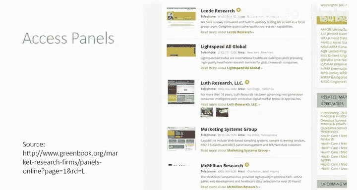
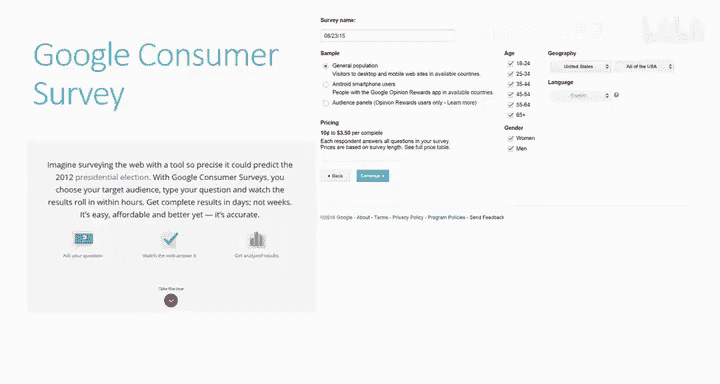

# 密歇根大学《调查数据收集和分析（第1课：框架）｜Survey Data Collection and Analytics》 - P14：13_网络与谷歌调查.zh_en - GPT中英字幕课程资源 - BV1pi421U7Zm

The second。And very different new data source that we saw over the last few years。

These excess panels。New in the sense that in the online format。

 theyre really spreading widely and this you know link here on the left hand side on the slides gives you links to a lot of different surveys here。

 we have you know just a screenshot of a long list。

Colleagues of ours working at Markham Systems Group， for example， but many， many。

 many others as well。They have a third of people and actually sort of survey monkey or partner in the specialization。

 they have prereced people or constantly recruiting people in many different formats this can be。

Delivered recruitment could be even a probability recruitment for some of these panels。

 but also pop up menus when you visit a website inviting you to join a panel or advertisement of other sorts。

Good panels often try a variety of recruitment strategies so that the scent of people。

 the composition of the people is quite diverse。

The advantage of these access panels is they have a large pool of people and for every given data analysis for every particular survey you want to do。

There's a smaller group that's taken out of it and the survey is fielded too。

 usually that then is pretty cheap， but keep this format in mind as we talk in module 3 about the different possible aero sources。

So that you then for your own research question， can decide。Will this be a problem here or not？

If you think back to module1， when we talked about description versus causation versus prediction。

These access vens might not be ideal to correctly give you a proportion of people who will suffer from disease X。

Or you know， in particular if something is related to literacy。

 they might not have anyone in there at all， you know。

 because those people do not participate in access panels if the delivery mode has all to do with reading and writing。

Same with age distributions and the Now for most of these demographic groups。

 they actually not that bad。And the more common these panels get。Or you know。

 depending on your research question， every single time you will need to ask yourself before it' like。

 is the selection mechanism of which people participate in these panels related？To what I want to do。

 my variable above interest and is there a chance that it can be distorted？Now。As I said， if you are。

 for example， interested in doing。A causal analysis。

And you would use the access panel to field an experiment， let's say。

 a question of wording experiment。Then unless you think that the self selection into this access panel would distort the wording experiment that you do。

 you're probably fine with your results so that's why in module1。

 we made sure that you understand the different purposes of your data collection。Now。

 we introduce several different modes to you。So that you have a platform upon which you can think about the different aero sources we talk about in module 3。

There are a variety of access panels， not just for market research but also a set of academic access panels。

The list pin on the Netherlands is one example it's run by Ctodido。It is based on a probability。

Respondents without internet access actually did get a computer or some device with which they are able to access the internet and can participate in the panel。

This much more mimics。A regular survey with the sampling procedure， and so here too。

 knowing as much as possible about the data generating process。

 transparency of their orthoosis will be key so that you can evaluate quality of the data。

If you want to read up。嗯。These academic access panels or on other access panels and quality of studies that assess the quality that compare those panels with other type of data。

 you can use this resource， WebSM， it's a fantastic platform。

That has almost everything that has been published to this point。

 either referenced here or with the direct link。So。Coming now to the Google Consumer Surve， another。

Very different type of data collection here， it's very few questions。Spread out to the respondents。

 if you look at the consumer survey， you want to field one yourself， you'll see you can select。

Demographic characteristics。Many of these things sort of。Gtimates from profiles。

 there's an interesting methods report on the Google website on this。

 and then you can create your own survey as you see here on that platform。

Many more survey creation features。Are available。For example。

 on websites that are particularly designed to do that like Survey Monkey or Qualtricx。

And other lineme surveys， another one， so the many providers of these days。

If you plan to use a V survey， it's certainly not a bad idea to start with those rather than trying to program everything from scratch。

Can take a lot of resources and might be cheaper to use this。

So if you actually plan to do a web survey， it's of importance that you keep general principles in mind here。

 how to design effective web surveys， like the book published by M Cooper that you see here on the left。

 or all the summary of the scientific findings that Rao Trenjo， Fred Conrad and M Cooperpa put out。

Or the just recently published book on Webserv methodology by Maria Kiggaro and his colleagues。

 Kaya Vasia。That light two actually both being responsible for VMS that I showed you before。

