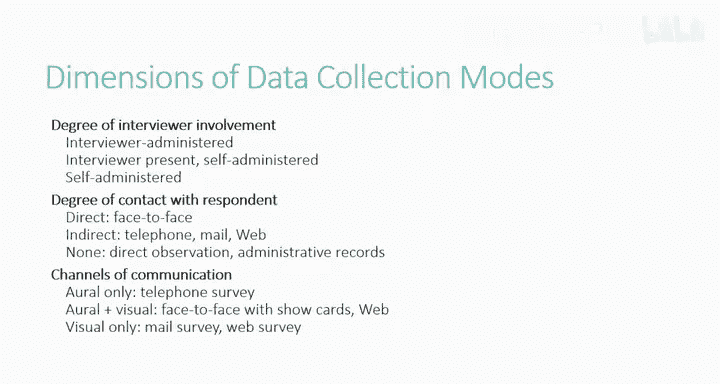
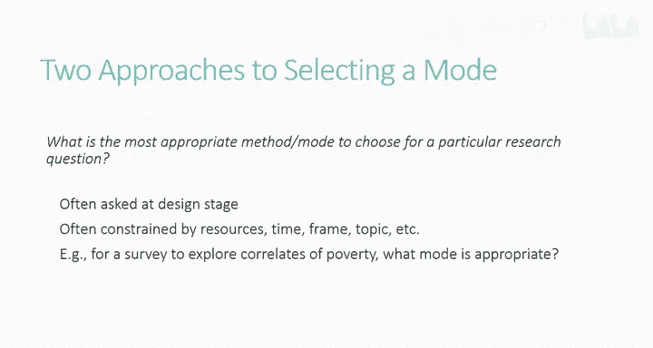
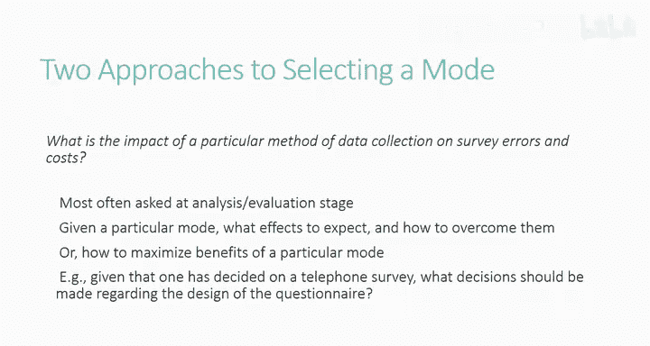
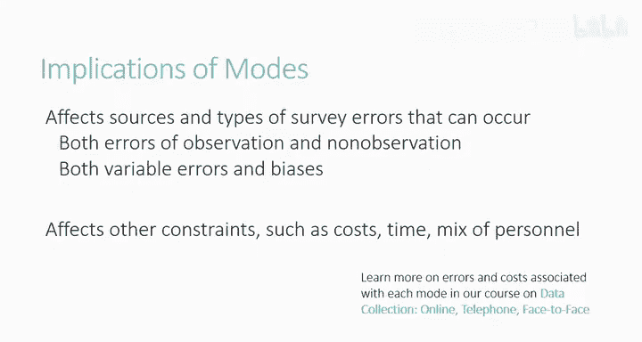
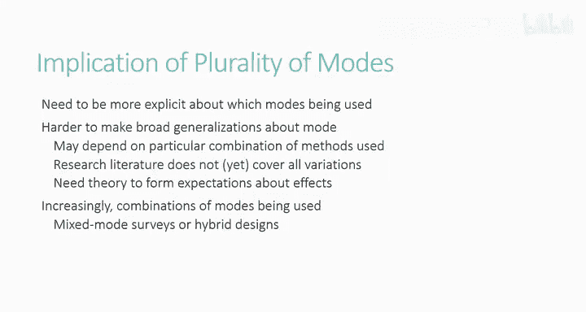

# 密歇根大学《调查数据收集和分析（第1课：框架）｜Survey Data Collection and Analytics》 - P15：14_调查模式选择.zh_en - GPT中英字幕课程资源 - BV1pi421U7Zm

Yeah。Another way to think about the data collection modes is degree of interview involvement。

 the degree of contact with the respondents and the communication channels。

 we talked about some of this before。

But as you make decisions， keep these things in mind just like the degree of privacy and the technology use。

I'm not going into too much detail because you will learn a lot more about this in the data collection course here。

But the two approaches that you can keep in mind when selecting mode is what's the appropriate method to choose？

Is often or should be asked at the design stage， so as I said， and what's the theme of this module？

You have the research question at the very beginning。

You try to get all the relevant target information。

 you decide on what are specific variables that I need。Based on your analysis plan。So now you have。

You know， a set of requirements， a set of constraints。And。

You will know how much money you have available。And that will then guide。

 is it enough to get information observational data or process data from administrative records。

 or do I need to go out and do my own data collection so that I have。

All the variables in that particular questionnaire that I'm planning to use。Now， increasingly。

 there's a combination of modes necessary because you can't reach everybody in the same way。

Or you won't have everybody covered by the same mode。And。Then the question is of。

 do you try to collect the exact same data across all different modes？And。

We at least in this group teaching the specialization here here favor the approach that you。

Try to maximize。Benefits。From a particular mode， so if you can add a video。

 if you can add an illustration in a particular mode， do so。

The implications of these choices that you make， no matter which data source or mode or method of data collection have。

An effect on the possible sources of errors of observation and non observation。

To understand。What those are， we have a third module for you that walks you through these specific error sources。

When people analyze your data， it is important that you are very explicit。On which modes are used。

It's much harder to make broad generalization about one mode。Across all possible topics。

 so this might depend on a combination of modes。In conjunction with a particular topic or a sponsor。

And increasingly like the American Community Survey that I mentioned before。

The survey come as a mix in a mixed mode design were hybrids of particular modes。

Surveying the landscape on what's out there what's been done will give you ideas。

 but for your own research question， you need to go back， think about what do you need。

 what's your analysis， this plan， what are the variables that need to go in there。

 how to can I get them？How much money do I have with which particular mode can I work and then how is that affected by the various air sources？

Which we'll talk about in module 3。So I encourage you to think about which mode or type of data collection is best for a survey of members from a professional association。

 a survey to compare nutrition needs of those below the poverty line。

And a survey that matters satisfaction of visitors in the zoo or illicit attitudes from statements on environmental policies。

 very different types， think about how you would go about finding that information that landscape of data that we presented to you and then you can circle back to these kind of examples as you evaluate the quality of each of them。

