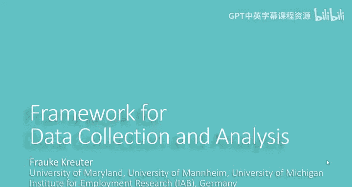
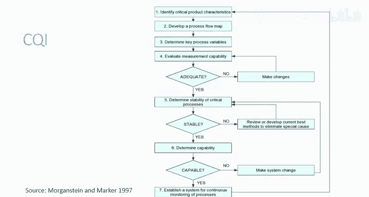

# 密歇根大学《调查数据收集和分析（第1课：框架）｜Survey Data Collection and Analytics》 - P16：15_数据质量.zh_en - GPT中英字幕课程资源 - BV1pi421U7Zm

。Welcome in module 3 in our course framework for data collection and analysis。

In the third module。Will， introduce。A quality perspective。On data products。

A good resource to start wherever you are in the world is the EuroStt handbook on qualityual assessment。

 methods and tools。It's a beautiful document。That has a lot of general guidelines on how to think about quality。

 data quality and quality of a statistic that you produce This visualization here shows you elements of quality quality management systems。

And。Each of these pieces has a corresponding principle for the European Statistics Code of Prae。

You can download this document freely， and I highly recommend taking a look in particular if you're involved in Sta production。

 the government setting。S summary you find here in a piece by Paul Beama in public opinion。

 quarterly。It catches the most important categories to think about when you think about data quality。

One is accuracy。And accuracy is something that this total survey error framework that we're going to introduce in a moment。

Is designed to minimize。 It's really all。Hned in onequ。However。

There are other elements to quality as well， for example， you want your data to be credible。

So it does matter who puts out the data and whether this is seen as a trust towards the entity by the community。

 not just people using surveys， but you know， government officials。Public spokepersons。

Private companies， enterprises， any of those。Another aspect of quality is comparability。

In particular， if you're interested in long time series or comparing data across countries to make。

Investment decisions or policy decisions， you want to make sure that you know that you're comparing similar things。

They can be accurate and good in each in their own way。

 but they might lack comparability because different things are measured， for example。

 so that's something to keep in mind。Usability is another aspect is the data documentation and accessibility in a。

Way organized that does allow easy use。Relevance so an important one we don't want to invest money in collecting data or designing data and even scraping found data that lack relevance。

You。I' in charge of demonstrating that relevance， or at least having that communication with stakeholders on relevance。

 accessibility already mentioned， and we discussed this earlier the importance of the open data Foundation and research data centers。

Timeliness is an interesting aspect， some statistics have fixed reporting rates will show you an example in Mo 4。

Data deliveries on a schedule is helpful and some of the data sources that you might want to use don't have this aspect。

Also， completeness。Is the data original enough so that you can？

Really follow through with the analysis objective that we discussed in moduled 2。

And are the estimates coherence， can you combine those data and results with other data sources。

 or is there a mismatch that will ultimately confuse any user of your statistics？

The are various frameworks here， one is that of continuous quality improvement also discussed in Paul Beamer's paper。

And a suggestion on making sure that you have quality always at the forefront when you。

Produce a statistic or the data。First piece here is preparation of a workflow diagram that can help to visualize the process and identify key process variables。

 those process variables can be identified and monitored over time and if need be changes introduced to improve the process。

You want to make sure that。You have control over your process and for those of you who really want to dive deep into that literature。

 there's a whole segment on process control quality control。

All these keywords here are represented in a flowchar that Morganstein and Marco developed quite useful to think about and to look at。

