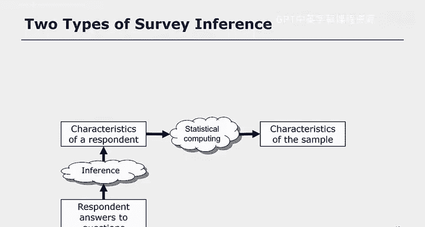
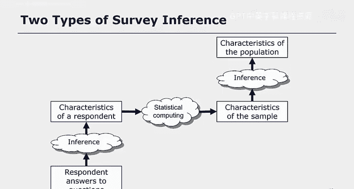

# 密歇根大学《调查数据收集和分析（第1课：框架）｜Survey Data Collection and Analytics》 - P17：16_统计推断.zh_en - GPT中英字幕课程资源 - BV1pi421U7Zm

So when you think of inference。It is interesting， you know。

 there are really several steps that are important to keep in mind。

There are two types of inference in the survey setting。

 one is the inference from a respondent to the characteristic of a respondent。

And one is the inference from the characteristic of the sample to the characteristic of the population。

What do we mean with that？Let's focus on the first part。

 the responded to the characteristic of the respondent。Let's say you have an answer。Very simple one。

 For example， The answer to the question， how old are you。You measure age。

 and you are interested in a larger concept， which is。Aging process of the cells of the mind。

 experience， life experience in some form or whatnot。 So you get the respondent's answer。

But the characteristic aging characteristic that you're interested in is already an inference leap from that particular item that you're interested in。

And the answer to that item。Two， the general concept that you're interested in。

 so that's one piece of inference that we are doing here， right？

You infer from my answer to the question age， something about my experience， my living conditions。

 my health， and the like。Now with all the answers to the individual responses and the in foot characteristic with it。

We do some statistical computing。So we form an average of all the respondents。Answers。

 and the implicit。Characteristic。If you come from psychology。

 you might be used to having multiple measures。That formed together a dimension of psychology trait。

A characteristic on a measurement scale that of course would also be in this first part。

 but then again averaging that characteristic over all of the respondents would be one form of statistical computing that gets you at the characteristic of your sample。

 so you have values for everybody。

An average age of a classroom， and average age of a population。

Careful of the population only if you ask everybody if it is a sample。

 then at first you have the average age of the particular sample。

 so I take from all students at a university， a sample of students。

 let's say it's random thousand0 students from a university that has 35。

000 and I compute the age that would be the step until here。

Then there is an inference piece from that characteristic of the sample to the characteristic of the population。

 so if my sample average for the university students were， let's say， 21。

Then I can do an inference to the entire population， depending on how I drew my sample I might。

Directly inferor at that same value is the characteristic of the population， but in order to do that。

 you have to design your survey in a certain way that these two inferential pieces do make sense and that's what we're going to talk about when we look at the different。

Design decisions for a survey， but keep in mind the two parts where inference happens。

 we will introduce one， sort of an aspect of measurement。

 a characteristic of measurement in inference about measurement。

 that's the first part and the other one as a characteristic of representation to the people that you gather information from。

 represent and allow inference to the entire population。

