# 密歇根大学《调查数据收集和分析（第1课：框架）｜Survey Data Collection and Analytics》 - P18：17_设计视角下的调查生命周期——测量.zh_en - GPT中英字幕课程资源 - BV1pi421U7Zm

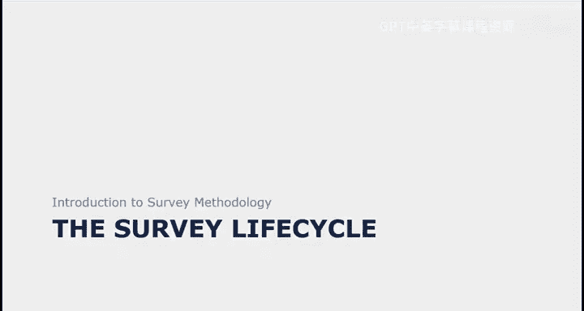

Let's continue with the survey life cyclee， we have three aspects here。

 the life cycle from a design perspective， the life cycle from a process perspective。

 and the life cycle from a quality perspective。We'll start with the design perspective。

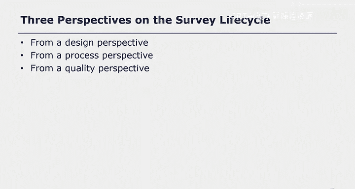

First one， as I mentioned before， we can look at this from two aspects。

 measurement and representation。The goal is to form a service statistic in the end。

And doing so in a good way。So let's look at this。Step by step。On the measurement side。

 we have a construct。The construct could be police reported crime that's something a government can be interested in We have a construct that means we have all information sought by a researcher usually described in words it can be abstract satisfaction with。

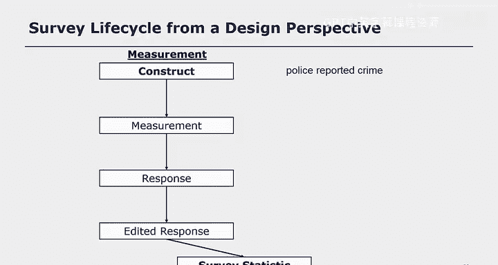

A class， it can be abstract as in believe in God or happiness or quality of life。

 or as mentioned before crime。

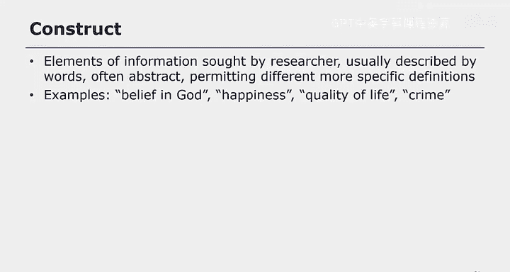

In order to measure this， you have to ask individual items and one of such items could be during the last six months。

 did you call the police to report something that happened to you that you thought was a crime with that？

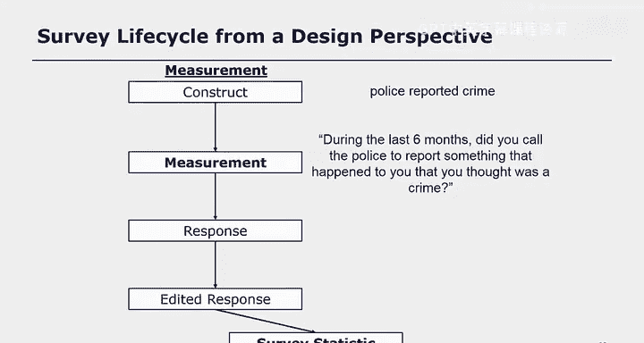

You will get information from each respondent assuming that the answer they give to this does relate up to the police reported crime that you're actually interested in。

Now the measurement itself links the theoretical construct to the observed variables。They are。

Many steps involved in that and our course on Queary sign， which is part of the specialization。

 will tell you at length the different pieces on how to do that。

Depending on what kind of data collection you are。Using you have either questions as the measurements or individual observations。

 if it's a study where you observe behaviors， for example。

 clicks on a website would be an observation， a measurement that relates to a larger concept。

 for example， interest in a particular item on a website。If you do surveys of soil。

Then it would be a soil sample that and measures that you take off that soil sample that fall in here or a measure of blood pressure if you work in the public health area。

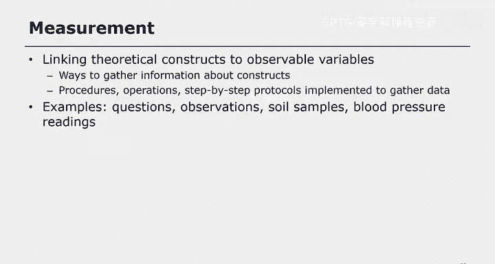

Then you get an individual response。 And this is interesting Now。 This is in the question。

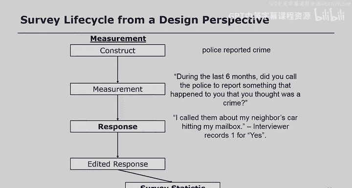

Nir setting the answer to that particular question。

In a blood pressure reading it would be a specific reading from a specific person。

 and it is important to separate that conceptually from the measurement itself from the question。

 because there could be slight variation， we all know that with blood pressure right if you measure now and you measure half an hour from now when I'm done with these recordings。

Likely my blood pressure will be different。And the same is， of course。

 could of course be true with answers。In this particular case。

 the response is I called them the police about my neighbor's car hitting my mailbox。

And the interviewer recorded one for yes， so that would be a recording of a response。

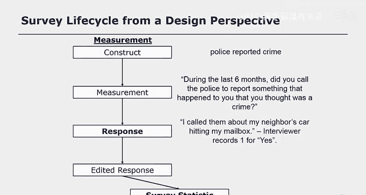

However。That's not the end of the story。 so when the response is recorded。

 that's the responded outcome for that particular measurement。The answer to the question。

 the quantity of the soil， the number of blood pressure from the blood pressure device were a record extraction in our examples。

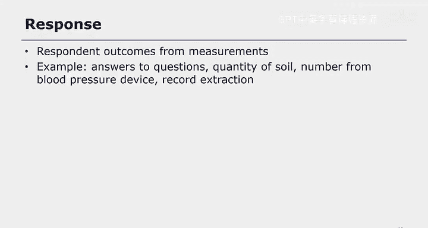

But this particular number might not be the correct one so in our survey example we might have notes from the interviewer stating that this was the neighbor's car hitting the respondent's mailbox which then can be by an editor classified as actually an accident rather than a crime and thus should not be part of the measurement that we are trying to achieve。

 so in this case the response would be edited from one yes to two no。

Only then would we properly capture the measurement part of this process。

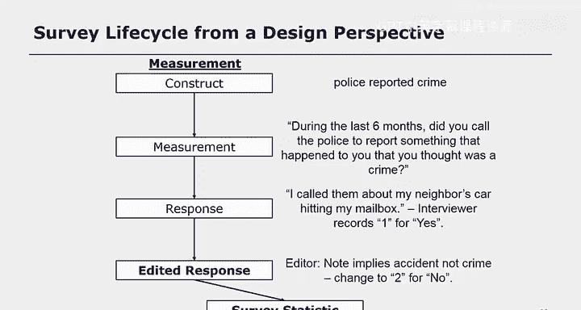

So the editinging of the responses means that。After editing the particular value stored in our data。

And recorded so that it can be used for the analysis。

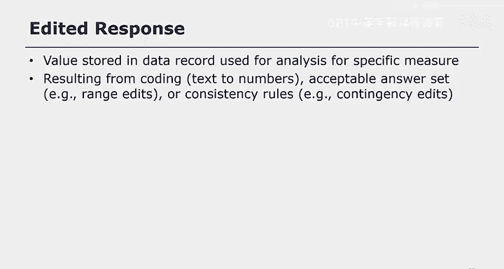