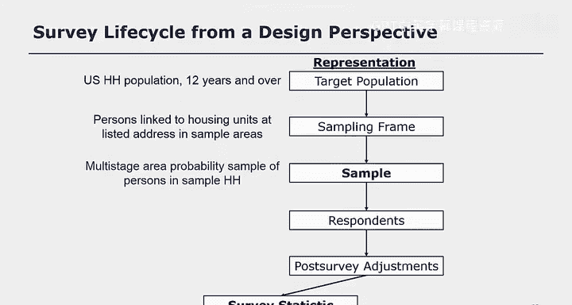
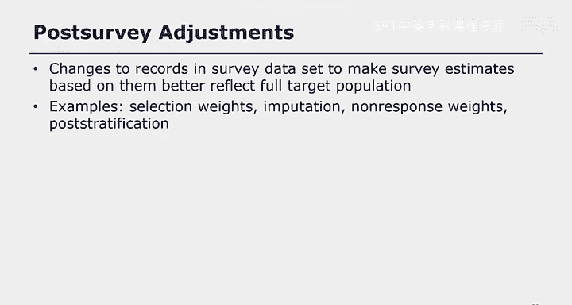

# 密歇根大学《调查数据收集和分析（第1课：框架）｜Survey Data Collection and Analytics》 - P19：18_设计视角下的调查生命周期——代表性.zh_en - GPT中英字幕课程资源 - BV1pi421U7Zm

So now let's look at the life cycle from the design perspective on the representation side。

We start out with the target population often you see in a methods report something written like US household population 12 years and older。

That gives you the description of the target population。It's interesting here that。

 of course not the entire US population would be part of this。It is excluding people in institution。

 excluding people that don't have a house to begin with or a household for that matter。

 homeless people， but also everyone below age 12。Often this happens for practical reasons because these people are hard to come by or they are hard to survey。

It is helpful。To look at。At these methods report to learn about the background for these data collections。

In general， the target populations is defined as the set of units to be studied。

It's often very abstractly defined and there are several ways to operationalize that particular set。

One example I just showed you in other cases， for example。

 in countries that rely heavily on administrative data， anyone on the administrative data。

house administrative records would be part of the population。

 and that of course then makes life much easier when it comes to the sampling frame。

So the sampling frame links each element。Of the target population to a particular list， for example。

A frame in an abstract way can be seen as a set of units identified in some way of nilist that can be sampled and located。

If no list is available， then you either have to construct one or find other ways to create a sampling scheme that then makes it possible to locate each of these individual units When we talk about sampling。

 we will tell you some practical aspects of this process。In an ideal sampling frame。

 every unit in the target population is part of the sampling frame and only those units that belong to the target population now on the frame。

Now， if you think of households and a telephone survey。

 it's easy to imagine that this list of phone numbers or randomly generated phone numbers do not include everybody。

on the target frame and also that there list the numbers on the list， for example。

 commercial entities that are not part of the target population。

 so you can already see that this is not necessarily straightforward。Then we draw a sample。In。

The class on sampling， you will hear much more about different ways to draw such samples。In the US。

 when you try to sample households you often deal with multistage area probability samples。

 so this is a sample that's geographically defined and is collected in multiple stages。

This is a rather complicated form of sampling， and in many cases there are easier forms available。

Assuming that you have a good sampling frame， so if you have a country that has a register of all people in the country。

 you can draw a so called simple random sample straight from that list。

The sample itself is defined as the subset of the frame population that you choose to。

Measure the things of interest on。 Then you have the individual respondents that provide the answers in a survey that's administered with the questionnaire。

Those would be the answers to that administered questionnaire。It requires， of course。

 that a sample unit is successfully contacted and measured。 Otherwise。

 that unit cannot become a respondent。And finally， we have post survey adjustments。

This is sometimes necessary because you do have complicated selection schemes or maybe not everybody is answering。

 and so you try to apply some positive adjustment in order to properly represent your target population that is a statistical piece that we will teach you as part of this specialization。

In general you can say the post survey adjustments are changes to the records。

 similar to the editing in a way， but it changes to the records so that those survey estimates better reflect the full target population Exles can be selection weights。

 imputation for missing values non-response weights or post stratification and if those words don't mean anything to you yet。

 no worries， that's part of what we'll cover in the course right now we just try to give you a big picture。

Of what it is you will learn here and will dive into these details in each of the courses。

