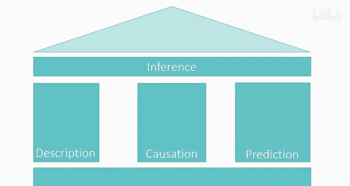
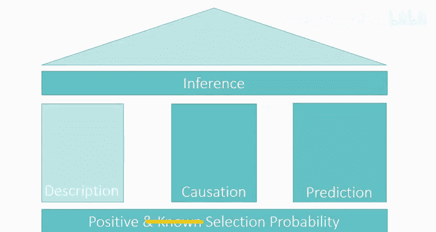

# 密歇根大学《调查数据收集和分析（第1课：框架）｜Survey Data Collection and Analytics》 - P1：0_研究问题设计.zh_en - GPT中英字幕课程资源 - BV1pi421U7Zm

So welcome to module1 of Frame for data collection and Ana。

In this first module。Well。Walk you through the entire data collection and analysis process。

And I will point out not only different data sources that can be used。

But also point you to the various courses that we offer in our specialization that shed more light on each of these particular steps we then continue with the framework that allows you to evaluate each data source separately。

In these Cora courses， we have many different。People。They are。Researchers， statistician。

 methodologists。That don't know about survey data， for example， that join this course。

 but they are even more domain experts that have a particular research question in mind that they try to answer and they're looking for guidance on how to do that。

Over in the questionnaire design course， we've seen this from all over the world， people with very。

 very different interests， some in health， some in labor， some in transportation。Can be anything。

 And of course， a lot of market researchers。Now。The research that help you get the right design in the analysis。

Have to work closely with domain experts。The larger your data sets get and the more complicated the system。

 the IT infrastructure is that you have， the more important is it that you also work with computer scientists and administration people。

So we hope that this course is one of the many that you will take that help you learn each other's language a little bit。

Be better able to communicate your needs or even do it all。That you need yourself。

 but most likely it will be a joint project between people with these various skills。

So let's look at this process of data collection and analysis。

It all rests on the spaces of a research question。Without a good research question。

You will not be able to do good research。I've seen countless times that people just had a lot of data and they weren't sure what to look for。

In the next module， I will come back to that in particular。Because。Well。

 it's quite striking what happened when you don't have clear ideas。

 what you're looking for or what you expect to see。Research question aside。

Data generating process I spend a lot of time talking about the data generating process。

It's important that you understand how important it is to understand the data generating process。

In fact， I would make the claim that you can't do any inference without knowing that process properly。

Then there's a lot of data cleaning， data creation and data storage necessary here。

 IT infrastructure and system administration people can help you quite a bit。

This class is not about programming， I'll show you a little snippet of what is important for this。

 but by and large the other courses， for example， in the data science specialization over at Hopkins。

They have a whole course on these kind of things our focus here is much more conceptual。

Planning a good study， knowing which data sources either to take that are existing or to collect and design the collection。

And then， of course， there's the data analysis piece。

Some of you might have had introductory statistics courses， long time back。

 you remember that you didn't like them。Or you loved them， but they were really theoretical。

Not that applied as you might need it here， or they used very different data。Now in this course。

 we have in this specialization， we have one segment that deals with data analysis。

In particular for survey data， because you often encounter issues of。Sampling issues of waiting。

And a complex nature with the hierarchical structure that really makes a different type of analysis necessary。

 and so that course will cover that， but I'll come to that and you will see on the course platform information on this particular piece。

And then finally， there's data output and access。In this course here。

 we'll talk a little bit about ethical issues involved and we'll come back to that later on in some of the other courses。

Now I've already spoken a lot about this process here， so why talk about each step even more。

 but let's see。So if we think of a research question， we can。Separate this out easily。

In three different categories。The first one on the left。Is a descriptive category we're trying to。

Show means， percentages for certain subgroups here， for example， three groups。

We don't have an x axis， so we don't know what these groups are。

 we don't have a y axis that we' have to call on。We don't know what the values are。

It's just an image capturing that this is descriptive statistic。

 You try to put out some numbers about the world， about the piece of the world。

Describing certain variables or features as they occur in the world。

Then there's a second type that I would call causal。

Or interest research questions that deal with causality。

So this one here captures all things that have to do with wanting to know whether。

A certain treatment， for example， taking some。Pain medication helps against headache and makes you smile。

We could teach a whole class on this issue because the question is what really can we really measure causation right with humans it's often hard。

 if not impossible to see the counterfeual， what would have happened had I not taken that pill almost impossible to do well actually it is impossible to do。

There's always something that varies。However， there's of course a large enterprise not only in the medical field。

 but also increasingly in economics and public health， where that is a research question。

And they are data。Experiments。That are collected for this。Finally。

 the third time of data are predictions what you see here is a graph from the Energy Information Association they put out beautiful graphs I recommend a visit to their website。

And you see the prediction of the oil price in the US？Now。What I would argue here。

Is that no matter whether you deal with description， causation or prediction。

You always most likely have some kind of infferential goal in mind。

So what does that mean。There is a larger population。A longer time frame。

A larger geographic area that you want your results to hold。So when I describe。

A population let's say I want to give a description of percentages for various subgroups for the US。

Then of course， I have to define what do I mean as U population and more likely than not。

I won't be able to get that kind of data for everybody in the US。

 in part because people are born and。Die all the time。

And so I can only have one particular segment in point in time。

Even if I were to be able to do a census。And just， scoop around on the census webp pages and you will see how hard it is to do a census to begin with。

So more often than not， people take surveys， or better yet I should say sample surveys。

So having a smaller set of data。From a larger population， in which case。

 you want to do inference to the larger population。The same is probably true with causation。

In prediction。All of them rest on some form of data， more likely than not， these data are sample。

Either in。Geographic space or in time， or because they are a subset of the population。

Even if you would have access to all of Twitter data。

You could possibly run your analyses with all data because they're constantly coming in now computing。

 software， everything gets faster so you can update your analysis however there's always some limit to the processing power and you know it might be necessary to look at the results once in a while。

So in some form or another， whether it's time， space or the number of people。

 you will end up doing some sort of inference。Now， the requirements on the subset of data。

 on this sampling or selection of which cases to look at， which units to look at。

Those are a little different depending on whether we deal with description， causation or prediction。

For description， I would argue。That what you need is a positive and known selection probability。

So in order to really be able to say。25% of the population are interested in。Cerra。

I would need to know a， what was the population， but also I would want to make sure that everybody from that population。

 however I defined it， had a positive selection probability。

If I systematically exclude by the way of how I collect the data。

 certain parts of the population from giving me their interest。

Or reporting their blood pressure if I'm interested in the medium blood pressure of people living in the United States。

Then。I run the risk。That I have biased results that my results are not。

A correct inference for that entire population。I also should know the selection probability because if I only take a part and in particular if I want to estimate totals。

 I would need to weigh the data up so that they con with。The values in the population。

So for this particular segment， positive and known selection probabilities。

Being able to know for everybody that they had a chance。To provide the data。

That I know what the probability is for that。Is important。What we and do with that knowledge。

 you'll learn in the sampling class。And then the course about missing data because obviously in practice。

 that's never going to be the case right there are always some cases missing for some reason or another and there are techniques on how to overcome that problem。

😊，Now， for the other two。Dis causation and prediction。

The known selection probabilities are a little less important。Maybe not important at all， actually。

What I do want to know， though， is that I still have a positive selection probability of everybody。

Only then would I feel comfortable to make that kind of inference。

Now let's step away from people for a second here。You could think of this differently。

If we think of Twitter feedats and sentiments expressed on Twitter。

If I want to make an inference to all possible sentiments。Then you have to ask yourself。

Just the database， the body， the corpus of data that I'm using。Half。Positive。

Selection probabilities for all possible sentiments。Right。In which case I could make inference。

 even if the people and the sentiments are not a one to one match，And that can be true for jobs。

Diseases， any of that sort， so it is important that you do know what units you're looking at。

And what units are in your population that you want to make an inference to。

 and then when you talk about your data， you should talk about these aspects because otherwise people might get mislead or misled by the data that you provide to them。

