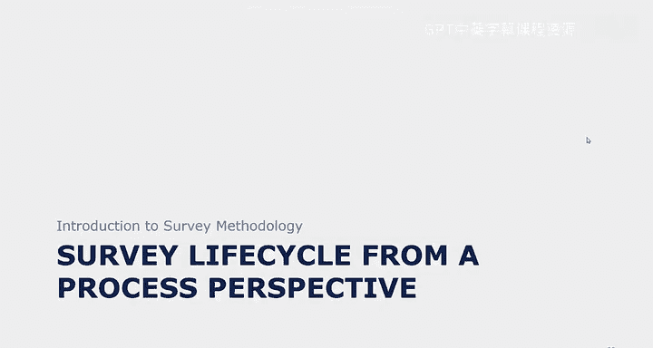
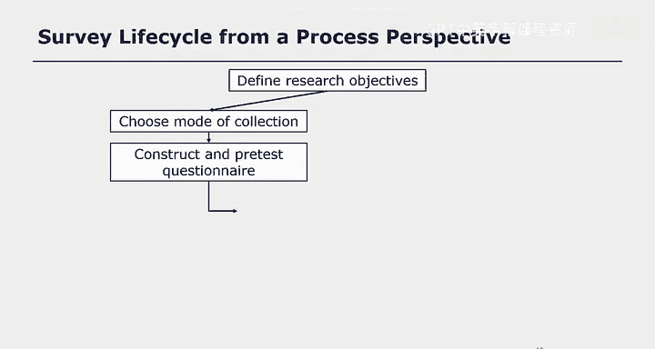
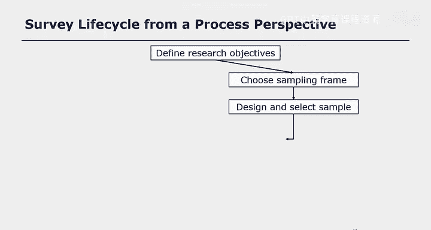
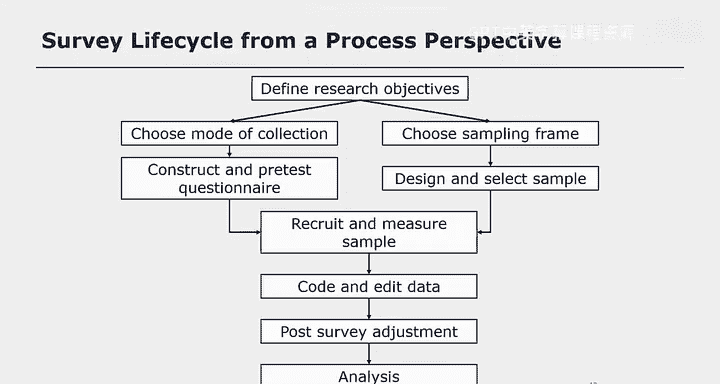

# 密歇根大学《调查数据收集和分析（第1课：框架）｜Survey Data Collection and Analytics》 - P20：19_流程视角下的调查生命周期.zh_en - GPT中英字幕课程资源 - BV1pi421U7Zm

So then we have to serve a life cycle from a process perspective。

It's a little different because here the emphasis on what are the decisions you have to make。

First piece， obviously， has also。Consequences of decision in it。

 because depending on your sampling plan and depending on your measurement device。

 you have different processes in each of these two segments。

 but this one here really is sort of action oriented。 What do you have to do。In the first step。

 you have to design your research objective， you have to choose a mode of data collection。

 and then construct a pretest and a questionnaire。There are two classes in our specialization that cover the material for these two pieces。

 the course on data collection will have information for you to make this decision as an informed one The course on questionnaireary design covers in detail how to construct and pretest such questionnaires Likewise our course on sampling will teach you how to choose a sampling frame and how to design and select a sample。

If you take the two pieces together。The actual actions happens right。

 you recruit and measure a sample， some of that will also be covered in data collection。

 but then you have the process of coding and editing the data。

 maybe augmenting the data with other sources and post surveyve adjustment。

 which is what we will cover in the course on nonrespon。Imputation and then of course。

 you have the analysis piece， which。if you deal with the service statistic and the more complicated your sample is。

 this require different statistical techniques from those that you normally apply and so one of our courses in this specialization covers this analysis aspect as well。

