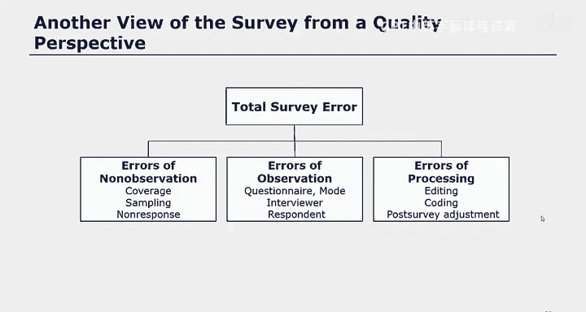
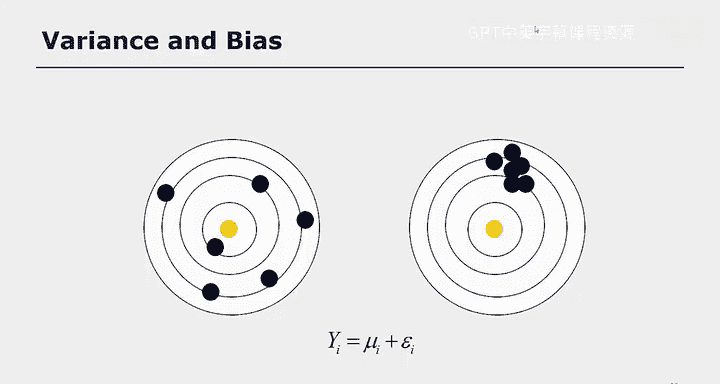

# 密歇根大学《调查数据收集和分析（第1课：框架）｜Survey Data Collection and Analytics》 - P21：20_质量视角下的调查生命周期.zh_en - GPT中英字幕课程资源 - BV1pi421U7Zm

So the real funds starts when we look at the survey life cycle from a quality perspective。

This picture you have seen already。Measurement side， representation side， and the different steps。

Now， from a quality perspective， what we care about is how good does each of these step work？

And we'll talk in a moment about issues of validity going from construct to measurement。

 issues of measurement error going from measurement to response。

 processing error going from response to the edited response。

Coverage error going from target population to sampling frame， sampling error in the step between。

Actually， drawing the sample into sampling frame， non response error。

In soliciting the responses and adjustment error at that step where you try to adjust your respondent answers。

A set of respondents to the target population。 So each of these are errors associated。

And as I mentioned before， this framework。It's really one that can also be used for other types of data。

 and we are using surveys here to explicate it。What we will also use is some mathematical notation that you see in the middle here that is somewhat important in order for you to be able to move between concept and words and abstract ideas to mathmatic a model back to the data。

 back to an analysis model and an interpretation of the results。

 data scientists at various places like Amazon Expedia that I talked to recently pointed out how important it is that both of these skills are present in people that hire you。

So for those of you less mathematically inclined， let me walk you through each of these notations mu sub I is the Greek letter mu indicating here the construct value for each individual I。

This is often not measurable what we can measure in an abstract format we would like to measure is that Y I capital Y subi for each individual that would be ideally the answer to the question how old are you if aging is my abstract construct and my measurement is the question on how old are you。

Now， why I？Lowercase Y subi would be my individual answer。

 and you might at first glance think why is that different from the box above？Remember。

 I mentioned there could be measurement error。 So if I don't want to reveal my true age。

 if I try to be younger than I actually am， then I might not respond truthfully to this question。

 And therefore， these two values can differ。 So conceptually。

 it's important to think of them as separate pieces here。And then likewise。😊。

And editing that takes place afterwards would change this value again。

 and we are denoting this with lowercase Y sub I P。On the representation side。

The average overall values denoted with a capital y bar。Now。

 that is over everybody in the target population， the covered population。

In the sampling frame would be denoted capital Y bar with a subscript C for the covered population。

The sample。Individual sample unit has a Sub A。And the respondent unit has a subscript R here too。

 there can be differences right I can have an average value of age for all people in my sample。

And then one for everybody that actually responded to the survey。 Now， these upper two。

 the one for the sample and the samplinging frame， may or may not be available to me。

 if I ask a survey questions， and there's no other source， Then all of the other values are unknown。

 but conceptualual in order to specify what the errors are。

 it is important to keep them separate and to be able to talk about them separately。 And finally。

 after you apply post of adjustment to am mean a percentage or a regression coefficient what have you。

Meaning you compute that statistic on data that either weighted or you apply those weights or the adjustment to the final statistic。

 but regardless， you will have an average value for the respondent at now with the subscript W。

 which means weighted data。So the survey the statistics that we are interested in at the bottom。

 you can see is。Resulting out of this measurement side with the editor responses at the bottom。

 therefore the P in the subscript。For the respondents usually unweighted data。And in an average。

 right， so no subi anymore at the very end of this。Stepping back quickly from the notation。

 another way to look at these different error sources would be looking at the total survey error as one that groups the errors into errors of non observation。

 errors of observation and errors of processing。 coverage。

 sampling and nonres would be errors of non observation， Que， mode。

 interview and respondent would be errors of observation。

 And then errors of processing are those of editing， coding and post survey adjustment。

 So the various ways to think of that。

What is important is that the concept。That we introduced you here as part of the total survey error is a way of thinking about the various error sources that may affect the survey statistics。

 and I say here may on purpose because it may or may not right That depends on your design。

 good design decision and good procedures when you do that。

It's important to think of these errors not necessarily as mistakes。

Because some of these errors just reflect uncertainty there's in the process inherently nothing you can do about it。

 but there will be uncertainty and that's in particular true for sampling error。Just imagine。

 you know， you draw samples， you know， out of a， you know bag of M andms。

 you would draw samples and you look at the colors every time you will see a slightly different set of colors。

 That's just the nature of the beast， right， There will be inevitably variation in the colors when you take a sample。

 at least if you take a sample of a certain kind。

The survey quality or the value， the ideal for a quality survey would be to minimize the errors for a given investment of time。

And the success of the total survey error approach depends on good information to measure each of these pieces。

 and we will introduce to you the concept of pair data that allow measurement of each of these error sources along the way。

What's important to remember about the total survey error is that errors can arise at many places。

 so the survey topic， the available funding， sampling frame， data collection method。

 they all can affect these error sources in different ways and the whole specialization will show you that you know we go back over and over again to this framework so that you really sharp me your analytic mind and can detect these errors in other data sources that are available。

In sum， the Tot surveyve error framework helps you to understand the potential impact of your design decisions on the overall quality of your data that you collect。

And together with the cost， they really give you good guidelines on what decisions to make when you plan a data collection。

So now a little bit of statistic， the statistical notion of errors expressed as what we call mean square error。

 so the average error squared， well each piece of error squared means that positive and negative pieces don't cancel each other out right that's sort of the idea here。

So this is the squared sum of all variable errors in biases。

The errors are specific to certain statistics， so that's another important piece。

 The error might look different depending on what variable you look at and what kind of statistic you look at。

It's pretty hard to measure MSE in practice and we'll come back to that。

But it is valuable to understand the concept of true value and error。

The true value is an idealized concept of a quantity that you try to measure。

Total number of people in the US。 That would be an idealized concept。 Now， it does exist。

 but it's very hard because people born all the time and die all the time。 And so， you know， that。

 too， is sort of an idealized figure， if you will。😔。

The theoretical view would be that if you had that measure。That idealized true value。

 you could compare each individual value to that true value and be able to assess the error associated with it。

Operationally。It means that。Need another data source to do that。

What is important to understand when we have this concept of true value and observed value that we also understand the difference between a variable error and a bias。

 so the bias is also an error， but it's a systematic one。

This slide would be probably be better if we would say it's variable error and systematic error so the variable error。

 if you look at it， it is a variation over replication。Remember what I said about the bag of M&ms。

 you draw a sample， it's a different set of colors in them。So in statistics。

 that's often represented by the term variance or variation。You might have heard that before。

 maybe some of you have heard about。Confidence interval were a certain percentage of election statistic plus minus a certain amount that is an expression of the variability because we don't ask everybody we ask a sample and so every sample from sample to sample will vary slightly and an expectation if we do this often enough and we get the mean we get the true value。

 we'll talk about this some more in a moment。Then we have the bias。

 that's the concept of a deviation from the true value。So that could be directional， right？You know。

 it can be that。Have people systematically under reporting the age。Friend of mine just turned7。

 she's probably more likely to overreport her age， but it's a certain point though if we go with that target population that we had earlier。

 households of people in households above age 12， then maybe not quite there yet but let's say age 18 we might systematically come to those that do underreport the age certainly we have we know that there could be systematic error in reporting wait。

 for example。To estimate bias again， we wouldn' need true data， the truthce from another source。

 but we can make assumptions about the effect。 This graph gives you an idea a visualization of variances and bias on the left hand side。

 you have variance。 You have variability。 Every black dot here would represent the average value of a given sample that you。

Ask or even for an individual person， if you would ask repeatedly。

 let's say the blood pressure measurement that we talked about every single time you measure blood pressure。

 you would have a slightly different value probably than the absolute truth because of the measurement device about the temperature in the room and whatever how you put the device on your arm。

 so there's slight variability and that's why with you know certain tests in particular they're very important。

 you want to measure a couple of times to make sure that you have this random variation in the measurement be even dull。

 so you see sometimes the values too high， sometimes the value is too low。

 sometimes it's too much to the right which only works in this particular visualization but you get the idea on average。

 you might have hit that target pretty well。On the right hand side， there's very little variation。

 so your measurement device measures actually the same thing over and over and over very closely in the same way。

 but you're off center， you're off target and that indicates a systematic bias that would be the case if for example。

 you ask。Me for my age， and I would systematically underreport my age every time you ask。Now。

 in mathematical terms， you see below in the notation we introduced before that the measured value。

 Y I。Is equal to mu I the construct itself plus。An atom。And now this is。At the first step。

 you know variation and bias with respect to the actual measure of interest。

 you could also think of that for the second step for the measurement error and then I would have a lowercase y subi is equal to uppercase y subi plus an error term right because my individual answer differs from what I should be saying to that particular question。

 so my underreporting example would actually not match this equation but would be one that uses the notation from the second step in our error model。

