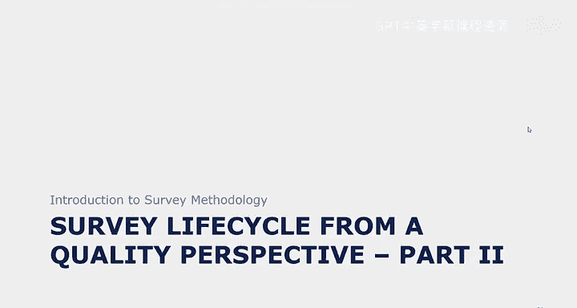
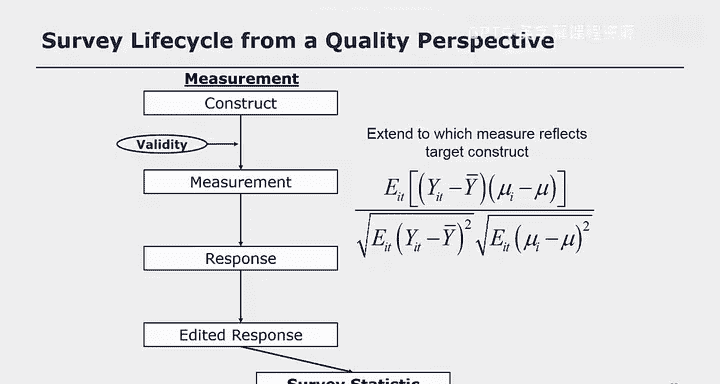
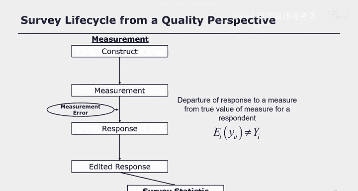
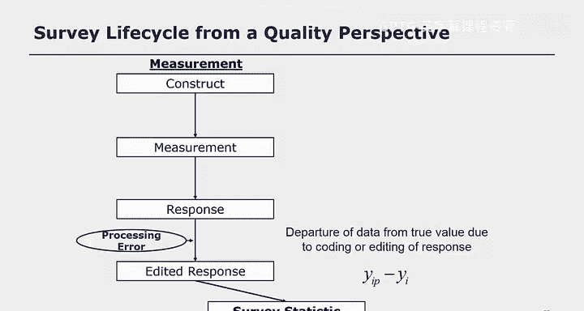

# 密歇根大学《调查数据收集和分析（第1课：框架）｜Survey Data Collection and Analytics》 - P22：21_质量视角下的调查生命周期II——评估指标.zh_en - GPT中英字幕课程资源 - BV1pi421U7Zm

Let's look at the civic quality perspective， from a slightly different angle。

We spoke about validity already。Here now， a little bit of more conceptual background for that。

Forgiven trial andrealization of a survey。I have a difference between an individual measurement for individual respondent and the average measurement for all of the respondents。

That difference。Reflect。A measurement error variation between the individual and the entire value。

 I'm interested in the overall value right so every single trial。

 every single unit is just one reflection of that。Now， likewise。Even at the construct level。

 I have variation from each individual to the overall mean。

Now it's not longer over individual trials because。Averaged overall trials。

 there is one construct for an individual mu subi， but of interest is， of course。

 the average for everybody right so there again is a different。

 It's a variation here between individual and。Overall。

So the product of these two different variation in expectation over。

The square root of the square differences of each of these variations is a measure for validity。

We'll have a little hands on exercise for you to work through these equations。

Measurement error， conceptually even easier to understand。 we have here。

Each individual Y subi respond for a particular question over trial T。

In expectation over all of those trends。That value should be the same as the measurement。

 but if it isn't， I do have measurement error。

One source for such measure and error that we often don't think of is。The interviewer in the survey。

 interviewers can contribute to both variants and bias。

There's variation and values of a service statistic that arises from different interviews collecting different data。

 despite the same training procedures。There are all kinds of reasons why this can happen in a field that's still heavily understudied。

But。One notion， for example， is that different interviews draw in different people。

 So there's some variation in in。Who it is that agrees to respond to an interviewer which would be an error on the nonres side。

 but also how they report and respond to a particular interviewer。

So let's say I'm a healthy looking male interviewer and I'm investigating or interviewing people and asking them what their health。

 if they evaluate their health relative to what they see in me， they might report on certain scales。

 their health differently than they would， if I were and you know aging obviously。

Maybe with some health impairment interviewer that enters their house， so there's variation here too。

 there's variation in how interviewers probe and tolicit additional information from the respondent and the like。

Other sources of measurement error are more obvious would be the respondent。

 the questionnaire and the mode of data collection。

If you look at the survey life cycle from a quality perspective。

We also have mentioned processing error， and that's simply the difference between the processed value and the true value。

Due to coding error or editing of the response。So， while coding。

Processing is meant to correct for errors that we have。

 it could be that it induces error if there's departure from。

The actual value what the respondent answered and should have answered。

 given a certain measurement construct。

