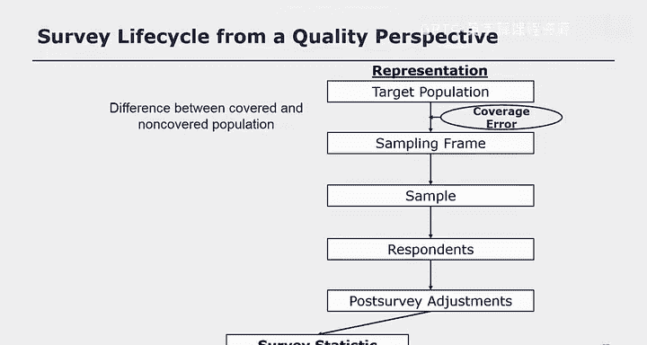
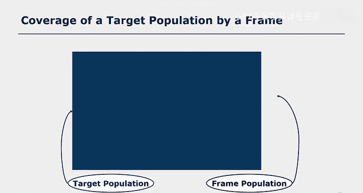
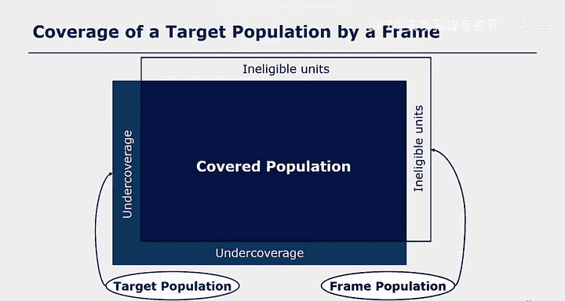
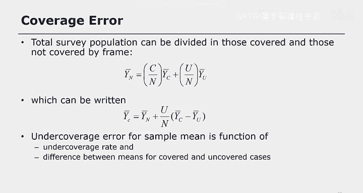
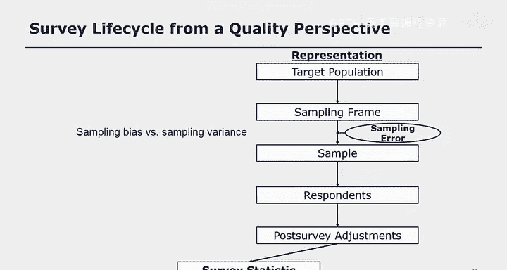
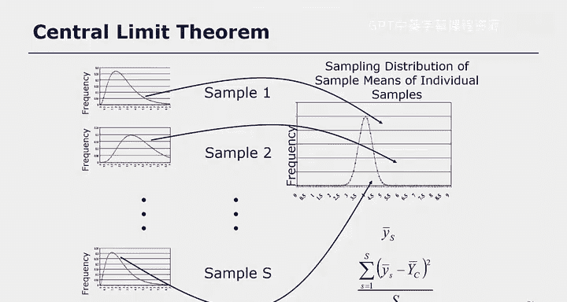
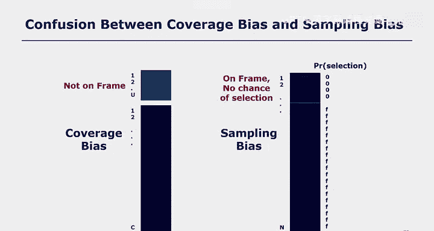
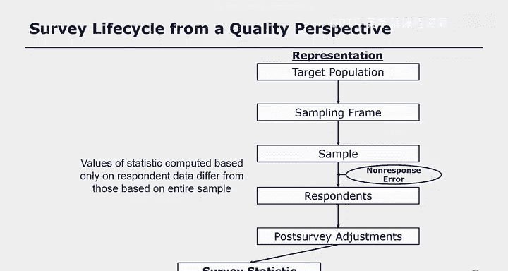
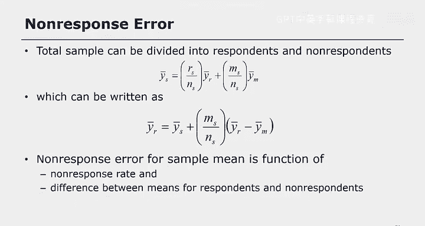
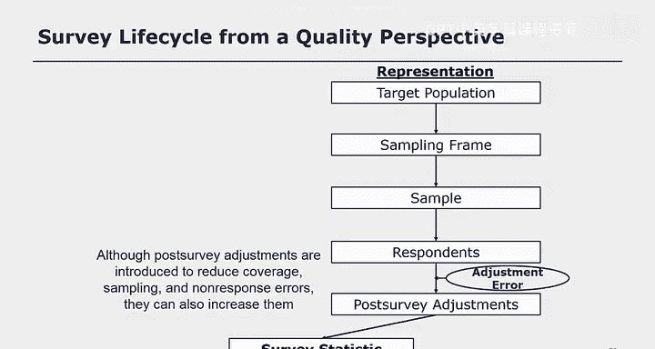

# 密歇根大学《调查数据收集和分析（第1课：框架）｜Survey Data Collection and Analytics》 - P23：22_质量视角下的调查生命周期III——覆盖与抽样.zh_en - GPT中英字幕课程资源 - BV1pi421U7Zm

So moving on to the survey lifecycle from a quality perspective on the representation side。

Now we look at coverage error at the first step， the move between target population and the sampling frame。

This is the difference between covered and non covered。People。Easier to think of or units。

 When we look at this graph。 let's say this blue。

Square is our target population。Ideally， you have to frame population be exactly the same size and everything is fine。

 no coverage error。

But often。The frame sits slightly off and the covered population is really just a part of it。

 What can this be， let's say we are interested in all people in the United States above age 18 in households it used to be the case that we could use listed phone numbers at least for a little while when phone books were good and had complete coverage of a target pop I show at least all households with the phone。

But increasingly that is a problem， the telephone frame does not necessarily cover the entire population。

 there are ineligible units。Pone numbers that belong to the dwellings that are establishments or empty or maybe even multiple cases。

 and then there are a case， many cases that are not covered by that particular telephone frame。

 and this think of cell phones， they certainly would not be or often are not part of listed telephone numbers。

 but other settings would have similar issues here。

So the total survey population can be divided in those covered and not covered by the frame again。

 if we look at this in equation notation， we have now subscript C and U for covered and undercovered。

 those are the two pieces and each of them is a proportion so the cover divided by the total n that's the fraction of covered people。

 the undercover divided by total n is the fraction of undercover people and。

Multiplying that by the average value that is of interest to us for the covered and the under covered respectively。

 the sum of these two gives us the average value for y for all of our cases in you can rewrite that and you will see that there is an error coming here。

 a difference between。Why bar Subscript C and Y bar Subscript in。

And the error that you see here is the difference between the covered and the undercovered on that particular y variable。

Multipied by the fraction of undercovered over a total n。

 so the proportion of undercovered people times the actual value so we can think of this as an undercover rate and the difference between the means for the covered and the uncovered cases。

So。How big that bias is depends on two elements or can be influenced by two elements。

 the rate and that difference， the difference is0， then the rate doesn't matter。

If the difference is large， then even a small rate will cause a problem。Sampling error。

Interesting to think of sampling bias as as sampling variance here too。

 sampling variance is just the pure variation from one realization of a sample。

Due to slightly different cases being in each of the samples that are sampled from the population。

This is most commonly measured in statistics in surveys。

 confidence intervals and standard errors give us a quantification for that source。Sampling bias。

 however， appears when I have a consistent failure to estimate a proportion of the population right so this would be a portion of the population like military。

Employees not covered in household samples because the military bases are exclusive。

 they have a sampling probability of zero and that would cause a sampling bias。

Look at this population distribution of individual values right I can think of that being my overall distribution every single sample will look slightly different depending on whom I have in my survey。

And。On average， the mean。Of the means of each of these sampling distribution will give me the correct。

Mean value that I have in the population。So， there's variation。

By each and you've probably seen this when you covered central limitthereum in your stats 101 course。

 We have a little segment just showing。

Animations for this particular piece， but if you already know all of that， then of course。

 no need to look at that。Sometimes there's a little bit of confusion between coverage bias and sampling bias coverage bias means someone is not on the frame right so this is entirely not on the frame and can't be covered。

Sampling bias， however， is people that are on the frame。

 but for some reason have a zero probability to be selected。A very important distinction here。

 and that， of course， would create a sampling bias。

Non response error is then the step between sampling and respondent。

The values of the statistic that can be computed are based on the respondent data and that can differ from the entire sample if we have missing data。

Missing data can come in two forms， we can either miss entire units， nonreent。

 so if you think of this piece here of this picture here being as our entire set of sampling cases and in each row you have the values for each individual on a particular item。

We have some values on the frame data available for everybody and then we have interview data。

 but those are only available for the respondents， the nonrespondentents are missing entire units are missing the interview data can have missing values as well those we call item missing data and it can be a measurement problem so this error actually spans both of these graphs。

Just like we saw for coverage error， the nonres error can be thought of the total sample as being divided into respondents and nonrespons。

 and for each of them you have an average value of the variable that of interest to you。

You can form a ratio of respondents over everybody and the non respondents denoted here with M。

In Subscript S， which is the sample that we are dealing with。

And so the nonres array together with the difference between the means of the respondents and the means of the nonreents。

 gives us a sense of nonres error。

And finally， there is adjustment error。So although post stratification or other forms of adjustment are supposed to correct any problem。

This correction can be done erroneously and therefore create error itself。

Key notions from this segment that you should be learning。Variable errors and systematic errors。

 Two concepts that。Should be clear in your mind and we hope that the quizzes that we have and other material in the readings will help you fully understand that issue。

Some errors are common to all of them， some errors vary over trialss。

 that would be the variable response error。Mind you， there are no good or bad surveys。

There's only a good or bad survey statistic， so the errors are a property of a statistic。

 so for a single variable。Or a model， a particular estimate。

 I mean a proportion or a regression coefficient， for example。

That means that you can have for the same survey， some statistics with the large era and others with a very small era。

Survey methodology is the science on discovering how to reduce those errors and how all of these apply to surveys。

