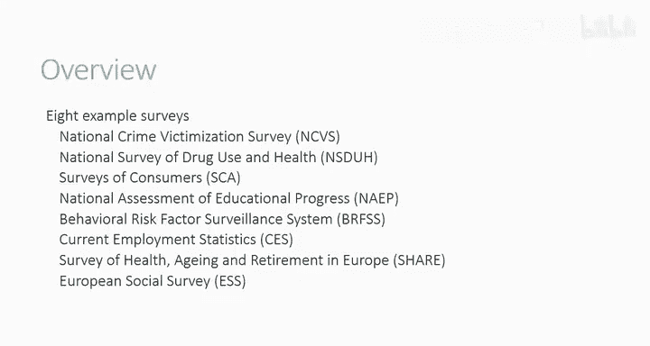
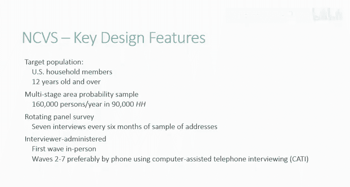
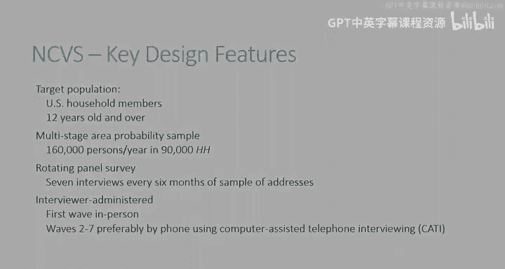
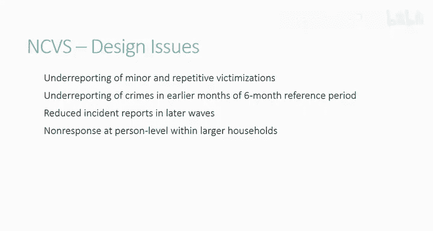
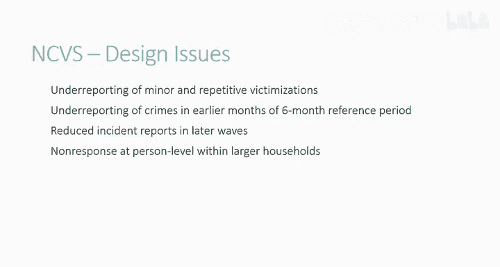

# 密歇根大学《调查数据收集和分析（第1课：框架）｜Survey Data Collection and Analytics》 - P24：23_全美犯罪受害调查(NCVS).zh_en - GPT中英字幕课程资源 - BV1pi421U7Zm

Welcome to Moio4 in our course frameworkrame for data collection and analysis。

In this fourth module， we will describe to you six example surveys。

To which we provide additional material on the course website。

And we are highlighting in our description of these example surveys。

 a few features of the total survey error framework。

 total survey quality framework that you saw in the previous module。

We encourage you to dive into these surveys and to look for similar surveys in your own countries and see how they differ in these key elements。

With that， you will broaden your horizon on the different opportunities to collect such data。

And the different methods and different qualities across countries。

Here's an overview over the eight example surveys that we'll provide or talk to you about。

I will walk you through each single one of them in one of the video' snippets。Obviously。

 there's only a very brief set of material that we can provide here in the video lectures。

But they are all interesting in as much as they provide key indicators that serve。

Policy needs。Researchcher needs and often also needs of private sector companies that want to know about the state of a particular country or even larger entities like the European Union that is interested in data across different European countries。

So all of those。Types of surveys collecting policy and social science indicators。

The first one in this series of surveys that we'll discuss is the National Crime Vtimization Survey。

The purpose for this survey is a concern that the police records underestimate crime prevalence。

Here is an interesting case， right？Crime statistics from the police records。

 and those would be a good example for administrative data that can be used in analysis。And in fact。

 in the US， theres a huge endeavore going on right now trying to。You know。

 link these different administrative database bases together so that a good picture is available for。

The crime and justice system， however。If a crime is not reported to the police。You have。

Under coverage of crimes and there is no record of them。So even so you have。

Maybe without any missing values and without any data entry errors。

 administrative records on each of the crimes reported。

Nothing is there on the underreported or actually not reported crime for that matter。

That's one purpose。Another purpose is that countries see value in perceived victimization。

 So even so not everything is a crime， there is。A perception of being victimized and a perception of being fearful of potential victimization。

 That is an interesting social indicator and has LED to。Many， many countries。

Collecting a survey that is somewhat similar to the crime and victimization survey that we see here。

We have in this one in the United States， measurement of both households and personal victimization through self report。

So there's eugene informant for a household that reports about the entire household and then the individuals in the household。

Some other surveys also have this concept of being a household sample。

 and then either every member in the household is surveyed or a selection happens at that household screening stage。

With the Crime and victimtimization Survey， it is possible to report and analyze rates of victimization across a variety of subgroups that are determined。

Through the survey vary。Right now the NCVS is looking at another redesign。

 there has been a lot of interesting methodological studies going on in that survey and so if you are interested looking through those old methods reports。

 we'll come back to some of that in the questionnaire design course。

Then there are the NCVS key design features for you to look at on the perspective of a methodologist。

 we have target population， in this case， US household members， 12 years and older。

It is a multi stage area probability sample with about 16，000 persons per year in 90，000 households。

 it's called a rotating panel survey that means there are seven interviews done。

 six months apart and then a new person household is used okay so there's a string of like a mini panel that these respondents are in a couple of years and then other people will be interviewed。

The survey is interview administered。The first wave is in person and wave 2 to7 are preferably done over the phone with the computer assisted telephone interviewing。

What's interesting here， the first survey， these kind of these types of surveys are often done as a bounding interview so that you record everything that happened up to this point and then later on you can always reference back and see was it reported up to that point again something that we will discuss in the question and design course。

Speaking of questionnaire and design， here is the questionnaire for the National Crime and Victimization Survey and the link on the bottom that gives you the full set。

 this is kind of an old little screenshot here from it。Also you see some results posted here。

 this is a difference in the rate of victimization per thousand0 persons age 12 or older for a series of years here 1994 through 2011。

These are other， you know， not design features， but design issues， as I said。Purpose of this is to。

Overcome issues of underreporting relative to the police records。

 but of course the survey has errors too as we discussed。

 so here we have usually an underreporting of minor interetitive victimimization this has to do with memory issues。

Memmoory and recall will be a whole segment in the course on questionnaireary design。

Also an issue with reference period， another piece relevant for good questionnaireary design。

 but then also we have nonrespon at the personal level。

 there are certain segments of the population that are typically hard to find or hard to get to an interview。

Older people are more likely to participate in the survey， younger people， less likely。

 in part because they are less at home here in the Crime and victimtization survey。

 it matters a lot that you people most likely to be victimized and people most likely to be victims actually might be the hardest to contact and therefore maybe not part of the survey itself or refuse to participate。

