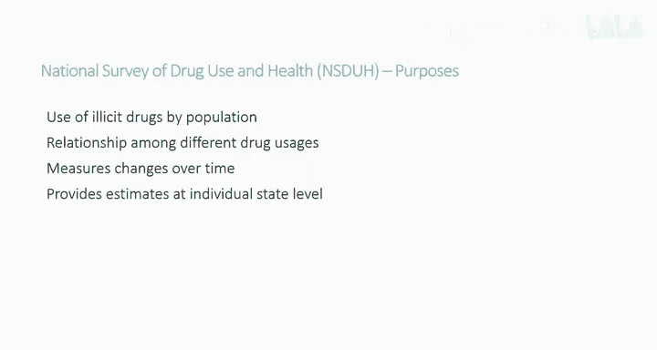
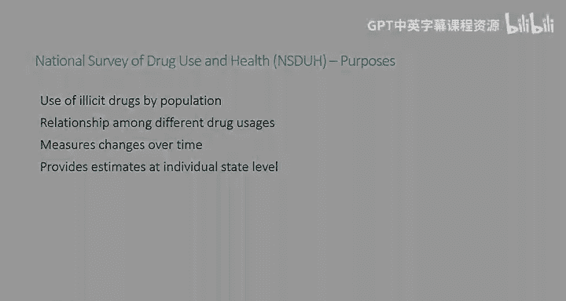
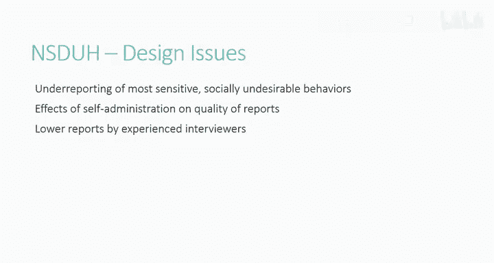

# 密歇根大学《调查数据收集和分析（第1课：框架）｜Survey Data Collection and Analytics》 - P25：24_全美药物使用与健康调查(NSDUH).zh_en - GPT中英字幕课程资源 - BV1pi421U7Zm

The second survey is the National Survey on Dr Use and Health。The purpose is to measure。

The use of illicit drugs by population， segment by segment and the entire population。Here。

 if you think of module 1。One of the primary goals。

 really is description up to the entire population。But also。

 a question of relationships among different。Drugs and different drug usage。

And maybe measures of change over time for the light too。

Maybe those differential issues are a little different than for the first one。

But。If you want to measure change over time， you have to of course make sure that your measurement from each time point to the next is comparable and that you don't include confounders in your data collection。

That make it seem like there is a change when in fact， there wasn't。

 and that's true for the National Crime and Victim Association survey as well， so it's important。

That if you have long time series。And you plan to make a change， then maybe。Good idea to have。

Part of the sample in the new design， while holding。

Another part of the sample under the oldt design so that you can see what's the change from one design to the next and what's the change over time。

Key design features for the drug survey， target population， slightly different， US household members。

 12 years old and older。In this case here， we have a multi stage area probability sample。

We'll talk in the sampling course much more about how to conduct those。

And that's a repeated cross sectional survey。 So here not the same people ask over time。

 but one survey。At a given point in time with the given set of people。

 and then a random set in this case， about 70，000 US household members at another point in time。

It might be by chance happen that someone is interviewed twice。

 but normally that would not be the case。This survey is interview administered。

It's a computer assisted personal interview so copy one of the modes we introduced earlier。In the。

Part of the survey because it's so sensitive is done by Audio Cai。

 where the interviewer Lister left around and the respondent puts on headphones and can hear the question and just enter the answer him or herself into the computer。

Again， here are some reporting figures on these social statistics and a link to the SMA website。

 hopefully you will be able to access it on these actual figures over time。Here too。

 there are some design issues。They might be under reporting of the most sensitive and social unable behaviors。

A questionnaire design issue， but also a little bit one of data collection。

 data collection modes because you might decide not have an interview administered but a self administered survey here。

