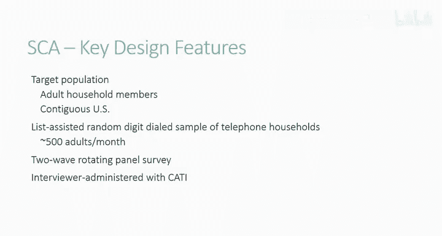
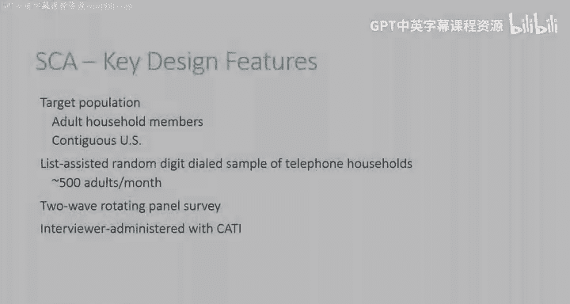
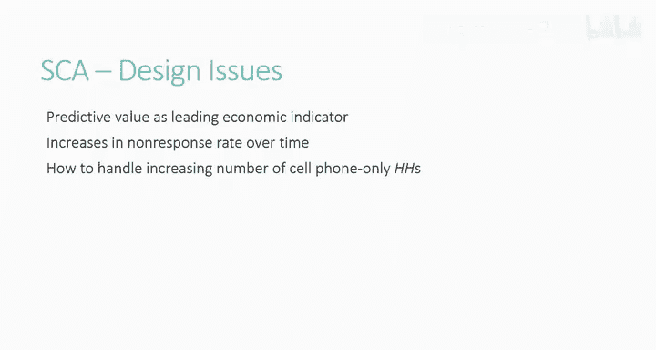

# 密歇根大学《调查数据收集和分析（第1课：框架）｜Survey Data Collection and Analytics》 - P26：25_统计区域分类(SCA).zh_en - GPT中英字幕课程资源 - BV1pi421U7Zm

The third survey in the series is the surveyve of consumer attitudes。

This survey has the purpose of measuring attitudes about financial matters。

And with the hope to predict later behaviors， these are measurements of attitudes towards personal and national economic attributes。

 measurements of saving， boring behavior， purchase intention。

 and measurement of change over time on all of these items。

This too would be hard to come by just looking at behaviors。

 although you could imagine analyzing credit card records and getting similar information。

 but you don't get the perception。And the relationship between perception and behavior that researchers or the public policy might be interested in。

The target population for this particular survey， again， adult household members。

 so 18 years and older。This one here though has a very different sampling frame。

 it's a list assisted random digital survey。Basis is。

A phone bank and then the last digits will be replaced by random numbers to increase the chance to have listed and unlisted telephone numbers。

Increasingly， as we think about frames， of course， they need to be supplemented by cell phone numbers in order to really have。

You know， created a level playing field in a frame that covers the entire population and gives everybody the chance to be selected into the survey the survey is small。

 it has about 500 adults per month， but it's running all the time。

It's a two way rotating panel survey。

People interviewed will be interviewed twice， and then they rotate out of the survey。

This one too is an interviewer administered survey， but over the telephone， so Kati。

If you're interested in looking at the questionnaire from the survey of consumer attitudes。

 here's one snippet of it as a teaser enter link to the。C， a website。Chts are plentiful。

 this is an old one out of the textbook that we recommend here looking at from growth and others。

 but of course there are many more reports on the data from the survey of consumer attitude。

 for example， this case here unemployment expectation and changes in US employment rates。

 how they trail each other but they are many， many more of course that you find linked up on these websites were in various economic journals。

The design issues， apart from the features that we already mentioned。That。

We have really seen here an increase in non-response rates over time for telephone surveys。

 this is a huge methodological issues， it gets harder and harder to reach people on the phone for a variety of reason。

 not the least that it's harder to even get them。

Contact。In particular if you call a landline phone， hence what I said earlier。

 the need to include cellphone frames these days， or maybe change the way these questions are asked。

 maybe move away from a long questionnaire to a single item questionnaire maybe move to the Google survey that we introduced earlier to capture this kind of sentiments and then interesting and still open research question is how important is the probability-based random dig sampling frame that is used for the survey in order to get the right estimates here of attitudes of the entire nation or could。

Google Sur， for example， be a good alternative source。

