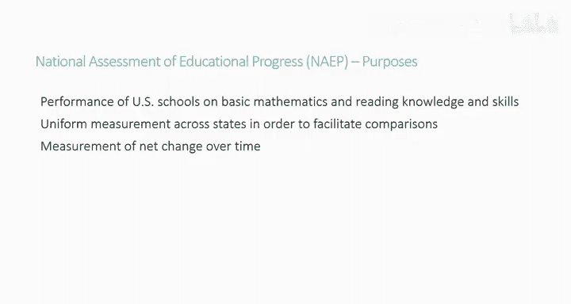
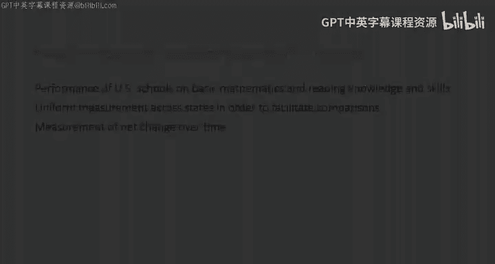
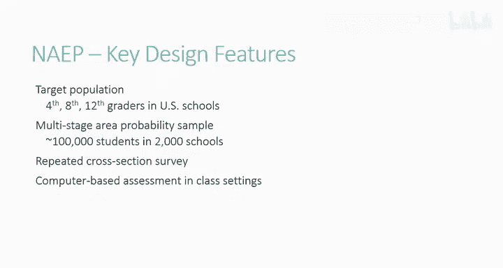
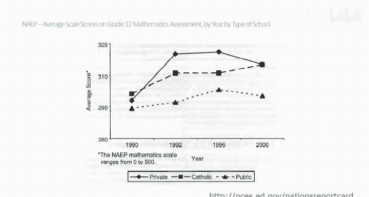
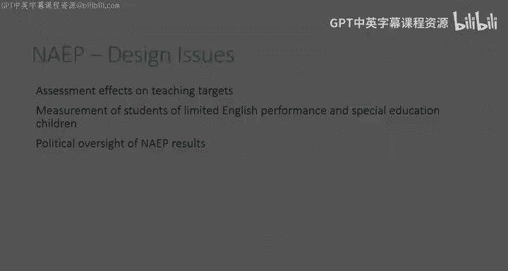
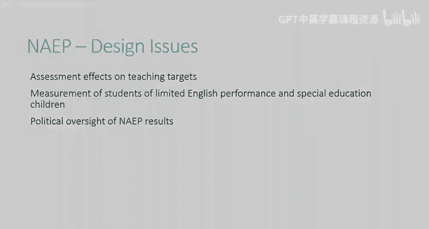

# 密歇根大学《调查数据收集和分析（第1课：框架）｜Survey Data Collection and Analytics》 - P27：26_全美教育进展评估(NAEP).zh_en - GPT中英字幕课程资源 - BV1pi421U7Zm

The fourth survey in this series is the NAEP， the National Assessment of Education Programs。

Goal here and this is you know， by now international we know a lot of surveys of this kind， PsA。

 Tims， PR study， you know， they all try to measure math reading skills and this one here provides a uniform measurement across the states in the US。

In order to facilitate comparison of schools of states and a measurement of change。

The target population for this particular survey is fourth， eighths， 12th graders in US schools。

It again is a multistage area probability sample， so similar to what we had before with about 100。

000 students in 2000 schools， you can already see how the data structure that emerge here is a hi structure and definitely one where it's worthwhile checking out our course on。

Soy data analysis in order to make sure that you know how to properly report and estimate results from this kind of data structure。

Again， this is a repeated cross sectional survey， meaning the cases are selected into the survey。

Interviewed and then released and not followed up， so no panel survey in this case。

's a computer based assessment administered by field workers at the individual schools。

The questionnaire itself looks a little different in part because this piece here is test question for these students。

 you see the correct answers here as well those of course the students would not see if you want to take a look at this assessment test you can do so at the NCES website。

Again， some graphs here different in the average schools for 12th grade math assessment by private。

 public and Catholic schools in the US。The time span reported here about 10 years。

And now we could add another 10 or soon even 20 to this。

Ne design issues in general， this is the hope to assess。Effects on teaching targets。

And the measurement of students language performance。

 there's a little bit of an issue with these measurements。

 if you try to measure maths and they require you to read and write your result and of course that's somewhat confounded with English level skills。

There's a political overt side to this， highly contious data， a lot of people move according to them。

Quality of school districts and housing prices follow along。

 so that's an important thing to keep in mind。