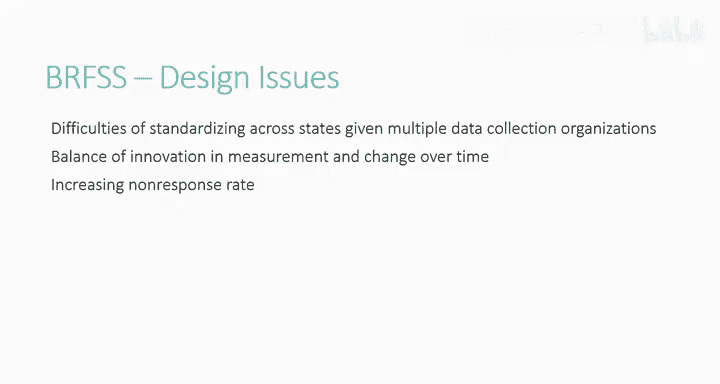

# 密歇根大学《调查数据收集和分析（第1课：框架）｜Survey Data Collection and Analytics》 - P28：27_行为风险因素监测系统(BRFSS).zh_en - GPT中英字幕课程资源 - BV1pi421U7Zm

The F survey is the Behavial risks Factor Surance Sury BR FSS。Some call it bfus。

Its purpose is to provide state level health measures and risk related behaviors。

And it provides estimate to the state's public health officials。And again， in here。

 not just the current state， but measurement over time， so consistency is important。Interesting here。

 I'll come to that in a second， this is done slightly differently from state to state。

 so while there is a lot of comparison going on of these survey data across the different states。

 you really want to look closely on how the measurement of health is done at each of them。

The target population is defined the same in the US。

With adults in households ran into their adult survey again， a repeated co like we had before。

 so no panel and a telephone interview using interviewers。

Here's a snippet of the questionnaire just like we had for the other surveys and some example for data reports from this particular survey。

 you find those and many more results on the CDC website。

The design issues that I alloted to earlier are really interesting for the VF。

Because it's very difficult to standardize the data collection across all the different stage the data collection agencies do this very differently one example。

 some have interviewers that do nothing but the B ofS and they run thousands of interviews on that same questionnaire Now just imagine how you would administer a question if you ask it for the 500s times。

So there might be some interview effects and you'll learn more about these in subsequent courses。

But that's only one of them。Here too， you have the issue of balancing innovation and measurement and the change over time and then increasing non responsesponse rate because people don't participate in the surveys。

Now， Google search has tried to put out alternative indicators like Google Fruend search keys。

 search terms on the website。End。You know， algorithmgos that relate those to key indicators also collected by CDC。

It's not unlikely that some of the measures in the BFS would be replaced by those kind of data collection efforts。

