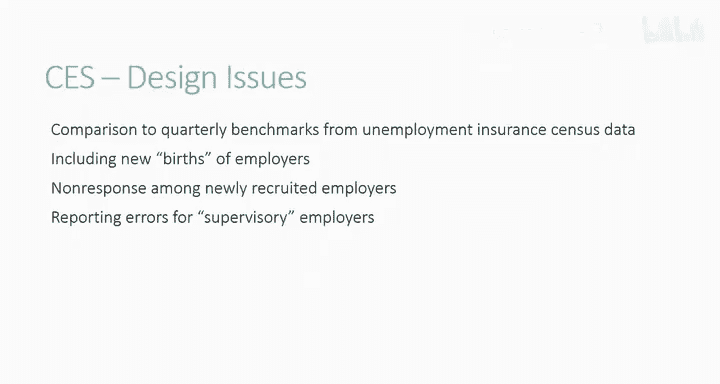
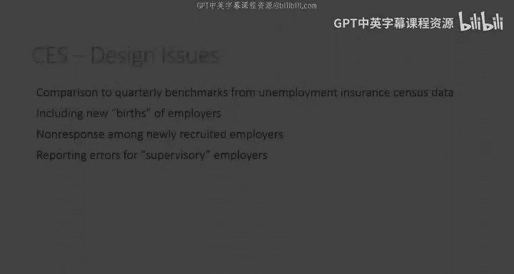
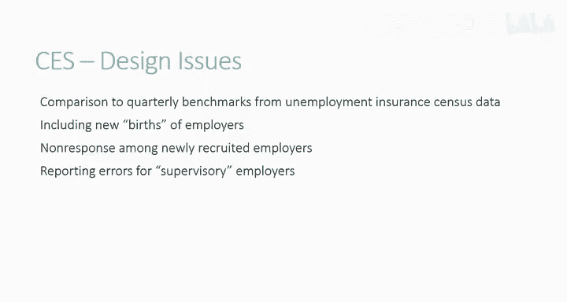

# 密歇根大学《调查数据收集和分析（第1课：框架）｜Survey Data Collection and Analytics》 - P29：28_现时人口调查(CES).zh_en - GPT中英字幕课程资源 - BV1pi421U7Zm

Slightly different from what we've seen so far is the current employment statistic。

This is the data collection effort designed to capture the change in number of jobs in the USA across months。

That means also changes in number of hours worked by US workers and changes in earnings for the workers。

The key design features for the CS。A target population that's now an organization。

 so not longer an individual person， but an organization。In this particular survey。

 one or more employees qualify。As being part of the target population。

The sample itself is drawn from a list。And it。Entails the data collection entails about 140 business and government agencies。

Which translates to many more individual work sites。The survey is a rotating panel survey， again。

 meaning that some enterprises stay in。For multiple waves of this panel。

 whereas others drop out in this case here， known necessarily a fixed panel length。

What's very interesting is that data collection is done a very different way。😊。

There's something used called EDI electronic data Interchange between the data collectedor。

 in this case， the Census Bureau and the particular companies。

But there are also alternative data transfer mode available like f or touch on data entry。

Paper forms and IVR interactive voice recognition。And increasingly。

 there's the hope that one could use these alternative sources also for some of the other service that we've seen。

Important figures are the outcome of the CS， for example。

 unemployment rates by state seasonally adjusted in this case， these are the figures for 2015。And。

You see many more， but with it come some design issues， one is the timely reporting。

 there are fixed release dates for the Cs， in particularly unemployment figure。

There's strong emphasis on。The unemployment insurance data that census has。

And benchmarking that to those data can be a challenge。

There's a challenge in including new births of employers。To capture those not yet in the list。

 but of course， contribute to。The economic growth。There is often non response among newly recruited employers。

And there can be reporting errors depending where in the hierarchy of a company。

The survey is filled out while the reporting is done。

