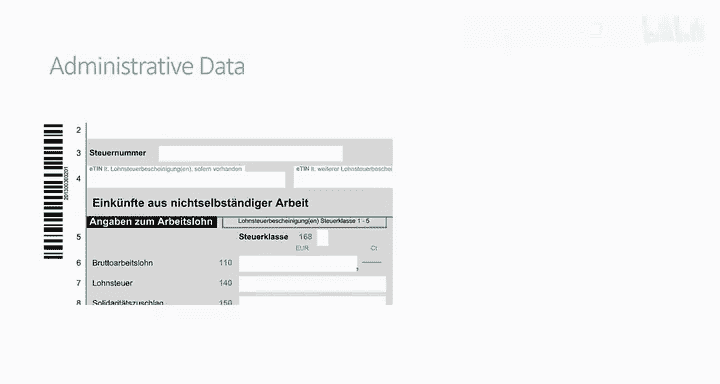

# 密歇根大学《调查数据收集和分析（第1课：框架）｜Survey Data Collection and Analytics》 - P2：1_数据类型.zh_en - GPT中英字幕课程资源 - BV1pi421U7Zm

So let's look at the data generating process。In experiments。Mention that。 we need them for causation。

You often have a setting that is in a laboratory。Confine space。

 a lot of control about all possible variables that might also influence。My headache。

My comfort with a certain。Game。My aim。Reaction to authority is in the Milgram experiment setup that you see here on the left。

Usually what you have try to do in an experiment in the data generating process is that you have a systematic variation。

End。Nothing else， but that systematic piece varying， right？They are often smaller in scale。

And they are specifically designed to answer that particular research question。

 what's the effect of X on Y， X being the treatment， Y being my outcome？Now。

 sometimes there is a little bit of an issue in having strong internal validity so you can be really sure you nail down that effect of x and y。

But you might be much less sure on whether this holds outside that confined laboratory space。

 so something to keep in mind， but here， if you think of the data generating process，A we slim。

You would want to make sure that you do know what is the laboratory setup。

 how was the treatment administered？What possible confounders will you。

 the randomization of people from you know， a large pool of people that you select into the treatment group and control group。

Was that really enough to even out all other characteristics that these people have so that these two groups are？

Most comparable， all those things are questions about the data generating process that you should ask。

Looking at survey interview data。They have also very interesting characteristics。There are。

Usually designed and have a specific research question or purpose in mind examplesles would be political polling or。

Health service。Consumer satisfaction surveys， they all are designed questions carefully crafted so that you do get answers to that research question。

Or at least we hope so， and that's what we teach in question and design。

Surveys vary largely in their quality。And in the size， of course， too。It depends on the one hand。

Your sample size， but also on what we call response rate。

 how many people do participate in the survey。Or other elements in the survey process？

We'll talk a lot more about what can go wrong here， but right now keep in mind。

 specifically designed and vary a lot in size and quality。Usually， we deal with sample surveys。

Sometimes， you see。So， we did a call。Oh hidden the census。Be conservative。But。

The processes or the elements in the process and possible aero sources are largely the same between the two。

And then there's a certain type of data。That are not designed， so unlike experiments in survey data。

 these data are often called found data or organic data。

 they appear as part of a process or as part of a largely uncontrolled data collection effort。

One example we want to give you here are data collected through the Boston Street Bump app。嗯。

As you can see， these data。Just appear and they have all the features of what。

We call big data these days。For one， they will provide large volume。

The sheer size of people downloading this app， using it。

 creating data minute by minute by minute by minute， is of course enormous。

Second feature is their velocity， they come in at a high frequency。And。

That creates an additional analytical challenge。They also come in in a wide variety。

 so here we have timets。We have geo coordinates， We have motion measures。And you know。

 if you think of the big data space in general， you can think of even more variety pictures， sounds。

 anything can be turned into data that's probably why you take this course because data are everywhere and are pretty exciting。

But for us， the interesting part is actually the last one。The data are also erroneous。

Where they can be。You might be doubtful about certain elements here in your dataset。

You might be missing entire pieces。 I spoke earlier about the issue of known。

Or at least positive selection probabilities， so those are things to keep in mind when you do evaluate the data generating process。

Now， another form of process data， not quite with the same frequency。

 although depending on the process could be pretty high as well。Administrative data。

Here are these processes are processes。That I。

Sort of a side effect of。Program administrations。Of any kind， let's say。

 a Social Security Administration。Welfare benefit programs， any of these is this forms to filled out。

There is。Some record that exists because a payment was made or was kept track of。

Anying of that nature will create data， increasingly electronically and even more increasingly available to researchers。

Both in the commercial， private sector and nonprofit world。

Of course， within the administrations， these data are always been available， but again。

 not necessarily in a form that's electronic and easily available。Interesting though， again。

 data quality， often you have very high quality on variables that are program relevant。For example。

 if the records are used to determine your pension。Then the income data are probably pretty good。

Other variables， maybe not so much。In this German forms snippbbleet that you see here。They are。

Information on education that the employer has put in。They might not know。

 it's not important for these forms and what they're used for。

 so the quality of these data might be much lower。Also。

 often the number of variables on these administrative data is rather small。

 so an interesting challenge comes when we link the different data sets together。And for that reason。

Further down the line in our specialization， we will talk about data linkage， how to do that。

 what to think about it when you do it。