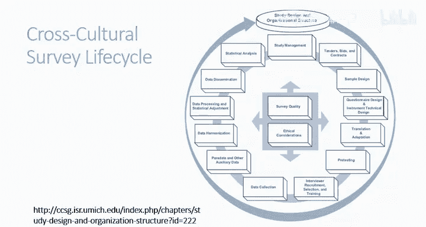
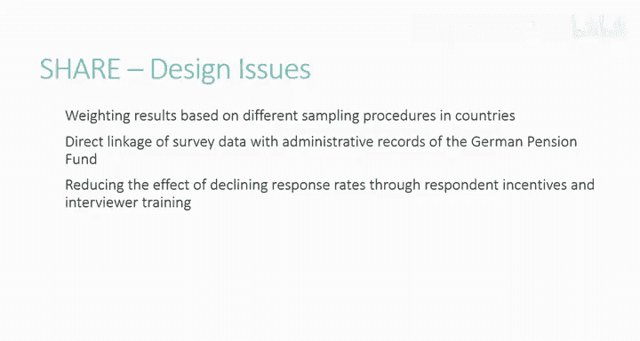
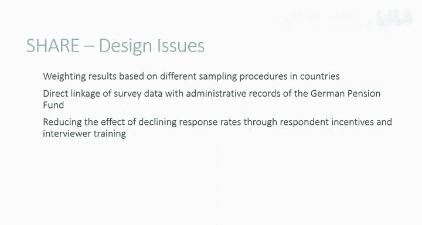

# 密歇根大学《调查数据收集和分析（第1课：框架）｜Survey Data Collection and Analytics》 - P30：29_欧洲健康、老龄与退休调查(SHARE).zh_en - GPT中英字幕课程资源 - BV1pi421U7Zm

The last two surveys that we want to show you here， Im want to preface with this。

Liif cyclee diagram for cross culturalural surveys。

You'll find this diagram at the CCSG website at the Institute for Sur Research in Michigan。

It is a cross cultural survey group that。

Has a fantastic website with a large set of information on issues concerning survey design in general。

 but also。Particular issues for cross cultural studies and survey done outside the United States。

Why am I emphasizing that， A lot of the literature。

Is admittedly very US and on centric and so here in this website you will find a lot of resources。

Particularly useful for those of you outside the United States。

What you see here in this lifecycle diagram is， again the process and the launch chunk of this process。

 having to do with translation and adaptation to different data vendors。Otherwise。The different。

Elements will look familiar。We've talked about the necessity of sample design and questionnaire design and the like。

 but translation pieces and data harmonization at the end。

 those are issues particularly common in these cost culturalural surveys。

The two examples we have with us here for such surveys are the share surveyve， the Survey of Health。

 Aging and retirement in Europe。It is a cross national survey on the goal of assessing。

Issues related to public policy， culture and history across a variety of European countries。

 but goal the primary goal is to provide a full picture of the aging process。

It has been funded by the European Commission。And trying to study aging and。

 differences across nations on that。Theres a harmonization going on in Sha。

 there's a sister study in the US called the Health and Retirement Study。

 it's also run out of the University of Michigan。And also the English long and Tuna study of aging。

 so both of these are additional interesting resources。

The key features for share are target population defined here as people age 50 and older。

Survey is done by now in 20 different countries， five ways at this point。

It has different forms of probability sampling in each of these countries。

 the samples are chosen in accordance with normal occurrences in the countries。

 most countries use registers of individuals， approximately 110，000 individuals are surveyed here。

 you see the pen study waves。The surveyy itself is interview administered and it has some of these physical measurements that we talked about earlier。

 at least I had them on one of the slides earlier， biomarkers。

 dried blood spot is one element that's collected here and some physical tests like grip strength and the like。

Pretty neat survey， cool data to be collected here。This is a screenshot from the questionnaire。

 the online instrument， you'll see a PDF of the instrument on the shareH website and increasingly there is information available also to analyze the data and secondary data analysis。

 including paraadata collected on the interviewers。Here's an example of output from She。

 the correlation between education and physical health。Across all these countries， you see that。

At least on the country level， a strong relationship here。

 we have to be a little careful here with fallacies that come through groupings of that z。

 but in within a country， the sample size is strong enough to examine these effects separately as well。

Now for。Methodologist and for you entering that field。

Deign issues are of particular interest for share one has to do with you know the weighting of the results based on different sampling procedures in the countries that's tricky and a challenge there's also direct linkage of the survey data in share with administrative records right now only for the German pension fund。

 but that will be expanded。

In other countries as well to do these kind of things。

 so there's a question ask permission to link and then for those people that give permission as linkage is done。

There's an attempt to reduce the effect of declining response rates through interviewer incentives and interviewer training。

 also interesting methodological work done here on that part。

