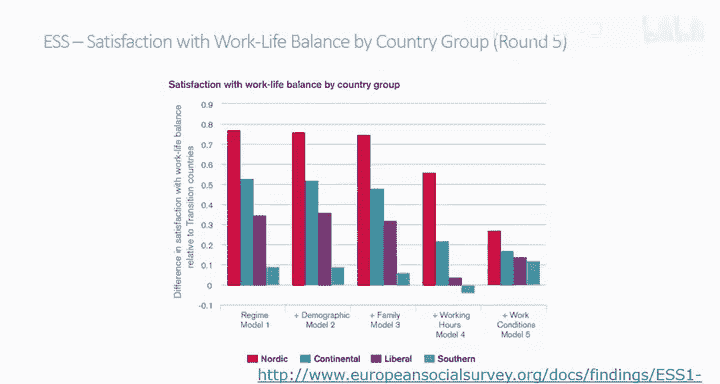
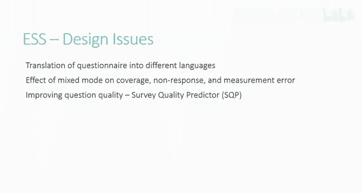
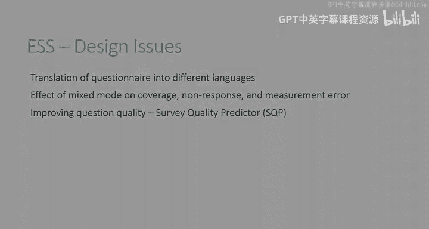
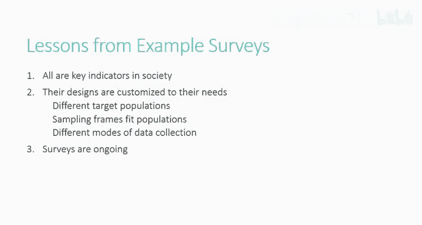
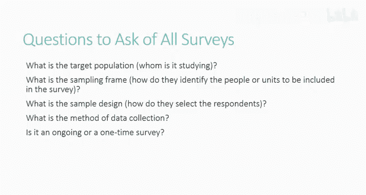

# 密歇根大学《调查数据收集和分析（第1课：框架）｜Survey Data Collection and Analytics》 - P31：30_欧洲社会调查(ESS).zh_en - GPT中英字幕课程资源 - BV1pi421U7Zm

Another European white survey is the European Social Survey。The purpose。

Is to map attitudes and beliefs in behavioral pattern across Europe since 2001。

 so quite a time series by now。Some of you might be familiar with the general Social Surve。

 the mothership of these kind of surveys done in the US a long time ago。

 already running for a very long time。This one here was initiated by the European Science Foundation at won a big price at the end is a very good instrument across the European countries has rotating modules in contact。

 the key design features here， the target population is restricted people 15， age 15 and over。

This means residents within private households in each of the 36 countries。

 regardless of nationality citizenship or language。

 which of course as there's more migration going on is a big problem because you would need interviewers who can administer the questionnaire in all these different languages。

Again， there are different forms of probability sampling going on and we'll provide you with some links to a very interesting study that shows how the way the recruitment is done might bias the surveys across these different countries。

The general sampling guidelines that are implemented in each of the countries and a requirement on the minimum effective sampling size in each of these countries。

The survey is repeated cross sectionally， so different people every time the survey is repeated。

 unlike shareHre which is a panel study where the same people stay in the data collection over and over and over and there are issues with panel studies to begin with which Fred Conrad in the course on data collection will hint on。

The European Social Survey， as I said， cross sectional so different people in each of these wave。

 it's collected bianly。 and right now they are in wave 8 and。2016。

The survey again is interview administered but computer assistants so they run around with laptops and do the data collection that way here's an example of the questionnaire you see lots of attitude questions here's a list of items that belong to this intro statement。

 the full questionnaire can be accessed with the link given below。

Here's an example of a data analysis that you see has satisfaction with work life by balance by country group。

Many more analyses also to be found on the E SS website。

For us， again， of interest design issues here， challenging。

 as I mentioned the translation of the questionnaire into many different languages。

 there is a mixed mode experiment or feeling going on in ESS。

 which has effects on coverage a non-resse and measurement error。

There's a continuous effort on improving the question quality and span out of the years as is the。

SQP project， the Sur qualityual Pre project that we will talk more about in the Quetion De sign course。

Now there are a few lessons to take from all these example surveys that we showed you。

 they're all key collecting key indicators in society。

And if you remember back in module1， when we introduced alternative organic data sources right now a very interesting debate going on or experimentation on what。

Indicators for society could be collected， not using this expensive。

Soy data collections but through alternative sources， but equal qualities。

 so that's a very interesting discussion going on these days。But for now。In most places。

 there is the notion that for these kind of indicators that we just introduced here。

 the survey is still the primary mode of data collection to gain that information。

For each of these surveys that we showed you， the designs are customized to the needs。

They have different target populations， they have very different sampling frames that fit the purpose of the survey and they have different modes of data collections all of these surveys are still ongoing。

Now， one question that you should ask to all surveys that you see。

Are these key things that we discussed with these examples， what is the target population。

 who iss the study studying right， what is the sampling frame。

 how did they identify people or units doesn't have to be people all the time to be included in the survey。

 who has the chance to be asked to was the chance to deliver their information。

What is the sampling design in general， you might need to know this to give the proper variance estimation to properly capture。

Insecurity im possession of your estimate。What was the main method of data collection to begin with。

 pureO survey， question and design， paired up with administrative data linked？

In which other format was the data collected and is it an ongoing survey or a one time survey that you see here in part ongoing surveys。

 you know the us particular issues。If the panel studies this an attrition problem。People。

Participating less and less over time， but on the upside。

 studies that are ongoing and repeated over time， they learn a lot from the last wave to the next。

And so hopefully we can share some of that knowledge throughout the next segments。

Courses in this specialization。So with this， I thank you for participating in the first course。

I hope we were successful in giving you an overall framework on what it means to collect data and to analyze data。

 what are the key points to think about， what are the potential quality criteria。

 what are the potential error sources and that you'll stick with us and enjoy the other courses as well。

