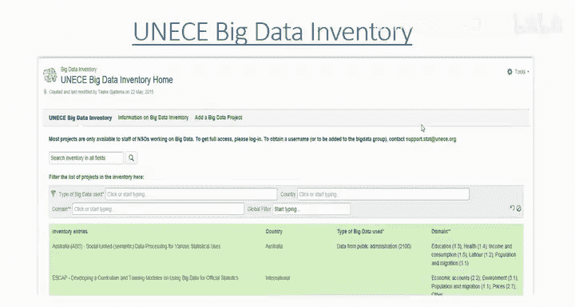
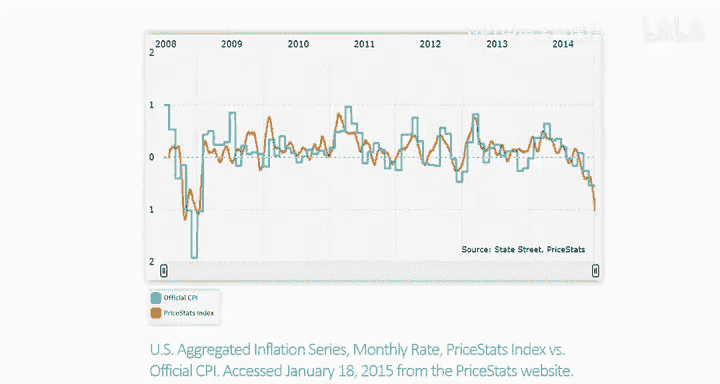
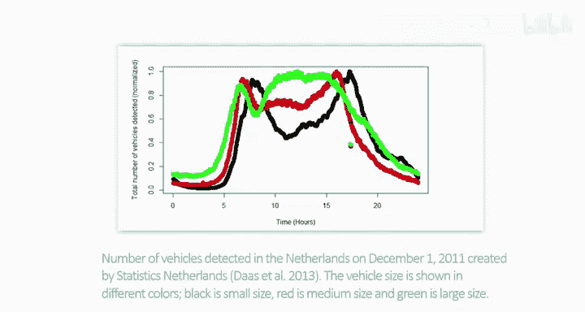
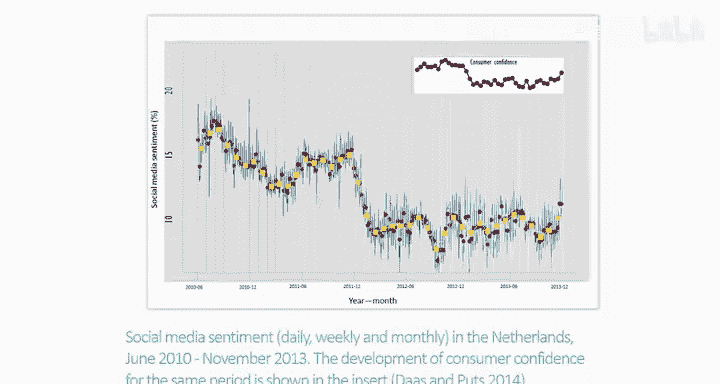

# 密歇根大学《调查数据收集和分析（第1课：框架）｜Survey Data Collection and Analytics》 - P3：2_发现数据实例.zh_en - GPT中英字幕课程资源 - BV1pi421U7Zm

Now government programs。And。Well， I should say federal statistical system。

And larger entities like Eurostar or UN ECE，I looking into these alternative data sources。

 data that exists as part of a process。That。Those interested in analyzing them don't initiate。

 but still want to do something with them。What's happening everywhere， for example？

The attempts to create consumer price indices by capturing information on price statistics。 I mean。

 scraping the Web for。嗯。Prices， you know， for certain goods， tracking that over time。

Very interesting website for you to look at is the MIT Billllion Pri project。

They are trying to match up。Information from there to the US consumer price index。

Mobile telephone data are another source of data that a lot of countries these days look at and trying。

To get information out， lots of cities employ smart medias。Or sensors in traffic loops。

 or use social media data to capture sentiments rather than sending out survey after survey after survey。

But keep in mind。Because these data are found。It's sometimes even harder to match them up with your research question。

And。You're not in control of the data generating process， so in order to make valid inference。

 you might need to know much more even more about the data generating process at each step。

That's why in this module， where we give you an overall framework。

 we'll talk a lot about quality elements。If you want to take a look at that big data inventory。

 feel free to scroll around that website。

The link is available on our course page。Here's an example of the CPA price index that I mentioned just now。

An example from the Dutch traffic loops and their occurrence with a reference accordingly that you can access from our website。

And。Also from the Netherlands。Social media sentiments matched up with the accounting survey in the Netherlands on consumer sentiments。

