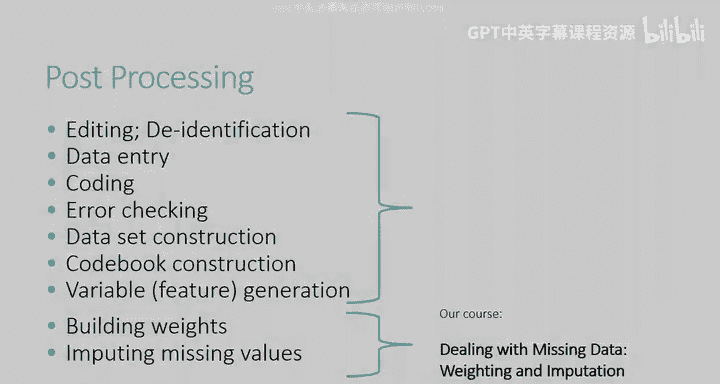

# 密歇根大学《调查数据收集和分析（第1课：框架）｜Survey Data Collection and Analytics》 - P5：4_数据治理.zh_en - GPT中英字幕课程资源 - BV1pi421U7Zm

Da decoration and storage。What do we mean with data creation， Obviously。

 just like any pictures that you could look at in this case here。

Display of the University of Manhattan campus。 Pret nice old castle。With some editing。

We can change colors with some more editing。 We turn the whole thing into data。

Editing happens everywhere， and the same is of course true with the data that well deal with。

They might be。Editing。As part of this creation step。In the big data process。

You wouldn't want all information that comes through to the house。 You would take out， you know。

Certain elements， maybe you would restrict to certain types of postings。

 Maybe you would restrict it to certain type of。Geocodes， although that is more a filtering step。

But in any case， most likely there is editing going on or data cur。

But that's not the only post processing step that you see in it。

Happening after the actual data is collected。Often you have。A step of de identification。

 making sure that personnel。Identifiable information is not longer part of the dataset set。

There's additional data entry going on， maybe you had O or just recordings that need to be keyed in。

Into so that they become you know data points， numeric values。There might be some coding， as I said。

 of open answers。That can be automated， maybe you use some machine learning techniques to do that。

You could check for errors， the inconsistencies and answers， inconsistency in how the data come in。

 timing purchase can't be made before a selection。The transportation of the data to you might have been screwed up depending excuse my language depending on what you do here。

And often you have to construct a new data set entirely because the data that come in are at different levels。

 you might have something about the household， the individual people in a each household。

And those need to be pieced together。This。This front set including code post construction variable generation to which I say a few more words。

Heavily covered in other courses on Cura。We'll talk a little bit about。These， but our focus。

Is actually。Somewhere else。So let me briefly touch you on the variables。

When you two types of variables we differentiate in continuous and categorical variables。

An example for continuous variables of blood pressure。Pretty much， values possible in any range。

They can be on an interval and ratio scale， ratio scale。

Usual reserve for variables that have a defined zero value that's not true for all interval scale variables。

And then there are categorical variables that are either oruddial or nominal that have ordered or nominal that have different categories that you can order or different categories that are just distinct from each other。

This question that you see here has a categorical nominal answer category， which is just yes and no。

 there's no。Ranking within the yes and no questions。No。

A little bit on that to actually how to actually construct a good question。

 you'll learn in questionnaire design。But。One issue that comes up in this coding and we'll talk about that somewhat in question design。

 but if you deal with data in any form of setting， you have to make sure that when this gets turned into variables or as you will see the computer scientists talk about into features。

 you often have multiple categories and when you use them。

 you for each of these categories have to make sure that you say okay does apply and does not apply right so you end up having a lot of different variables for example。

 public yes no。Private， yes， no and the like。 so even so that looked like one question before。

 later on in your data set， it will be seven different variables or features generated out of this one。

Question。Now our focus later on in the specialization is on building weights and imputing missing data。

 so if you don't have certain information， what to do then。

Because the step in between， we found that a lot of people actually do learn this eventually。

Or as I said， there are other courses luckily available here where youll learn these pieces。

We go a step further and want to make sure that you had to have a good grip on your entire data set。

So that you can do proper data analysis。