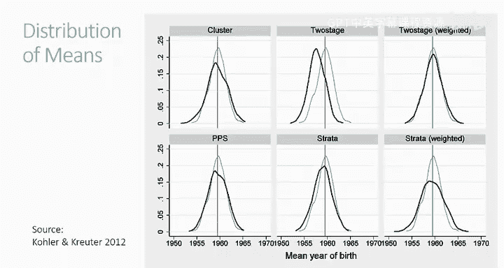
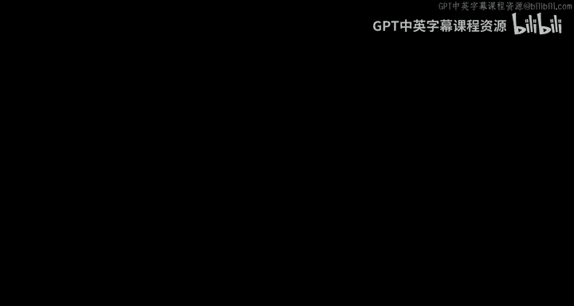
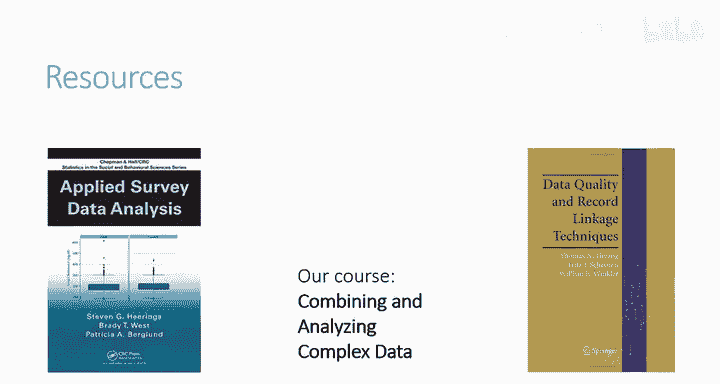

# 密歇根大学《调查数据收集和分析（第1课：框架）｜Survey Data Collection and Analytics》 - P6：5_数据分析.zh_en - GPT中英字幕课程资源 - BV1pi421U7Zm

Now， obviously， a course on data analysis could include a lot of different topics， right？

We would have you know， means， percentages， totals， how to compute them。

 how to estimate differences in means， how to do regressions， how to do clustering techniques。

 lots of stats courses， some of this covered in stats 101， some of this in advanced。Quises。

Some of it， your software package knows how to do and gives you good guidance on how to get through it。

But。In many data contexts， there are challenges involved with any of these standard procedures。

That you need to know about and then know how to deal with one is， for example。

So you start linking the different data sources。You might have them at different hierarchy levels。

 much more complex， much more difficult to deal with in the analysis。

You would want to take those kind of things into account， but more importantly。

 you need to capture variability correctly。In order to。Provide your estimate of a percentage。

A mean or total， or even to talk about。The size of a treatment effect or the precision of a prediction in each of these cases。

 because you make this inference because you infer from the data at hand to something larger across people across time。

 across space， or all of these。You need to make sure that the way you communicate the variability。

In your estimate， in your statistic is A。The proper one。So let's say we take a sample of three。

Little faces here。You could have in one sample， all blue， right the next one could be。

One of each color。Obviously， each subsemble might vary。

 and that's the kind of variability you do wanna capture properly。In your analysis。

 that's what our analysis course is about。You might remember this from your Inter quizzes in case you took those。

Confidence intervals， standard errorss。Vakely remember that， maybe。Here has a visualization of。

Hundred samples taken from the German socioeconomic panel data set。

And what is displayed here is the average year of birth。In that population。

Where the population in this case is the GS subP data set。And then the bands that you see。

 the little stripes around this。Midpoint looks like a ton in bound to me。嗯。They。Have in the middle。

The estimate for that particular sample， just like I had the sample of all blue heads right。

 so here is the estimate of that particular sample and around it is an a band For now we don't care how to estimate that particular a band that's what the analysis class later on shows you。

But what you see here is that most of the time the air vent is constructed in a way that most of the time it does spin the mean value in the middle。

 sometimes marked in these blank ones here。That's not the case， right？

But depending on how you construct them。This will vary how many of the repeated sample that you could hypothetically take。

Will or will not capture the true population mean， So that's the issue of variability that you tied to the。

Now， when you take some samples of the whole population when you take。

Data from a particular part of the population at a particular time point or in a fashion that is either what we call a simple random sample or a sample grouped by geographies or done in some other form。

It's important to know about that piece of sampling because。When you plot， as you see here， the mean。

For each of these sample， pile them all up， right？You see the distribution of these varying sampling means。

 depending on the technique， how you do the sample。

 that distribution can either be wider or more narrow than。The population distribution。

Can also be biased。A way， the center being away from the true center。

Now I know that some of you might not know these terms and that's good because we do want you to take the sampling course as well。

 this is just a teaser why it's worthwhile to learn that right so depending on the technique your variability might change and no matter what you do you have to reflect the variability when you put out your results and so that's what these courses later on our about。

Resources， as I said， combining and analyzing complex data is one。

 our sampling course itself is another one， and these two excellent books here in particular one on the left。

 applied surveyy data analysis from one of our three of our colleagues from Michigan actually as Diering Pe Bdlin and Brady West。

 highly recommended。

