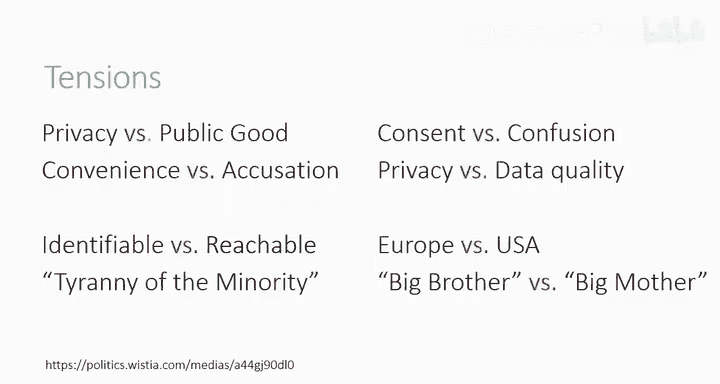

# 密歇根大学《调查数据收集和分析（第1课：框架）｜Survey Data Collection and Analytics》 - P7：6_数据获取问题.zh_en - GPT中英字幕课程资源 - BV1pi421U7Zm

Okay， so the last step here， this data。Output an access piece。That I want to tell you about。

Is mostly on the access part for now。Because。Having access to a lot of data is really。

What makes this time exciting for us？As data analyst。Or data scientists， well statisticians。

 however you want to call the people that deal with the data。

So much data is publicly available and can be used for the public good。

 but of course there are privacy issues。And challenging ones that we haven't solved yet in this book。

 you find a variety of chapters。Dealing with。The tension between。

Privacy on the one hand and public goods that can be created on the other。

Between the convenience of having Google tell me that it's about time to leave my house so that I will be at work at time versus。

Private companies knowing everything about me and maybe that data being then later onused for accusations or for denial for certain products or services or what have you。

Particular around insurances and loans， that is a debate that you see heavily flaring up。

There is a tension between identifiable them。End。Reach。

There is tension that even so I might decide not to put my data out there to Facebook or other places。

Other people that do with Facebook one can't probably say minority at this point anymore。

 but other people that do might report about me and therefore。Privacy is not longer guaranteed。

 either。There is。Attention between informed consent， asking people whether they are。

Viilling and purposefully providing the data。And the fact that many of these consent statements are really confusing。

😊，I wonder how many of you have ever read when they have used their smartphones。Or any other？

You know， an electronic device that collects data through all the privacy statements and really know what that means and understood。

Then there is a tension between privacy and data quality。

 maybe knowing that these data will be collected， people start misreporting age， for example。

Would be an easy one， but other information probably as well。

There certainly is attention on which country you talk to。

And I will be interested to hear from you guys on the discussion forum how that is。

 that notion of privacy in your country， whether people are willingly giving their data up for the public good。

😊，Or if they are more worried about that being abused。

 like the Germans are of this tension between big brother and big mother。

