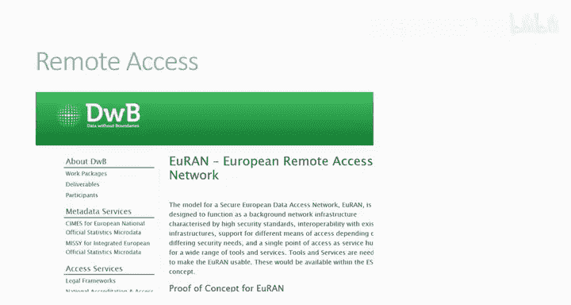

# 密歇根大学《调查数据收集和分析（第1课：框架）｜Survey Data Collection and Analytics》 - P8：7_获取资源.zh_en - GPT中英字幕课程资源 - BV1pi421U7Zm

Now， a lot of the data。That researchers collect。Survey data are de identified。In the last segment。

 when we talk about record linkage and data analysis， but also in the imputation setup。Well。

 point two ways on how to deidentify data， these techniques can be used for that very same purpose。

And then the survey data or experimental data are put into data archives this UK data archive is certainly worth visiting and increasingly house administrative data in it as well。

Likewise here， there are data archives in the US ICPS is a very large one for the social sciences super popular has been around for years and a similar one in Germany Now this is my location bias。

Providing you with these examples， I'm sure that you guys can， for your own country。

 scoop out those data sets or data archives and share that with the community taking this course。

What is interesting is that increasingly federal agency。

 national statisticalistic Institutests that collect data were actually even organizations like the Federal Employment Agency in Germany。

That are part of the ones that collect the data as part of the administrative processes。

 make these data available for researchers in their own country or across the world。My current。

Half employer， the Institute for Employment Research in Germany has put out these research data centers that allow accessing increasingly remote access to the data that are housed there。

 obviously entirely be identified or with strong restriction on who can do that and how。

 but it is possible， and therefore a rich resource for all of you when you do analysis and I can only recommend visiting these various websites。

Data。orgov is a website if you haven't come across that you should definitely visit and I'm aware that not all countries can access。

gov website so apologize for those that can't and I hope that will change for you。In some form。

But other countries have similar databases as well。

This is a collection of government data available and EurosStt similarly puts out a lot of data。

 maybe not quite as many microdata that you can reanalyze for your own purposes but certainly tables and aggregate figures that you can download as well so and its the amount of stuff that's out there is updated all the time What's nice about these kind of websites is they often pair the data up with methods reports so that you do really know enough about the data generating process that we talked about before。

In general， there's a big movement to open data， open data forum， open data access。

 a lot of countries increasingly subscribe to that because， you know， those running certain agencies。

you know， making policy decisions， they're not enough people to analyze all these data。

 so they rely on you to actually take these data and make good insight。

 create good insights out of them。Data without boundaries is an interesting initiative that try to least within Europe。

And beyond to make this access of datas easier in the exchange as well。

