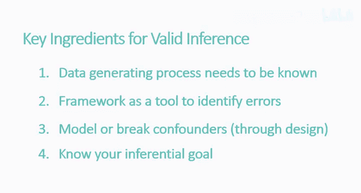

# 密歇根大学《调查数据收集和分析（第1课：框架）｜Survey Data Collection and Analytics》 - P9：8_总结.zh_en - GPT中英字幕课程资源 - BV1pi421U7Zm

So let me stop this first module here。

And repeat the key ingredients for volet inference。

We do want to to make sure that the data generating process is known。

We want to make sure that you will have a framework in mind。That helps you to identify errors。

 And the next two modules will feed to that。Sometimes when you have confounders or things that would disturb you from making valid inference。

 there are statistical techniques that can help you overcome that problem。

But in order to know what problem you try to overcome， you really have to know your in goal。

 meaning you need to know your research question and what kind of inference do you try to do to whom know for whom should this be valid？

And。That's the line along those lines。 we'll be thinking about in the next module。

