# 康奈尔大学《智能系统的机器学习｜CS4780 Machine Learning for Intelligent Systems 2017》中英字幕 p01 -01-Lecture 1 ＂Supervised Learning Setup＂ -Cornell CS4780 Machine Learning for D -BV1Lo6gBxEKE_p1-

Welcome， everybody。let me remind you， no laptop rule。Please no laptops。

 no handguns in the lecture theater。 Thank you。哎。All right。Let us point out， I got it to work。唉。

It turns out actually the new MacBook Pros have a problem a no problem。

 they don't work with old projectors。嗯。But this is VGA。 So this seems to be working。 al right。Rights。

 thats good。All right， good。嗯。One quick thing I told my students that。A lot of people like Python。

 Mattierier， and apparently they were right， like it was it was close， but it was， you know。😊。

But one thing I forgot to mention， Julia has the same syntax as Matlap。 So if you know Matlaap。

 you also know Julia。Does that change things？Okay， who's in favor of Julia now， I， here's a noise。

 Go yeah。😊，All right， comparison， Python。All right， set a tie。Well， at least there's some。

 there's some excitement about Julia。 I spend all， all Christmas with， you know， vacation doing it。😊。

Okay， good。 So what we got left off last time was， what is the machine learn？

 So I don't recognize this guy in the background。 This was actually my。😊。

Motivation to go into machine learning was I want to have my own terminator to beat up my brother。

 So that was， you know， when I was 15 or something。😊，I still know，m still working on it。Okay， good。

 so let me just give you a high level overview of my view of what machine learning is。😡。

So basically you're now traditional computer science， or at least you know something about it。

 and traditional computer science， you have a computer which is this thing in the middle and you have some data which is the input。

😊，And so the data could， for example， be an MP35， or some music file， some video file or something。

 And you want to generate some output。And where the programmer comes in。

 the programmer writes a program that generate that basically takes the data， the input and。

Gens output out of it。So if you， for example， want to play a music file an MP3 file。 Well， you know。

 given that you've taken a programming course before， right， how would you do this， Well。

 you would look up in Wikipedia， What are the specifications of an MP3 file。

 And then you would sit down over a long weekend， and you could probably write something in Python or and see because you takes the file。

 decodes it， generates the wave forms， and so on。 And it's not a big deal after a couple days you will have a program that takes that that data and generates the output。

😊，That's fine。 That's not the kind of problem that I'm confronted with as a machine learning person。

 So the kind of problem that I get is something like this。

 right So someone comes to me from the med school and says， here have this FMRI scan of this person。

 and I would like to know if this person has Alzheimer， yes or no。

 and the problem is there's no Wikipedia page to look up。

 how to generate how to extract that information out of you know an FMRI scan。

 So if you're the programr at this point， not to happen。😊。

But it turns out it's a very specific type of problem。 So what I can do is I can say， well。

 I can't really help you with this particular image yet。But there's something else。

 So if I ask the physician to go back and basically look at the past files and look at FMMI images that he or she has collected maybe five years ago。

 Well， you know， let's say within the last five years that actually has become a parent if the person has Alzheimer or not。

 right So you can take the past images that you took from people a long time ago。

 and you can now annotate them and say， well， it turns out this one did have Alzheimer and this one didn't。

 Okay So what I can do is essentially， I can collect data for which I know what output I want。

 and say this guy， basically， here an FMI is going a person， the answer should be yes。

 He has Alzheimer。 He is a person she does not have Alzheimer， etca。😊，And。

That's exactly when we can do machine learning。 It's a machine learning basically turns things upside down as input。

 you stick in the data and the output that you would like to know。

 like you would like to have for that data。And the machine learning algorithm then crunches this data and outputs a program。

 which if it had given that data's input would generate that output。 does that make sense。

 basically in some sense we are replacing the programmer and this program sometimes literally can be C code often it's not often' some numbers because it's just more efficient。

 but you can' convert this into you know into C or whatever programming language code you have。

 it's usually not very pretty， It's very long and cryptic and so on， but it is。

 you could go through it and it makes sense。And then of course we do the obvious thing。

 right we go back to this doctor that came to me the first place。

 and now I have this program and now I stick in the data point that he actually or she wanted me to analyze and now this program generates some output and that is my prediction and we call this part here training and this part here testing。

😡，All right。Any questions？We will go through this in much， much more detail in the future。

 and by the way， just one morning， this is the last PowerPoint side I will give after this。

 actually everything will be blackboard。😊，🤧And。So this was initially， and people came up with this。

 This seemed like a crazy idea。 right， Can you even do this， know， like the program by， you know。

 the computer busy programs itself， right， It seems not。But it turns out over the years， you know。

 it really really works。 And nowadays， actually， what's fascinating about this is A。

 you can write programs that basically， you would be a lot of work to write。

 And now you can make it automatically。 But on the other hand， that's the most fascinating part。

 you can write programs that you don't even know how to write。

 But you can generate programs that you wouldn't even begin to know how to write that program。😊，嗯。

So machine learning was formally introduced。 It's actually it dates back before this。

 but the first formal definition that I' am aware of comes from Tom Mitchell in 1997。 So he wrote。

 and let me just write this with this out。 a computer program A is set to learn from experience E with respect to some class of tasks。

 P and performance measure， P， if it's performance at tasks and T as measured by P improves with experience E got that。

The short version is algorithms that improve on some task with experience。 right， That's you know。

 without the E and P and you know， that's very， very simple。 why does this improve。

 if you go back here， where is things improving， Well， if I give this more data here。

 I can basically generate a better program， right， And I would do better。 Okay， So that's the idea。

 The more data I give it， the better the program is。 And that's why we call it learning。😊，はい。Okay。

 let me go through a little bit。 Let's just walk down memory lane and give you a little bit before we get dive into how to do this。

 a little bit of a history of how this all started and where it came from。So arguably the very。

 very all has some dispute。 But the first algorithm that learned from experience was Samuel's checker player in 1952。

😊，诶。It wasn't really kind of what we would consider machine learning now。

 but it was basically the first time someone came up with。The idea to， you know， to actually learn。

 you know， basically to stores and moves in the database。 And actually， as you play more。

 you eventually get better。😊，checker since then actually has。Is a solved problem。

 So it was a benchmark for AI for a while。 So by the way， this time。

 there was no mentioning of machine learning。 Machine learning did not exist yet。

 So the field first actually， there was， you know， at this point， you know， at some point。

 people at first called artificial intelligence。 And eventually。

 machine learning emerged out of this。😊。

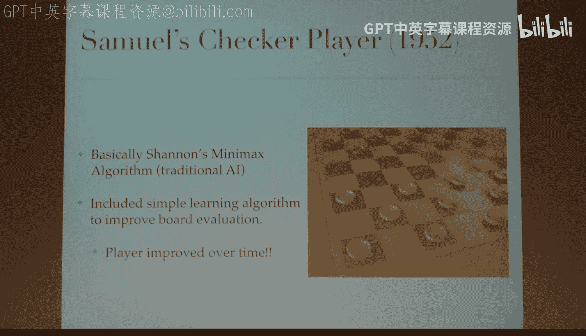

The checkers actually became a benchmark task for AI for a while because that actually there was a world champion of checkers。

 He was amazing。 He was probably the best human to ever play you know therell never be someone who plays check us that well。

 He was undefeated for know over a decade。 it was no one was ever close them。

 the big dream of the AI field was to finally beat this guy and they tried many attempts and turns out you know he always beat the computer and eventually actually。

😊，I forgot which year exactly it was。 They finally had a program that beat him。

And he died very short thereafter。And so I looked into this。And Tnz actually。

's not a coincidence that he died very short there after。 Tnza actually he had terminal cancer。

 And he at the time， basically， he was already in his deathbed。 He was in a hospital。 He was dying。

 Only a few days left， and someone rushed in and was like， beat this computer program and。

When they beat him， like， oh， yeah， you'll take this。I don't know。

 I feel like it's kind of a dark point in the history of AI。Could have you know。

 let him die undefeated。 Like really， anyway， checkers is actually now and solve problems。

 So for any single position， there's the optimal position。 the optimal move is worked out。

 and white will always win。 right， So that's it's no longer a challenge。

 It's not a game in that sense。😊，嗯。What I would call the first machine learning algorithm actually comes from Cornell in 1957 by Frank Rovelt。

 So he invented the perceptron， which was something people will talk in very， you know。

 in detail devote a whole lecture to it。 But this is really an algorithm that is still used today。

 and was really revolutionary at the time。 And ultimately。

 this is what an artificial neural network or what deep learning is today。

 So there's actually very little difference to what he invented back then。

 So he had basically his insight back then is you know， it was basically 90% of the way there。

 So know what he was really missing was computational power。

 So he did not have this large computers that we have nowadays。

 so he was really evolutionary And this is a genius algorithm that we will talk about very soon。😊。

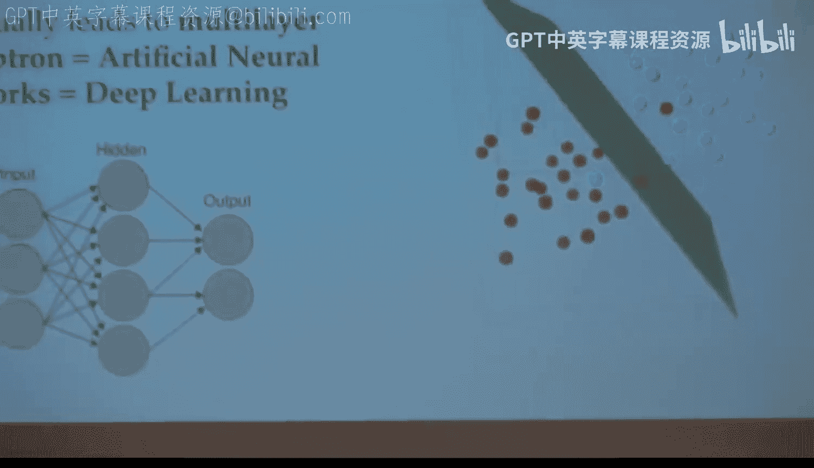

At the time， though， one thing you have to keep in mind， this is。

 I will not talk about this too much， but it's basically he could only train very。

 very small networks because it was very constrained by the speed of computers。 And its 1957。

 Think about this。 Probably in all the computer power the entire world。

 is less than your phone right and。😊，So he had what he mostly analyzed was like a single layer perceptionceptome which is a very。

 very limited algorithm。 But when this came out， there was a huge at this time。

 there was a huge excitement about AI。 because this was something new。

 right could algorithms they could could learn from experience， you know， they could play checkers。

 to some degree， and so on。 So people were really， really excited。 there was a lot of funding for it。

 a lot of funding research。 And you know， generals were already dreaming of， you know。

 armies of robots， etc ce。 know， this was generals to do。

 right dream about this kind of stuff I have nightmares of that kind of stuff。 But So。😊。

But it turned out， actually， it was a little bit too early。

So what happened was something called the AI winter。 This was the AI boom。

 People were really really excited。 This was the first AI boom。 People were really excited about AI。

 And this came out。 And everybody was talking about it。 It was articles in the newspapers and so on。

 and then came a book by Minsky and Pro。😊，And I don't think they had the intention to kill AI。

 but they did。 And they actually analyzed these algorithms。 And they came up with a very。

 very simple data set that everybody could understand the X or data set。 It's very， very simply。

 can draw it on2。 And they could say that the percept as rose and blood shows that the single layer perceptron can never learn that data。

😊，And it seems so simple。 Its basically four points。 It could， you know， two are positive。

 two a pluses， two circles。 It could say you could never actually learn to distinguish between these。

 And it seems such a simple thing that everybody understood， Wait if they can't even learn this。

 right， How can they ever become killer robots， right Like， you know， there's a disconnect here。

 And so what happened is actually funding for AI collapse。 like， you know。

 drastically in the United States in most countries around the world。

 So this is called the AI winter。 And people still referred to this。 Its basically even you know。

 people got really disillusioned with AI。😊，Today then what people did is they said， well。

 wait a second， we don't do AI。 We do machine learning。 It's totally different。

 And you should find that。It's the same people， But， you know， so that was really actually。

 And this is a castastic way。 But it's kind of where I came from， right， So but。😊，It's。

To some degree。The fact that the old some some research area dies。

 there's also a moment for basically new approaches that maybe before and weren't taken seriously because it wasn't kind of it wasn't part of the way people thought it wasn't along the lines of people thought suddenly new approaches were taken seriously。

 And that is essentially how it would place machine learning。 So on one hand， you know。

 if you want to get funding， you have to say you have to do machine learning。 But on the other hand。

 actually， there was also a difference。 And I would say the difference is twofold。 number one。

 AI was very focused on the human。 basically like we want to build something like a human。

 and it was very focused on problems that humans think very， very hard。

 and try to solve them with algorithms。 Machine learning is more the bottom up approach。

 So basically you start with a computer and it's more like basically what I told you earlier。

 you basically try to find a program learn something from data。 There's not really， you know。

 machine learning per se does not really have the ambition to。😊，You know， create humans， essentially。

 again， something like a human。 It can be very different approach。 And that's very freeing， right。

 because you can do things that， you know， well， that's clearly not what's going on in the brain。

 but it works really well on these kind of， you know， on computer hardware that we have。

 And computer hardware is very different from the human brain。😊，Another thing and that's very。

 very important is that machine learning focus on statistics and optimization and not logic。

 So you know computer science traditionally is very entrenched in logic there's a very strong connection between most algorithms right the way you argue about algorithms is through logic and that is that was a natural choice to think about AI。

 And if you look at old movies like Star Wars， etc ce right the way AI know is presented is as completely logical beings。

 everything they say is like 33P is always logical right because that's how people thought AI are actually because if you read these old papers。

 some people thought that at the time that humans are completely logical someone in the brain。

 everything is very obviously didn't have many friends。😊，But。

It seemed like ultimately the wrong approach， right And people tried， know， at some point。

 like people inventing fuzzy logic because they realize you have to have uncertainty。

 right Sometimes we just we have beliefs about something。 Its not， you know。

 you don't have a clear truth。 Like， you know people basically made these statements like is the light on yes or no。

 And if the light is on， then I don't do anything。 if the light is off， then I switch the light on。

 But sometimes you're not sure about something。 And the right approach to do that is really statistics。

 I mean， Statisticians have dealt with uncertainty for， you know， for generations。

 So before I wasn't really taken into account。 It was， know， I'm not saying AI is not old statistics。

 It not statistics at all。 But machine learning was definitely a much more statistical and optimizationbased approach。

😊。

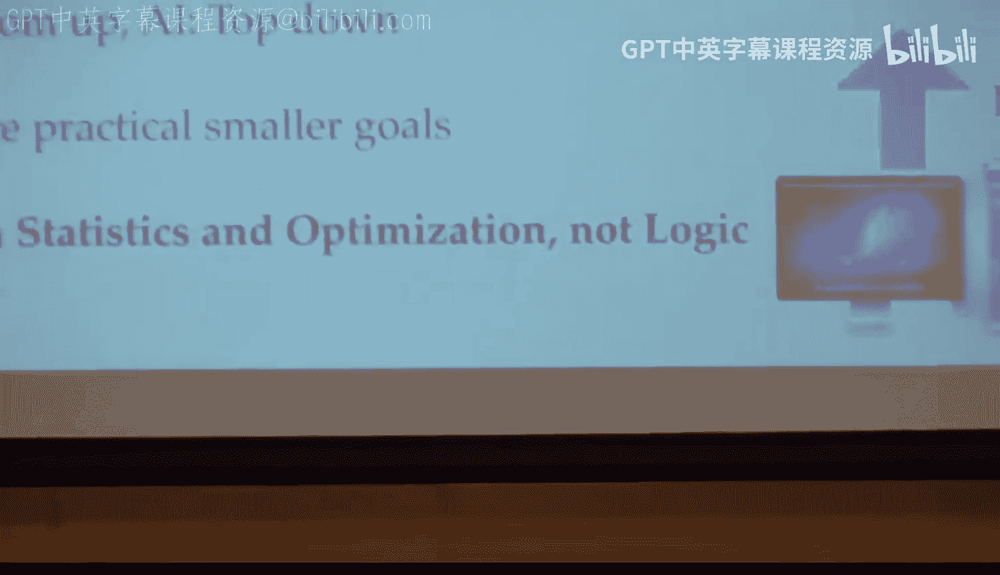

Okay， so there's a very interesting point in 1994， where I would say this was a pinnacle point because it was the first time that people really kind of realized how powerful that idea is。

 right and that it really works。 So you have these moments in time。

 researchers are working on things。 And then they own bubble。 But occasionally。

 basically people around the world noticed what's going on。 And that。😊。

One of those moments was in 1994， but Jerry Tarro from IBN wrote a backgamon player。

 So I don't know people have heard of a backgamon。 it's actually a very。

 very popular game around the world。 almost every country except the United States。 people on play。

 But it's actually has a huge following in huge parts of the world。 It's very， very competitive。

 it's world championships， etc。😊，And。What Jerry did is he wrote a program that basically would just check if a move is legal。

 and that's easy。And then he， you know， the time the time the way people thought gameplay works is use the minimax algorithm。

 So those people have taken AI。 They know how this works。 Ba。 What you do is， you know， know。

 if you play checkers， you would do this Ba say， well。

 you go through every possible move that you could make。 And he say， I would make that move。

 What would my opponent do， if I was the opponent would make that move。 But what would I do。

 I would try this move， etc。 And you always flip the boy。😊，at the end， you say， well。

 who looks better now？ And if now my opponent looks better， then that's a bad starting position and。

If I look better than that， made a good move。So we something else。

He instead took an artificial neural network， which is basically。

 you know what what Rosenbl invented in 1957。 And he made let the neural network made the decision which move to choose。

 So he said， you know， here's a list of impossible legal moves。

 The neural network chooses which one to play。😊，And so when he did this。😊，The algorithm。

Maade totally random moves， right。Yeah didn't work， right， doesn't do anything。

 But they did something really， really cool。He took the network。And he led the program。

Play against the job。And so you had two copies of the same program。😡。

And the latter play against itself。 at the end， one of them wins， right， They pretty random。

 make pretty random moves。 But one of them wins。 And you tell that one， what you did was good。😊。

And the other one you lost what you did was bad。So basically。

 it tries to so reinforce the network to do whenever you get positive feedback。

 you try to do that more。 when you get negative feedback， you try to do that less。

And so he had that feedback loop。 Maybe he just let us run。

 and then he went home and he let this thing run and play against itself。And that's a run of an eye。

 whatever。Next morning， he comes back。He takes the program。He tries to play against it。And he loses。

The program beats them。😡，Had overnight， just playing against itself。

But no other input has learned to play better than he did。 So he goes around， you know， this office。

 right and challenges other people， like play my program， right。

 and it beats every single one of these people。😊，So then he gets really excited。 right。

 So what he does is he calls the world， you know， the organization for the World championship in Bagamen。

😊，And he says， like， you know， I have this program and it can play really， really well， know。

 back really， really well。 And I would like to challenge the world champion。😊，And so。They were， okay。

 they were curious。 and the world champion was interested。 And so they actually made an appointment。

😊，And。They played against each other。 And in the meantime， by the way， you know。

 he kept let that program play against itself a couple of hundred thousand times a million times。

And the two had a face off， and the program won。And that was something that to people completely by the price。

 and people go up to them afterwards and I was like， well， that's amazing， right。

 how does the program do it And he's like， I don't know。😡，Because it learned it itself。 In fact。

 Jerry， you know， was not such a good backga and player， actually。

He actually me I talked with him about it。 he actually said， well afterwards， But， you know。

 because then he， you know， he had to talk so much about backgamon and so on。

 he actually started to get really into it。 But at the time， he really wasn't a good player at all。

 The program was much， much better than he was。 And without him actually putting any backgamon knowledge into it。

 And in fact， the amazing thing is that。😊，Doing that face off with a world champion the the。

His program made a very interesting move， a very interesting opening that the World Cha thought was crazy。

It was not of a good move at all。 And so， but it turned out it was actually a very good move。

 So the world champion actually asked for a copy of that program and started analyzing it。

 and then actually realized that's actually an opening that was undervalued。

 And actually turns out there was a new opening that basically this program discovered。

 And it's now actually in the backgamen folks。😊，So after this happened。

 his boss at IBM were really excited about like， this was awesome。 But why did you choose Beckgamon。

😊，No one cares about Beckend， so they let's do chess。And。So they again， put， you know， this time。

 they put a big team together and a lot of resources。 and they challenged Gary Casperrov you know。😊。

You know， world champion at the time。 and probably one of the best players， the history of humankind。

 And there are two matches against them in the second match。 actually。

 the first time Gary Husperov won， and they challenged him again And the second time， deep blue1。😊。

Oh Fness， actually， this was less a learning approach。 This was more of a minimax。

 traditional AI approach because they played it really safe。

 but evaluating if a position is good was learned。😊，Now， machine learning is everywhere。

 and you may not even know。 This here is a search engine。 This is Yahoo。

 I don't know if you've ever seen it。So诶。Search engines， for example。

 mean think about search engine is a completely ridiculous problem。

 right We have billions of web pages and you type in three words and you expect based on these three words that the search engine knows which one of these billions of web pages you want clearly that cannot work。

 right。😡，How， but does， How does it work。 The reason is that humans actually have very predictable expectations。

 of what you want to see， etc ce。 And know a lot of web pages are not very interesting， etc ceter。

 And so the way this actually is done is really is actually learn。

 So with Google and Yahoo and Bing and so on。 what they do is they employ hundreds and hundreds of people。

 that actually go through search engines basically whenever you search something on Google。

 there's a small chance it gets to one of these people。

 And what they do is they actually label web pages and say this was a good answer。

 This was not a good answer。 This was a good answer。 This was not a good answer。😊，And then they。

 you know， basically put all this into a big learning algorithm。

 The learning algorithm then learnss you know， what's a good answer and what's a bad answer。哎。

Of course， Spmfords is a great example for something that's really。

 really hard to write a Spmford It's almost impossible right you know， for two reasons， A。

 what is a spam email， Well a spam email is an email that you don't want Well。

 what does that mean Well， clearly， some people want these emails， otherwise。

 would respond to these emails So for example， emails about stock stock options or something for me it's always spam。

 because I'm not really interested in this， But you know， I know someone's actually you know。

 in finance， Well， for them actually it's not and can can also train your spamford know。

 whenever you get emails from your motherinl you can just spam， you know， train it to say that spam。

 So whatever you think is a spam right， it's a very， very subjective definition。😊，That's one problem。

 The second problem is that the moment you would write a spam footage it that's hard riot that we say like whatever you。

 you know， for example， the word Viaggra， right know， this is some。

 I don't know what that is is some spam But like for a while， there was a lot of Viagra spam。😊。

And so。You know， it's very simple Google people。 whenever you have the word Viaggra in the email that's probably spam。

 right， it's very rare that people actually， you know， emailmail people， you know。

 I love Vigras something， you know you know what we do that。😊，But maybe some people do。

But that doesn't work right， because the moment you do this then you know。

 the spammers would just miss better。 So they basically spell one instance of an eye or know something slightly different。

 And then you still get the message across because it's adversarial behavior。

 right So people but actually immediately then change the way they are spaming。

 And now you have to rewrite your whole program。 The nice thing about learning is you just take the new data and you just retrain bang。

5 minutes later， you have a new spam filter that actually is now adapted to the to the new new way spam looks。

 or you can actually do online training that basically that's the way video works is every time you get a spam email。

 you train a little bit。 And so it always keeps up to date。😊，Another example here is news， right， so。

Google News actually learns what you're interested in。 apparentlypparently。

 I'm interested in Lindsay Lohan。😊，Well， I guess that's not true。 But so it will learn your parents。

 right， and basically suggest new stories to you。 And so one thing， you know。

 that I guess a lot of people talk about is also a lot of research here at Cornell is， for example。

 selfdriving cars， right， And so that's also something that really， I think you know。

 a big part of why that is possible now is actually through machine learning。

 right So a lot of the sensors have been around before there are some， also some new developments。😊。

But the fact that you can basically you know， learn from from how to drive a car safely really kind of was a game changer in this respect。

And thens something， by the way， where I was surprised。 So I remember a couple of years ago。

 someone asked me， maybe 10 years ago， someone asked me how far are we away from self drivingriving cars。

 And I was like， it's going to take 50 years。And， you know， next year， basically。

 people started driving around these things。😊，So， and then the reason is actually because suddenly a lot of things come together。

 So suddenly you get these leaps because suddenly a lot of little problems get solved。

 and then you put them together。 And suddenly you can do something big。😊，When will it stop？

So there is， of course， we have this， this， this carrot that's kind of dangling in front of us。

 That's the human brain， right， So the human brain really is a big computer。

 It's just a very different hardware。 But we know humans are really， really good at learning。

 And the principles are very similar。 The actual implementations of the algorithms are very different。

But the good thing is we know there's basically， we are not even close to that， right。

 So we can do much。 some people claim this nowadays that deep learning is now better than than human brains。

 I completely disagree thats they are very good， you know， very specific things。

 you can train deep nets to be。😊，Now， if you have a very specific task。

 you can train the algorithm to be better at that。 But humans can do so so many things。

So that's certainly， in some sense， good news。😊，That keeps me employed。And。The， the， that。

 in some sense， means there's， you know， there's still a lot， you know。

 we still have a lot to to do a lot of opportunities。 The other thing is， machine learning now is。

 you know， the breakneck speed is。😊，Being applied in all those areas。

 So people now biology and chemistry， et cetera。 like 10 years ago。

 when I got my PhD and I talked to people outside of of my， of computer science。

 and I told them I did machine learning。 Nobody knew what that was right thought thought of doing building machines something。

 like， you know。This was something that was completely unknown。And now people in biology， chemistry。

 you1 anybody you do machine learning and they all like， oh， okay， yeah， you know， we should talk。😊。

So。It's basically， you know， suddenly， you know， people in fields that have nothing in common， right。

 use the same algorithms to analyze the data and make predictions。 And that's extremely powerful。

 It's still very hard to design machine learning algorithms。

 And there's not many people who can actually design new algorithms that are meaningful and useful。

 It's a small community。😊，But there's many， many people who can use them。嗯。Oh， wait， oh yeah。

 I have a little more。 Okay， good。 So let me just talk about what are the different types of machine learning there are。

 And there's on you know， very roughly， there's three types of machine learning。

 There's supervised learning。 There's unsupervised learning and reinforcement learning。😊。

So this class is really only about the first one。 So in this class。

 we will talk about supervised learning。 Supervised learning is exactly what I just told you earlier with the。

😊，FMI images。 So I give you data， and I know the answer to that data。

 And I would like to have a function that goes from that data to that answer， to that output。

For example， spam filters and search engines， etc cetera。

 unsupervised learning is when I give you data， but I have no label。 I just say， like。

 here's some MRI images。 Do you think there's something interesting going on here。

Maybe you can find some patterns that repeat or something like this。

There the class machine learning for data science is mostly covering this that's。Basically。

 be alternating these two classes。 There's also reinforcement learning。

 and reinforcement learning is when you do something for a while。 at the end。

 you get feedback and say， you know， that's good or that's bad。😊。

And that's what what J Tar used for is B Gamin。 So that's mostly covered in the AI course and in the robotics course。

Also there there's a significant overlap in the methods that we're using。

 It's just the way the feedback is incorporated is different。嗯。Apparently。

 machine learning is the number one skill that employers wish for these days。 Unfortunately。

 I don't remember where I got this far。 So， so someone claims that on the Internet。 Sos。😊。

But there was a list of of 12 A skills that employers can't say no。

A few clothes that are now a little bit old， but Bill Gates once said a breakthrough machine learning would be worth 10 Microsoft。

 now I'm waiting for that one。Machine learning is the next Internet。 Machine is the next hot thing。

 and so on。 V rankings today are mostly a matter of machine learning。 That's really true。

 Machine learning is going to result in a real revolution。 Machine learning is today discontinuity。😊。

Alright， good。 That's the last slide。 And from now， we will switch to Blackboard。

 Any questions about the stuff that I just said。😊。

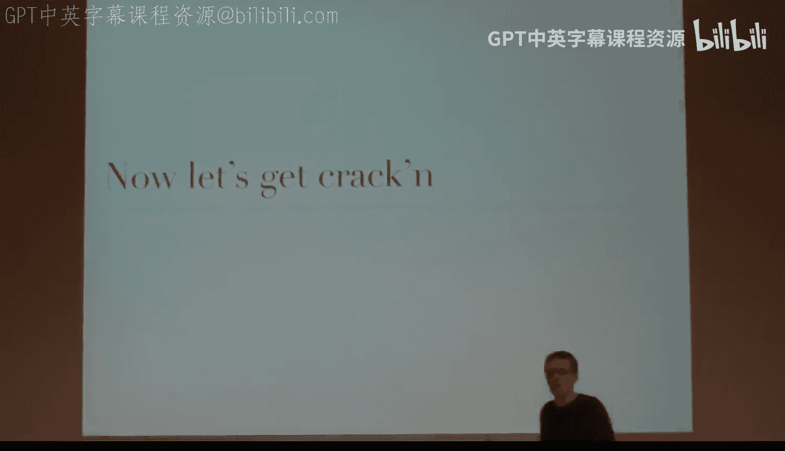

嗯。No， good。Allright， so while I do this， I can hand out notes。 So the way people do this is。😊。

I really don't like it when people take， you know， I write something on the blackboard and then。😡。

You know， the entire class writes down what I'm saying。 and no one pays attention。

 So what I'm doing is I give you exactly my notes。 So I there' no。

 I have no information advantage in some sense。So we can just pass these back。

And if free to annotate， there's a downside cell to get my notes and my handwriting。

 And I apologize right now， the minute you know what I'm talking about。

好笑。さ。Sa good ae。Okay， so we only have 15 minutes a day， but let me get started on。😊。

Let me at least get started， I guess。哎。So。And this is the headline of the entire class， actually。

So the entire class will be able a super by。

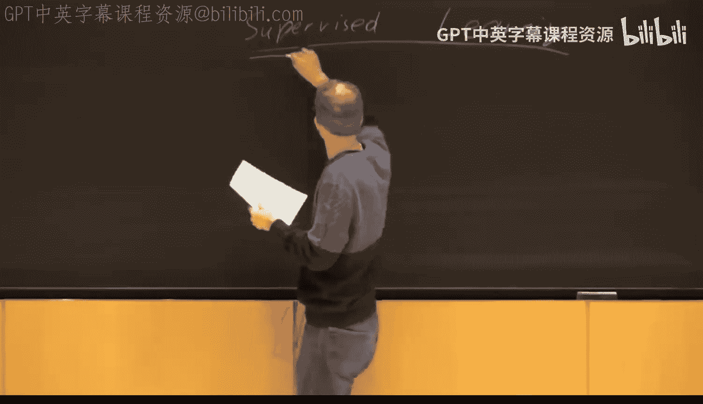

And what I want to do at least today is to formalize the setup。

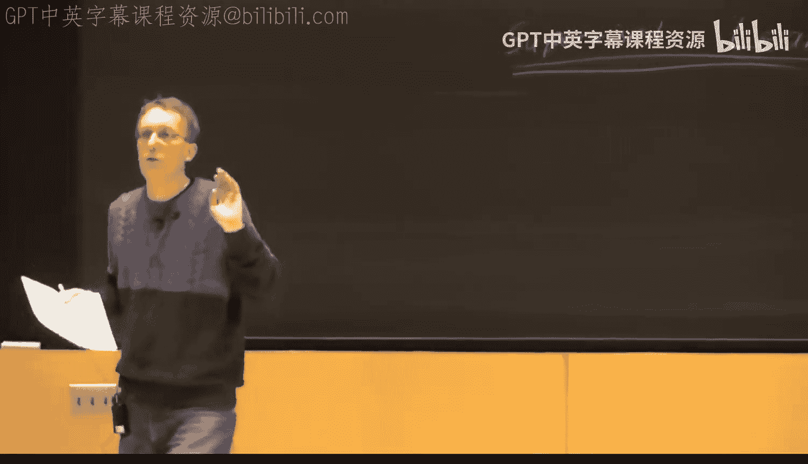

So what's the high level goal and what have we given， what are we trying to do。

 And let me just write this down in mathematical notation and。

And give you some basic terminology that we will use throughout the course。 So make sure you。

You familiarize with this yourself with this， because this is exactly the stuff you will be using the entire class。

😊，So on a high level。Supervised learning attempts to do is make predictions from data。So。

The setup is you're given a data set。😡。

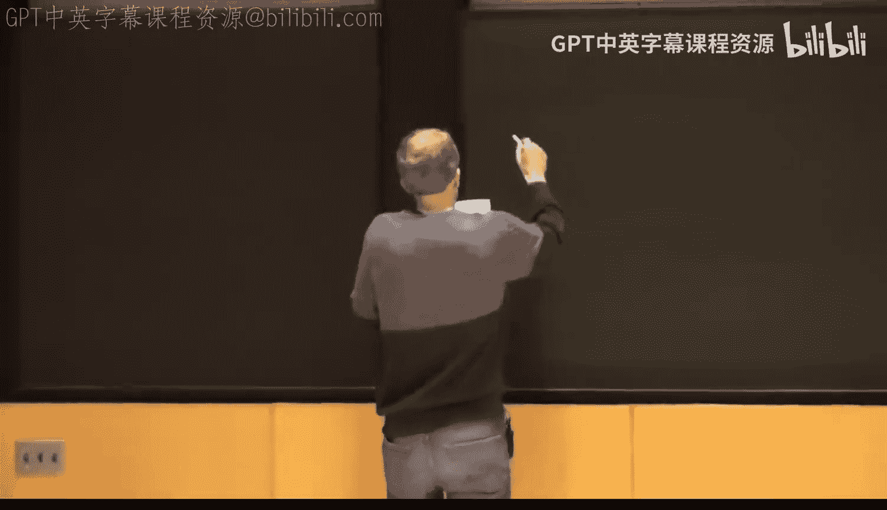

And we call us D。

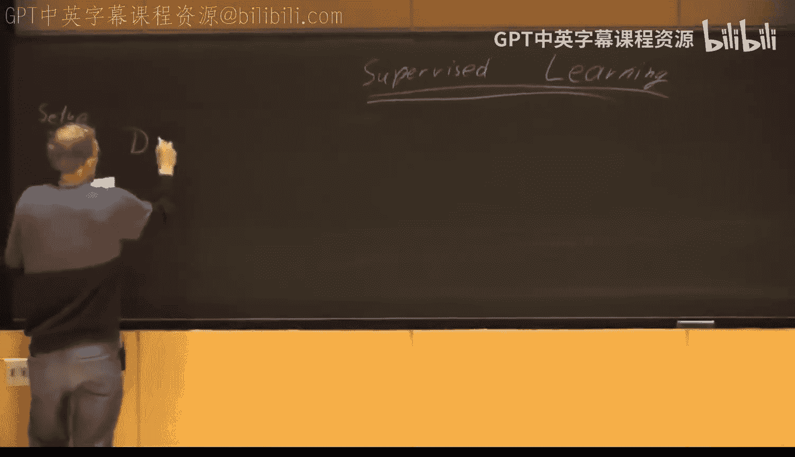

Of data points。And their labels。So we're given。N pairs of points where my x is my data。

 and y is the output that I would like to generate。 We call that the label。

 We call that the feature vector。😊，So in terms of spam filtering， that would be the email。

 and this here would be it's at of spam or it's not spam。😡，All right， so。you know。

 in terms of stock market， right， this here has basically on features about a stock。

 and this is what mean up or down。 trying to predict does the stock go up。 Let's talk it down。嗯。

So these data points are sampled from some distribution。😡，And。So you have X， I， Y， I。

A samples un distribution P。😡，平的。It's a distribution that we have no access to。

 It's a distribution that only God herself knows， right， It's basically where the data comes from。

If you had access to the distribution， then everything would be easy， but we don't。

 There's some probability distribution that if I would pick someone here randomly and take an MRI scan of that you know。

 their brain， I basically get， you know， get an MRI scan。 if I would do this repeatedly。

 there's basically some distribution of MRI scans that I get with that process。 Okay。

 It's some strange distribution。 It's some from mother Nature。Okay， and we observe data from this。

 you know， in terms of emails， this is the distribution。You know。From which emails are sampled。

 So everybody may have a slightly different one。 right， So some people sign up to some newsletters。

 etc ceaa， that changes the distribution of the emails that arrive in your inbox。

And so what we would like to do is take data from this particular distribution and learn a function that basically goes from x to y。

😊，Okay。Any questions。 so this kind of data is either you know there multiple cases。

 the most common cases， either it's a time series。For now， let's assume it's not a time series。

 For now， let's assume these are IID。 So these are drawn IID。😊，Anyone know what IID stands for。

I think all of you together got it right。Who knows it raise your hand？Yeah。That's right。

 That's right。So they're all from this distribution P。

 And basically knowing one of these won't tell you anything about the other ones。

 if you know the distribution。Okay， good。So。What are these xes and what are these rights。

 So let me just quantify this。 So these xes come from。A space that are called cur X。

 and the Ys come from a space called curly Y。😊，And so in this class。😊，The x typically。

A D dimensional space of real numbers。 So basically， what we are doing is we say， we take our data。

And we summarize our data in SD numbers。 So it's a vector that has D numbers。😡。

And that summarizes everything we know about this particular data instance。😡，Okay， so in email。

 you could， for example， imagine these are the words of the email or something， right。

 and I' will show you a minute how to do this。So for now， we assume you can always do this。

 it turns out very， very often you can do this。 In fact， if you think about it。

 if you store your data on a computer， what your computer， what does it do， right。

 It has a long file of numbers， Well， that's a vector， right。😡，Of lengthy。 So， you know。

 it's always possible somehow。All right，So we just call RD is real numbers。

 and it's D dimensional feature space。 thiss what we refer to。

 and the XI is basically a vector that represents the if data sample。😊。

So the I email or the IE MRI scan。Why I。But the， can you read this in the deck？Okay， not so good。

 You know what I， what I， the bigger chalk。Okay， let I would try to。 Okay， I would try。

Remind me tomorrow morning， to bring bigger chalk。I'll remind you。 All right， okay， awesome。So。Hello。

So Y I is out of the label space， clearly y？😡，And that's basically the answer that you would like to know。

 says either， know， for example， there's a spam， there's not spam， et cetera。Okay。

 let me give you some examples for what why it can be。

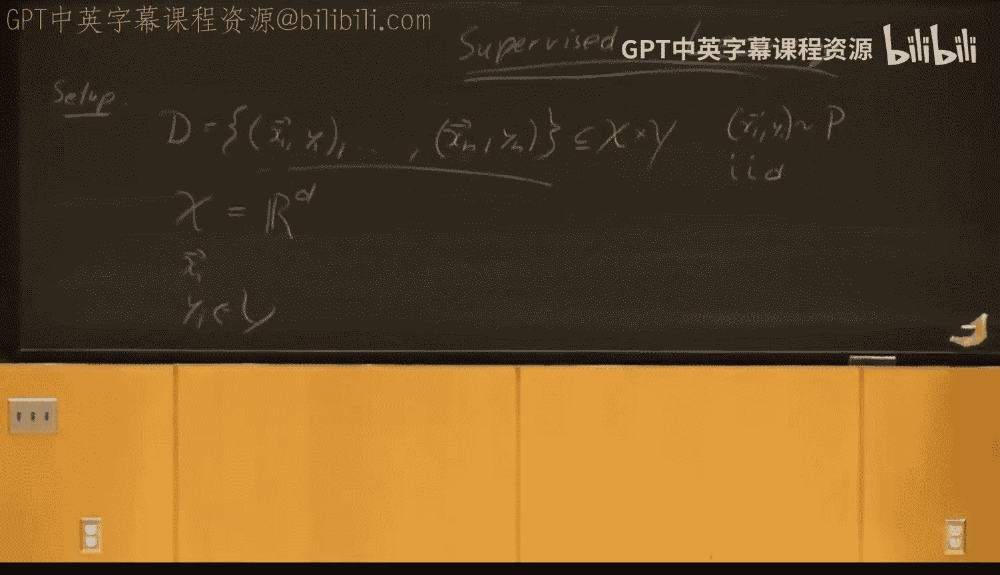

That me how to do this。Oh， that's。That was the coast one， all right。

Okay， let me give you some example， so for example one is vitamin classification。😡，So， examples of。

Bye。😡，So binary classificationification。😡，Its。Kelly Y is either0 or1。😡，Or you can also write it as。😡。

-1 or plus  one。And so the example here would， for example， be email spam filtering。

 where you basically say-1 is spam and plus1 is not spam。 So you have exactly two options。

 And for every email， it's one or the other。嗯。Another option is。Well， you know， for example。

 face detection， you take an image。 Is that a face yes or no。 All， So your camera does this。

 detects faces。 Theres a little window that goes over the face over the image and tries to find a face。

s one of the most common settings in machine learning。😊，Another one is multi class。😡，Casification。

So here，漂 by。You have multiple classes。So。I call this K different classes。 So it can be 1，2，3，4，5。

 right So let's say， for example， one option would be that I take articles on the web。

 and I would classify them as either sports， know， or politics or about gadgets or something reviews or something like that。

 So basically have different categories and you want to know， for example， Google New， they ask you。

 are you interested in entertainment， Are you interested in politics Are you interested in tech news or something right And so what they do is they go through the newspapers of the world and they classify each article that just came out is one of K classes one made。

 for example， be sports and know K is politics。😊，Any questions about this？

Raise the hand if you're with me。Hい， awesome good stuffフ。Another one is regression。And regression。

Why is's just the real numbers？😡，That's one way of doing regression。

So here you don't differentiate between different categories。But you sort of hit a specific number。😡。

So， for example， I don't know if people know Zillow。 Zillow is a web page。 We can actually。

Go to any location in the United States。To go to any house and it will tell you how much that house is worth。

And so that's interesting if you want to buy a house。

 you can look around and kind check the neighborhoods how much different houses cost。 right。

 But it's a relatively hard task。 So what they try to do is they basically say， you know well。

 you know how many bathrooms does the house have， what's the square footage What's the proximity to the schools。

 What's the ranking of the schools， etc， all these kind of different features。

 So these are the feature items that I have my vectors， different dimensions。

 And I try to predict how much the house sold for。 And whenever a new house gets sold。

 I basically put add that to my data， and I retrain my。😊，Right， so。

 but the answer could be anything between 0 and I don't know。 couple millions theoretically， I guess。

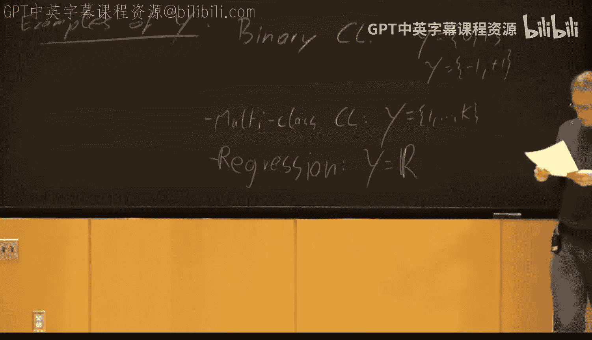

嗯。Another one is like， for example， if you would like to predict the height of a person right or the age of a person。

All right， good， Any questions about classification versus binary regression versus classification et cea。

😊，Allright， good。嗯。

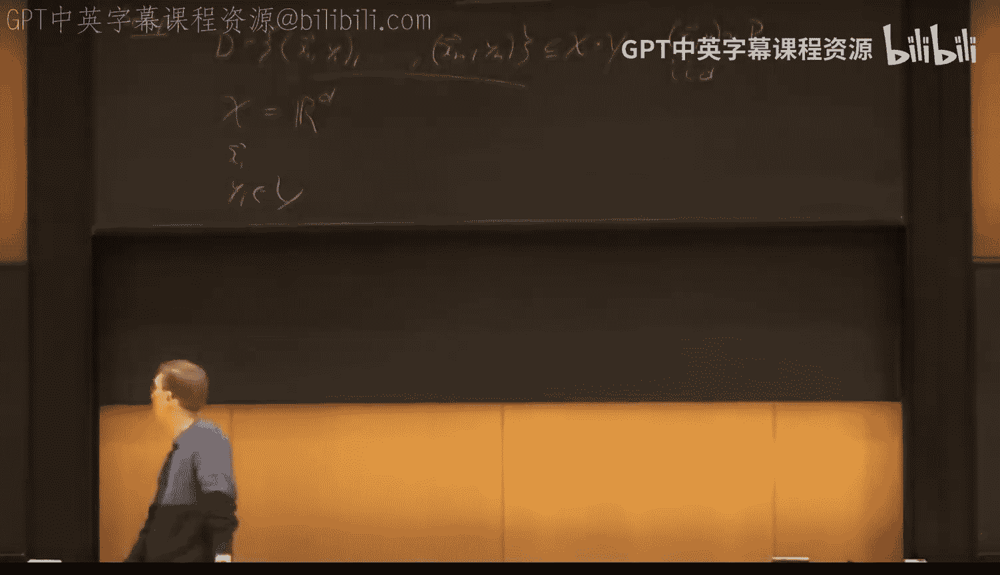

Yeah。

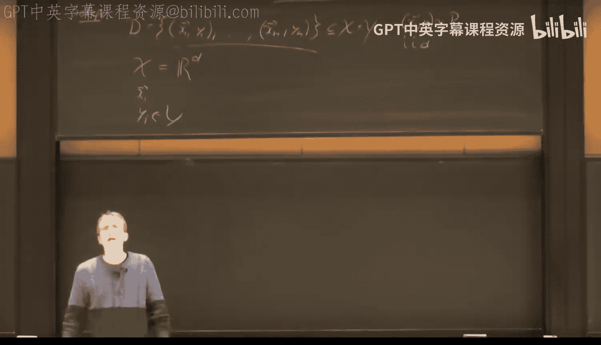

I， I cannot， I don't have more。

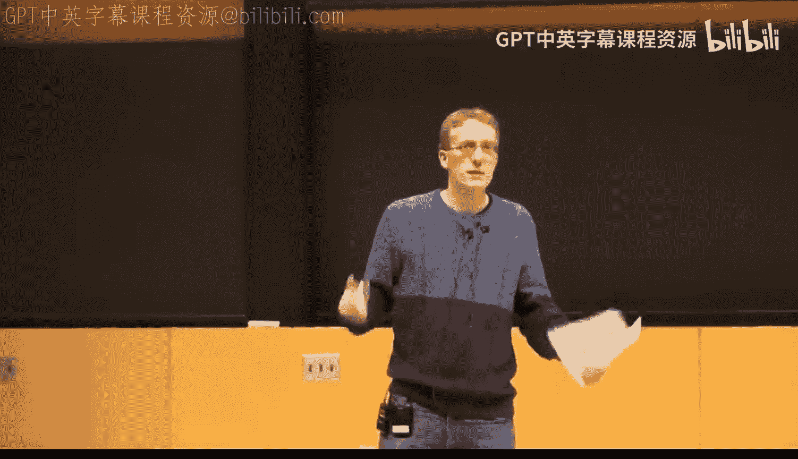

And if anyone have two， three。You're not allowed to sell them。I will post them on Piazza。

 How about this， and you can just print out your own。Who does not have one？ raise your hand。 Oh。

 that's terrible。 They're all the， I see， they're all in the same location。

 Can't even look at the neighbor。

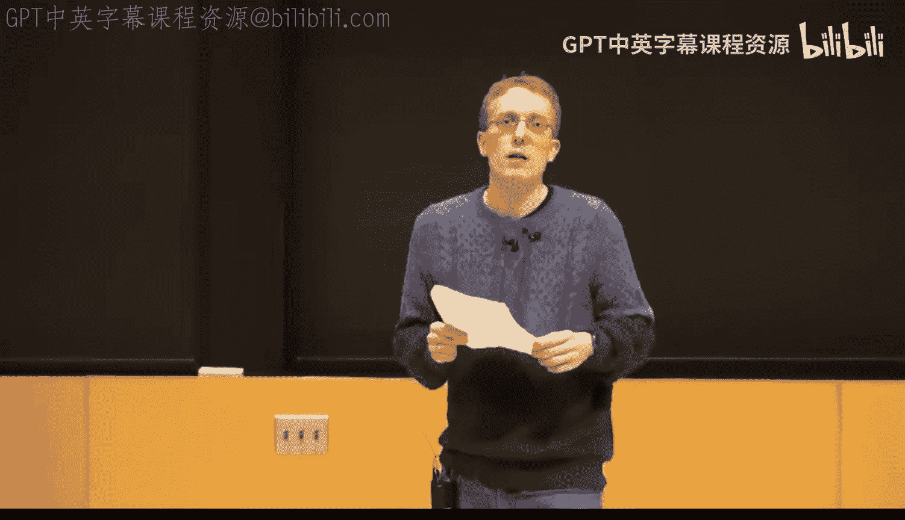

Okay， if someone's really nice， you could just pass。Pass it back。 And then。Look at your neighbors。

 But it's only three minutes anyway， left。Okay， so that is why， right， so basically we have。😊。

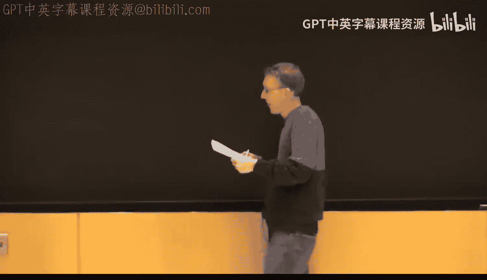

You have our X， and you have our Y。So why is what we're trying to predict。

 And it just says kind of either be， you know。A set of numbers that you're trying to shoot for -101 01 can be。

 you know， k numbers thats you know multiclass classification or can be real numbers。

 you know if you want to do regression。😊，Now， what about x， Let me give you some examples of x and。

Well， let me give you。First one is， for example， you know， patient data。So one thing that's really。

 really big nowadays， actually， well it won't be anymore， I think。

 one part of the Affordable Care Act， I guess was there was a lot of incentives for hospitals。To not。

嗯。To not discharge patients that then come back very， very quickly。

So that's generally not considered in the interest of the patient。

 right So if you basically get discharged from the hospital。 But then a week later。

 you have to go back in。 Well probably you shouldn't have left the hospital that's usually could generates more costs for the insurance。

 And so basically there were penalties for hospitals if the patients go back to the hospital within six weeks。

 there was some some time period。 So a lot of effort was made saying predicting if a patient will come back in the next six weeks So is the patient healthy enough that he or she can be six weeks outside on his or her own and do fine。

 because then after six weeks， you're probably good And so what you could do is you could basically say well。

 my X is basically the specifications of this patient So one thing you may want to stick in is here binary features 01 or your male or female So it could make a difference Who knows And the other one is the age right So you know here is like the person 76 years old。

 is the age in years right。

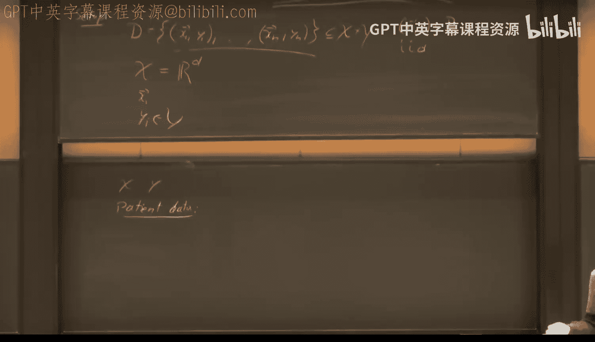

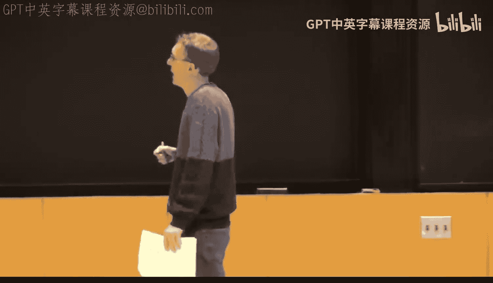

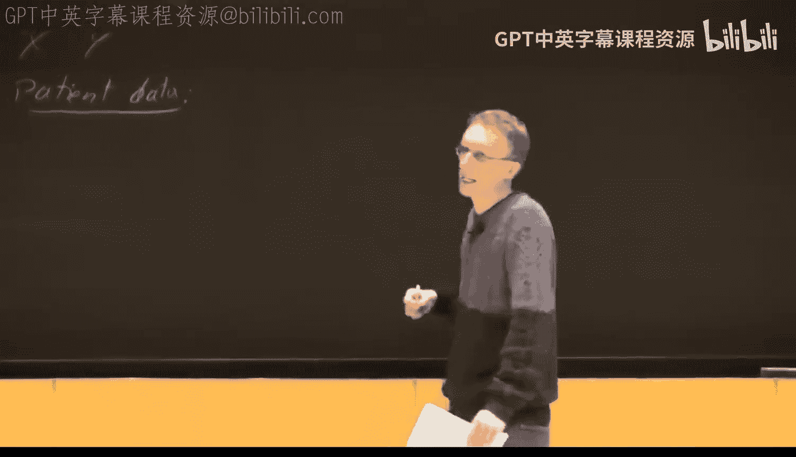

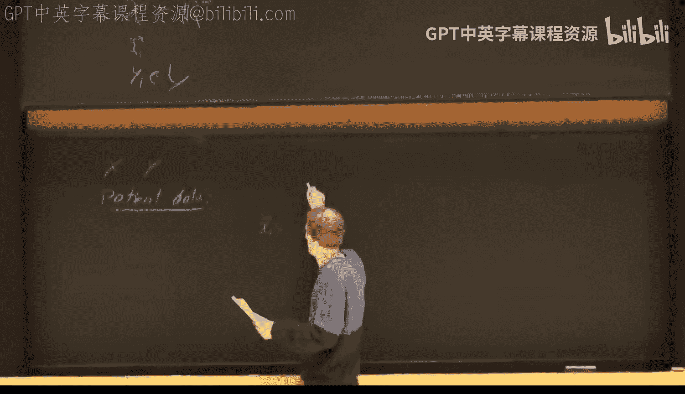

So that's another way of describing is the height， right，183 cm， of course。You know。

 you don't know what that means。 But， you know， you're 6 feet or something。

 I don't know how many hands。 I don't know。 you know， height in。centimeters0 me， yeah， you know。

And you now basically let's say you have some blood pressure and heart rate or whatever。

 And now you try to predict， basically does the person， will the person come back yes or no。

 and you just take historic data from people that did come back or did not come back and you train your algorithm that way。

So another very common one is text documents。So here you have an email， for example。

 and so that doesn't look like a vector that looks like string numbers， as are as a string of words。

😊，So what people do is they have something called a bag of words。Bag of words about representation。

But you basically say， well。Word order is overrated， right， just， you know。

 who cares about which order you put in the words down。 Let's just only look at the word occurrences。

 which words are in the text。It turns out that works surprisingly well。

 So and then you can actually take the following。 You can take a vector that basically is de dimensionsal。

Where D is the number of words in the English language， for example。

 So I don't know how many words they are in the English language， maybe a million， right。

And so then you start with the first word alphabetical what it doesn't matter。

 right So andt right and down here you have zebra， right。

And so then for every single word in your email， for example， you just。Say how many words that occur。

 So， for example， the word the you may have five times， right， and the word moves right， seven times。

 right， I don't know。 something like this。 right， And and no， right， And zebra。

 you didn't talk about， etctera。 right So basically just， you discount the words in your email。

 And that is a vector of just word counts。 And that is a vectorial representation of your email turns out that works surprisingly well。

 So that's an easy， you know，😊，Usually you can identify as even as spam or not spam or news article。

 you know if that's politics or sports， you can detect that very well just in this representation。

 which makes sense， right， So if you talk about baseball， a pitch or something， it's probably sports。

 you know， if you talk about Washington， D C or president or something， it's probably politics。

why don't we leave it right here and I see you again on Monday？😊。

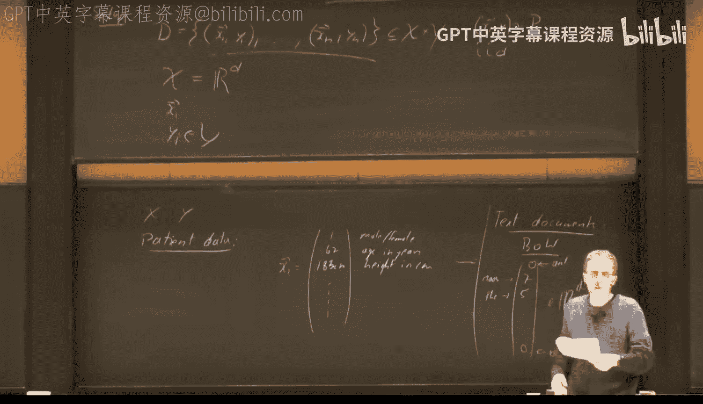