# 康奈尔大学《智能系统的机器学习｜CS4780 Machine Learning for Intelligent Systems 2017》中英字幕 p06 -06-Lecture 6 ＂Perceptron Convergence Proof＂ -Cornell CS4780 SP17.zh_en -BV1Lo6gBxEKE_p6-

come everybody。

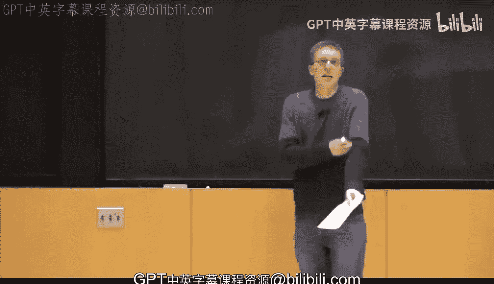

哎。Quick reminder。 Project 2 is now out。 I know you couldn't wait。And Project one is do this Friday。

Please， if you haven't gotten started by now， I hope you have gotten started by now。

Restar immediately。嗯。You have two late days for every project and for the homeworks。Please。

 everybody close their laptops。 Thank you。唉。Even those who pretend they can't hear me。

I could try different languages with their laptops， to Mahe and Swashna Dancan。All right。 Thank you。

All right， so last time we talked about the perceptron。Last time we talked about the perceptron。

 Does anyone remember what was the assumption that the perceptron made。On the data， yeah。

 not always you， you know， everything， anyone else。That's right。 The data is linears。

 But dot mean that in a positive way。 Don hope you're not offend。😊。

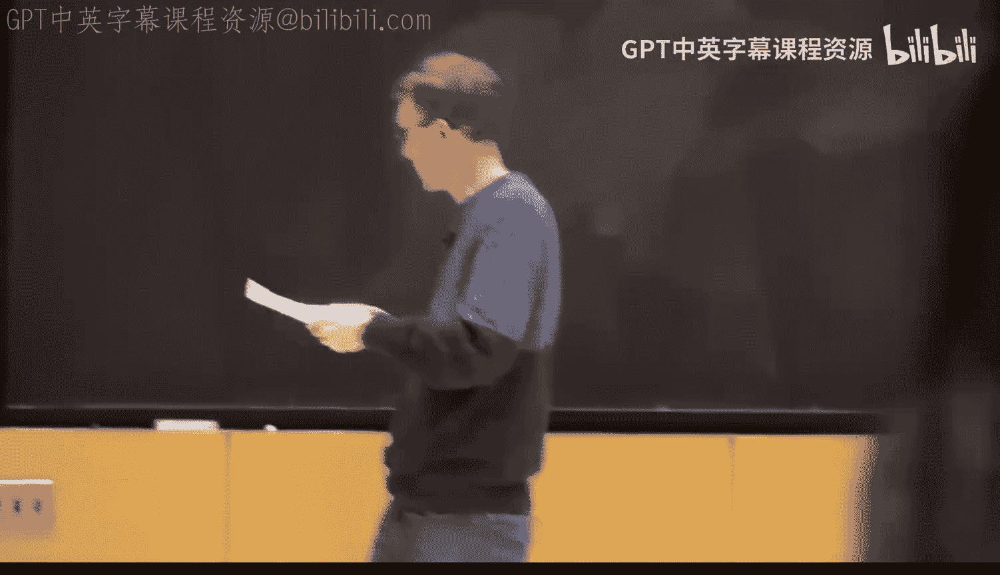

Right， so we have our data。Crosses it。In zeros， we assume that we have two kinds of labels。

-1 and plus 1。哎。So let's call this  one plus 1。 This one， you know， these zeros are -1。

 And we assume that they exist a hyperplane that separates these two， right。

 the hyperplane is just a line and two dimensions some。😊，P and high dimensions。 Yes， question。

gression based on how close you were to the hyperplan。Or this if you， I see。

 if you don't want to classification， you want to do regression question。

 that's exactly how you do regression question。 But there's。

 there's a little bit more to it because you can't just use any have plane。 There's no。

 because there's no separating have plane anymore。 if you actually have no classes。Right。But。

 but yes， there's something along these lines。We will get to this， very soon。All right。

 And the percept on algorithm is very， very simple。 This， this hyperplane is。😊。

It's defined by this vector W。😡，And technically， it's actually， you know， the hyperplane is。

The set of points。X， such that W transpose x plus B equals 0。We can collapse that into just W X。'。

 you know， if we just add one more dimension。 So we talked about this last time。 And， so you know。

 without loss of generality， well just assume that we， we have no B。

And then the algorithm is really really simple。 right， So you basically。

 you go through your data points one by one。And you check。

 do I look at lie on the right side of the hyperplane。 And what do I want if my label is plus one。

 then I want。

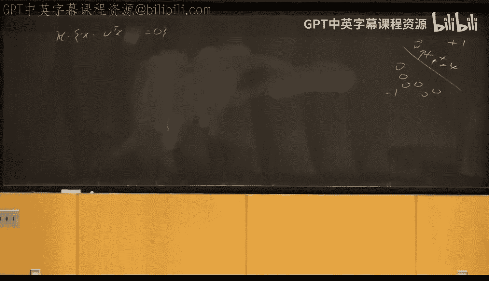

I want W transpose x should be greater than 0。 And if at -1， I want W transpose x be less than 0。😊。

Y equals y equals。 So this means I always want y times w transpose x to be greater than 0。 right。

 So that's， that's the same thing。😊，And that's exactly the condition we are checking。

 So you go through one data point。 you know， at a time， the order is actually not important。

 You check if this condition is satisfied。 And if it satisfied， then you move on to the next point。

 That means you know， we lie on the right side。 So we don't have to do anything。

 the moment this is not satisfied。 So we have a less equals 0 here， then we do an update。

 And we basically do the following update， if y equals plus1， then we say w becomes w plus x。

 if y equals -1， then we say w becomes w minus x。 and that again translates into w becomes w plus y times x in both cases。

😊，All right。Any questions？や。呃，OK。Damn， did anyone hear anything I just said。It says that battery。

 alright。嗯。Yeah。Okay。Yeah。Okay。Allright，1，2 tests better。Thumbs up， thumbs thumb， thumbs up， better。

Yeah， okay， good， awesome。 Thank you。 Thanks let me know。😊，Luckily， I had batteries with me。

 It's amazing。嗯。Okay， good。 So what we want to do now is we want to prove that this is actually a reasonable algorithm。

 That means if there exists such a hyperplane or if there's a single W star that does separate them。

😊，Then we will also find some right， find a W that does。

 So It doesn't have to be the same One in they exist one。 There's， you know， usually infinitely many。

 but we want to show that， you know， that we will converge that this。

 this update actually will not loop forever。 and we will terminate at some point。

 ideally in a finite number of steps。 So not just in the limit。And that the， you know。

 whatever the converge to does separate it。 Now， the one thing is， you know， Well。

 the moment we do stop， we must have found a hyperplane because that's our stopping condition， right。

 So we say we loop until basically this is satisfied for every single data point。

 That means the moment the algorithm stops。 We must have found a solution。😊。

It could be that we never stop。Alright， so let's， let's make sure the question is like， you know。

 can we somehow show that this algorithm cannot loop forever。And so last time we basically said。

 okay， well， let we set set up this proof。We made a few assumptions。

 So the first assumption is how we ended the lecture was while they exist。 A W， W star， you know。

 that separates such that。For every x comma Y in our data set， we have satisfied that Y W star X。

 know， there a transpose is greater than 0。 So we always lie on the right side。😊。

Then we made one more step。 We said， okay， this is just the assumption of the perceptionceptrons。

 That's not a big deal。 It's just formalized。 But the moment that exist 1 W star。

 There actually must exist infinitely many。 Why is this Because you can just take W star and multiply by any non negative number any positive number。

 and this will still be satisfied。 right， So if I multiply this year with any constant alpha。

 the alpha is squared 0。😊，And this is still true。Right。

 so I can just define any other W star prime equals alpha times W star。 Okay， so for any alpha。

 basically， I can find another hyperplane that has exactly the same property。 And essentially。

 what I'm doing， I'm just recaning this W， right， So I can just make this longer Well doesn't change anything。

😊，Okay， so there's infinitely， they exists one。 There must be infinitely many。And。

 and the effect that kind of any possible scales of what we say is very simple。

 if we just pin down one of them and we say W star， the norm of W star equals 1。Okay。

 and we can easily recover this the moment if have any of them， we just divide。

 we just set alpha to the one over the norm， right。

 And then we basically rescale it such that the norm is one。😊，Any questions about this step。

So we now basically have， you know， just this W V has exactly norm 1。 right That's my W stop。Okay。

 so that's the first step that we did。 And then we can a little bit further。 And we said。

 but actually be conscious。 We don't just have to do this for x。 for W， we can also do this for x。

 right， the same thing。 We can also multiply x by alpha， and nothing changes。

 So we can also rescale all our data as long as we rescale every single data point by the same scalear。

😊，And has to be positive。So we can do exactly the same trick。😊，Basically， what we， we assume that。

 you know， X I， the norm of X I is less equal one for all I。嗯。So essentially。

 what we are doing is we divide every x by the。Norm of the point of the largest norm。I just possible。

Any questions about this？Raise your hand if you're okay with these two steps。Okay， not everybody。

Any questions about it。So the geometric intuition was the following。 We have our data data like this。

 And what we are basically doing is we are rescaling the scale of this。

 such that the entire data set。😊，Falls into a circle of unit 1。ERdius one。

So some data points going lie right here on the edge。 That's the one that's furthest away。

At least one。 and our W vector is going to go exactly from 0。😊，I没没。prettyttier here。

This here is my 0。 My W vector has exactly norm 1， right。

 So it will also the W vector will also go to here。 right， And once I found this。

 I can rescale the whole thing again， to my original data。😊，Data setいや。

The reason that the hydrogentrain will scale with the same material scaling all the moon is that it because it passes。

 it passes to the。嗯。That just certainly makes it easier。 And you could also do it otherwise。 But。

 yes， this way， you just multip by sator， right。So don't know if you've seen the movie。 honeyney。

 I shrunk the kids。 Have you seen this。 It's a little like this。 You just shrink everything。

 then you can make it big again， yeah。😊，Let be guaranteed that the。

 the rescaling doesn't change the classification of any of the world。 Oh。

 because you shrink everything by the same amount。 The entire world gets shrunk。

But you shrink everything。Right， so if you shrink everything。

 then the relation between any two points is the same。So we shrink everything。

 find the hyperplane and then be unshrinking then。Okay， any more questions？呃， yeah。20。多。えま。No。

 so these can be rescaleed independently， actually。

 because W actually has an additional property that actually， you know， any。

 any rescal of W will still be a separated hyperplane because it goes to the origin。 Yeah， all the X。

 you shrink all the Xes。 And then you can still actually shrink the hyperplane anyway without changing。

 changing its orientation。😊，发一个。That's exactly right， right， So you basically say X becomes X。

 X I becomes X I divided by the the maximum norm。Of any point。喂。So therefore。

 the largest one has exactly norm 1。Any more questions？Okay， so if you buy this， which you should。唉。

Then we can move back。Who managed to look at the proof before this lecture， Raise your hand。Yeah。

Well， that's some。's some。😊，All right， congratulations to you guys。😊，哎。嗯。All right周。

So here's the idea。What we want to show。Is that。We know there as suspected W star。

It starts from  zero。Heres the origin。 this W star。 And we initially， we have， you know。Sject this W。

 and then basically we keep updating this W。And。The first thing you want to show is that W becomes closer and closer to W star。

RightSo， you know， if you could show that basically W becomes more and more similar to W star， well。

 then you could actually make an argument eventually， it's the same as W star。 That's kind of one。

1 way of looking at it。And so what we will look into is the quantity。

 what happens to W transpose W star after update。Okay， so when we make an update to our W vector。

 how does W change in relation to W star。

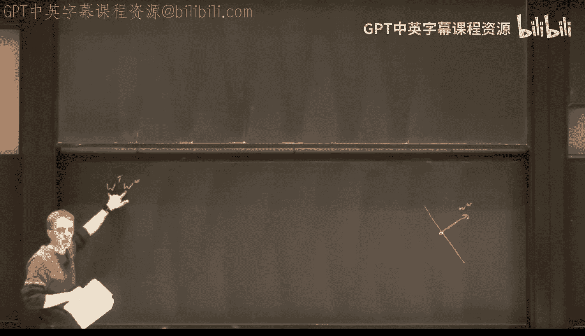

Okay， that's the first thing you look at。 And what we'll show is that that will actually always become larger。

 So every time you make an update。This quantity becomes larger。Now， that's good， but it's not enough。

Why is it not enough， How could you make this。Trivially larger without actually getting closer to W star。

 Any ideas。So I'm showing you every time I update W， this becomes larger。 That's good。

 That seems to suggest that these two vectors become more similar。

In a product measures the alignment like how， you know， how close they are。But actually。

 it's not enough。 So， it could be a pathological case。

 but this becomes larger with every single update。 yet we're not getting any closer。I saw you。

 I give you， I give you three answers per lecture。 alright， alright。😊，That's right。

 So you could just rescale W right So basically， you know， one option could be that， you know。

 imagine you could just every time you just update you update W by a factor 2 or something， right。

 And this always becomes larger by factor 2。 But actually the the relative relation between these two hasn't changed at all。

 right So the first time W is this。 Next time W is twice as long and then four times as long， right。

 And we haven't actually made any progress。 Our hyperplane hasn't changed at all。 right。

 And so for that， we look at the quantity。 W transpo W。😊。

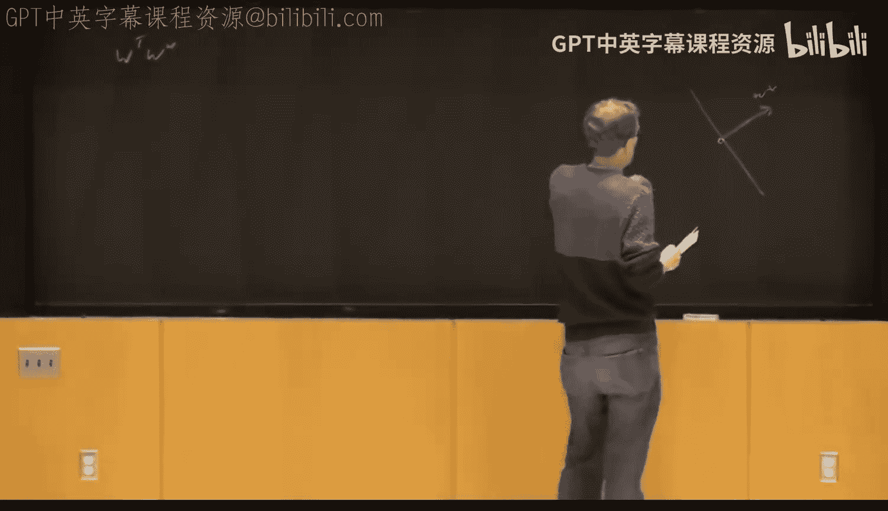

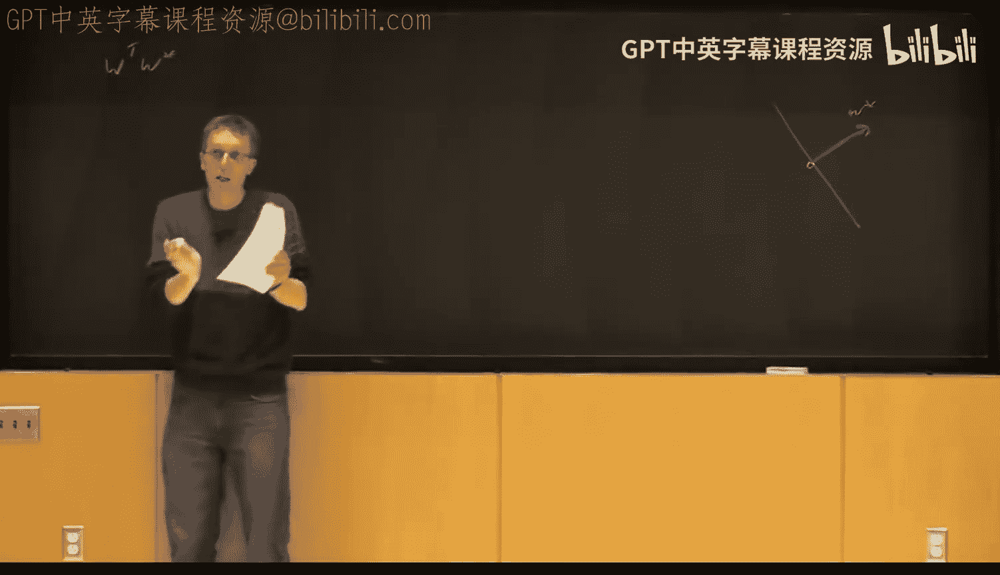

How does that change？RightAnd so in the case that you just pointed out， what would happen。

 this would grow really fast， but this would also grow really fast。 So really。

 just the norm of w become really really large。😊，What we can show is that this year grows fast。

 and this year does not grow very fast。 And then we can actually prove put these two results together and say。

 if that's the case。 if W becomes more and more， you know。

 the inner product between W W star becomes larger。

 yet we can show that it's not the case W is just growing。

 then the only option that we have left is that W tilts towards W star。 And eventually。

 they define the same hyperplane。😊，Any questions about the high level intuition。Alright。

 so let's get cracking。All right， so let's first look at， you know， when we do an update。

 what happens， An update is the following。😊，By the way， please pay attention Now。

 It's so much easier to follow it now in lecture。 Like it this is definitely on the exam， right。

 So this is kind of such a beautiful little proof， so。😊，It'sresistible。嗯。嗯。These are resistible。

 Wait， what the hell。

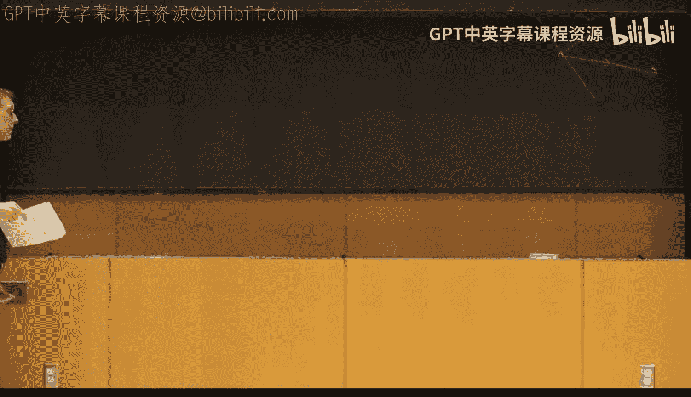

Okay， here we go。

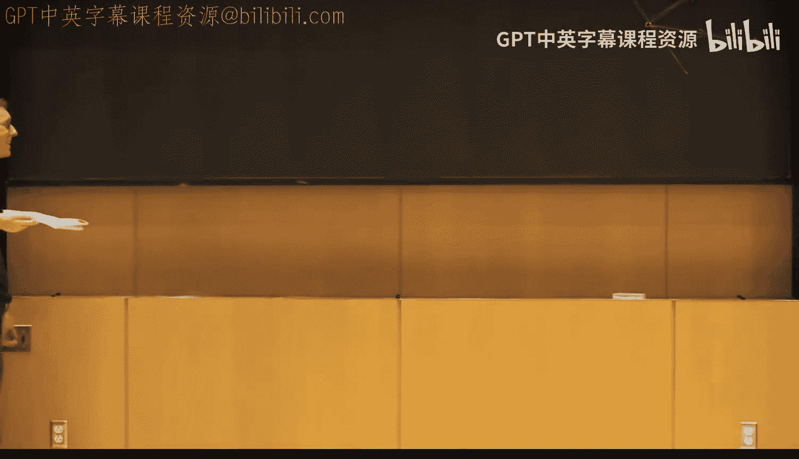

All right， okay， this is what pipeline one。 So when we dot update。W becomes。Becomes w plus y times x。

Okay。That's the first thing we have to note。The second thing we have to note is that the only reason we didn't update was because we misclassified X。

 right？ So what do we know， therefore， we know that Y W transpose x must be less equal 0， right？

 Otherwise， we wouldn't have done the update。😊，Okay， raise your hand of you with me at this point。

Okay， awesome， right。 So we know these two things。 So we're making， we know this about X and Y and W。

😊，And we be making this， we're doing this step， right， W becomes this。

 And the first thing you want to now look at is if we make this update。

 how does that affect these two terms， right？ And I think I started with W transpose W stars。

 Let's do this one first。啊啊。So the first question is， how does that affect W。

W transport stars or how does it affect our relationship of W our late vector with the。

The holy grail way back that that we know actually separates the data。And so， well。

 what we do is we just substitute the new new W in here。 right， So we now know this。

 what does it become， this term now changes， right， in which way does it change。

 We now have W plus y times X in here， transpose W star。😊，Okay， that's。

 that's basically that's the change that happens。Raise your hand of you with me。Okay。

It's going to be a lot of raising your hands。 But， you know。

 I just want to make sure I don't lose you guys。Alright， good。 So that's great。

 Now we can take this apart， right。😊，And say， well。

 that's the same thing as pulling this in here and pulling it here。 So you have W transpose W star。

Plus， y times。呃。W Transpo star。X。Okay， now without looking at the notes， what do we know about。

listster。And now， be careful， this is a star。 This is not W。 This is a star。哎。

So this is not our original W。 This is the W of star that we basically want to find。Someone said it。

 yeah， it's positive。 Why is it positive。😊，ぱれも。啊。W。That's right。 right。 So this here is kind of。

 you know， this here is the golden ball here。 right， So this guy gets everything right。😊，Right。

 so this means the only way that's possible is if this term here is always positive。Okay。

 so this is greater than 0。Right。嗯。Right， why am I So the。Okay， so then， oh， shoot。 Sorry。

 I forgot one thing。 Oh， sorry， guys。 I forgot one。I try to be really quick here。Sorry，1，1 quick。

 one quick note that I。One thing I forgot to define。Is the margin。Okay， good。So what is the margin。

You will need the margin。So。The margin。Is， remember， we have our data points Xs。And you have our os。

嗯。Well theres some point that's closest to the hyperplane。Right。There must be some of them。 Like。

 let's say this guy here is the closest to the hyperplane。 right， Everybodys on the right side。

 but one of them is gonna be closest， right， could be the two are actually equally close， right。

 That's fine。 Let's pick one of them。😊，You can find。Gamma to be the， we call that the margin。

 basically， in some sense， the distance to the hyperplane， right。

 because everything is normm1 actually turns out it's just the minimum in a product with the hyperplane。

 So x transpose W star。😊，For x comm Y element of D。So this is just a constant。

 And we we will't need it proof。 So the important thing is like this is， is。This is greater than 0。

 right。It's not greater at equals here。The margin is actually something we will use use throughout the machine learning。

 whenever we define hyperplans。One thing you want to。Think about is， you know。

 how large is that margin。哎。Can anyone give you intuition？What do you want， like， you know。

Lets say can find a hyperplan you know have two hyperplans。 One is a very small margin。

 One is a very large margin。 Which one would I prefer as it does not matter。Any ideas？哎。

That's exactly right。 right。 So， so the intuition used to be is if you have a small margin， right。

 you would carve a hyper plane right here。😊，Then if you get a test point。

 that's just a little different from this point。 Then it could be on the wrong side of the hi plane。

 So typically， a large margin is desirable。 The machine learning。

 So we will get into this is actually the whole family of large margin classifiers。 But for now。

 thiss， you know， just。😊，Think about this notion。 And is actually。

 this's why I put this on a placement exam。 You remember computing the distance to a data point。

You know， the margin basically says， how close are we What's the distance to the closest point in our data。

O， good。嗯。All right。So。So now we know this is greater than0。😊，And in fact， we know even more， right。

 If you look at W transpose X， well， that's exactly what this thing is， right。And we know that。

Gamma is the smallest such terms。 So Gamma is the smallest in a product with with the W star。

So we know that this must， in fact， be greater than guump。O， does that make sense。

 So this is basically， essentially what this is， is the distance of x from this hyperplane W star。

 And we know the minimum is gamma。 So it must be lit greater than gamma， right。

 or greater equal gamma。😊，Okay。Does that make sense， any questions？

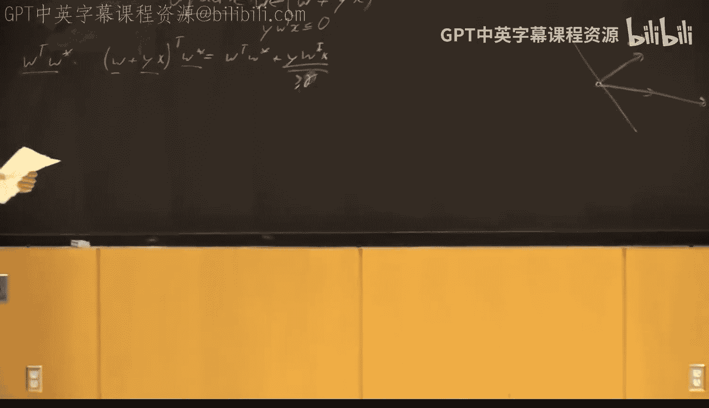

And so that means what we can do is we can say this is greater equal than W transpose W star plus gamma。

😊，So why is that important？So what if we just jump。We've just shown that if we make an update。

The inner product of the hyperplane that we're looking for。

With the hyper planee that we want to find。Growth。By Ghana。At least by gamma， it may grow more。

 right， But every time we make an update， this quantity。Increases by at least gun。

 because what we showed us that basically this， the updated quantity is greater equal than the old quantity plus gun。

😊，Okay， any questions？Raise your hand if that makes sense。O， awesome。Okay， this is a big deal。

 by the way， because we're showing it it's not that actually it like one thing it would be bad if it kind of increases a little bit and you know。

 increases less and less and less as we keep going， right， No。

 the beauty beauty thing is we actually have a concrete number。

 And we say it will grow at least that much every single step， right。😊，So's。

 that's a very powerful statement。All right。So here comes the second one。

What happens with W transpose W？😡，All。So that was the second thing we about。And well， what do we do。

 We do exactly the same trick。 We plug in。 We now we do an update。 So this， you know。

 becomes the following， right。You plug in the new definition of W in here。

 So now we get w plus y times。X transpose w plus y times x。 Okay。

 so all I did is I take W transpose W。 So what's the squared norm of my hyperplane。😊，And for each W。

 I put in the new W。 So that's the new expression。Alright， so once again， I expand this。

 this becomes W transpose W plus， you know， two times y。

W transpose x plus y squared times x transpose x。All right。Okay， so let's look at this。 This is good。

 right， This is， again， the old term。😊，Plus， some stuff。Right， it's exactly what we had here。 right。

 basically said， you know， when we update this， we get the old term plus some stuff when the stuff turned out to be at least ghanma。

 So the question is， what is the stuff here。😊，Right in this case。

 So we have W transpose W and now we can look at these terms here And then let's see what we can figure out about。

 right， So the first question is， what do we know about why W transpose X。

 Any ideas without looking at the notes。 What is， what is this。😊，It's。

I don't know if someone someone said it， yet。Whathy is this term yeah？I's negative， right。

 Why is it negative。That's right， right， So W transpose x。So the reason he made an update。😊。

Is because x was on the wrong side of the hyperplane。

 And we only that means w Y trans W trans x must be negative， right， That's the test for our。

 if you do an update or not。Right， so we know this is less than 0。All right， good。

 And second step is y squared。 What do we know about y squared。😊，Right， it's one。 Yeah。

 So it's it's one。And what do we know about x transpose x。That's right， Let's take go one， right。

 How do we know this。That's right。 right， we， we made it that way， right， So we kind of， you know。

 now we know why we did it。 Alright， good。 So now if we know these things。

 well we can actually plug these numbers in， right， and we can actually say， well， that is。😊。

Less equal than w transpose W this term here。😡，嗯。Sorry， one second。Plus  one。 Alright， Okay， good。

 so。嗯，没。Is correct。Yeah， okay， good。 So this year is basically， okay， this year is less equal1。

 And this year， you can， you can only make this smaller if you basically。

 we can only make it larger if we drop it， right， So we can just drop it。

 and then we have less than W transpose W plus one。😊，All right， any questions？

Raisezy hand if that makes sense。 Last that makes sense。 Allright， good， good， good， Allright， good。

And。So。Here's basically what we did。 right， We said we have a lower bound。

Hes saying this one here changes， at least。By gamma， every time。This point here。

 the inner product with itself， the squared norm， changes it most by one every time。

Okay we have a lower bound of one， upper bound of the other。And now we basically。

 what we want to do is we kind of， you know， one kind of grow。

 grows a certain speed The the amount grows can't grow faster than than up bound on the speed。

 And we hope that basically they converge at some point。

 And we can see that that must converge in a finite number of steps。

 right So that a final number of steps， basically， this can only go on for so long， if this is true。

 that's basically the idea。😊，And let me move this up so that we can keep these two inequalities。

All right， whos ready to move on？All right， good stuff。So let's say we make M updates， right。

 So we've run the algorithm。

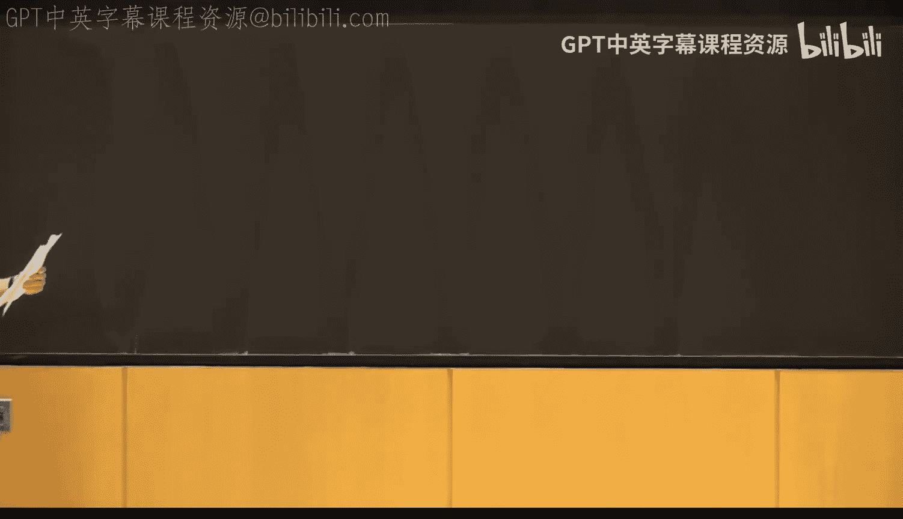

And we're still running， and we've made M updates。 So after M updates。

There now like in the TV show， you know， I say like 10 years later or something。 right。

 like M updates later。And here's what we say， well。We say m times Ghana。We do have the same。

 Let me make sure。Yeah。So M times gamma is less equal than。W transpose， W star。Why is that true？嗯。第二。

关那。

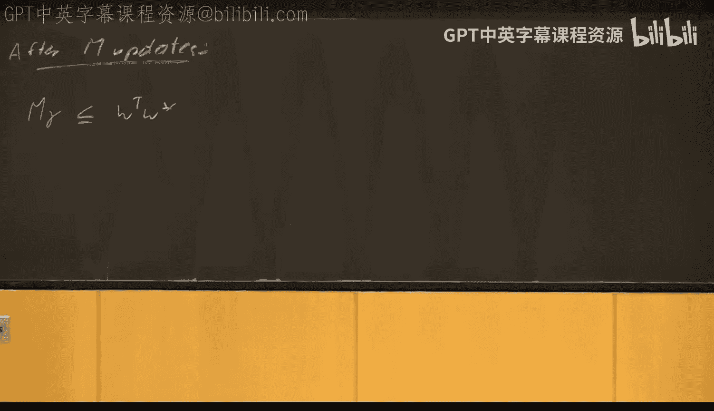

Maybe you have to be careful。 W trans W star。

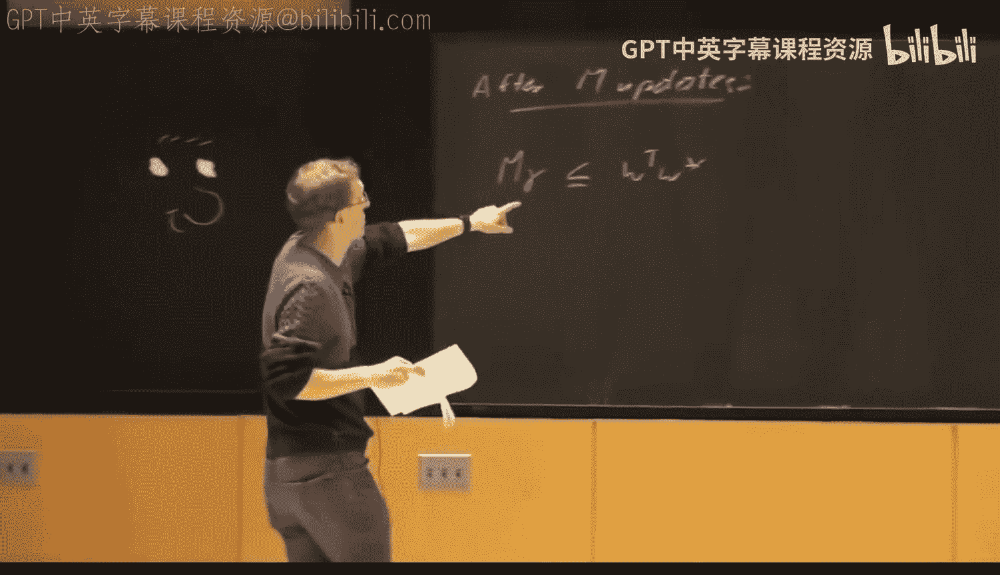

You're almost right。Yeah。こ记る。it's right。 So the first thing is W starts from 0。 So initially it's 0。

 right， And we've seen up here， the W trans W star。😊，Grows at least by gamma， every time。Right。

So after M updates， it must be at least n times Ghana。O。😊。

So W dance with star W star must be greater equal M times gamma。 Okay。

 because every one of our M updates made this quantity。😊，largerger by by an additive term of gamma。

 Okay， doesn't make sense。Raise your hand， that makes sense。Okay， awesome。 Okay。

 so on more time W trans W star is the inner product with the hyper frame that we want to have。

 So every single update， it increases by gamma。 Now you've made M updates。

 So it must be at least n times gamma。😊，All right， good。So now we can say。We try to go really。

 really slowly through this。So that equals the absolute value。 That's easy， actually。

 because it's not negative， right， So you can just take the absolute value around it by not， right。😊。

But what we can now do is the following。 we can say， well that equals less equal than。

The norm of W times the norm of W star。Does anyone know what that inequality is？😊。

Without looking at the notes， anyone know it。Cutish rights， right。

 So there's cautious rights inality。Okay， good。 So you have to。 that's one inequality。

 It be one of five inequalities in computer science that you should know know about。

 So if you don't know this one， please look it up。 The basis says exactly this。

 If you have two vectors， W and W star， you know， A or B，😊，Then actually， basically。

 their inner a product must be less equal than the norms。Mipplied。嗯。It's actually。

 it's very fairly easy to prove。Okay， who is with me？ Raise your hand。I went awesome， good。

 We only a few steps away。 It's so close。😊，嗯。🤢，Okay， what do we know about W as sorry。

 what do we know about W star， the norm of W star。😡，It's one， right， This is one。

So you can just drop it， right， So this is W。There't normal with that。Okay， good。

So this equals square root of W transpose W。Why is that？It's the norm。 That's。

It's the definition of the norm， right， That's， you know， that's just what it is。

And now comes the last step。 So W transpo W。 Wait a second。 What do we know about W transse W。

 We've done M updates。 We just showed something with W transse W， right。

 That's like some some vague collection。 Wait， just 10 minutes ago。 we showed the W transse W。😊。

Grows by at most one every time。Okay， so this here。😊，Can be at most M， right。

 because we've made M updates。Okay， does that make sense。

 this must be less equal to square root of n。Okay。😊，Raise your hand if you're still with me。

All right， good， good， good， awesome， so close。So now we've showed something。You showed that。

M times gamma。Is less equal。Then to square what I' at。So， that actually。It's very interesting。

Because M is the number of updates we made。And we showed an basically proven inequality about this。

M times gaarma is less equal than square root of M。But we can now solve this form， A for M。

Can square both sides。We get M squared gamma less equal M。Sorry， I was sorry got on square。

 Thank you。 Thank you。 Thank you。 Good point。嗯。Or you can implement。 You can divide both sides。

 but actually， maybe you divide both sides， but that's go And。 it's actually better。

 you actually get squared of M Gamma is less equal  one， so。😊，You know。

 if you now flip it around you， please。One over gamma squares。M is less equal1 over a gamma squared。

Now， I came it down。Why are we done？Why is this a big deal？This result made Rosenbld famous， yeah。

That's right。So early on， we said， well after M updates， right。And the moment I said this。

 you could prove， wait a second， M can't be larger than one of a gamba squared。😊，Right。

So you can't make more than that many mistakes。 Well， Gamma is some value， whatever it is。 that's Hs。

1， right。What if it's 01， right， you know。What you get10 is you know，100 updates， right， That's it。

 After that， you're done。嗯。So that's an extremely strong。Result。

It basically shows that the algorithm converges in a finite number of steps。

 and the number of steps only depends on how far away you know， W star is from。

From the closest data point。Now。Firstly， any questions， Any questions about this last step。

Raise your hand if you think you've got it。I went awesome。So， I have one question。

There's not just one W star。 There could be many W stars。Which one would you pick？Yeah。

But it's right。 right The one of the largest margin， right， So basically says。

The perceptioncept converges， like， you know， if you take any possible hyperplane。

 you can choose any W star you want， right， take any possible hyperplane。

 If you take the one that has the largest margin， right， So that's basically right in the middle。

 In this case， actually， what is the optimal hyperplane， right， It's not this one。😊。

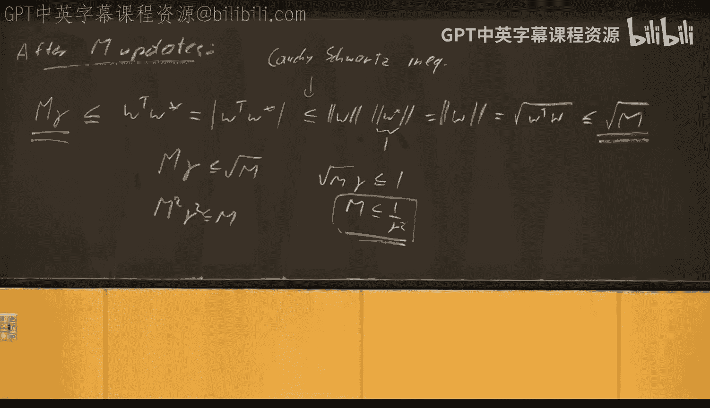

Be probably something like this， right， Here's my X。 Here's my O， right。

 You probably want have something like this。2是2。Like this。

 it has maximum distance to both data sets to both classes。Okay。

And if you take that hyperplane and you measure how close you are what the margin is。

That basically bounds how many steps you need。Or in other words。

If your data is really very well separable， So data points are really far away from each other。

 That means you can place a hyperplane with a large margin。That means people converge very quickly。

But on the other hand， if your data set looks like this。 if you X， right， and the X and O's。

 they kind of hanging out， right， like like this， right， really really close together。 right。

 That means the hyperplane here has a tiny margin。 to be right。

 then actually will take a very long time。😊，Right。Which intuitively makes sense because you have to wiggle it right into between these two two sets。

Yes， question。哦。W that。When you run out， you will find that。No， it doesn't。You find a hyper plane。

 that's basically the only guarantee you have。So it could be that this really awesome Hypanic exists。

 And the one you find is this yeah。😊，诶。That's correct。 And so what we will do very soon。

 we will talk about support vector machines， which will actually find exactly the same。😊，So that's。

 you know， slightly different optimization procedure，But it was invented 20 years or 30 years later。

Anybody， good question。 Any more questions。一。あ。そすや？That's， that's right。 So。

 so for a maximum margin hyperplane， you will always have the same margin on both sides， right。

 if you didn't， if one was further away， then you could always move the hyper planee a little bit middle。

And actually， get a better margin。Yes， yeah。そ制な。Next transfer is always Western we constant。

That方 max。YouFrom the original。说明这些呢。あだま。So is your question， what if you didn't do re rescaling。

 if you didn't rescaling， essentially the same thing holds， right， because you could do。

 if you just rescale the data set， you're just rescaling all the updates。 Actually。

 everything still works out。やた。Ex。喂。That's right。 There will be some constantstancy。

 Yeah that depends on。 That's right。 That's right。Yeah。I guess it's the maximum。

 is the norm of the maximum data ph， yeah。Yeah。一住得谂嘅呢。にせなら。We've going urge the two things that why。

Cran X and start。国全在のさ点に。AndWell that's， yeah， I mean。

 all I'm saying is that you can have most of M steps after that， Basically。

 this inequality can't hold anymore。That's basically what it means。Like， you know。

 these two inequalities。E can't hold for longer than that many steps。These two。

 that be the W transpo W grows by most one。Right， so the， you know， the implication here。

 basically tells you， gives you an up bound of how what WW star is and what。And what W square is。

Okay。I don't think exactly how spending is that going to the。So， so think about the following。

 You basically have a function of。W trans W must grow at least a certain rate。Right。

That's actually W trans W grows by， you know， So W trans W must be less equal than this It must be in this region。

Right。And。W dance with W star must be greater than some other function。 right， must be， you know。

 greater than than gamma or something， right。😊，And。For these two to hold， I guess， you know。

 So whatbaby basically did here， as he basically said。ESorry， let me just。Yeah， so so I guess。

Let me just think about the intuition here， So the。I guess you have， if。Gmma times M and one times M。

Sorry， you know what， I can't can't figure the tuition out right now on the fly。

 but essentially what you're doing is you have an upper bound a lower bound to meet up at some point。

😊，Yeah。Yeah。So yeah， I add up one of you。

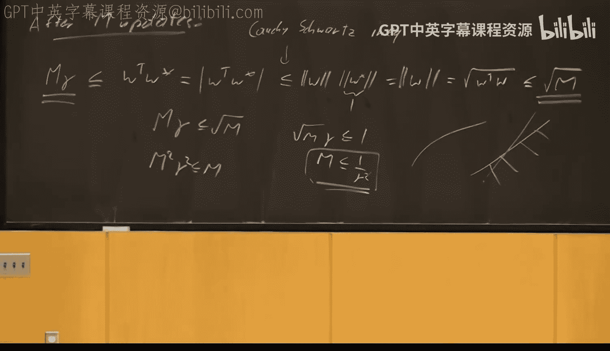

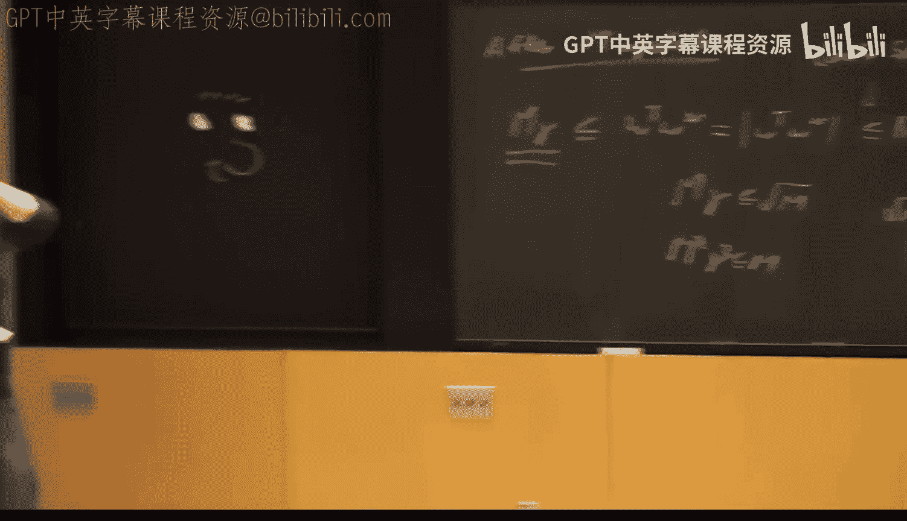

。你还。あ。Forgiven。If。Yeah， so， so that's， that's a good question。 right。

 So you're basically saying we assume that W star exists。 What if it doesn't exist， right。

 So the the cheeky answer is， you run the perception algorithm， you wait two days。

 And if it hasn't converged， then you know， it doesn't exist， probably。😊。

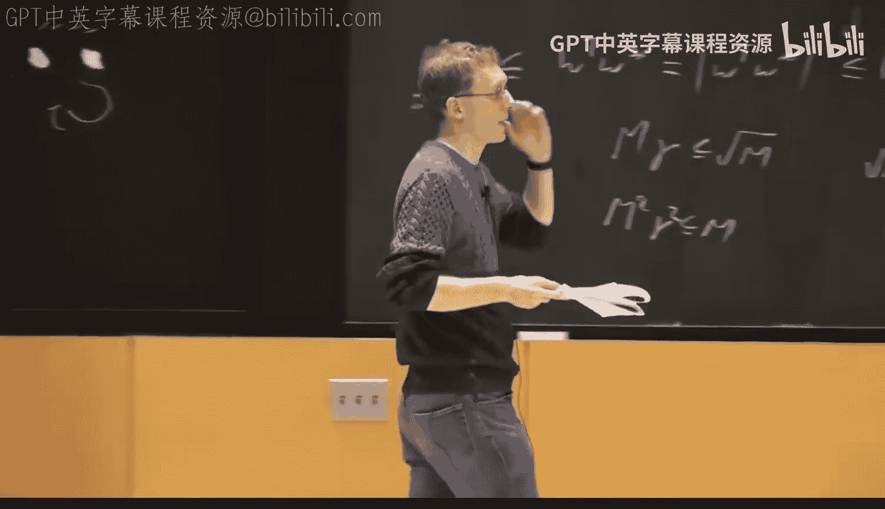

诶。There， there is better way。 So once we learn the per the SVM algorithm。

 you can actually solve for this exactly。 And you basically can us an optimization problem。

 and this optimization problem has no feasible solution。 So you can test for that very easily。😊。

Sorry， there was someone else first yeah。たて。So I can't understand your question。

It does not guarantee conversions。 If W star does not exist， then you have no conversions。

Then then it will always conge。 Yeah， after that many steps。I it must。

Because he can only have that many updates。So this means it must converge。Basically， after this。

 after this many updates， you can't make a mistake anymore。的。It may Ga be really good me。嗯。Well。

If gama is really， really big， right， then this actually。Yeah嗯。And that's actually not a bad thing。

 right？Actually actually means you converge much faster。 I don't know who ask a question。 yeah。睇。

So the perception number spread on high dimensional data。Yeah， that's absolutely right。

 In low dimensional be actually， it's unlikely that you can find a hyper planee that separates。😊，To。

 Okay， maybe last question， yeah。It。Be on the scale。This means that if you have a data out。

 which has a dimension， that is really large。There's a chance that we you scale it down。

 getla will be。So it depends on the scale of the data。 So I'm not sure if that's true。

 but it depends on the separability of the data。that's really the case。Does that make sense。

 So I forgot who asked the question。有有呀。そ。data。When you actually scale it down。

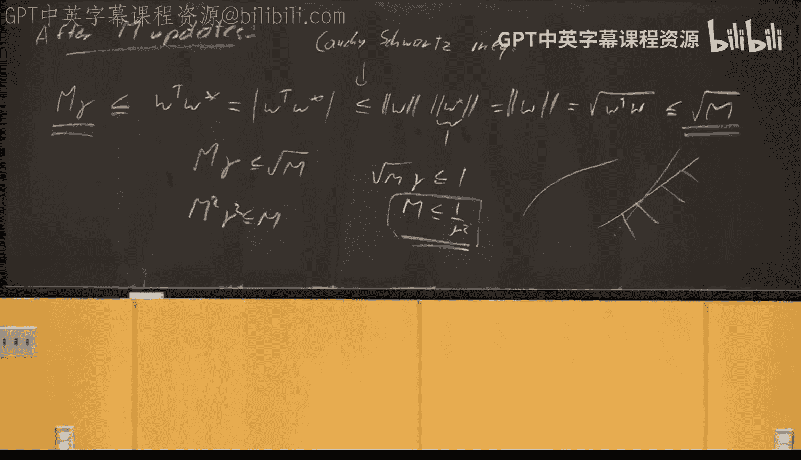

Mmhm。Well， so I guess last time， what you saying， if you been saying， you think that it's really。

 really large， really， really large scale。So at the beginning。

 I have to scale it down to this unit chuckle。 So they have to scale it down a lot。And therefore。

 they're gonna be really close together。 But that，'s not really true。 right。

 You could have data points at a really， really large scale， but really far away from each other。

And I's gather down to the unit circle。 And then you have some points here and some point here。

 right。So maybe I scaled them down by a factor of a billion。

 right to get here doesn't matter that the margin is huge。

it's really about how close together are the points of different labels。ThatThat's really what it is。

Okay。Alright， So we actually， you won't have time for the next topic。

 But let me just tell you a little story。 So the a little bit of history of this。

 So when the perceptome came out， 1957。😊，It made a huge splash， right， This was gigantic。

 This was all over the news。 It was considered the first time the people， This was， by the way。

 neuron inspired。 like it seems a little weird right now because the hyperplane。

 But the idea basically is that， you know， what a neuron basically， you know。

 either fire or doesn't fire。 And so that's either positive or negative and you take all its inputs。

 you basically a linear sum of the inputs that that was painted of the idea where it came from。

 And so this was celebrated as the first nerve cell。 the first artificial neuron。

 And the newspapers were full of it。 like， you know。😊，Everybody was reporting about this。

 and it led to a huge AI boom。I even get an article about that I linked to from from the Webage in the New Yorker from 1958 that actually discussed the perceptioncept on and it talked about everything there is。

 Like remember， it ends with this beautiful sentence saying， what is the。

 what is the percept on not capable of， right， Will it ever understand love or human sex drive。😊。

To this day， I'm confused about what the， you know， author was confused about。 There something。 Kiny。

 something he's not getting， but。Either about the percept or about something else。

But but the important thing is it was really just the hyperplane。

 And it took a couple years for this to catch on。 And Mar Minsky actually then famously had a book。😊。

Which he actually called the perceptron。 So he actually wanted to write a book about it and show how awesome it is。

 But he showed us limitations。 And he showed this very， very simple data set。 where he said， well。

 here's a data that the perceptron can never learn， right。

 You you have a positive point here and negative points here。 It's called the X or problem。😊。

And this is a data set with four data points。 and there's no hyperplane that separates the circles from the axis。

 right And it was not mean spirit。 It was really just， you know。

 clearly that's a limitation of this assumption that things are inseparable。

 But when people read this they were like wait a second， it can't distinguish this。

 I thought I'm gonna have like armies of robots know。

 I want to have my next husband should be a robot or something know。

 and people got so disillusioned that actually the entire funding for AI dried up。

 So I talked about this in the first in the very first lecture。

 this was the death of the first death of AI right people realized you know。

 at the beginning they heard about what there artificial neuron。

 or very soon we will be able to build brains they are going be artificially going outsmart us and you know。

 people when you talked about what do we do do we have to laws against this。 And then this very。

 very simple example and say， well we can never solve this one with a perceptioncept And it was such a disillusionment that AI basically。

😊，Died and people stopped working on AI， and people started working on machine learning and。

That's what we know， continue with next next election。

