# 康奈尔大学《智能系统的机器学习｜CS4780 Machine Learning for Intelligent Systems 2017》中英字幕 p09 -09-Machine Learning Lecture 9 ＂Naive Bayes continued＂ -Cornell CS4780 SP17.zh_e -BV1Lo6gBxEKE_p9-

Welcome， everybody。嗯。Alright， today must be a beautiful day out。😊。

Because at least one third of the seats are empty。Okay， one。One quick announcement。 So project。

Which one where we now3， a knife base will hopefully be shipped tonight or tomorrow。Yep。Also。

 there will be next。Next week will be three， really cool machine learning talks here at Cornell。

 For those who are interested， we had one last week， two weeks， No。

 two weeks ago on on computer vision， which was really， really fun on deep learning。

 I saw some of you went。 next week， we have one on robotics， machine learning， one on healthcare。

 machine learning， you one on machine learning， core machine learning。 I will announce it on piazza。

 But if you want to see cutting edge research。 These are really， really cool talks to attend。😊。

All right， one quick things， one thing I actually didn't get around to yet is Project 1。

 So that's now done。And I just want to say we have， it's really， really fun to see。😊，The leaderboard。

 people moving up on the leaderboard。 So maybe。I want to spend me one minute looking at the top results。

 So Steve Nash and Carl Sagan。Can you repeat。Yeah。Where is the team， Steve Nash and Carl Sagan。

 Can you raise your hands。Okay， can you tell us， please， please be quiet， guys。

Can you please tell us what you did， What was your secret sauce。Okay。

 and how did Z for everybody else， they did feature waiting。 So when you compute a distance。

 you weighted each feature differently。 How did you find the weights。是被事。は。So that be try。这不是。ちと。

大分で出て。Oh， interesting， okay。Oh wow， okay， interesting。

 So what they did is basically they computed weights for every single feature。

 and they used different functions for different data sets。 So they tried out basically， for example。

 a Gaussian weighting。 So that would be points in the middle or， you know， x plus y， I guess。😊。

Ws the bottom right corner though。For some reason， when you're waiting on。喂。诶窗。Oh， I see。

 I see in that， okay。Anything。So there's a whole industry in metric learning。

 So the way you make Kenius neighbors truly competitive is actually by learning metrics。

 So that's basically， you know， the guys took the first step into that direction。

 right where you basically you know， the ideas during training， you actually given some data。

 And now you actually want to learn a metric。 such that during testing。

 a Kenous neighbor classifier would do really， really well。 And that is essentially actually how。

 for example， Facebook does face recognition So they actually have some very fancy way of computing metrics of faces And so then they basically say if you upload an image and first detect faces。

 And then the question is， who is that person while they now at you know。

 basically do a nearest neighbor classifier with this really。

 really fancy metric that actually optimized for faces。

 And so one advantage they have is because people upload their profile pictures， they have many。

 many， many faces and they also know who they are because usually upload a profile picture of yourself。

 not everybody does。 But almost always it is。 So they have a lot of training data。😊，Whatで。Okay。

 but how about。Number  two， that's the ha ha， ha witty kitty。 Ha ha， ha witty kitty。

 Can you raise your hands。😊，Are you here。Alright， they are celebrating outside， Not bad。😊。

How about team Garma。It's actually very close on the top。 Dgamas not。Oh， here we go。 Oh yeah。

 team Garma。 What did you guys do。As thought you speak up a little yet。大で。ある。Oh， interesting。 Oh wow。

 interesting。 Okay， Okay， cool。 It's called data augmentation。

 So it's actually interesting because these are completely orthogonal approaches。

 So you can combine them。 and then you would， if you joined your teams。

 you would have beat So just one more time。 what he's doing is he basically takes the training data。

 and he modifies the training samples ever so slightly that basically the sample does not the label does not change So for example。

 you have a digit of a6， if you just take， you know。

 take this image and just move a little bit to the right a little bit to the left。

 It's still an image of a6 that And so the advantage of this is you get a lot more training data right And so if you test maybe a bit to the right little to the left。

 then actually have a better chance of actually finding neighbor。

 And this is actually test a trick that people use and practice a lot it's called data augmentation。

 So when people actually for example， they do exactly this， by the way。

 they take images and move them a little， they rotate them a little bit。 flip them。

 you can't do this with everything。😊，Or with people， you can flip them， right。

 and they should still be， you know， faces， etc。 And this way you basically artificially increase your training。

 It's a very good， very good approach。 Awesome。 This is very， very nice。

 I love that you guys actually basically got to the top by actually， you know， adding。

 adding totally reasonable things to the classifiers。😊，嗯嗯。Okay， good。 So I hand out a little handout。

 who did not get the handout， raise your hands。Everybody got them one person， okay。Who has to。 Okay。

 good， It's a resolved the problem。 So there's a very quick little quiz。 It's not meant to be hard。

 It's actually from an undergrad class， an entry level undergrad class。 but it's a knife base。

 So why don't you and your favorite neighbor go through this and just try to figure it out one thing is。

 just to clarify the last question。😊，You， I really want you to use naive base， right。

 So the early on when it says CPT， CPT means conditional probability table。

 That basically means what if I estimate the probability just given this table。😊。

They if I make a prediction。 That means what if I use the naive based algorithm。

So please discuss it with your neighbor and just go through it。Great questionYeah。什么。Maybe， actually。

 it's。Well let me just。 Okay， so question 7。So Zzi goes on a date。And。Anyway， there's a， you know。

 horribly。え。EB story， but。What's the prior property that the person is good。

Who can tell me the answer。Come on。 This is the easiest one。 Yeah， one half， right。

 So the first one is one half。 Why is it one half， because you just look at why and without any other knowledge。

 right， Well，50% time，50 half the people are good。 half the people are bad， right， So she has a。

 you know， just estimating P of y from the data is just gives you one half probability。

Alright， so then she wants to train a knife based classifier。 And for this。

 she constructed CP because CP is a conditional probability table。

So that basically says， what's the probability of this， this random variable。

 given this random variable。 So the first entry is。

 what's the probability of not see that the person is not wearing a cape。

Given that the person is good。O跟咱们也。

That's one third。 Why is it one third。

That's exactly right， right， So you basically say out of those people， like， you know。

 you throw away everybody who was not good。 whereby is false。

 And then out of those who fault by is positive。

One out of three actually does not wear a cake， right， So it's one third。Next one is the probability。

 the person is not wearing a mask， given that he is good。

What's the answer here， Yeah， one third again， right， This is exactly the same scenario。

then question 10， one is the value of probability。

P of not。 the person is not wearing a cape， given that the person is good。

 if you do plus one smoother。Can anyone tell me？

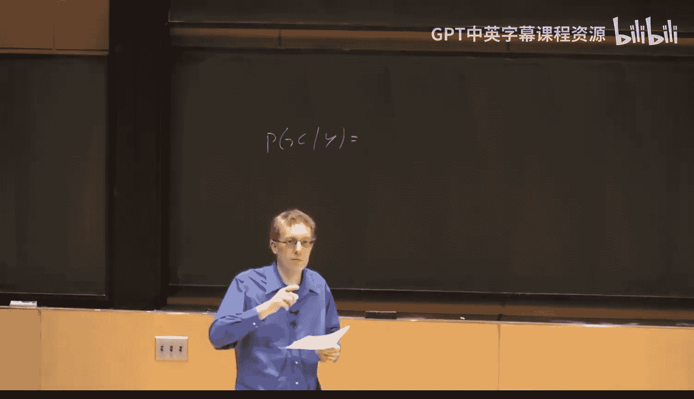

Yeah也 yeah。2 or5， right， So that's basically what you're doing is you say， well。

 only one of them actually does not wear a cape。 but I'm adding one to this。

 That's where the two comes from。 right。 So I have one plus one over three in total plus one that I added in the positive case and one in the negative case。

 right that's 2 or 5。😊。

So you're adding one for each class。 right， this means you add one heads。

 And here you add the heads and a tail， right。Can you raise your hand if you got that result。

 correct。哎，O。So now next question， Susie spots her date。But to her his appointment。

 he already sits at the table。 She cannot observe his underwear situation。

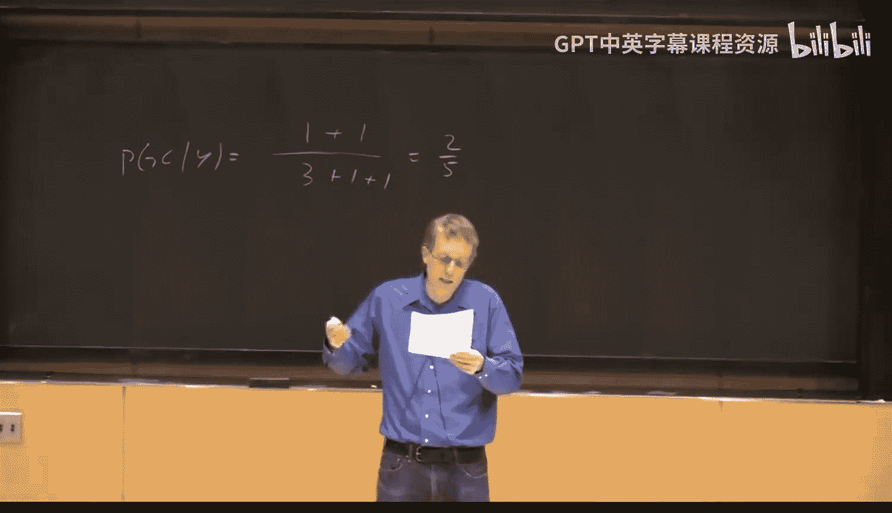

What's the distribution that the person wears his underpants outside his pants。

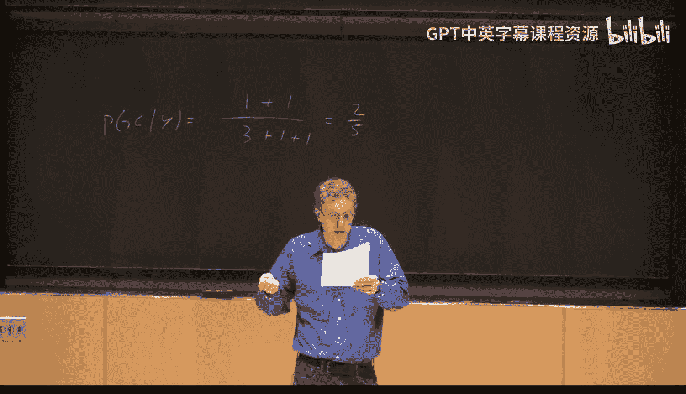

P of view， yeah。

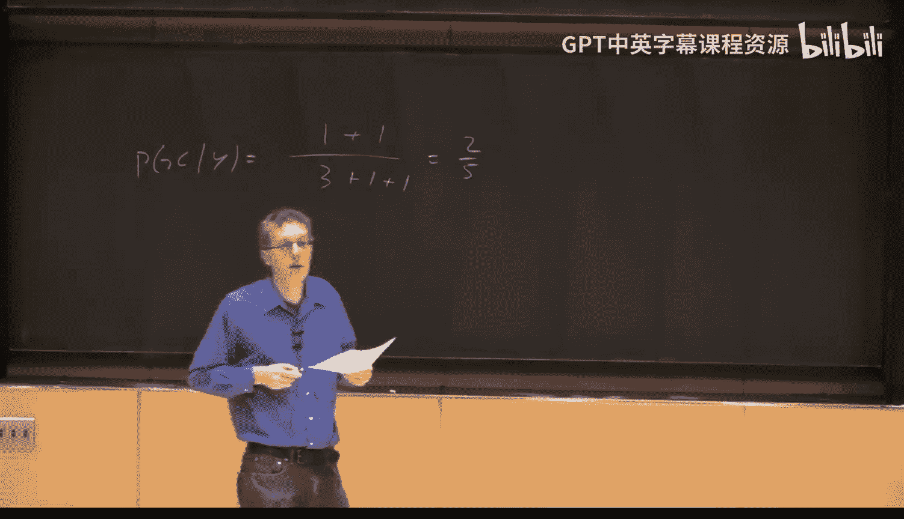

Oh see。 So this here is the total number of tosses。 In this case， you basically have coin tosses。

 where basically you either get a person with a cape or you don't get one with a cape， right？

 So were adding， that's one smoothing means you add two tosses。

 one with a cape and one without a cape。😊。

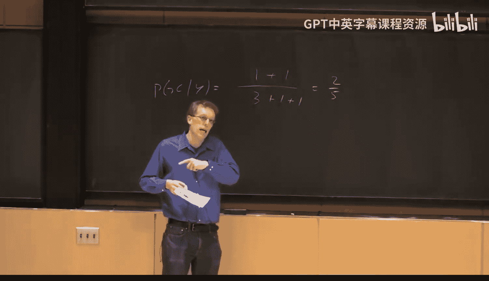

So here you're counting the people without a cape。

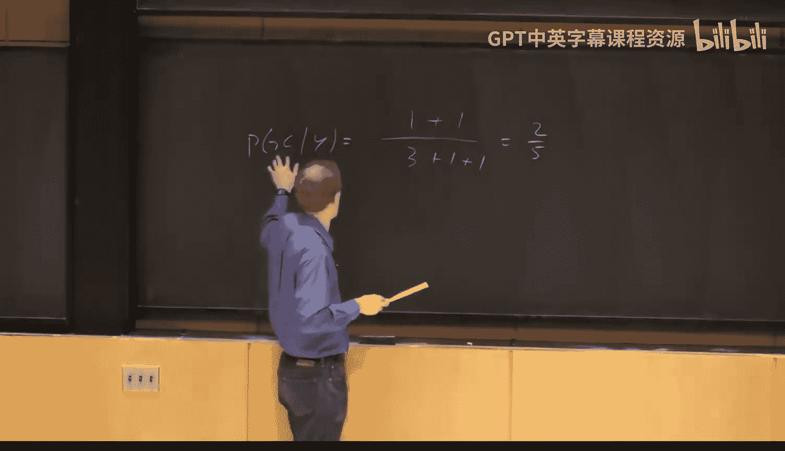

Right， that increased by one。And the total number of tosses。Increased by 2。

Because you added one without a cape and one with a cape， right。As that in the。没啊。

So basically have to add one per class， right。

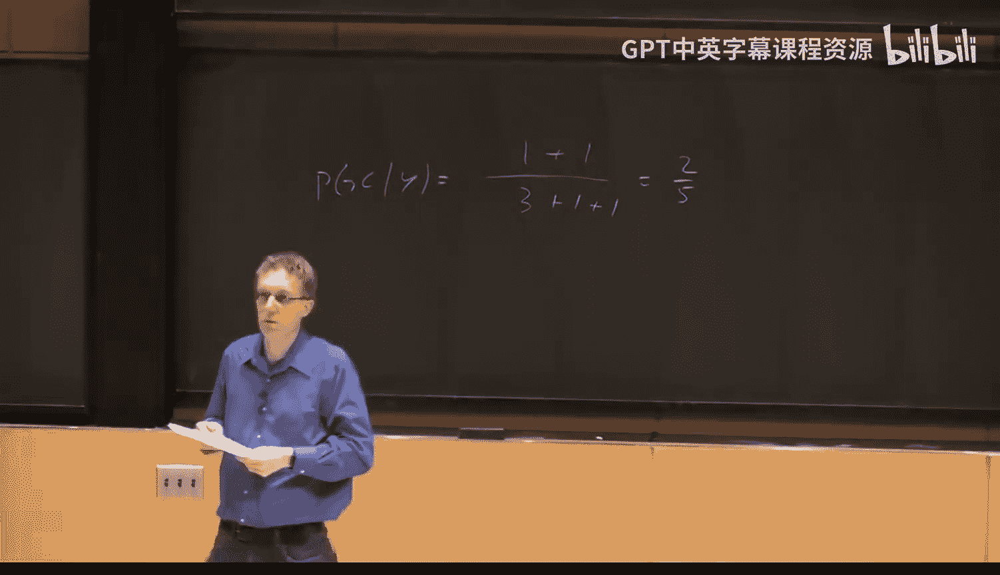

Okay， what's P of U。Who's brave。But it should be really。Yeah。It's a third， right， Yeah。

 you have used a third。Okay， goods。Sorry for a second， I was like， I missed some。

 This is really hard now。 This is just now， just two out of6 are true， right， and so。

Is that true about Spiderman。I guess， I don't know， okay， whatever。All right。Now comes the last one。

So now she actually， doess her inference， right， She sits down with this guy and turns out he does not wear a cakee。

 He does not wear a mask， because that's， you know。哎哎。So what's the property that the person is good。

 given that he does not wear cape。He does not wear a mask。So who thinks he or she has the answer。

Yeah。One over nine， no。Yeah。No。Close， closezy。 Getting closer。

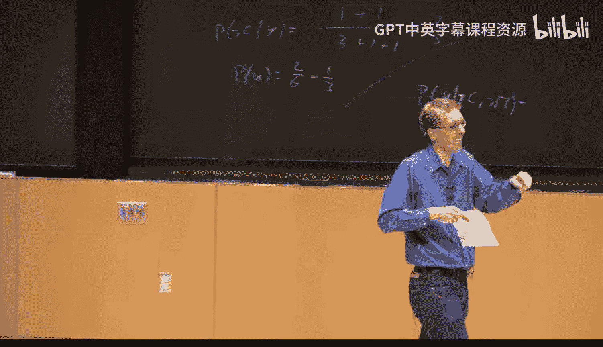

No。10d%， wow， you get actually all over the place， no。No。Alright， let's run through it。Okay。啊。

Let me do一题，Let me do一题哎。So the probability of why。Given nots， can you read this in the back。

Raise your hand if you can read this。Okay， good。他们嗯。Not mask， right， So this。

 we can't really observe， right， If you， you realize this is exactly the dilemma we went into this why we did naive base in the first time right in the first place。

 right， If you look at the the the table， you actually never see this， right， And so， you know。

 you want to basically use， make use of the naive base assumption。😊，So here's what you do。

 You flip it around。 You say， what's the property of the data they observed， not C， not M given Y。

 That's the property of Y。Over the probability of not C， not X， okay。So far is good。

 Who has it so far。 Raise your hand。Allright， alright， now。Here on the top。

 we can use the knife base assumption right， And instead of this term here。

 what we do is we write this is the product over， you know， well， no， let let me just write it out。😊。

The P of not C， given y times P of not M given y。T be of话。Okay， so that's。

 that's a knife based assumption that these two， like given why these two are independent。

 So now this this factors。Who has it so far？ Raise your hand。All right， Okay， good。

 now comes the second part。Down here we have this guy， right？ Well。

 how can we actually apply a knife base here， right， We also have to apply a knife base assumption。

 And so what we do is we just say， well， this is given， you know。

 given why prime and we sum over y prime。😊，So now actually， it turns probability of quite right。

So now this factors again。Okay， does that make sense that this is exactly the same as what we had before you just。

You just basically， you know， look at both cases。 Either you have why， you know。

 Well let me write this out。 What we basically get is P of not C， given y， P of not M， given y。

 P of y plus P of not C， given not y， P of not M， given not y， probability of not y。嗯，呀。Oh， okay。

Yeah， let me just write this down one more time then。No， why prime ministers。Okay。

 let me write a some time。 So what you're saying is basically that P of。

Y give not C not M。Equals。P of Nazi。Not M。Given why， P ofY。Divided by P of not C given P of not C。

 not M， right， And what is P of not C， not M。Equals P of not C， not M， given y。Plus， P of not C。

 not M， give not y。If have not why。Okay， that's the same thing， right。Does that make sense。

And now we've got everything in this。In these nice little conditional terms。

 And now we can apply the the naive based assumption。 right。

 So now this year becomes just the product of two terms。Raise the hand。 That makes sense。OK二审。

And then you plug everything again。So。嗯。You know嗯嗯。Alright， so we can then now do this。

 like times P off。Not C given Y， P of not M given y。You have not see why。Not M givenY。

P of y plus P of Nazi， given not y。Of not M given not y sense P of not y。Okay。Now。

 the first thing you do is you realize that that's P of I is always the same。

 So you can just knock it out， right， You don't need it。 That's always one half。So you can add an in。

 but it doesn't really make any difference。 And so P of not C given y， P of not M given y。 Well。

 that's exactly what I let you compute compute early on。 right。

 That's exactly the answer to question 7 and question question 8， question 9。

 So that's basically one third times  one third。downown here， you have exactly the same。

 You have one third times one third。 And then what about this guy。Anyone tell me what this is？

What's P of Nazi see， given not why。It's two thirds， right？ So two thirds times two thirds。

And that gives you one over 5。Right， so 1， fifth。Any questions。Yeah。两播系飞。그죠。

I' a9 faith classifier in that Lake Suie has constructed a training。呃，王斌。就。Ding。他。大家。Right， so。

So the question is the following， well。You know， this data set is nice， right， But， you know。

 actually， to Susie's mom who cr the data， actually， it wasn't Susie。 But anyway， as we。😊。

As weve been precise。😊，And so you're right， right， So， you know， if you're going on a real date。

 Well， it's very rare that you're gonna date with Spider Man， right， Usually he's a pretty busy guy。

 right。😊，So it's not representative。 So that's， that's actually not a crucial。Weakness of naive base。

 It's a crucial weakness of machine learning in general。 right。

 So you assume that the training data is from the same distribution as you test data， right。

 So in this case， if she's not dating any super superheroes。

 then it wouldn't actually probably wouldn't apply。 But you would have two。😊。

Definite enough a distribution。Does that answer your question。Okay， any more questions。All right。嗯。

Okay， so let me continue them with knifeface。Where's my talk。And at the end of last lecture。

 someone asked me some a few people asked me some good questions。 So one question was。

So we make this naive based assumption， right， The naive based assumption basically says that we can。

 that these features are incomp independent conditioned on the label。

EAnd the first question someone asked， well， what if that assumption actually holds， right？

 What if that's true is that naive Bay is a perfect classifier。😊。

What do you think。

So if the assumption actually holds。

Do you get the optimal base classifier。啊 youina。

So a vote。 How about this。Vote， if yes， now。Who thinks yes。Who Who thinks no。We have low。

 low participation here。😊。

Yeah。The answer is yes， right。 So if your， if your assumption actually holds。

But we haven't done any fudging since that assumption。 right。

 The assumption was the one fishy thing that we did。 Everything else is just， you know。

 absolutely accurate， right， So if your assumption holds， then you actually recover the。

 the bays optimal classified， right， So then it's actually very， very good。😊。

嗯。So one thing， someone asked me like， well， when does this assumption not order。

 can you give you some examples where this is really bad， right？ And I thought about one thing。

Like one question was also by decomposing P of X given y into P of。Alpha P of x， alpha given y。

 right， do we overestimated， do we underestimate this probability。

 And it turns out you really can't say that in in general， right， So it could go either way。

 Sometimes you maybe be poverty maybe be larger。 And sometimes poverty maybe be lower。

 Can anyone come up with an example where this year is larger than that。

 can anyone come up with example where this year is lower than that。

So maybe I give you a minute to discuss it with your neighbor。

 I think this is very helpful just for you guys to get some kind of intuitions about this algorithm。

 So come up with some practical example where you say by decomposing this。

 I actually get a larger value than this。😊，So overestd probability。

 or come up come think of some example where you can actually， but you underestimated。

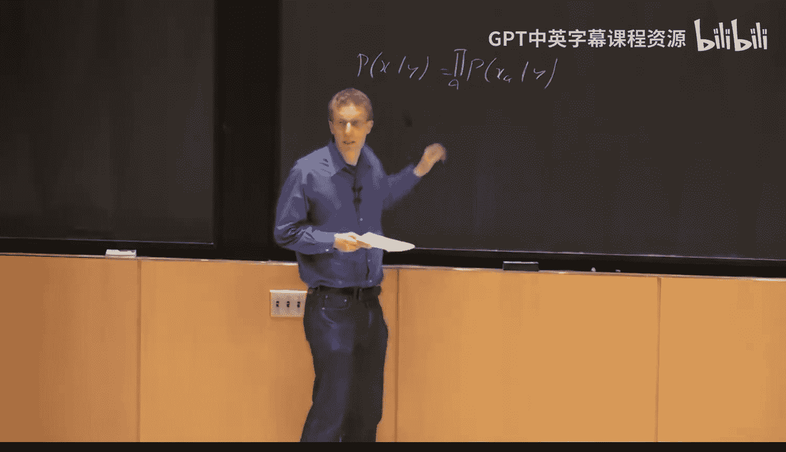

Okay。Who wants to volunteer volunteer an example。 Here we have someone brave， yes。Veryか。

Probably， oh gosh。 Okay， I don't know anything about poker。 Okay。

 probability that you have a full house， given that you have。

3 crs。 but it doesn't， isnn't that a full house already。パ会。H Singapore。Oh see。

 the features are you have three kings， and you have。

Oh， I see， Okay， O， you have two features， One is， do you have three kings。 Do you have two queens。

And you say， if both these are the cases and you always have a full house， that's your label。

 the labels do you have a full house， yes or no。 So okay， good。 So if both of these are the case。

 then actually， it turns out you always have a full house， right， But actually， if you。

 if you decompose it， then actually， well， sometimes when you have three thingss。

 you have a full house and sometimes you do not， right， So you actually， okay， good， good。

 I like this example。 That's good。 That's good。 Any other example。😊。

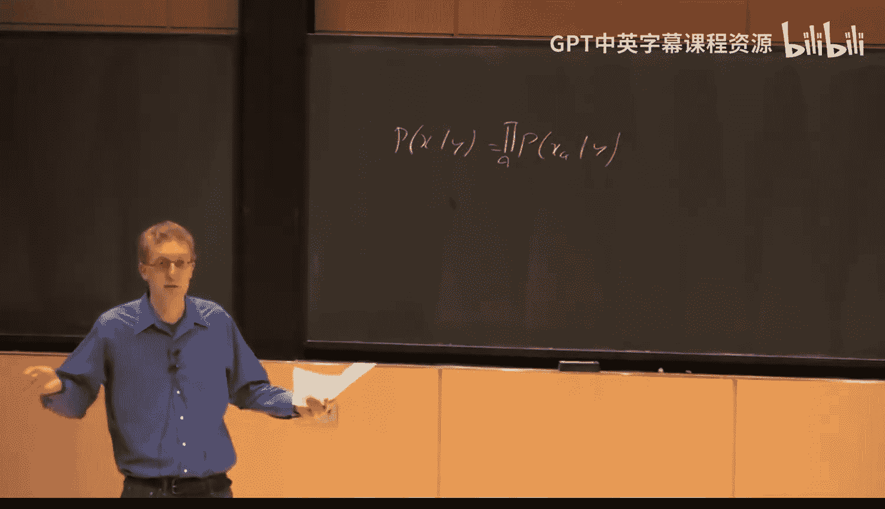

Yeah。

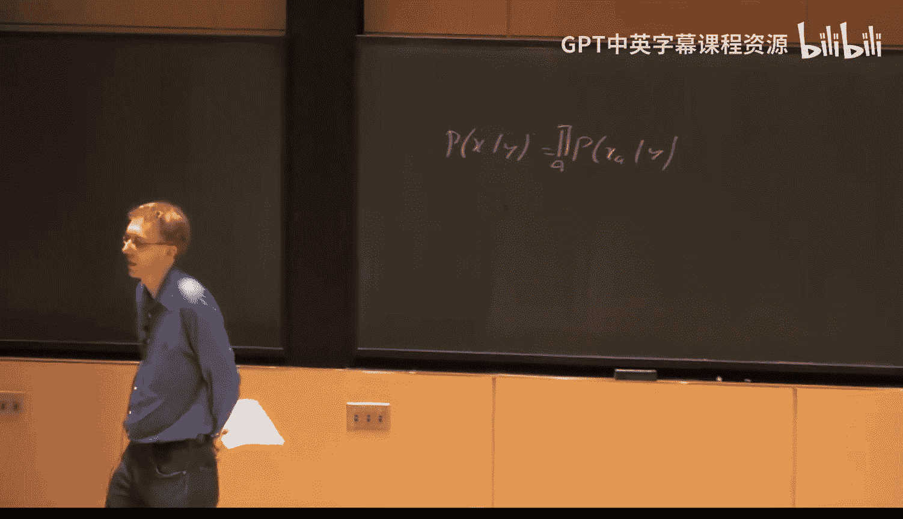

啊转灯。Then we would have like the probability of having the6， for example，With me waiting number。

the northビと家の。Like youre not down the。I would say， so 10written digits。

 you say the different pixel are not independent。 That's right。 So shown they are。

Then well end up with very low probabilities for six or five。就是刚时。い色。That's true。

 But this is also pretty low， right， because he' actually saying。

 what's the probability of getting exactly this particular digit， right。That's actually super。

 super low， too。 right， So it's not clear which one is large， or which one is lower。哎。嗯。

Any more examples， yeah。2 that that cat。Perfect， exactly， right。

 So let's say you have two events that are both indicative， but they actually never occur together。

 right， So a neat example is， for example， email spam， right。

 So this basically used a lot for email spam。😊。

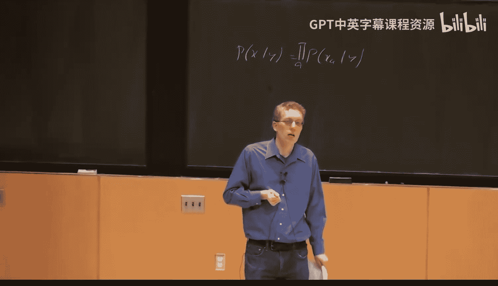

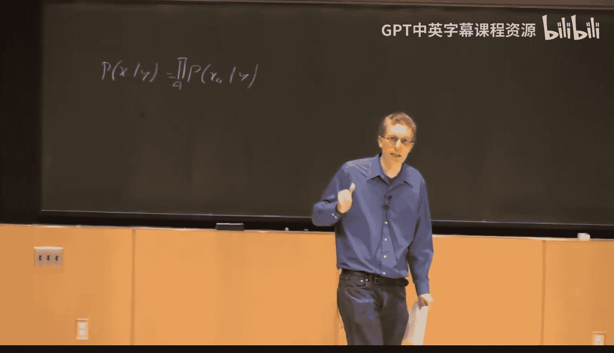

But there's different types of spam， right， They are quite a stint， right， So， for example。

 you have Viagra spam that people try to sell you Viagra。

And there's Nigerian Prince spam。 I don't know if you know， Nigerian Prince spa。

 It's like someone's like， I， I'm from Nigeria， you know。

 and I have $30000 that I really want to give you。

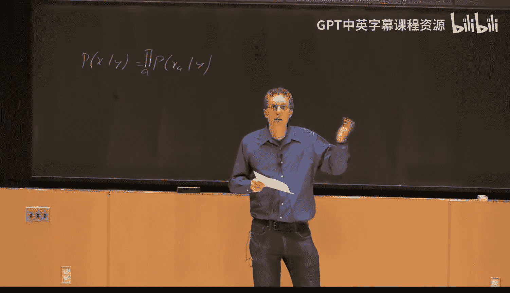

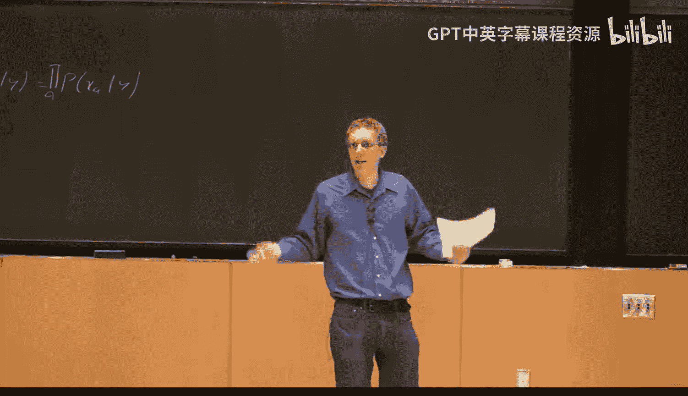

Right， because I'm from Nigeria。 And so please， I just can't afford the transaction fee because I don't know why I have $30000。

 but。

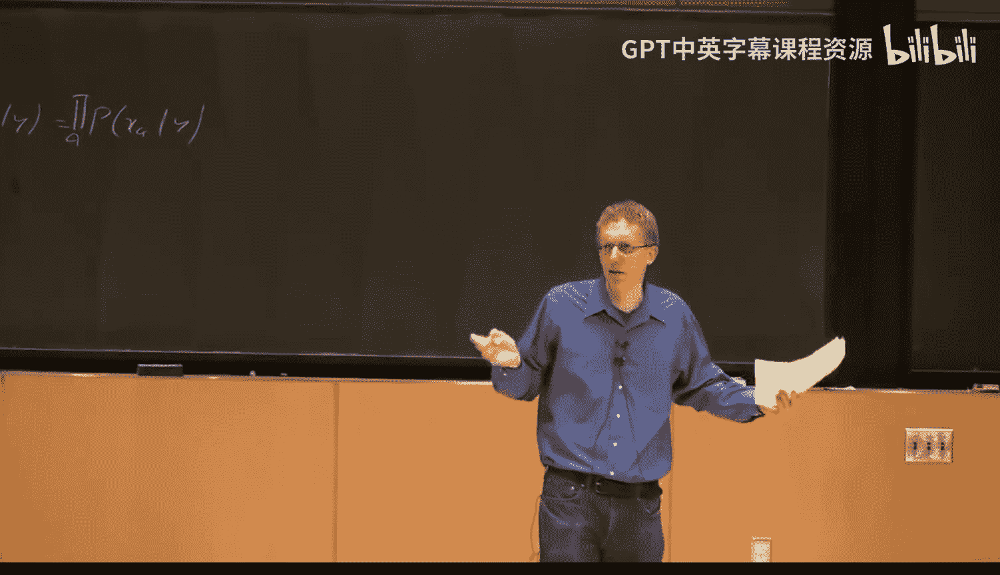

The story doesn't really add up。 So why don't you give me $200 bucks。

 And then I will give you $30000， and surprisingly， many people end up doing this。

But these are very different spamers， right， So these are totally different people。 They have。

 you know， they have nothing in common。 So both of， you have the word Nigeria and your email。

 It's pretty indicative that it's spam。 If you have the word Viaggra。

 it's pretty indicative that it's spam。 right， So both of these words are pretty， you know。

 are likely given that it's spam。

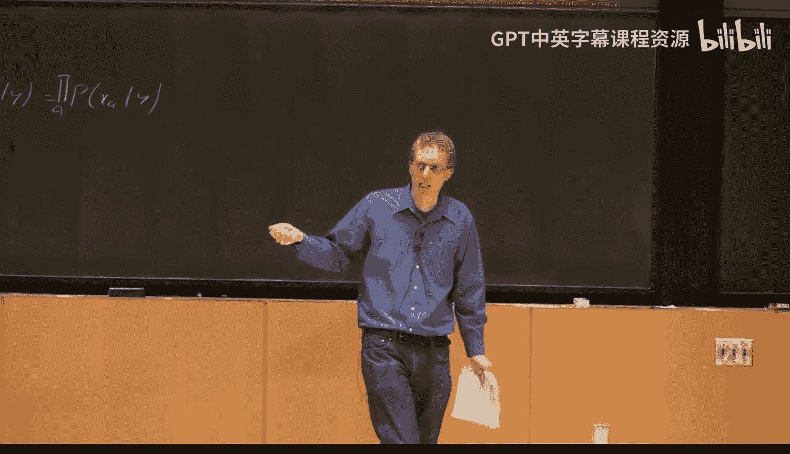

But seeing both of them together is extremely unlikely， right， There's actually， though so far。

 theres not yet been anyone who's like Nigeria in trying to sell spam and also wants to give you $30000。

 right，s。

So if you actually write an email， maybe you talk about spam emails， right。

 something that I could send out to you。 And I mentioned both of these words。 Actually。

 that's actually， given that it's spam， both seeing both words， it's really unlikely， right。

 It's actually very， very small。 But if I decompose it。 And I say what's probably。

 given that it's spam that it's in Nigeria。 And what's probably that Is in Viaggra。

 it's actually pretty high， right， So in this case， actually an overest。 very nice。

 very nice example。😊，All right， good。So what I want to do today in the last couple of minutes。

start looking into a few base cases of knife face。哎。And。

So just to make this a little bit more practical to show you how it's actually used in practice。

 Okay， so what we said is we have this distribution P。 on let me just just erase it。😊。

P of X given Y。 And thiss ultimately what we are what we are approximating。So there， you know。

 so far so good， that's the first assumption we've made。 We have to make a section assumption。

 And that's what that distribution actually is。 right， And so early on， we talked about M E。

 we talked about the binomial distribution， but we could actually talk about many different distributions。

😊。

You know， that it could come up in in practice。 And so let me go over a couple。Let me just see。

 what's the first one I do my notes。 Oh yeah。 So the first one actually is， that's the easiest one。

 So if we actually say， what if my data has categorical features， right， So basically。

 I have't feature vector X， And each X alpha is element of some， sum you know， of one to K， right。😊。

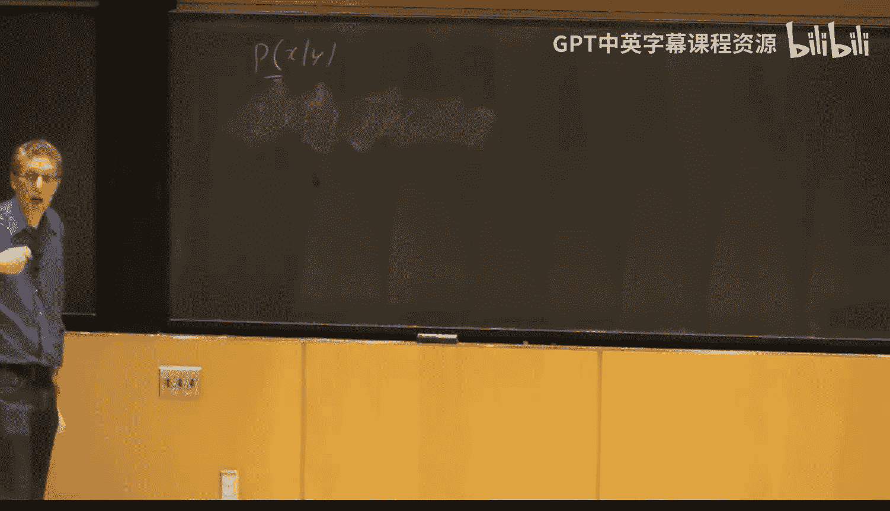

So。My X element of of R to the D。 But each dimension can only take on one of K values。 So。

 for example， you know， the typical example would be， you know， patient data in a hospital， right。

 And so， for example， the first feature maybe are you male or female， right？ that's then， you know。

 K equal2， then another one could be， what's your marital status， right。

 And so on these are kind typical questions they ask you， Are you allergic to anything。

 And they give you basically a couple of things to choose from， right， And that's。

 that's basically all you have， right， or similar actually。

 the example we just had was do you wear a cap， Yes or no， right。And so in this case。

 this is exactly the thing we talked about in in the previous in the M L E lecture。

 like flew few lectures ago。 but you basically say。😊，Well， the probability of a certain feature。

You know， having a value J， given a certain label。Is estimated as some parameter。 That's basically。

 you know， we had earlier。 that's the our theta。 That was the theta of our coin。

And we call this index by the dimension and basically actually by the， the feature value and by the。

Clas probability and。These are normal。 Let me explain this in a second。

 just to make sure everybody's with me。So。What Im。Let me just explain what I mean by this， so。

This's actually really， really simple。 What I'm saying for each feature， basically， I have a certain。

 I take on one of these K values。So in some sense， I'm rolling a die with K faces and have some probability for each one of them to come out。

 right， And so overall， they have to sum up to one， right So if I sum over J。

 which is basically the the feature type， this should sum up to one。😊。

And I have a different die for each class， and for each dimension。Okay， does that make sense。 So for。

 So for each dimension is's basically the question I'm asking the feature I'm asking。

 are you male female， for example， that may just be a coin chart right， Its a male， you know。

 that comes up with either male or female， right， but it may not be 50，50。 For example。

 hospitals actually， you know， because men die earlier and women live longer。

 but you actually mostly in a hospital when you're old， right。

 It could be that distribution is more shifted towards women versus men or something， right so。

But basically， for each， for each feature， for each label， you have a different die。 And this these。

 the probability of the size of the die have to sum up to one。Raise your hand if that makes sense。O。

嗯。So then the question is， how do I。How do I estimate this？ And this is exactly the the ML LE。

Or map map approach。 I basically say the probability that given that I have class C。And。You know。

 thisent is horrible。 I apologize。 I hate this temptation Now that I'mm seeing it， it's awful。

 Allright， so the probability of。Of X J equals J given y equals C， which is my。诶 datata。JC。

Maybe where's my alpha。 X sorry， the Al X alpha alpha here。Equs。

 And I basically what I'm doing is I just go over all my data points。 and I say。

 how many times do I observe this particular label。

And how many times do I also observe this particular feature of value。

And then I sum over the total times。Iob the link。Right， and I can do smoothing if I want to。

 So I can do plus L plus。Al times k alpha， which is， theres just how many。

 how many different parts of features there are。So this is actually nothing new。

 This is exactly the same thing what we did last time with M， L E and map。

Raise hand if that makes sense。Okay， awesome。 So let's get to the more interesting part。😊，So the。

 the only thing thats maybe confusing is because of the thetas。But。Otherwise。

 it shouldn't be any surprises。嗯嗯。Okay， next thing is。

 what if we don't actually use a binomial distribution， What if we use a homogenial distribution。

 That's something you have not seen yet。More dyial distribution。Okay， so by noial distribution。

 he said each feature can take on one of K values。 And basically。

 what we're doing is we are rolling a die that has K different， you know， numbers on it or something。

 And they have different probability。 And then that that's basically how you assign the feature value。

 And we're trying to estimate that die。😊，Mogenial distribution， the process is a little different。

 And that's the typically use， for example， for spam filtering。 actually。

 So most spam filters that you use on your whatever MacBook or something actually just use the naive based classifier with multiial distribution。

 And so here's the idea。 The draw M words， right， So you have an email。 The email has M words。😊。

And the way it works is you basically draw repeatedly without replacement。

 So sorry with the replacement。 So you basically， you have a distribution of all possible words。😊。

So there are some property that you draw the word the。

 some property that you draw the word A or something， right。

And then what you do is you basically just， you know， from this distribution， you just draw M words。

 and that's your email。Okay。The only the key key insight is that you have different distributions for different labels。

 So you assume that spam emails are drawn from some distribution， where， for example。

 the word Viaggra and Nigeria are now disproportionately more likely and not spam emails are you I have different distribution。

 So in my case， for example， the word Killian is's pretty likely it's not spam emails because a lot of people send me email addressing obviously addressed to my name right So in what these spamford is are basically doing there's estimates these probabilities from the data。

Let me formalize this。 So basically， what you're saying is my。Each feature alpha can be。所以诶。

Can be one。It be up to M numbers。And。M的。1。Yes。And this here is no longer a feature。

 iss a feature value， but actually means something specifically。

 This actually means how many times this particular word is present in your email。Okay。

 so your feature vector here is actually not。You know。

 it does not have as many dimensions as you have words in the email。

 It has as many dimensions as you have words in the vocabulary。 So in the English language。

 there maybe be 10 million。 right， So you have a really， really large dimensional vector。

And what you're doing is for each one， each one of these dimensions basically represents a particular word。

 let's say X1 is the word the， right， And then you count how many times to have the word the in my email。

Okay， that maybe 5， right。 So then the first entry is 5， right， that correspond。 you know。

 let's say the word A， right， That's alphabeical word。 The second one， maybe the word and， right。

 How many times do you have the word and in your email， I'll probably not， actually。

 right and and so on。 And you have the word all right， And all well， how many times do you have00。

 And so on。 And so you count you basically have counts of how many times each one of these words in your email。

😊，And the total sum of all these counts is exactly M。

 which is the number of words that you have on your email。Raise the hand。 That makes sense。哎，二审。So。

 of course， in practice， you don't store all these zeros， right， that's the， that's the trick， right。

 otherwise。The extremely inefficient。 So the question is。

What is now the probability of a certain vector X given。That I have， you know。

 a specific number of words。 and that my email that I know the label。

 Right It's either spam or it's not spam。And。王。What I'm doing is I basically， again。

 have a probability that I'm assigning to each。Each word。And so here's what I'm doing。

 I basically say， okay， well。The first thing is the order of the words doesn't matter。

 So what I'm doing is， I say， for each。One of these ten X D。

There's how many combinations I could rearrange my words in my email， right。

 I could have all the A A A A at the beginning and so on。

 and I could rearrange the words in my email alphabetically and would give exactly the same representation。

 right， So this is just this is you know， good old probability theory that you've learned in the middle school or something right。

 So this is just basically you know， considering that there's many different words of of reordering the email。

 which don't actually make any difference。 And then you say， okay， well。

 I'm going now now I'm going through my to my email 1 to D。 I look at every single word。

 And what's the probability that I'm drawing exactly X D of that particular word。 So。😊。

Theta alphapha C here is the parameter that basically says that given that the class is C。

 given that it's spam or not spam。You know， what's the probability of drawing word alpha。

And I drew it exactly that many times。 This should be an alpha， sorry。Yeah， this should be alpha。

 right， So I drew it that many times。 Okay， does that make sense。

 So this year basically the probability of coming up heads or whatever， right， Do you know。

 But that is the the probability of that word。 And I came up that many times。So this。

 this will be the probability of receiving exactly the email that you observed in that order。

 And if I multiply with this term， then I say， well， if I wishshuffle the words。

 it doesn't make any difference。Any questions？Raise your hand if that makes sense。

Raise your hand if you want to go outside and be in the nice， sunny weather。 Alright，'s good。

 see you all on Monday。😊。