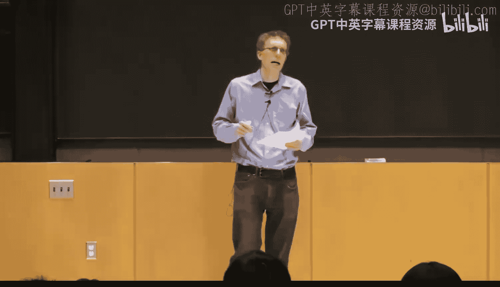
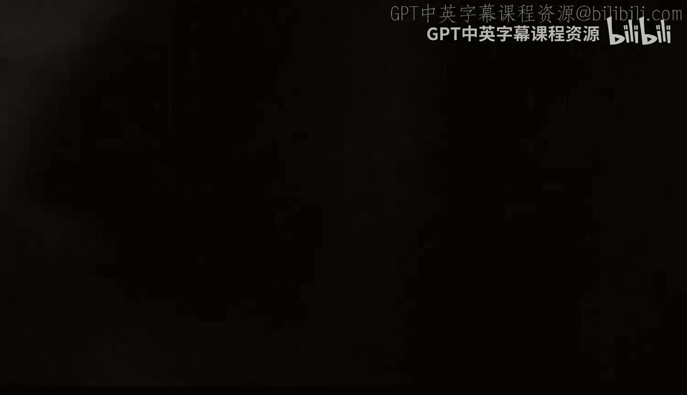
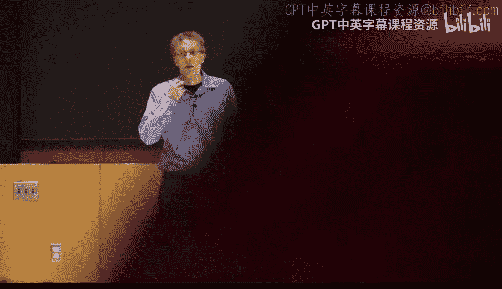
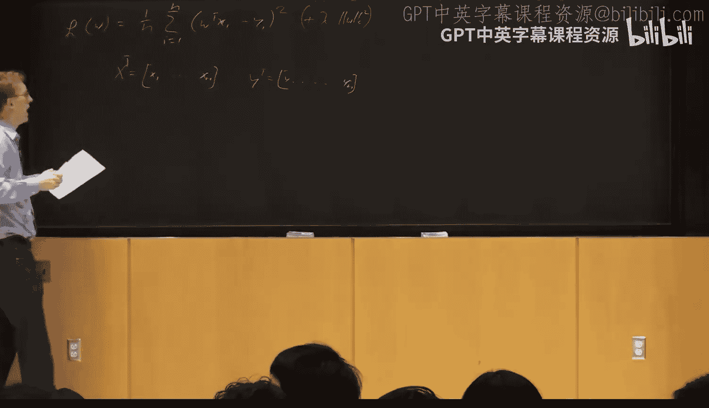
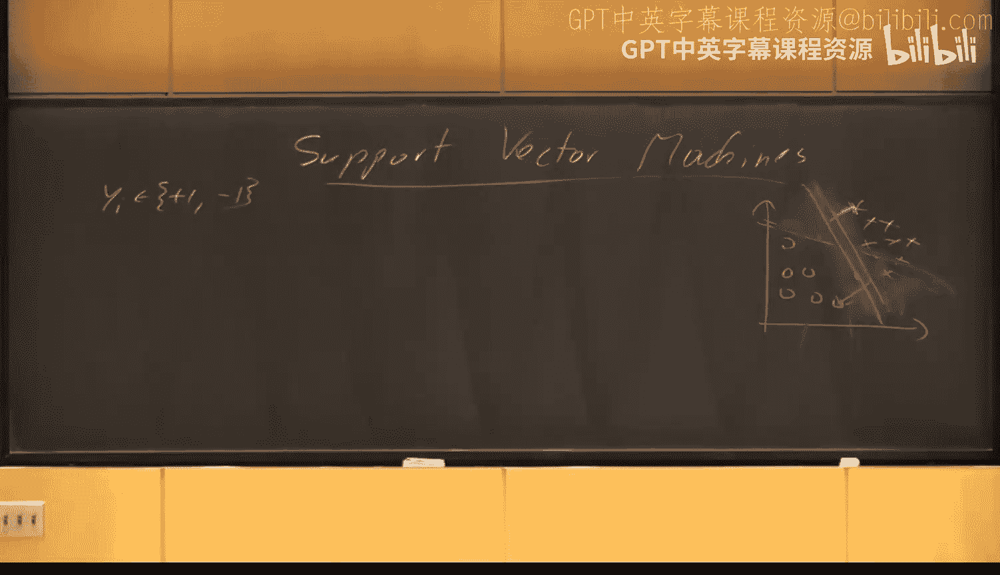
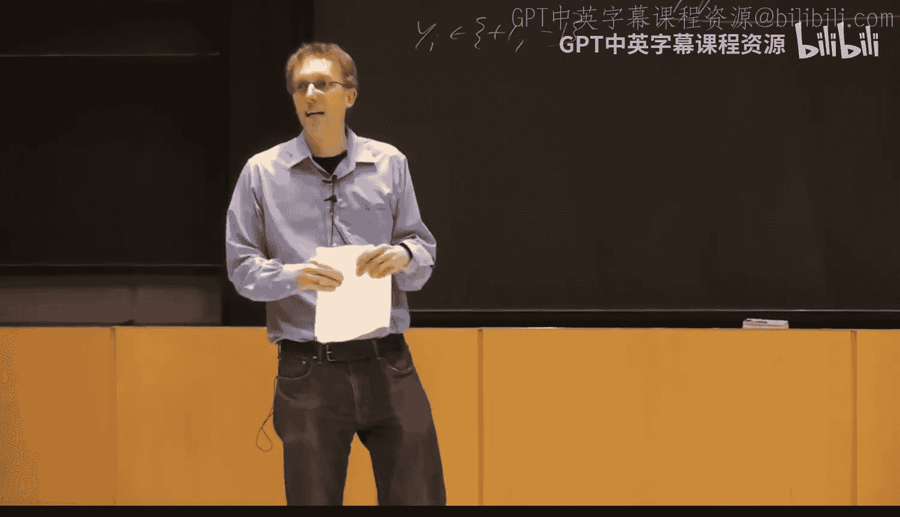
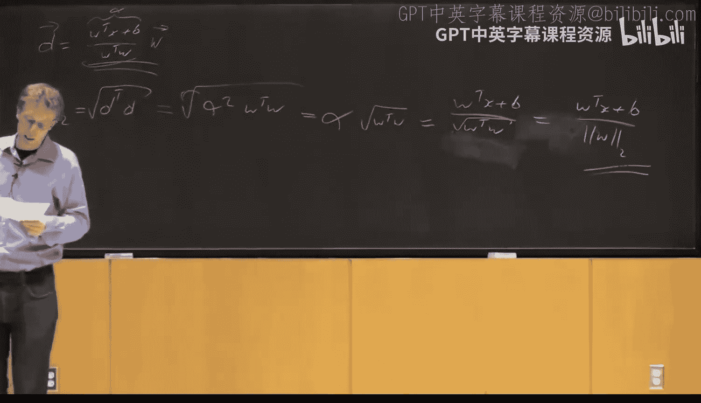

# 康奈尔大学《智能系统的机器学习｜CS4780 Machine Learning for Intelligent Systems 2017》中英字幕 p14 -14-Machine Learning Lecture 14 ＂(Linear) Support Vector Machines＂ -Cornell CS47 -BV1Lo6gBxEKE_p14-

Well come， everybody。Okay， that is good。All right， few logistics things。

I handed out the handouts already， so please make sure you have a handout。Also。The next project。

 which is diabetes believe Project 4。Is that correct。 Project 3 is9 phase。 Yeah。

 so now Project 3 is still going strong。 I see a lot of submissions。 It's very， very nice。😊。

Project 4 is， we are still testing a few aspects。 andre talking with vcarion right now to make sure everything works seamlessly。

 So it may be delayed by a few days。 So it may be delayed by until Friday。

 You will get your full two weeks。 so it is not eating into your time。😊，Also。

The CEO of Vquam just emailed me， he has seen all your complaints and all your suggestions。

Pazza， thanks to those who posted something there。 They are taking this very， very seriously。

 and they are very interested in fixing things。 So please continue to post things there。😊。

They actually， they found some bugs in their software。 And hopefully。

 most of these things will be addressed very soon。嗯。All right， any questions about logistics？

The other thing is the exam is just around the corner， by the way， right， So we have two more weeks。

 less than two weeks。So please get started。Please， I just want to remind everybody the exam is a huge part of the grade。

 like the biggest failure mode in this class is to do really well on the project。

 but not do well on the exam， so please take it seriously。😊，Okay， so last time we talked about yeah。

 question。Yeah， we couldn' only try to find one date where everybody can do it， it may be a Sunday。嗯。

It's really hard to get everybody in the same room。And yeah， please follow the Piazza post。

There we go。I guess if you， if you can't， if you miss the makeup exam。

 then there will end up being an oral exam。In my office， so。That's kind of the， the way it works。

All right。So last time we talked about the squals。So the square loss was basically linear regression。

 where we said， you have our data。 and we make an assumption that the data is somewhat。😊，You know。

 lies on a line， right， like basically line is a good model of that， of that data。嗯。

I better said there's a linear relationship between x and y。

And then we made a second assumption that， well of course the points won't be exactly on that line。

 so if they're off， we actually assume we have Gaussian noise。

 so you put a Gaussian around raising this and this says the probability of being here iss kind of a Gaussian center around the mean which is the position off that line。

😊，We derived this and it turned out actually， this last function is a parabola。😊。

And once we went through all the notions that just turned out to be quite simple。

 that last function was basically just， let me write it down here。

The last function end up just being。Some of points。W transpose X， I。Minus y I squared。

And if you do thats the ML E answer。 So this is basically the last function you're trying to minimize with gradient descent。

 And the ML E the map answer is you basically add a regular right to it。 You have Las Lada times。😊。

Squad。This is， if you have a map。哎。Okay， so one thing is this a problem。

T out actually has a closed forms of。 Right， So a function that parala you can just find the minimum in closed form。

 is essentially actually doing a hassian update。 If you just do use the Newton's method and take one step with Newton's method then actually you get right to the minimum。

😊，We can quickly derive this。 I just want to spend three minutes deriving this。

 One question that people ask me is。You know， do people actually， like， you know。

 if there's the closed form solution， why don't we just always use the closed form solution。

 Why don't we actually just gradient descent。And the answer is， as you will see in a minute。

 the closed form solution requires d squared memory。And is actually de cubeed in complexity。

So I'll get to that in a minute。 But it turns out that， for large enough， dimension。

 that thats actually is prohibited。So。Let me just derive this real quick。

What's the close resolution is， let's say I define a matrix x where。X transportpo is the following。

 X1。X， N。And y transpose is y1。Why。 so X is basically a matrix where every row is and data input is exactly the kind of matrices you use in your project。

😊，Then I can write this last function。 as by the way， please， everybody kills your laptops。

 Thank you。😊，You can write this last function as the following。

 This is just x times w minus y squared。

， so that's that's the last function。 If I just write a matrix notation。

Rraisezy hand if that makes sense？Alright， awesome。 So I can write that out。

 and I get x y W minus y transpose X W minus y。😊，So that's， you know， so far， nothing Inter here。

And if I multiply this out， I get the following you get W transpose X transpose X W。

 at these two terms， then I have minus twice y transpose。😊，XW。Oops。plus， y transpo y。Alright。

 so this is just。Completing the square。And this is now my function。

 this is the parabola you see basically， this year is a positive definite matrix。😊。

And if you now want to find the minimum， we just take the derivative and set the derivative to 0。

 We take the derivative of this function here with respect to W。Right， any questions so far。

So one more time I took this last function。 I just divided the matrix notation just because that's cool。

 right， And then I write everything out in matrix notation just makes it very obvious that there's a close form solution。

 And now I have this function。 Yeah， this is just the function of W。 right， This is a function。

 It tells me the last respect to W。 If I want to find the minimum。

 I take the derivative with respect to W and set that to0。 right。

 This is something you've been doing your whole life。 right。😊，And so if I do this。

 then the derivative of this function becomes。X transpose， x。W， right this see is a quadratic term。

 This is， by the way， if you're not familiar with taking derivative reflect vectors。

 please look at the matrixtri cookbook。 It's something that's very， very useful。

 If you're familiar with it。 If if youre not if you're uncomfortable with it。

 you can always go back and take the derivative respect to every single W I right。

 so that that always works。 It's just a lot of notation， a lot of summation。😊，So it's actually。

 it can， you know， when you do this kind of work， it can can save you hours and hours of time if you are just familiar with taking derivative spec to matrices。

Okay， so this， this is the term we get here。 This is because we have W on both sides。

 just ends up being x transpose x times W。 Then we get -2 y transpose。X， and then， you know， the W。

 this is a linear transfer。 So we just get y transpos x。There's the derivative。

 we said this equals 0。So if you put an equal 0 here， that's the same thing ass put equal here。

Raise your hand if you' still with me。Allright， now we get rid of the22s because we don't need them。

 They on both sides。And now we have some matrix。Times w equals something。 Well。

 we just multi with the inverse of that matrix。 So we get w equals x transpose x。-1。 Oh， sorry。

 I made a mistake here。就是是。X transports one。A trans。Okay， after transposeing。嗯。

And that's the solution。So there's actually the close form solution to this last function。

 So if you can compute this， then there's nothing else to be done， right。

 You just jump right to the minimums。 You know， there's basically。

 your function is a parabola and you can just it jumps right here， and then you're done。😊，嗯。

Why don't people always do this， The answer is this matrix can be gigantic。😡。

And inverting it a gigantic mat can take forever。 So there's two problems。 A。

 you have to store this in memory， which you may not be able to do。

 And then also actually inverting inversion is is very expensive。In practice， actually。

 you don't do the inversion the way actually you can also write this as a linear program。 and then。

You can do it a little faster。 But ultimately， the complexity is the same。

 The complexity is the cubed。 So QB complexity is always a problem。 So what that means is basically。

 if you double your data， it becomes a times small， eight times slower。 And so that's。

 that's what QB complexity means。😊，The complexities。D to the cute， right， that is the come。

 And this is the space complexity。 So this is a space。AndThis is consultation。Risezy hand。

 that makes sense to。O，到时。嗯。嗯。Basically that that's kind of， you know， elementary， you know。

 computer sciences， the ideas， basically， whenever you have an algorithm， you try to argue。

How much slower does the algorithm get， how much more space do you need as you increase your input size。

 And here， this is a function of the number of dimensions that you have。So， for example。

 in Stan filtergering， my economical example there you actually have millions of dimensions potentially because these are the dimensions are the number of words in the English language。

So if you have millions of dimensions， then this year becomes prohibitively expensive。

 So what you do is you just do gradient descent。 and that actually works really well。

Any more questions about these squares， yeah。Oh， it's just because when you take the derivative。

 you have to actually take the A times W。 If you take derivatives make to W， it becomes a transpose。

So that's the matrixtri cookbook。Okay， any more questions？All right。

 today we will do something much cooler。😡，Even cooler than linear regression。Okay。

 today we will talk about support vector machines。😡，All right。So。

One more time we the last lecture we talk about regression。

 Let's go take a step back once more time one more time and talk about classification。

 So our labels Y I are this time either plus 1 or -1。😊，And。Just as before。

 we make the assumption that the data is linearly settledd。So we have data。You know。

 we have some crosses and positive points。 We have some negative points。

 And we would like to find a hyperplane between these two。Now。

 one thing you already know is like if you know such a hyperplane exists。

 we have an algorithm to find such a hyperplane who remembers the name of the algorithm。😡，Perceptron。

 right the perceptron finds us a hyperplane， but you have no guarantee what hyperplane it finds。

 right， It turns out actually， there's infinitely many。 if there exist one， there's infinitely many。

 So you could accept this one or this is a hyperplane or this is a hyperplane， etca， right。

So people have been wondering ever since it was possible to find a hyperplane。

 The obvious question is， well， which one should I find， right。

 And that's where the perceptionceptron is weak， right， You have no guarantees on what you find。

What the SVM does， it actually finds you one a very specific one。

 And I would argue that's the one you do want to find。And so if you remember correctly in the。

 in the SV the perceptioncept proof， what we talked about is the this notion of margin。

 basicallyy said， you know， how many steps you need to find this hyperplane is inverse proportional to the margin。

 So what you want is the data to be far away from each other。

 And just to remind you that margin to have a hyperplane。It's the distance to the closest point。

that's， that's the margin。 I call it gut。嗯。And。The intuition behind SVM says that。

If I want to find any hyperplane， the best hyperplane is actually the one that has maximum margin。

AndThat's the idea。 So originally， actually， they will you know。

 phrase margin maximum margin classification。 And that's not just a good intuition。 You can actually。

 you know， theoretically derive that this actually is you know， likely to generalize very well。

 So the idea is， if I have a hyperplane that's kind of really far away from the positive points and really far away from the negative points。

😊，Then if my positive points and negative points are drawn from the same distribution。

 they won't be exactly the same points。 like my test points that I'm actually。

 that I actually care about。 when I actually deploy this thing。

 I'm gonna see slightly different points， right， I see maybe this point at this point， right。😊。

Hopefully， they will， you know， they will be somewhat in that region where the with the axis where my training axis are。

 And if I move my hyperplane as far as possible away from these points。

 I give a lot of margin of error， right So they basically， if they're here。

 then that's not a big deal， right， because I actually have this larger margin of which they could fall into。

 if instead I drawn the hyperplane like this， which is perfectly fine。

 It separates the training data very well。 But now if a test point is here。

 It will actually be misclassified right And intuitively。

 that seems like the wrong thing to do because that point is still very close to these guys。😊。

Does that make sense？So the idea is if you find the maximum margin hyperplane。诶。It's actually。

 that's basically defined as the the hyperplane that has the maximum distance to its closest points。

 And that's always exactly the same on both sides。 Can anyone tell me why that is the case。

 Why do you have the same margin on both sides。One person already knows it。Yeah， sure。That's right。

 if one side was closer than the other， then let's say here is a little larger than what I could do。

 The margin is actually the distance to the closest point。So let's say my hyper plane is this。

 And this guy is closer than that guy。 But what I then can do is actually I can my the margin is defined as the shortest distance to a data point。

 Then I could find a better hyper planee that's moved a little bit over here that increases this margin。

 So by definition， the distance to the closest point on the positive class and the distance to the closest point in the negative class must be exactly the same。

😊，Okay， any questions at this point。

Alright， so SVMs are were invented， I think， in 1994 by Corria Cortez and Isabella Gion and Vdir Apk。

😊，At A and T。To， to this day， they are the most popular machine learning algorithm and are extremely successful。

😊，That's。So was one of my favorite algorithms。There's one little caveat。 They actually。

 it's actually patent it。 So you're not allowed to use it。嗯。But besides that， it's great。

OrBut it put another way if you use it。😡，And， you know， you just can't admit it。

 So there's actually a patent trowl company that owns the patent。And if you ever， you know。

 would admit that you use SVM's any product that makes money。

 they will sue you quicker than you can say vector machine。And。So and actually， Oracle， for example。

 they foolishly agree， you know， admitted at some point。

 they advertised our databases now have super machines and bam， right， They get to the next day。😊。

嗯。But you can always say we're just using learning a linear classifier that has a maximum gap between the hyperplane and the closest point。

 So if you avoid the language a little bit， then it's very hard to prove that you're actually using Ss。

😊，Okay， good。So let me just formalize this notion of margin。

 We've talked about this a little bit already， but let's just make this crystal clear。

So we have our hyperplane。 Our Hyplane is the following set， with data points。诶。

Except to w transpose x plus b equals 0。so this is my hyperplan index by WN P。嗯。So far。

 that should be， that's， that's basically the set of all points that lie。 right， here。

 in this middle。And what I want you to think about a little bit is what is the distance to a point from a hyperplane。

 And this was， you know， you may recognize this was actually on the placement exam for exactly that reason。

 because I wanted you to kind of get a little bit of a head start just thinking about the geometry of these things。

So let's say this here is my hyperplane defined by the vector W。And now I have some point X。

And I would like to know， what's the distance from this point x to the hyperplane？And well。

 the first thing I can do is say， well， I can project this point X onto the hyperplane。😊。

That's basically this point here has called it X， P。

And then the distance from the hyperplane to this point is exactly the distance between these two points。

And because this vector to your deep。Any questions so far。Raise your hand if you're with me。

All right， good。So one more time， I have this hyperplane W this hyperplane defined by W。

I have some point X。 I would like to know how far away is that point from the hyperplane。嗯。

What I do is I project the point onto the hyperplane。

 that's the basis the closest point on the hyperplane to X。

 and now I measure the distance between these two points， X P and X。😡。

I call the vector between these2 D。So， then， I can say。X equals， sorry， Xp equals。X minus D。Okay。

 so if I take X as atract D from it， then I get exactly my point， X， P。All right。Any questions？

All right， So then what do we know about Xp。We know that X P lies on the hyperplane。

What do we know about points on the hyperplane？😡，By definition。

 these are the points where w transpos x plus B equals 0。😡。

So what we know is that w transpose Xp plus b equals 0， right？😡，That's just the very。

 very definition of points on the Hy planee。 And we know XP lies on the hyperplane。So far。

 no big problem。Now， we can。Plug in our definition of X P in here。

So what do we get is W transpose x minus D。Plus B。Itals 0。And now comes the question。

 what does this be？😡，And。Here's one interesting realization that D is actually as I didn't draw it that way。

Must be parallel to W because it actually points away from the hyperplane。

 What points exactly or to the hyperplane is the vector W。Right， so actually。

 D is basically a rescaled version of W。 It must be， right， because it's parallel to it。

So I can say instead of D， I can write， D equals alpha times w。Raise your hand of you with me。

Awesome， so I just plug this in here。 And what I get is W transpose x minus alpha times W。😊，Plus。

 b equals 0。And that's。All I need， because here B is given。 W is given。 X is given。

 So the only thing I don't know is alpha。 So it can solve for alpha。And if I do this。

 what do I get I get？I solve this。F that。 Al equals。W transpose x plus B over W transpose W。

So what I'm doing here， Well， I know， maybe I give you a minute to digest this and try of。

Verify this。Any questions？Rrazy hand， if you want me to move on。Awesome， okay， good。

So my hope was that if you've all done it for the placement exam。We can go through this quickly。Okay。

 great。So now we know exactly what alpha is。 That means we know exactly what D is。

 So D is alpha times W。 So D equals。😊，This term here。

Al times W Al is W transs x plus B over W transse W times W。And that basically that's a scalar。

 that's my alpha。And that's my w。All right， so now what I want to know is what is the length of D。

RightAnd that's basically， but as a computer， what's the norm of the。So， the norm of the。

Equals T transpose D。And the square root thereof。And that equals。Well， okay， so I guess I have。

Actually， let me write down Alpha squared W transpose W。Because D is alpha times W。

 So this is alpha squared and。Iい。People nodding， Maybe you just no。

 I don't have to raise your hand all the time because there is some vigorous nodding。 Okay， good。

 thank you。 You take the alpha out。 right It's alpha squared。 We can pull that out。😊。

And then you get square root of W transpose W。嗯。Now， what is this。 Well， what's alpha one more time。

 That's this term up here。 That's my alpha。It's w transpose x plus B over W transpose W。

 That's my alpha times the square root of W transpose W。Okay， one more time。I take my D。

 I have a formulation for D。 I want to know its's norm。 Nor was just the square root of its square。😊。

Back to square。Now I plug in the definition of D is alpha times W squared。 Thats sorry alpha times W。

 I squared the whole thing。 I get alpha squared times w squared。I pull the alpha out。

 I get alpha times the squared of W transpose W。And now alpha is this term here。😡。

If I multi that with a square root of W transpose W， I can just。Dide by it， and this term disappear。

And that's ultimately what I get。So it is W transpose x plus B over the norm。Of。

Which is what this is the norm of W。So this here is the distance of 5。 x。To the hybrid plane。

 And if you remember this from geometry， when you went to high school。

 that's exactly the formula you learned。Any questions？Where did you move on？

Question ready to move on。Okay， question， yeah。other。飞。好，可以。Great impossible。Bas at work are there。

It works in all the spaces we care about。Yeah。诶。I mean， it doesn't have to be， oh， sorry。 I mean。

 is just has to be theres Euclidean spaces。So it doesn't have to be two dimensional or something。

 this can be n dimensional or D dimensional。 That's totally fine。

And it all works in actually in general ban spaces， etc。And this is。

 this will become relevant in a few lectures。Good question， though， yes。Any other questions？Okay。

 awesome， so now。This is the distance to a data point。

 Well we want to know the the smallest distance to a data point。

 And so we can just define the margin。

Off a hyperplane， defined but W And B is。The smallest。

Such distance the smallest w times is x plus B over the norm of W。

So that's basically you go over all the data points in the data。

 and you compute the distance to the hyperplane for every single one of them。 And you say。

 what is the smallest one， Which one has the smallest distance。🤧嗯。Okay。

 maybe take a second and digest everything。All right， any questions？All right。So what an SVM does。

 it says well a second， right， So we can define。You know。

 this basically the formula of the margin of a classic fire， there gamma here。

And what we would like to know is the hyperplane that has the largest has the largest margin。Right。

 and this is， this is what the margin is。So why don't we do exactly that？

But't we just say you want to find the W。You want to find the W。Which maximizes。W come and。

gamma of W。 This basically says you want to find W that maximizes the margin。

So if we just leave it as this。What do we get。right， so maybe。giveive you a minute to think about。

 So are we done at this point， If we just say this is an optimization problem。

 I just want to find any hyper plate W B， which has maximum margin。

 So I give you a minute to think about it with your neighbor。😊。

Why is this going to blow up in my face。Yeah。这是。め。Yeah。Yeah。没题。以上。Yeah。可快。No no。我。All right。

 Who knows that this is my data set。 I'm trying to find a hyperplane that maximizes the margin。

Where should I draw the hybrid plan？Why is an optimization going to give me？Yeah。

You could drive it here， that's right。And so if you want to maximize distance to your data points。

 you're just going to go push it away to infinity， and that's a great pipeline。

 really large margin to both classes。😊，But that's not what we want。

 We want a hyper planee that actually lies in between the two classes， right。

 It's actually separated。So we have to somehow force this， this。

 this maximization to also do something sensible。 And we do this with a constraint。

 So This goes into constraint optimization graph。 So a constrained optimization， you basically say。

 well， minimize this function。 and as we maximize this function。😊，Subject to a certain constraint。

 the following has to be satisfied。 And the constraint is that for all our data points， I。

We have to have that Y I W trans equal X I plus V must be greater equals 0。And so。

We had this before and when we talked about the perceptron， this year。

 reason he says which which side of the hyperplane you lie on， right， if you're positive in one side。

 you're positive on the other side that's negative。AndIf you multi with a label， the positive points。

If the positive points are on the positive side， and that's positive。

 And if the negative points in the negative side， that's all the positive。

 So if this constraint is satisfied for op I， then you must lie between them。 And then actually。

 we get the rh justify。😊，Any questions？Yeah。やて。咩。The minimum I。WhatYou're looking ahead。

I'm not there yet。Right， good point。诶。So we'll get there very， very soon。😊，All right。

So we want to solve this。 right now， we don't yet know how to solve this。

 And so this is actually what people will get to in a second。

You want we know we want to maximize this function subject to this constraint。

 And now just pay attention for five more minutes， right， then be this。's only like three steps。

So you're got to learn something really， really cool。😊，嗯。

Being able to solve these things makes great conversation pieces at first date。😊，Cocktail parties。

Alright， so now you plug in the definition of gamma， which is basically just saying you want to find。

 you know， here， you want to find， you know， the minimum。X element of D。嗯。

W transpose x plus B over W transpose W。Next， is the absolute value。Okay。

 so now we have something really nasty， right， Oh God，'re gonna put on sunglasses。

 So it's gonna to protect our eyes。 It's a maximization of a minimization， right， It's nasty， right。

😊，So let's not be scared。 just keep going。What can we do。

 The first thing we can do is we can pull this w transpose w out of the internal minimization。

 you have a maximization for minimization， But w transpo w here is not actually a function of X。

 so we can pull that out。😊，So you pull that out。 Sure， why not？ W transpose W。

So now we just get this term here。 So we minimize。W transfers x to Sp over x。

 And then we multi the whole thing。maximize that over W。 That's still pretty scary， right。

But now comes the cool trick。And the cool trick is that if you have a hyperplane。😊，Right。

 and this here， my airplane is defined up here。 But this is my my W， right， my I said。

All the points such that W transpose x plus B equals 0。

What I can do is I can multiply my WM B by any constant。And it doesn't change a thing。Okay。

 does that make sense So if I take this equation here， W transpos x plus B equals 0。

 If I rescale W and B， by any positive value， it makes no difference， right。

 this is gonna be exactly the same set。 So what I'm doing essentially。

 I'm just recaling this vector here。 W， right， It can have infinitely many scales here。

 It's always exactly the same hyperplane。😊，So that's a degree of freedom that we can utilize。 Okay。

 so currently， there's no unique solution。 So we don't care which scale we get。

 And it doesn't really matter。 We just want to find separating hyperplane so we can just fix a scale。

Raise hand of that makes sense。Alright， awesome， good。

 So let's just fix a scale that's really convenient to us。😊，And here's the scale we're gonna fix。

 Were gonna say， okay， well， we want a very specific scale， such that。AndThe minimum。

W transpo x plus B。Right， it's just this。 Well， yeah， okay， minimum。Equals one。

So you basically say we just rescale it exactly in a way that this here is one。It's a good trick。

 right， So now this whole thing is just what。And so now we are left with just， you know。

 the maximization of one over W transpose W。And we just have one more constraints to talk about this。

So， so the the objective function is now much， much simpler。 Okay， any questions。

So we still have to deal。 have， you know， we have committed some sins here。

 We still have to deal with this。This constraint in the future。 But， but for now， just just。

 you know， we basically pushed it down as a constraint。Yeah。because there's always， I guess。

 if I give you some X and B， right， I can always rescale this in anyway。

 the minimum what the margin is exactly one， right like whatever your margin is。

 I can just divide my W and B by exactly that value So that this term is one。 right。

 It gives me the same hyperplane。😊，Doesn't give me the same solution to the problem。

 but I don't care about actually the， the the actual value of this problem。

 I care about the hyperplane， right， for my means and purposes， that's， that's identical。

Does that make sense？All right， good。 So now we can。You get rid of all this。 scary stuff。

 And now we have one hour W transpose W， right。Now。

 here's a very important lesson that you learned last time。 right， Maximization is for losers， right。

 You gonna to minimize So thats。😊，Let's put a minimization here。if you just， you know， in， you know。

 just say instead of one over w transse W， you just max minimize W transse W。

 that she's the same thing。 There's no difference， right。

 You can either maximize x or minimize one over X the same thing。Okay， good。

 raise your hand if you're still with me。All right， okay， good。 So now we are almost there。

Now we just have these two constraints。😡，And so now I'm I claim something。

 and I want you to verify it。That。Instead of these two constraints， right。

 we can actually write something else。 We can write instead of these two constraints。

 we can actually write。 That's the case。 if and only if。For all I。Y I W transpose X， I plus B。

It's greater equals one。So I claim that this set of constraints is identical to these two constraints。

 In particular， these two constraints if they are satisfied， implies this。And if these are satisfied。

 it implies these two。And I give you a couple minutes， please。

Talk with your neighbor about it and see if you can prove it that these that's actually exactly the same thing。

Right。Alright， who can go one direction or the other left to right or right to left。Who is brave？

Nobody。All right， author， right。在啊。If you're minimal。

lotAnd everything else is greater than zero then everything's just greater。Okay， good。 That's right。

 So this from going this direction。😊，To that direction， right， But saying everything is， is。

Greatta equals 0。 You have to be a little careful。 actually。

 So everything here basically says has the right sign。's on the right side。

 So what I can do is I can actually rewrite this thing here is Y I times this right。

 instead of the absolute value， because that's the same thing is that basically multiplying with the same sign that's here。

😊，Otherwise this would be negative。And then I actually know that the minimum here is one。😊，Right。

 therefore they must all be greater than equal1。 That's another way of saying it。Okay。

 raise your hand if that makes sense。Okay， good。 Any questions， Theres some questions， yet。

So in this case， actually， you're just going from left to right。

 You're just saying the fact that everything is the minimum is one。

Must mean that everything is greater equal1。 So that's just going from left to right。

 I think what you're concerned about is the other way， right you're saying going from right to left。

 it could be that the minimum is actually 5， right， which is so greater equal ones。

 everything here is satisfied。😊，But we are we are violating this guy here。

 right that's your question。Okay， good。So left to right， everybody's okay。😡，Left to right， tick。Okay。

 now right to left。So assume this year is satisfy for every single data point。Now。

 he's raising a very， very good point， right， He's saying， wait a second， assume。

For every single data point， this expression here is greater equal1。 Well， it could be 5， right。

 or could be 100， right， the smallest one could be 100。😊，So then let's see is definitely satisfied。

 Everything is， you know， greater than 0， greater equals 0。

 So you're not worried about this constraint。But this here seems fishy。 right， here。

 be're saying very explicitly。The smallest margin has to be one。

And he was just saying it has to be greater equal ones， So it could be larger than one。

 Why is that not an issue who figured it out other than author。Yeah。You could。

 And why is it going to be scale downscaled， Why is it going to be exactly one yet。That's right。

 because we are minimizing W， right？ So if you had something that's larger than one。

 let's say you have 10 right， for the smallest one。 And every single one of them is larger。

 greater equal 10。😊，Then what you could do is you could actually reduce your W further， right。

You could just actually divide W and B both by 10。Your constraints are still all satisfied。

But you're getting a smaller objective value。And therefore， it can't be the optimal solution。Right。

 so in the optimum。This implies that。Does that make sense， that argument makes sense。

So the key is because we are minimizing the square of W， we are fine。Any more questions？Alright。

 so the good news is this problem on the right， actually is。😊。

A linear a cadratic function appear right before it disappears。 This is this is a parabola。

And this is a linear constraint。That's a quadratic program。

And quadratic programs is something that our friends in the math department have been studying for 50 years。

 So they've written all these packages and obscure languages that nobody uses to minimize these functions。

😡，And。We can use them but write our own。嗯。Real quick。 Yeah， last lecture。

 you said you were going to start with demonstration， and I completely forgot about it。

 you brought down the projector。All right， I owe you a Ta。😊，He called my bluff。 I made up that demo。

 but。Yeah。No， no， I do actually have one。All right。All right， thanks， thanks for keeping me honest。

Well， let me first do the demo for this class。 And then we can still do the element。

Why is the banana， I don't know。Okay，So here we go。 So we have a data data set。

 we can now create a data set。😊，诶。Let me just make some linear receptable。 data shoot。

 What's going on。Oh， that's good。 al right。And I hear my negative hear my positive points。

What other rounds。N in an hour run my SBM solver。And what will give me is exactly。

The hyperplane with maximum margin。 So you basically see， heres the hyperplane。

 and the white lines are basically exactly the parallels that goes to the closest point。

And you can see they exactly parallel。 They echo distance from each other。 right。

 And so the beautiful thing is about， you know， you just run this Q P solver。

 this quadratic programming solver and bam， right， you get the answer。😊，There's no iterative process。

 I mean， ultimately inside that package。 you have iterative process。

 But it's such a beautiful formulation of a machine learning problem。 So when this came out。

 people hadn't thought of machine learning that way。

 Everyone thought of like some algorithms that iterated or something right。

 And then basically Kana Cortez and Iabel like Y came along And they just said， well。

 you can just write this as an optimization problem。 And， it gives you the answer。

 And that put the entire field into a frenzy like for 10 years， nobody did anything else。

 but quadratic programming， or you know， convex programming。😊，I can show you some， you， I don't know。

 anyone want to see any other examples。诶。I mean， I guess we can do something where they are really close together。

 right， That's something where the perceptron would take a really long time。诶。

And so here we have you know， a very， very small margin。

So the perception would take a long time to converge， right， But the SVM ban。

 right immediately finds it。 And so this is what makes SBM so， so， so popular。

 It turns out there like when this came out， it's ugly they blew everything else away。 You get much。

 much lower error most data set， right， and you could actually run it。

 Like it's such an elegant framework， right， Everybody understood it。😊，Any questions about the demo。

Yeah，ization。On one side， the closest of one class， the point。 What about the one on the other side。

 Just minimizing the closest point to one class， also minimize the market。喂。No， no。

 you're automatically minimizing both， right， because you're minimizing。Do you mean the constraint？

The basically that the closest point is to be run away。 But by doing that。

 you have to have equal distance from both classes。 Otherwise。

 you could always move closer to the one that's further away and increase your distance to the closer one。

😊，All right， so the other demo， I guess I pushed that away to next lecture。

 please remind me at the beginning。