# 康奈尔大学《智能系统的机器学习｜CS4780 Machine Learning for Intelligent Systems 2017》中英字幕 p17 -17-Machine Learning Lecture 17 ＂Regularization _ Review＂ -Cornell CS4780 SP17.z -BV1Lo6gBxEKE_p17-

Everybody。Alright， so a quick thing on Tuesday， as you hopefully know， at this point， is the midterm。

If you haven't started this point， please realize that you're late in the game and get started as soon as possible。

Last time we talked about regularization。And。I showed you that the L2 regularor。😡，Is。

Basically saying， I have a ball。 Oh， wait， this is not on。 This is on。No， is it all now better， yeah。

L2 regular rise says you have a ball around the origin。And。Maybe let me move this up after all。

So the L two regular rises a ball around the origin。And。What he's essentially saying is。

You see solution has to lie within the ball。 And this is how you control complexity。

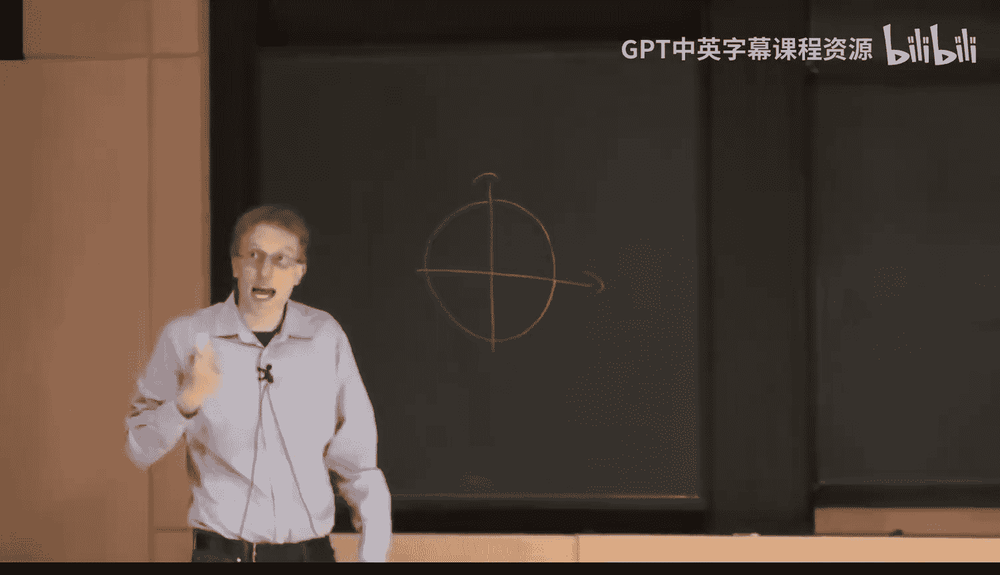

Please close your laptop。 Thank you。哎。This is how you control complexity， so。

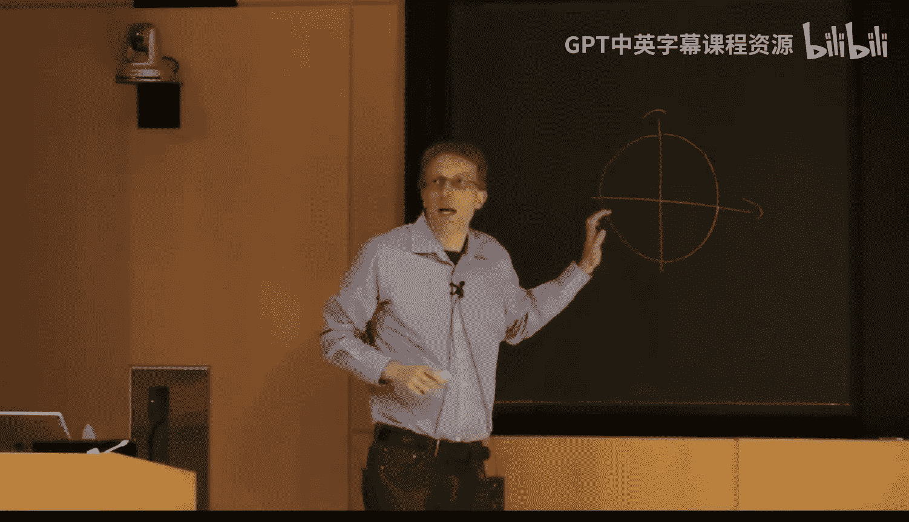

Essentially， what you want to avoid is that you get a really。

 really complicated solution where some values are really， really large and others are really small。

 If you shrink everything， it basically has to come up with some simpler solution。 That's。

 that's the optimal intuition。And you're restricting the space。

 right instead of actually finding a solution anywhere in the space， you just say， well。

 I has to belied within this spot。 And so you， you try to minimize some function。 as it is。

 my function， here's the minimum。 So ideally， if I didn't have any constraints， I would end up here。

But my worry is that that would actually that could overfi with the training data。

 So what I'm saying is find a solution to this function， but stay close to 0。

And that typically helps with generalization gives you a better estimate， you know。

 for your test data。 And also actually， that's actually what the map estimate gives you if you have a prior Gaussian prior over your your vector。

😊，Another norm， another regularizer that's just as popular is the L1 norm。

 So the L1 norm is the following。 You just regularize lambda times the absolute value of w。

And if you draw that as the same kind of image。What you get is not a ball。 It's called the L1 ball。

 The L1 ball actually is not a ball at all。 It has corners。 It looks like this。this is the L1 ball。

 It's kind of like a diamond。Right， and so you're restricting。

You to try to find the optimal solution， and you're restricting your set to be inside this L1 ball。

That's the idea。Can anyone imagine what are， what are the advantages of the L1 ball。

 What are the properties of the L1 ball， Like， why would you do this。

 Why would you not alwayss use a circle。Any ideas。啊。他这。嗯。Well， this is。

 this land that basically defines how big that that that area is， right。

 you can make it as large as you want。 It doesn't have to be uniform。Yeah。That's right。

 The increases sparseity。 That's exactly right。 So， so what it does。

 let me explain this for everybody else。 What happens is。😊，It's like you're minimizing this function。

 right， And let's say this function is up here。 The minimum is up here。Okay， so ideally。

 what what you want， right， This has my W1 value。 This is my W2 value。

 The best thing would be to have W2 pretty large in W1 some small value。 Okay， so that's the。

 that's the optimal solution。 If no constraint was， was enforced。Now。

 I'm enforcing matter 1 constraint。 And now， if you look at this objective。

 let's say this objective function looks something like this。 right。

 What you will see that actually the optimal point will be exactly this corner here。Right。

Because because it has these pointy edges， the pointy edges of， you know。

 can penetrate this function a little bit further。 And so the optimal solution will be this value here。

And what does that mean， I crank up W2 as much as I can。 And I said W1 to 0。

 not just a small value to 0。 And so that's what what end up happening here in L 2。

 you don't really see this And L 2， you would end up somewhere here。 Pret， pretty close。

 Like you would have a very， very small value to of W1， but it wouldn't be 0。

And the reason people really， really like setting things literally to 0 is because then you can rule out that whatever feature W1 you know。

 whatever dimension that corresponds to contributed anything to the prediction。😊。

So if you make predictions in biology， and you want to know， you know， for example， here's my， my。

 you know， DNA or something， right， And and I want to predict， does a person have， you know。

 it is likely to get cancer。 Yes to know what I would love。

 right if most of the weights are actually zeros。 if I can do well by a prediction well。

 And then actually most of my weights are 0 Then I know all of these things actually don't didn't。

 didn't actually contribute to the prediction， right， And that makes it much。

 much easier for me to understand how the algorithm arrived at the prediction。😊，Okay， so but people。

 especially in sciences， people actually care much more about understanding the prediction than actually the actual prediction itself。

 And so therefore， they love these sparse vectors。 in a lot of things such as0。

 And so with very high dimensions， what you will see is that actually， you know， in three dimensions。

 this kind of， you know， kind of goes out of the。😊，It out of here。

 And so these entire edges all have W 1，0。 So in high dimensional spaces。

 this thing consists of many， many edges。 and almost all of these edges have the majority of the weights set as 0。

😊，So your， your answer will always almost always lie on one of these until you will get a very。

 very sparse answer。 Your weight vector set almost always to 0， yes。😊，我。

the goal is to reduce like content。It could be very little， like why not？

Use like the arguably better。我啊。然后。We your profit buy。I。Right， so what。

 what this thing is going to do is this， this will set something nonze to every single dimension。

Right，So I guess what you're saying is， why not train this and then just look at the largest weights of something and see。

 you know， the problem is you don't know， wait， a small weight makes you still contribute a lot。

 right， Only once it's  zero， it's really kind of off。 It's switched off。😊。

The people do do this occasionally that they actually then look at the top ratess。

 but why not just use thatnder regular is actually， to be honest。

 the optimization is more annoying without that one regular。

 but ultimately the predictive power is usually not worse。😡，Is that going to answer your question？

The nice thing actually， and we won't get into this now。 But actually。

 if you do add one regularization， one thing you can do。

 you can actually solve in closed form for the values of Ladas is that that exactly the first feature feature becomes nonze。

 The second feature becomes nonze and so on。 So just to make this clear。 if my Lada is very。

 very large。 Then this little diamond's gonna be really， tiny。 and almost certainly。😊。

I will sit in exactly one corner， So only a single feature will be nonze。

Ne also also intuitively make sense。 If you think about your last function。

 there's going be a single feature that's most important to predicting the label。You know。

 if it can only spend very， very little weight。 what it's gonna to do。

 it's gonna put all the weight on that one feature。So that's what the album regularor does。

 And so as you basically one thing people do is they kind of grow this ball slowly and slowly。

 essentially lowering Lada and then kind of see which features pick first。

 which features features pick second and so on。😊，Any questions？

One downside of the L1 regularizer is that it's not strictly conve。 So that means there's actually。

 you could have， for example， imagine you have two features that are identical。Then。

It doesn't matter how， you know how much weight you put on one or the other。

 And you could put all the weight on one feature， all the weight on the other feature or half on both or any combination thereof。

 And they're all exactly the same solution。That's one downside， and that's annoying。

 So what people do in practice， this is called the elastic net。It's that you do a little bit of both。

Rolanda L1。Plusミ。L2。And when me is very， very small。So if you do this。

 then actually because this year's。Strictly convex。

There's a unique solution that cannot be multiple solutions。我 sorryで嗯。😊，How do you say。

This constraint basically says， minimize my loss。Subject to。It's less equal some budget。

 And this budget corresponds to Lambda。So。Last lecture I said， that is equivalent。Just saying。

 minimize L of W plus Lada times W。 Those are the same， those is the same thing。

 The same optimization problem。对这是。Lagoy and formulation。So I can go back and forth between these。

 It's just these are nicer because now， actually， you can draw the set and you say you have to sign lie inside the set。

 lie inside the set。😊，But those two are exactly the same thing。In fact， actually。

 if you solve this problem， then if you just take the norm of W， that is exactly B。嗯。

And if you think about it， what is the absolute value， right。

 Like absolute value of w equals the sum I W that's called alpha alpha up So basically I'm penalizing every single W the same way。

 every single dimension， the same， same amount。So I'm saying， I try to find a simple。Solution。

 that's my goal。 That's why I'm regularizing。 I'm saying， you know， we don't just minimize the loss。

 You minimize the loss， but find a simple solution。 Yet。

 he defines implicitly as saying the sum of all the weights must not be larger than B。

But it's O to put all the weight on one dimension。 That's okay。

 That's not more complicated than putting a little bit of weight on all the different dimensions。

 right， That's okay。 here， I do something else Here， I say。Is the sum of alpha W alpha squared。

 So here I'm saying， if I put all my weight on one dimension。

That's worse than putting a little bit of weight on all the other。 on every single dimension。

Because I'm squaring， right。 So if I put， you know， like one way really， really large。 square this。

 that's a lot more than many， many small squares。😊，So it's a different。

 different definition of complexity。And so this definition of complexity basically leads to。

 you know， the classifier putting all its weight on on a few features。 And that's very informative。

 has the disadvantage that it's more brittle。 right So if you， for example。

 imagine if a selfdriving car or something you try to classify something。

 and it put all its weight in a few sensors， if these sensors， then drop out， then actually。

 you know， your prediction is off， whereas this one can be more robust because it spreads out the way more。

😊，Any questions？It does not solve you differentialability problem。

 But the elastic thing that solves is that one thing you could do is you could actually。

 if you have two， you know， features that are highly correlated。

Then you could put weight on one feature on the other feature on both features。

And that's the same thing， according to this thing。

Whereas this thing only have a solution in unique solution。 Imagine you have two identical features。

 The optimal solution in terms of the L2 norm is to put the same amount of weight on both。

At the moment one would be larger because increases quadraically。

 you're actually paying more for that。嗯。So that's， that's what that does。

 So the elasticness basically kind of combines the robustness of the solution with the ability for L1 norm to。

 to actually identify features， yeah。😊，Same thing yeah。Any more questions about this。Yeah。あてこ。Yeah。

 but the problem。 So So his answer is as saying in the following。

 Imagine I have two identical features。Wouldn't it be the best thing if the answer would be to just drop 7 to 0 at the element to a large value。

 But that's not what the L1 norm is doing， right。I wonder you have no idea what you're doing。

Because they're all exactly the same。Right， so depending on your implementation。

And that's what scares people， right， because two people run basically the same， you know。

 optimize the same optimization problem。 They get different results。

 And you don't know which one is right， right， what the problem is。

 People would like to have deterministic answers。And so by doing this， now you have， you know， now。

 if you run this and I run this， we must get the same solution。 no matter what solve are you using。

 But if you use Matlab or Python， doesn't matter。哎。第二。那错了。Feachs。You fit your model。

 you minimize the model， but you， you add this complexity penalty， basically。

 And this serves two purposes。 A， it avoids overfitting。There's the bias variance trade off。

 It is the first lecture after the metterm。And the second thing is that you will also discover which features are responsible for the prediction。

Right， it shrinks the weights， yes。So okay， good。 So he's asking a very good question。 He's saying。

 wait one second。 if I'm only I'm a biologist and all I care about is basically， you know。

 the first thing I care about is which features are you know are useful。

 but then actually I really want to have a good predictor。 Now。

 these things are in conflict with each other right So I have to make a tight budget B。

 I say I want to have my classifier inside this small area。

 That's good because that will tell me which features are responsible for the prediction。

 it will set0 to most features。 but also but those that I'm selecting。

 it will also shrink those right because it will in this case all the way on W2。

 but ideally W2 should be this value up here， So I want to learn that W1 is maybe not not relevant or W3。

 maybe is not relevant at all。 But I still actually don't want to cramp W2 style here too much。

 And so he's say why don't we just run this first then we identify which features are useful and then be run without regularization or with L2。

😊，ularization on， on with these features。 And that's what people actually do in practice。

So if you'd invented it 20 years ago， you'd be famous now。嗯。Okay， any more questions。

That was going to the end of ErM。Please look at the notes。 I wrote down two，2 or three famous cases。

 One is called Lasso。😊，Lastso， it squared loss。And the other one is elastic net。

 If you add an L2 regularizer to it。 So if people refer to Lasso or elastic net。

 this is what these are。 So basically just a square loss with either L1 regularizerizer。

 That's Laso and L1 and L 2 is elastic net。😊，And then you also have SVM and， of course。

 logistic aggression you already know。嗯。Maybe I show you a very， very quick demo for a few seconds。

 And then we can， then I actually want to do a little bit of review for the exam just to get you guys ready。

😊。

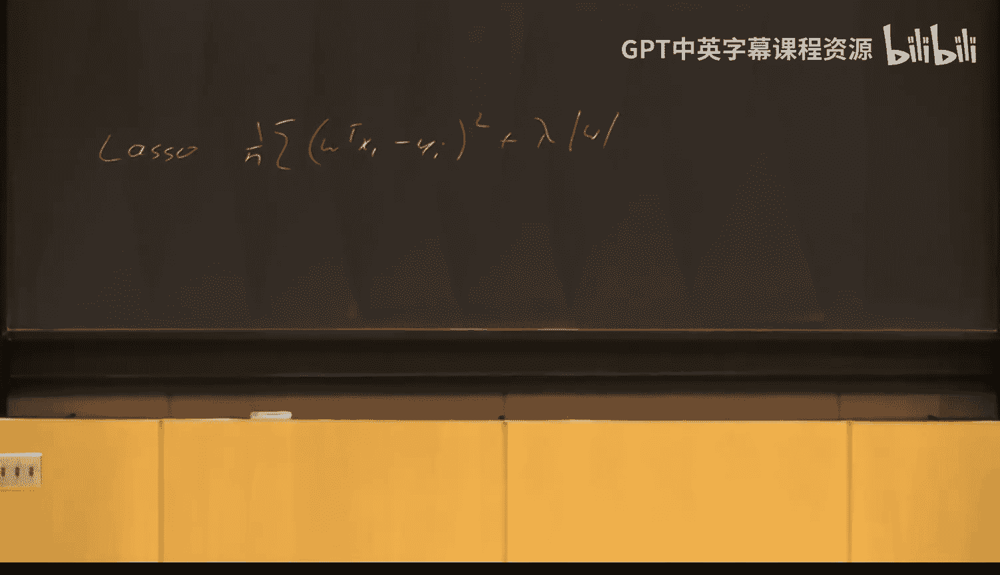

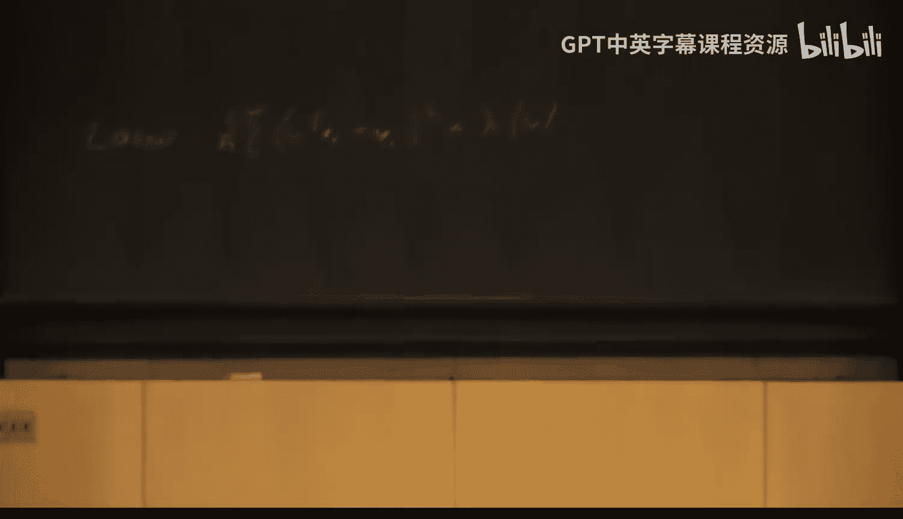

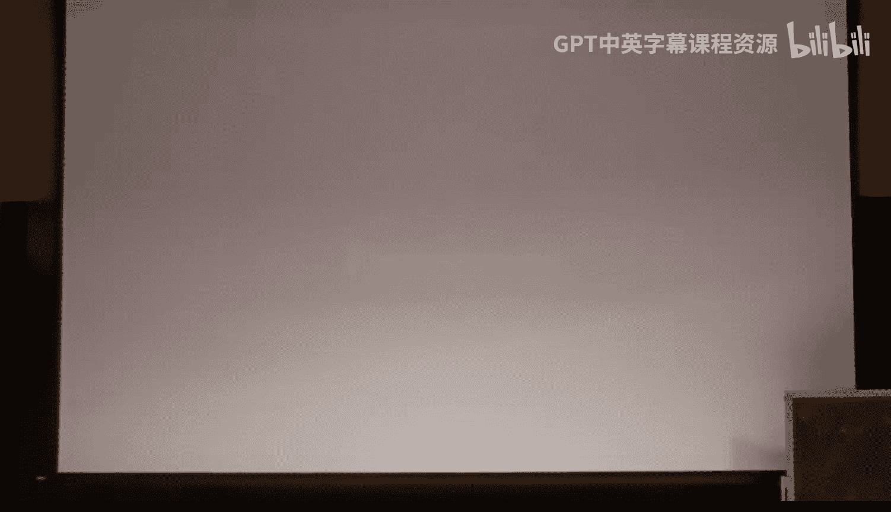

Yeah。

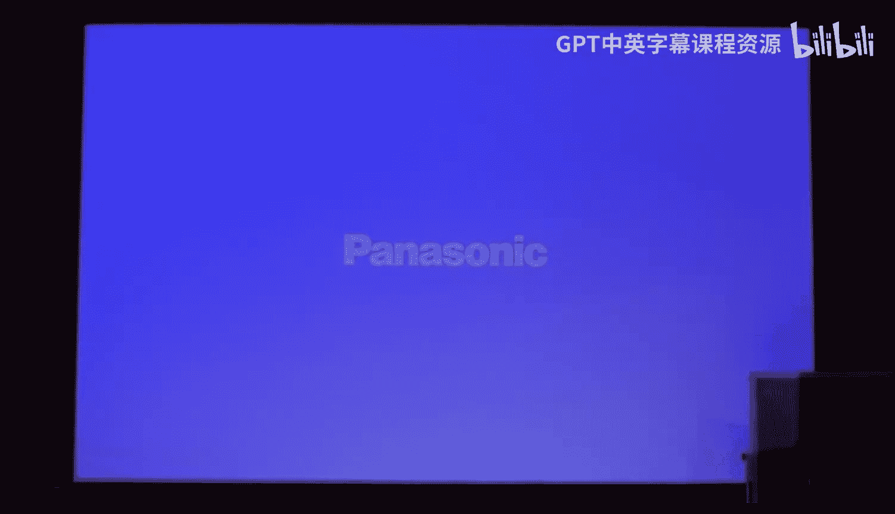

Okay， what I want to show you now， It's a small dataset set I。 I don't think you've seen it yet。

 It's a small， you know， Sams data actually from life sciences。 And what you see here is。😊。

Let me just explain this。 Just pay attention for a second， guys。 So what I want to see。

 what I want to show you here is， basically if I run。If I run the classifier。

 there's a squared loss with L1 regularization that's called Lasso。 And I crank up a lower lambda。

 So if lambda is really， really large。😊，This is the first solution。

 So the x axis here is basically whenever I kind of lower my lambda just enough。

 such that one more feature becomes unlocked。 Okay， so my my lambda is infinitely en largeged。

 then every feature is 0。 Okay， so everything is at 0。😊，And what you see here。

 these lines are the weights associated with the different features。

So if I lower my lambda a little bit。 the first weight shoots up。

 That's the first feature that it picks。 Okay， so basically at the beginning， it right here。

 I now basically allow it just a little bit of weight right to distribute over the weight vector。

 And what it does it picks one feature and puts all the weight on that one。

 right That's the most important feature。 And then I lower lambda further。 And what it does。

 it keeps increasing that feature。 but it also increases another one。 That's the second one。

 And these are some features。 they're not necessarily dimension 1 or two。

 These are just over the vector right here you see the same thing。 This is the weight vector。

 So what you see here is the first weight is all greens。 that's0。 Everything is0。

 And then the next row is the weight vector is like the weight here is incorporated as color that you basically see here。

 the first value up here。 That's non-zero。 That's the first feature that basically some weight assigned to。

😊，And then as we keep to the right， what you see is that basically， the features get more and more。

Pronounce， right， more and more weight distributed across the different features。 And so here。

 that's the same graph as this one。 This is just basically， you see the value， you know。

 as negative or positive points here along these lines。 So here at the end， basically。

 what this line tells you is that this particular feature has a value of-2-0。2。 Okay。

 because the graph makes sense， right the hand of the graph makes sense。😊，Okay， good。

 And what you see here on the top right is the error。

 And one thing you can see is as I'm lowering my lambda， right， the training error。

 the loss goes down very， very nicely， right， that makes sense， right， because actually。

 now I'm not constraining myself into a ball anymore。 right at the beginning。

 I'm constraining this very， very tiny mall。 Now I'm growing this。 I'm growing this。 So eventually。

 I basically， you know， I can get closer and closer to the actual minimum。😊。

What do you ever see is when you look at the test error and that's the yellow line。

 let's look at the training error first， training error is the red line。

 that also gets goes down nicely。 but the yellow line。Is the test error。

 And that actually goes down up to here。 And then it goes back up again。

 So actually the lowest value is actually at 0。5。 there's five features。 So here。

 So you only need five features right to do really well on the test set afterwards。

 the other features， they help you on the training set。

 but they don't help you on the test set anymore。 and that's exactly what the biologists want to know they want to know which five features。

 other ones that really help me on the test set， right because those are the ones that really generalize。

 the other ones are just fitting noise， something that's specific to that particular data set。 Okay。

 So when you work with biologists So you know， in life sciences make these kind of graphs and find the cutoff point。

 and they're gonna get really， really excited when you then tell them it's these three genes or something that explained actually everything know the entire test error test data or the accuracy of test data can be explained just by these five genes or something or this protein something like this。

😊，Any questions， yeah。Oh， yeah。 Well， you got me there。 I， I， I can't remember。 was something with。

Something with iron。I don't remember if it's like in， in the blood or something。 I， I can't remember。

 So， that's the problem。 I just think about the abstract data。 And yeah。不来的。L。

 this is actually this but this is the number of features that are nonze。

So I always decrease my lambda until the next feature basically becomes nonze。 It turns out。

 actually， there's an algorithm called least angle regression that we won't cover in this class。

 But that algorithm actually tells me exactly what the next value of a lambdas should be。😊。

So actually， you can solve that in closed form。这。It's it's correlated with B。

 but it's basically that that's right it's just。That is somewhat there may be different gaps。

 You know， B may suddenly increase a lot until you get the first feature。

 Then it may just go a little bit further up to the second feature， right。

 So it's really the number of nonzero features。That's what the X axis is。 But， yes， you're right。

 As that goes to the right， B goes up as well。 It's just not linearina， right。Yeah。😊，あとからた。

So the loss is the actual loss that I'm minimizing is the squared error。But in this case， actually。

 it's a classification problem。So actually have a training error as well。

And those are not the same thing。So if you actually see that the loss keeps going down。

 but the training error goes up， that means I'm， I'm overfitting to the loss function。 right I'm。

 I'm putting too much energy trying to get the square loss， right。

 when I really care about it is the training error。嗯。Okay， any more questions？Yeah。

 if you only can have a prediction， then I guess。This is like looking at the feature vector is less interesting。

 right， or it may help you debug things。 You may still want to to use Lada， right， because here。

 the best test error is actually at Lada， you know， at five features。😊。

So you still want to do regularization。Right you otherwise。

 you don't know when you are fitting noise when you're just memorizing training the data and you know。

 when you still generalize。Any more questions about regularization？By the way turn out。

 that actually is a funny thing。 that elastic net。Which is。

 I guess people typically use here actually can be solved。 It's the same thing as an SM。

There's a very interesting relationship that actually， a student of mine discovered two years ago。

 because it's spent， but you can actually reduce elastic net exactly to support vector machines。

 So for any problem of this kind， you can actually construct a new artificial problem that has no meaning。

 And if you feed that into an SVM， the weight vector is exactly the one that you get here。😊。

And so the nice thing is S BMs can be solved much faster。

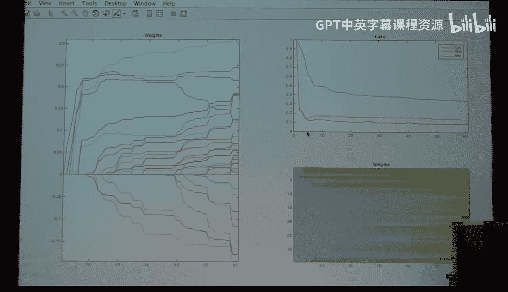

Allright， what I want to do today。응。Its a little review。嗯哼。

Okay， good。So I thought you make two teams。 So how about undergrads against grad students。

 That sounds good。Who is undergrads， raise your hand？Who are grad students。Oh， that's， that's rough。

Do have anyone who's not whos neither。He add them to the grad students。How should the grad students。

 are you willing to take the challenge。Yes， okay。Okay， good。Alright， let's do this。 undergrads。

 This is grads。

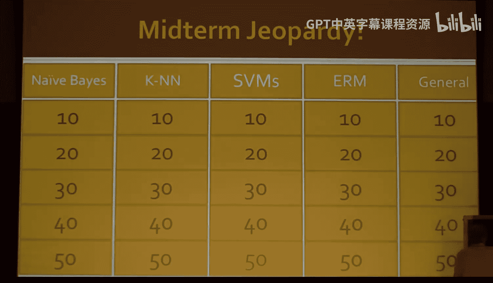

How do you get you oh， street bragging rights。哎。I demand an extra point of。😀No。

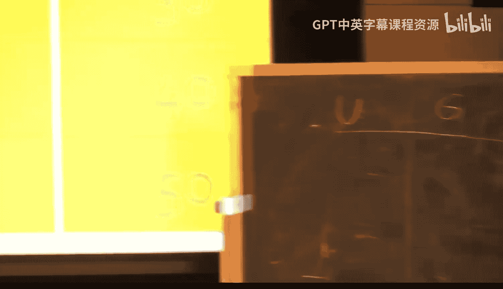

O， does this work。 Yes， this work。 Okay， good。 Okay， so because the grad students are appears。

 So the way it works， do people know Japaneseopard。😊，Yes， okay， great。 I don't。

 But you can tell me how it works。I guess the people bid on on these fields。

 And then this is how many points they get if they get it right。

 So that the way it works as someone says， for example， SVMs for 40。

Questions get more get harder as you go to the higher points。😡，And then I read the question。

 the moment I'm done reading， Anyone can answer it。 You raise your hand and you make a loud。

 buzz noise。 It goes like， eh。😊，Alright， so maybe I's practice that for a second。 Okay，1，2，3。Good。

 good。😊，2。Don't be shy。Maybe everybody can， each individual can only answer two questions。 Alex。

 let's say undergrads can only say two questions。 grad students can only answer four questions。

All right， that's fair。 Let's put some regularization on。😊，Okay。Grad students go first。

 Who wants to go first， Any grad student。You don't have to answer a question。

 You Just have to say which field I should read。 It's pretty safe， yeah。Sorry。

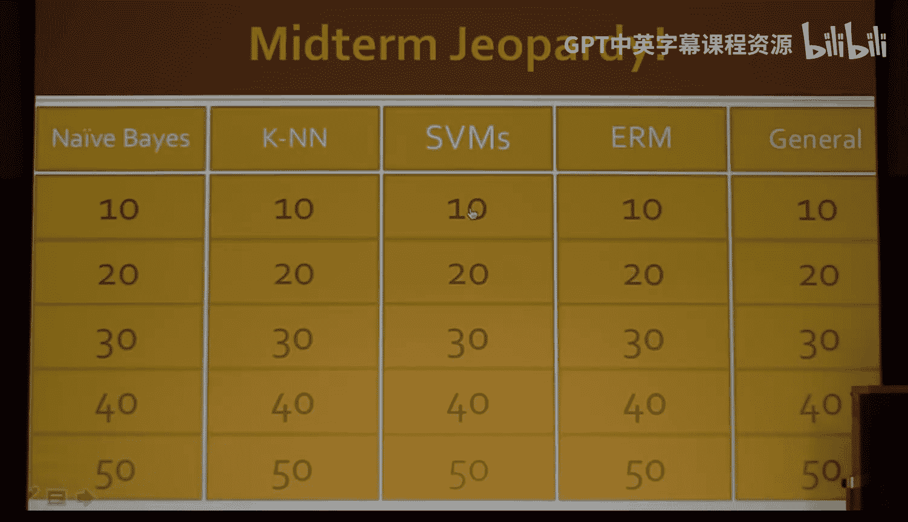

K and N for 10。 Okay， he's playing it safe。All right， here we go。

The error of one year's table classifier is at least as bad as twice the error of the base optimal classifier as N goes to infinity。

Who raised the hands I hurt someone？ Was it you。Sorry。truee or false。2。好的。😊，It's true false。

Because it's at it's at most。 Good。 Okay， undergrad or grad， undergrad。 Okay， good，10 points。😊，Yeah。

 it's it most as bad， right， Otherwise， it would be wouldn't be not not as useful of a bound， right。

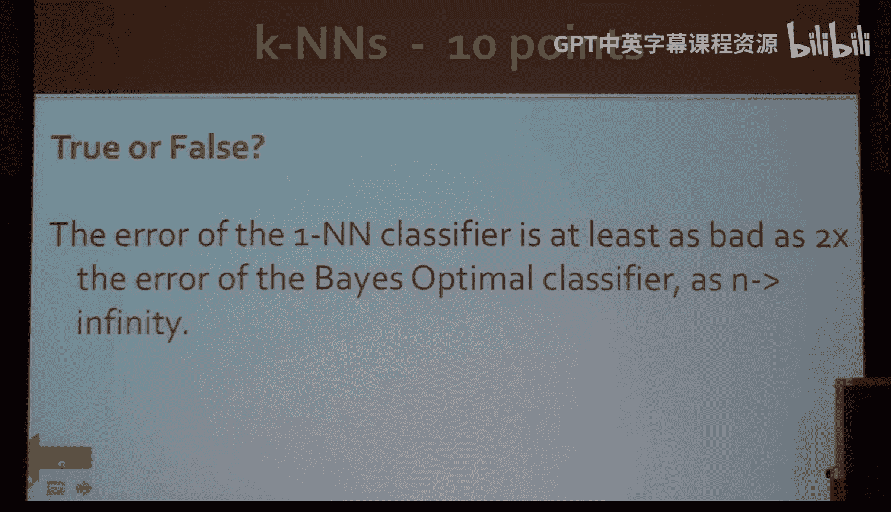

Oh we can barely see this。 It's be， It's supposed to be dark， okay。Okay， you can pick the next one。

9 bake for 50，9 face 50。 All right。Ready go。

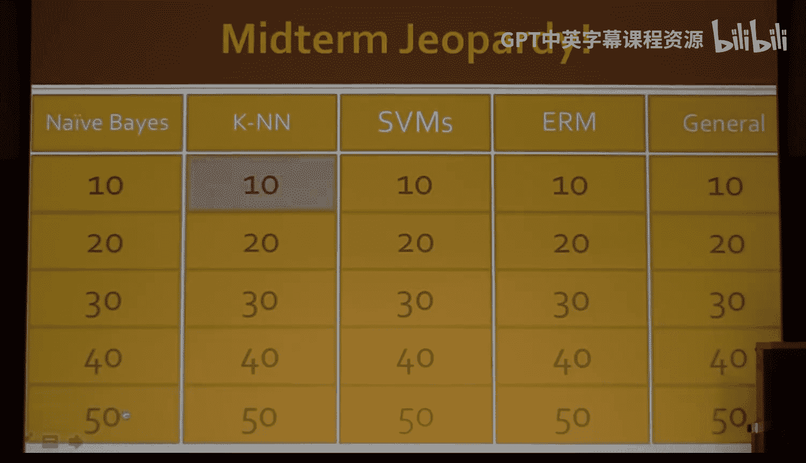

Oh， here you go。When is the knife based decision boundary identical to logistic regression。Okay。

 good。When we are。那个。Like when when when the。way。那关关个 data。You almost got it。 Can someone help him。

 I allow some other grad students to to help her。You undergrad or grad。Youre great， okay。Now。

 the undergrads。や 거야。やけ。That's exactly right。 right， So it's not going to be assumed。

 but it's actually true。 right， That's what it is。嗯。YeahOkay。Yeah yeah， I will opposed those。我连视。

yeah， okay。😊。

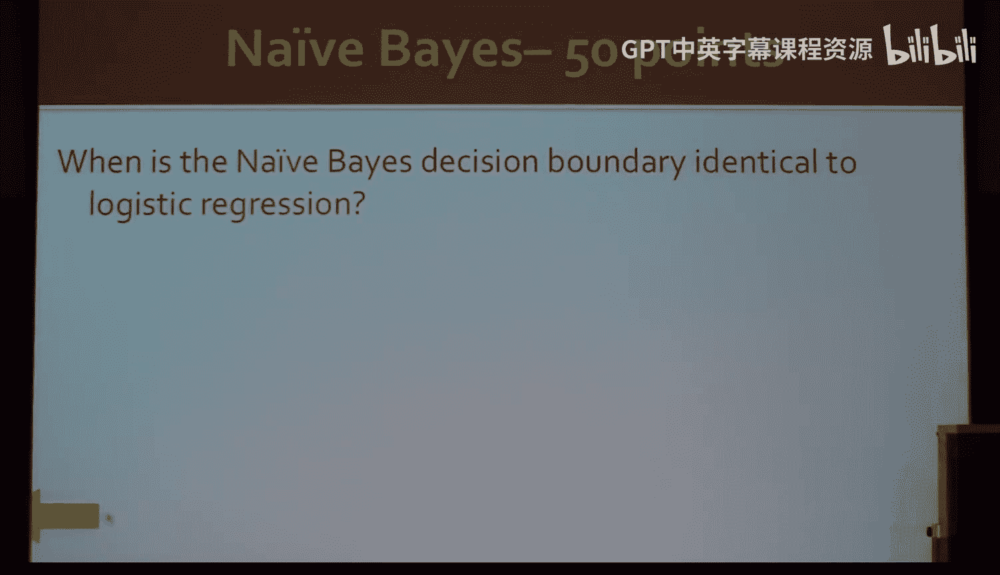

ok 嗯。You can ask the， sorry， the person just answered the question。You can， you can ask the next one。

 You can pick pick the next one。S we am 50。 All right。Ready。

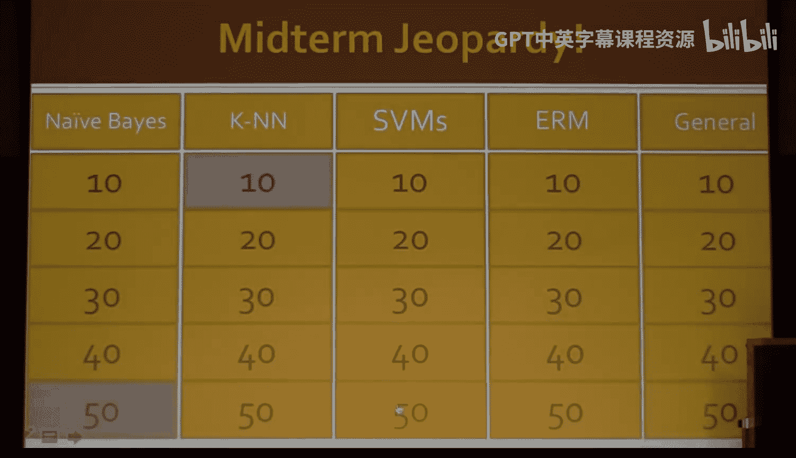

第二。Why shouldn't you incorporate the bias as a constant features。As a constant feature。

 when working with S VMs。Just just make this clear。 When we had a perception on algorithm。

 we just incorporate the bias as a constant feature。 We just added a feature of one。

 why can't you do that with the SBM。Wait， I didn't hear a buzz now。 Come on。 Okay。啊这个职类。まあ。これ。说。No。嗯。

Undergradgrad。Right， okay， so the undergrads get a chance to answer it。There's 50 points。

Why can't you do this， So that I would just absorb。The诶。The。Ex， that's it。 That's it， right。

Undergrad I presume。2。Oh， boy。我。So， the answer was。That's because we're minimizing W transpose W。

 right， that's actually， you know， we're maximizing the margin。

But a crucial part of this is that we are not minimizing B squared。

And so V would actually minimize W transpo W。But you absorb the B in there。 right。

 Then that would be the same thing as minimizing W trans plus W plus B squared。And you object it。

And that's actually not maximizing the margin。 They're actually saying， I'm maximizing the margin。

 plus， I want my decision boundary close to 0。which is not what SVMs do。Does that make sense。

 So B actually has to be free， right， B is not minimized。Very nice。 Okay， next question。

 Which one do you wait， Let me just。

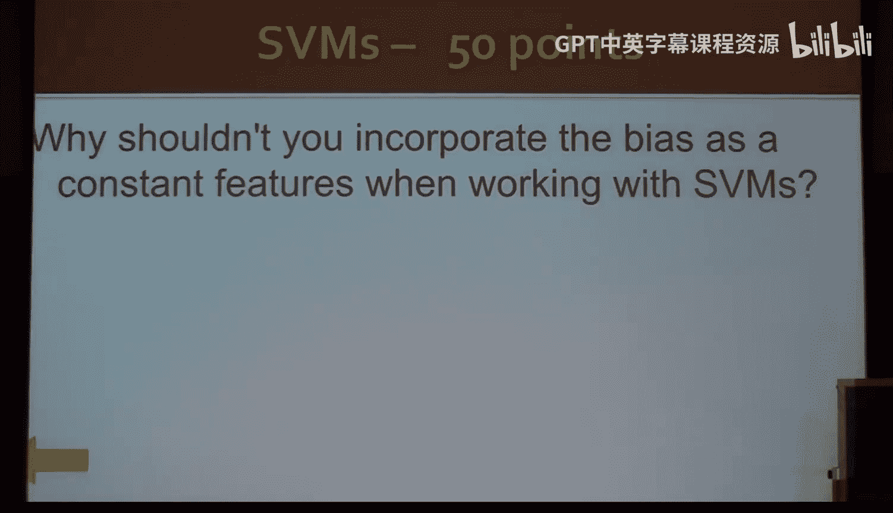

Yeah， sure。

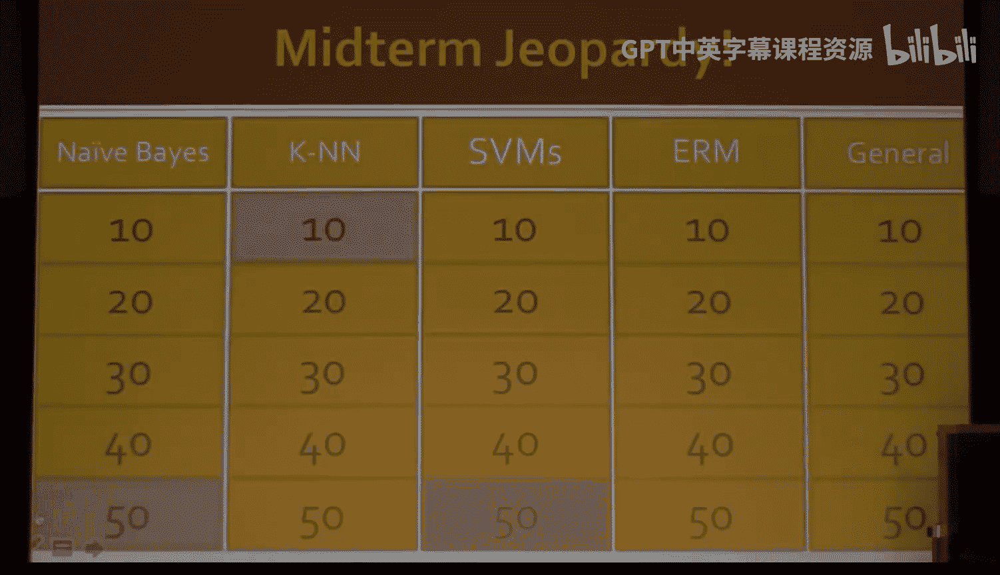

呃。Cs。So who's talking。 Oh yeah，なベ。ざです。じゃあ。啊。that's， that's right。 That's part of that constraint。

 That's right。For it to actually become a linear classifier。 Yeah， that's right。我 the。好好。

So it's Ga distributed with the same variance across both country countries classes。 Sorry， yeah。呃。

Ntaa， right。You can pick the next one。K and 50， you guys， I like it。 You go over the big ones。

 Alright， ready， said， go。How would you modify the Kenies name algorithm for regression。Someoneあく。😊。

Okay， sure， undergrad。Undergrad。Yeah。This is what you've scared the Gr students so much I'm gonna say anything。

 Yes， exactly right， right， So one thing you can do is you can just take an average of the Can neighbors。

 right， and that gives you a value。 And so even better， actually， if you take a weighted average。

 So actually， if you just take， you know， assign a weight to every single point。

 So you do the following， sum over oh my neighbors， I element of my neighbors。😊。

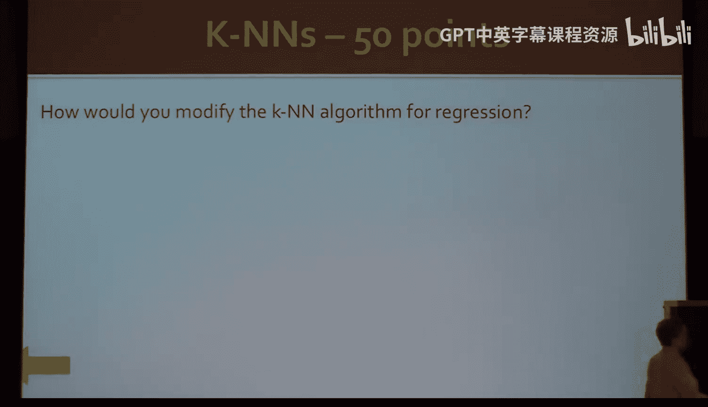

W I times Y I。 And then I normalize the whole thing。 some of our。I element of n。W I， right。

 they have to sum to one。 Otherwise， it's not a weighted average。 And so you know。

 one thing you could， for example， have this， you know。

 this weight W I could be the distance run over the distance， X minus X I。

Or one thing that people often pick is they expentiateator。So basically。

 what you do is you want to give less way to points that are further away。 That's all。

 you can define your own weighing function。Tipity that improves， that improves the results。

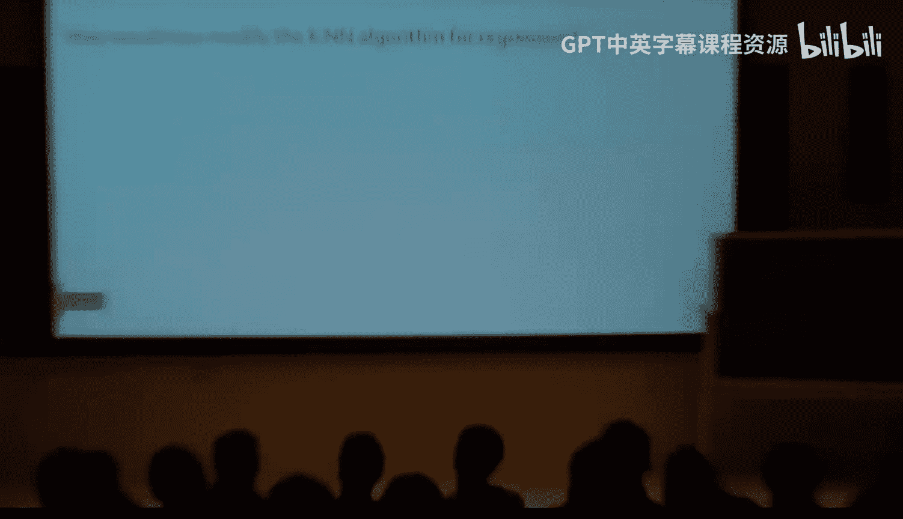

All right。Next question。General 50。Alright， ready。Go。

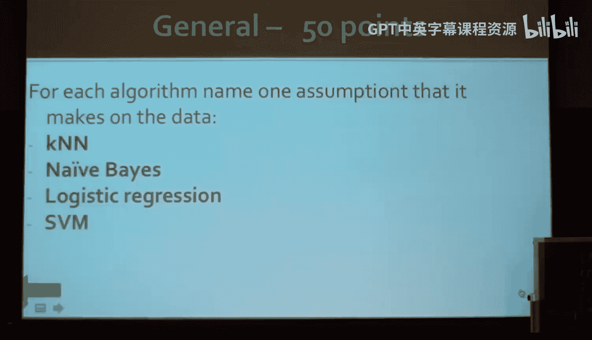

For each algorithm， name one assumption that it makes on the data。

 Ken' neighbor's knife base logistic aggression and SM。A， okay， good。

 K And N points that are close to each other have the same class。

 night phase each feature of your feature vector are in。😊，啊好。Loistic regression。喂哎，你。OhYeah。😀Yeah。😊。

Okay， keep keep going。 Keep going。 right， independent， given the class name， very， very important。

 Yes， conditionally independent。Is that youre two classmatemen。Our both。

Normallyor distributed based on。Give it the。And standard SMV SVM is that your data has been released。

I want to have。They're almost there。 I mean， it's very very close， so。I mean， I I don't know。 Okay。

 you know what， I， I give you， you know， I give you half the points。 How about this。

And prodo is to motivate the grad students to get them 25。 Here we go。😊，嗯。We can't just beat them up。

 like。So， yes， Ken's neighbors data points are close， you know， similar points of similar labels。

 That's， that's a good one。 knife base。 you know， features are conditionally independent， right。

 logistic aggression。 you said the right thing。 Actually。

 it's actually a little less strict to be honest in practice。

 I would count it because we didn't talk about it in detail。

 It doesn't have to be a Gaussian distribution。 Actually。

 it also works for any distribution of the exponential family。 Gauss is one of such such example。😊。

And S VM linearly， is linear separable。 Yes， except when you actually have slack variables and it doesn't have to be。

 right， then actually still gives you。You know， it actually gives you a reasonable answer。

But on the other hand， the assumption you're making is that a linear classifier， you know。Is。

 you know， it' a good classifier， right， you can fit a hyperplan。

 which is it gives you reasonable results， which is a big assumption， right。

 that could be totally wrong， right， could be that the function is totally data is totally learnable yet。

 But any， you know， you just can't do it with a linear hyperplane。😊，Right， so in that sense。

 you know， let let me count it。 Another assumption is that the， you know。

 a larger margin actually generalizes better。 That would be something specific to S BMs。嗯。Yeah， so。

 you know。Was basically correct。 Okay， good， Arthur， one more。 You can pick one。😊，啊。E R M 5 E R M 50。

 Okay， I like it。 I like it。Which loss function was used in each case。 I two different。

 three different examples。The squared hinge loss with C， very。

 very small squared hinge loss with C large or the exponential loss。😊。

That may have been taken from an exam， actually。안 맞죠。Okay， good。It undergradgrad。Awesome， al right。

 go for it。 Come on， be all cheering for you。😊，The first one is a really good small。 That's correct。

😊，That's correct。Exactly， perfect。All right， it's the comeback。Alright， so just to make， you know。

 a few indication why that's obviously the case。 So here， the first one， But， you know。

 it gets basically everything wrong， right like it's horrible， right。

 the decision boundary is not between these different classes It doesn't care at all about getting the points right。

 It just cares about having a smileies many W。 It's a tiny W， which is exactly here。 know， the W。

 you can't even see it。 It's so tiny， So that's， you know。

 basically you have almost a zero loss in front of your your constraints。 in of be stack variabless。

 So these two must be the other two， And I guess what you see is that the hinge loss here。

 basically tries to enforce a margin between these two。

 You see one point is on this side that should be here right So basically gives up on that one。

 That's a lot harder for the exponential loss。 It also has to give up on that one。

 but it will be moved much， much closer to that point， just because it gets exponential penalty。😊。

All right。SVM for 40， okay。Why is the SVM margin exactly one over the norm of W。

You have to do the buzz sound Okay， kid。啊。And no， no， that's just max maximizing。

 Will maximizing the margin will ensure that it's equal on both sides。 But the question is。

 why is it exactly that value。Yeah。我的还。Because be very attitude assume that because B is equal1。

 It's exactly right gra student undergrad。 Grd。 Allright， alright， guys are coming back。😊。

It's getting， getting exciting。 So， so the answer is very simple is。😊。

The margin is actually w transport X plus B times I， I guess， divided by the normm of W。

 But we doing that motivation set。 Well， let's fix the scale of W and B right to any particular value。

 but if we do， we fix it exactly such that it's one。

 And this was just to make the optimization problem easier。 So essentially。

 its the answer is A because we be fixed it that way or B。

 it's enforced by the constraints the constraints basically ensure that this must be the case。😊。

And by the way， if you just look at this objective。 that's the size of the margin。 Now。

 it becomes clear by minimizing W squared actually maxs the margin， right。

 You're basically minimizing the the norm of W here， But the margin is exactly one over that。

 So if you minimize the norm of W， you know， it basically must blow up。 right。

 you're exactly maximizing the margin。😊，Alright， Which one do you want to pick。You am for 40。Oh。

 to do to do to do to do。My grad students told me to make that sound。

 I don't had to know what it means。😊，All right。So there's not the， oh， shoot。

 I shouldn't have shown you the question。Before you can actually now bet and remember， Wait。

 this was a grad student。 you can now bet。 But who who asked that question。Okay。

 you can now bet as much you know， as many points as you want on this。And if you get it right。

 it will double them。So you gotta double， you know， to be honest the best strategy。

 But you can steal choice。 You can。 How many points do you want to bet。You everything。

 you want to go everything。So basically the way it works is， you beat a certain number of points。

 And if you get it right， you， get， you double them。 If you get it wrong， you lose them。

 Is that correct， You get nothing。All of it， you got to go all in。 That's the optimal strategy。

 You got to win。Okay guys get doing right。1 hundred and 50。 Okay， good。

 So now only the gra students allowed to answer， right， But if you get it wrong， you lose everything。

Name two distinct reasons why you might not be able to use Newton's method on a particular data set。

 independent of convergence。 So I'm taking away the one that may not converge。

Give me two reasons why you may not be able to use Newton's math。Only grad students。

 Only grad students。The afternoon。 Okay， okay， okay， so we do teamwork。 Okay， sure。 So first one。

 Okay， first one。😊，Okay， first one， if the last function is not twice differentable， that's correct。

Second1， I can think of at least two more， yeah。If the。食べばなんで。感觉 that。It's exactly right。 right。

 So if the data set is really， really high dimensional。

 it may not be feasible to compute the heh here。 Alright， I give you the points。

 Awesome What was the。😊，Oh， it may as not be invertible， right， You actually have to invert the he。

Okay， now it's getting really， really tight。I think the graduates are in the lead， I think。

they guess they have 230。 and， oh yeah， yeah， yeah。 they are。This， is like the election， like。

I don't expect。Don't take it too personal， sorry。😊，All right。Who can pick， I guess， you know。

 you were the first one。 So 9 40，9 base 40。 Allright， ready， said， go。😊。

Map estimation with plus one smoothing in naive base with C classes and a category of distribution with K categories per feature is equivalent to adding how many hallucinated samples to the training set。

😊，😀Yeah。😊，You got。Good。😀。😊，Aucinated， hallucinated。C。😊，Now。Yeah。It's C times K， right。

 Because for every single class of everything category， you have to hallucininate。

 you assume that you see that exactly once， right。😊，嗯。was that was a grad student。Okay。

 that's how many points，40。 Oh my gosh， the gra studentss are winning。It was was the daily double。

 that's what it is。 actually By the way， That's how Watson actually won。 So Watson actually。

 they knew they had no chance against the human players。 The IBM Watson， they actually much， much。

 much better the human players。 But then you， one thing they observed by watching the videos is that humans are terrible at betting correctly and actually finding the daily double。

 And so that was actually the they had an entire team working on two strategies。

 A betting optimally with the daily double， which you can actually solve for exactly。 And B。

 the other thing was actually to find the daily double。 So daily double is always hidden somewhere。

 And what they did is they actually analyzed all these past videos。

 and they realized that the distribution is not uniform at all。

 And so they actually incorporate that Watson's strategy。 And so Was had a much。

 much higher chance of getting the daily double and then actually capitalizing on。

 That's actually exactly right one。😊，对。Okay， who wants this I suppose you， yeah。9 page of 40。

 al right。I we just had that one， sorry。K N for 40。 All right。

 Why does can N L still perform well on high dimensional faces and handwrittendge digits data。

Who was the first one？ He were the first one， O。It not the data action。That's right， that was 30。F利。

嗯。so the answer is the data is high dimensional， but that actually is not what matters。

 is the dimensional。 sorry the space is high dimensional。

 but the data actually intrinsically is not high dimensional。

 you can even take a low dimensional data and just add for in some really high dimensional space。

 make everything else zeros and then just rotate the space arbitrarily。

 Then it will look like the data is really high dimensional when it's really not。

 right So Canous neighbors won't change。😊，嗯。O。前这。General for40。 All right。

Which algorithm would you expect to result in lower test time classification error。

 Ken years neighbors or linear SVM， A on text classification by topic， B， patients vital science。

 Given the patient's vital signs predict the health status。

 you have 15 features when C 6000written digits classified as three of as 8s。😊。

So on each one of them， which one do you think will do better， S VM or Kenius neighbors。Yeah。意见没有。

But we you do the out of order。 Okay， so it。SVM， SVM， K， and， N。呃。哇。Okay， tell me why。

 If you have a good reason， then that account。By， I'm with you。Oh not。三次。I'm with you。

 The question is B。两稍哦。我把正。还就。は。次言大。So。😊，还有加么一个。Yeah so the point here is basically that this is very low dimensional data。

 right， typically a low dimensional data。 Linear classifiers do not work well right。

 just because there isn't just much， much space。 you know， many options to， to place a hyperplane。

 So the first one， definitely linear classifier。 text documents are really high dimensional。

 right You always find a good， you know， they just a linear classifiers are amazing at this。

 And but the other two typically are not very high dimensional and tend to have nonlinear decision boundaries。

 So，😊，Canan tends to work better。 How about this， I give you， I give you 30。 I give you 30 points。

 and I give 1，10 to the grad students。All right。No， no， no， no， not the first one。It is a little bit。

Sorry。A yeah Grian。I want him to be a tight race， all right？I just leave it at this。 I just said。

 you know， I feel like 10 points。Yeah。😊，Okay， okay， we only have kind of out of time。

 maybe do one last question。😊，So there's the last one。Okay， you can ask last month。K andN for 30。

 all right。True or false。 N nearest neighbors on a data set with N training points and D dimensions takes order n times D computation。

不。2。That's a tricky question。😀。😊，There are setup up。 this question are set up。 yeah。我。Yeah。

 exactly right。 So， yes， yes what it is， right。😊，So第。Because。Usually， you accept me right。

 So usually the computation is K to D。As n times D to comply the Ken nearest neighbors actually pass the bookkeeping of who the Ken nearest neighbors are。

 which is some， some little tree， heap tree。 But actually。

 if you take all the points as you training as your neighbors， then actually。

 all you need to basically always predicting the most common label。

 So you actually don't need to look at your data at all。 right， It's， it's a silly classifiers。s a。😊。

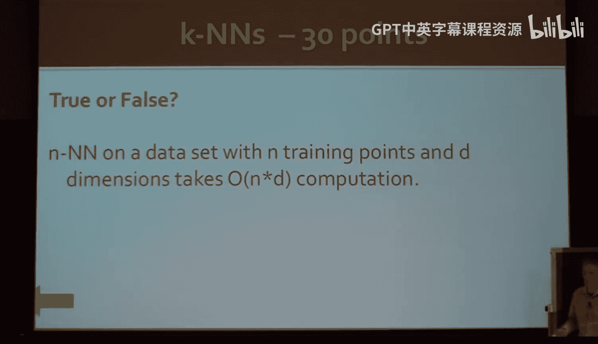

Grad student or grad， undergrad or grad。

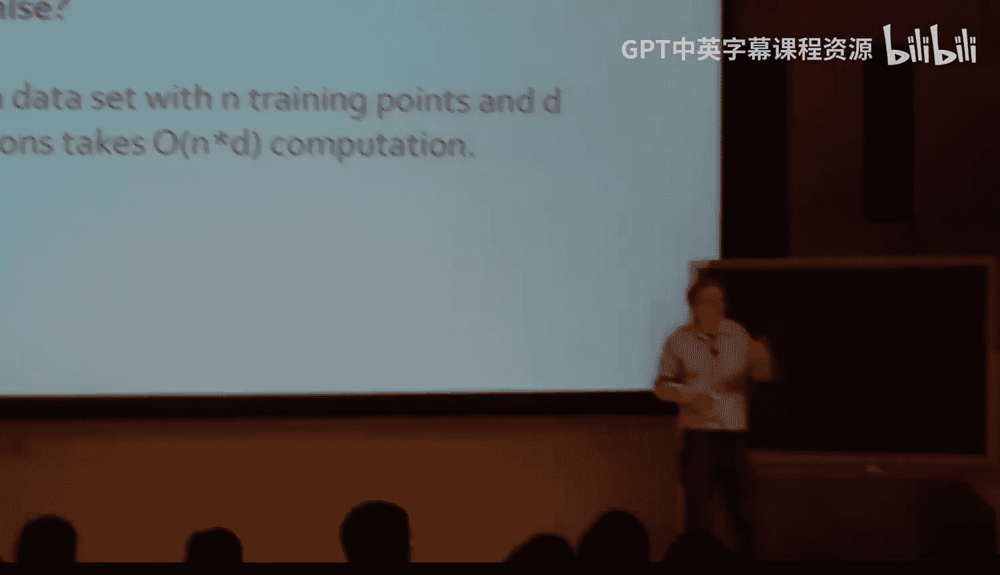

Right， okay， to Well， it was a tie。