# 康奈尔大学《智能系统的机器学习｜CS4780 Machine Learning for Intelligent Systems 2017》中英字幕 p20 -20-Machine Learning Lecture 20 ＂Model Selection _ Regularization _ Overfitting＂ -BV1Lo6gBxEKE_p20-

Welcome。Yeah。Please everybody close your laptops。😊。

I hope everybody got a handout because of St Patrick's Day， they are in green。Oh。In Germany。

 St Patrick's stay today。Okay， so last time。But he talked about the bias variance trader。

 which I consider one of the most。Important topics in machine learning and data science。

 It's really a topic that comes from statistics。 This is something that statisticians basically first arrived。

And the idea was the following last time we basically came up with all these。

 And I brought it up here just to to make this faster。

 We basically looked at the expected test error of an algorithm A， where we basically say we look at。

 if we integrate out any possible training data D。 And then we look at a test point X with label Y。

 and we say， what's the probability that we draw this this train data D。

 then this x point this test pair X and y。 And then given that what's。

 what's the error that we get right And if you integrate out all of them。

 that's exactly the expected error of that algorithm from that data distribution。😊。

4 are given training data set size。And so we looked at that error。

 There is this term here on the left。 And this is just， you know。

 basically a squared square squared error here， expectation of a square error。

 But then we look at this a little bit more closer closely and decompose this error。

 And we found something pretty， pretty amazing that this term decomposes into three very interpretable terms。

 right， and let me just you know， go through every single of one of these one more time。

 So the first one is the variance， right， the variance basically says how much do my classifiers vary。

 right if I take you know， would basically， in some sense， a classifier as a random， you know。

 random variable But I'm drawing a classifier， which is basically the processes I draw a data set and then I train a classifier。

 So I can also view it as drawing a classifier， So if I draw various classifiers。

 how much do they vary from the me， right， This is exactly the variance of these classifiers。😊，So。

 I mean， it's amazing， right， Like if you just think about this for a second。

 that this square term decomposes the sum the sum of three different quadratic terms。

 and each one of these is beautifully interpretable， right。

 So this is going to help us a lot when we try to make machine learning work and practice。

 So please really pay attention to this and make sure you understand every single one of them。

 So so one more time， this basically says how much do the classifiers itself vary。

 this here is the noise。 So here， the important thing to realize is that when we minimize the square loss。

 which was the assumption we be made here。😊，The square loss is minimized at the average label。

 So the average label is exactly this guy here。 right。

 So this is the the expected label in this case。Right， so。

What our entire algorithm is trying to do is trying to find a classifier that reliably for certain X outputs by bar。

 right， That is the goal of the machine learning classifier。😊，And what the noise is measuring。

 saying that even if I'm 100% correct， right， every time I'm hitting exactly by bar。

 I still have some error。Because the data points don't actually always have the expected labels。

 right， They can vary themselves。 And that's this term here。

 right So it's exactly the variance across the label。Okay。😊。

Any questions about the noise about the variance？Yeah， so intuitively， as you get a bigger data set。

 your barrier should go down Oh shoot。

Your agency should approach。H average， right， So that's exactly right。 Yeah。

 but isn't H average weighted just an average of all of your functions weighted by how likely you already get that data set And is it having a bigger data set less likely。

So why does increasing your data Oh， I see。 So， yeah。

 this average they all have the same data set size。 I mean， in this case。

 basically I didn't actually go into data sizes but it's still the case if you would have a very。

 very large data， you would you know in the typical case， actually。

 your age would approach approach this age bar So then actually it's exactly So heres why I can tell you。

 it's very， very simple， So in some sense， this captures the variance of the data as well。

 So if I would actually sample， let's say I'm sampling a billion data points right。

 And then I'm sampling another billion data points right Well。

 these two sets won't be very different Does that make sense。

 would be extremely unlikely that the first billion data points are completely very， very。

 very different than the next billion data points。 right。

 would be a billion times I'm drawing from this corner of the space。

 And here a billion times I from this corner of the space。

 It's not gonna happen So when the data sets are small。😊，Then actually， if you draw many data。

 you know， different data sets， they will vary quite a lot。 But as your data sets gets very。

 very large。 the next time you draw a different data set， you will basically get the same one。

 Does that make sense。So that actually， you， you ultimately。

 what that tells us is as my data set becomes large。

 this becomes very small because my classifiers won't vary， very much anymore。😊，Very good point。

 Very good point。嗯。Okay， so then we have the noise and then we have the bias。

 So what does the bias say， The bias says， now we take the expectation。

 This is independent of the of the label wine， independent of the training data set。

 This is basically， you know， take away， assume we actually get the average classifier。

 we basically converge to this， How much error does that still make。

 right So even even the expected classifier， right。

 is not good at hitting the label it's trying to aim for right。

 And that's because we make some assumption that is not true in the data， right。

 So no matter how much data we have， here be averaged over an infinitely many classifiers， right。

 So infinite amount of data， right， still， we are not hitting the expected label of the data points。

 And why is that because， for example， we assume that the data is linearly separable when it's really not or something like this。

😊，Right so it's really important to kind of like， it's really beautiful how these different。

 three different terms capture completely different aspects of our algorithm and our data。😊。

So anyone have an idea how to reduce， for example， noise。 right。

 So this is kind of these two are done in the algorithm。 But what do we do about the noise term。

 Any idea。在。Is itreducible。It's a pesimistic view。Yeah， filter out outlier， filter out outliers。

 Sure of if you basically say some terms， But then you actually change the data distribution。

 you would actually say like， you know。You change distribution on P prime。

 but you say we exclude certain， certain points， right， you know， data cleaning， yeah。

Add more features， right， So that's actually very。 That's actually a really good one， right。

 So Y bar here is a function of X， right， So X basically describes your data。

 That's really important。 It's like if you try to predict the price of a house， right， Well。

 if you only have like three features， number of bedrooms， number of bathrooms and square footage。

 right， then actually， you know， the amount of just based on these features for any given house。

 right， there could be a large distribution of prices， right。

 But if you have much more fine grain features， then hopefully eventually。

 you actually gonna pick up the nuances of the pricing right， and the variance will go down。😊。

So this is actually， this is not something that's just just given to you。 you as a data science。

 scientist can influence each one of these terms。 Yeah， just No， no， you're not， right。

 The variance does not change， right， More data does not make any。

 This is the expectation of a distribution。 There's no notion of your data set D。

I more likely to pull out things closer to the me though。だてら。No， this is， this is expected value。

 right， Theres the in expectation。 This， This has really nothing to do with howology data set is。

 There's really something about your distribution。 But be careful。 the distribution is in the space。

 you know， described by your features， right， So that's the one thing used under your control， right。

 the， the feature space itself。😊，Okay， anyway。这个赔偿。そしてで。Right， so， so here comes the interesting bit。

 Right， So what he's saying is， as I'm， if I add more features， right。😊，And I make thisian smaller。

 right？I may make this one larger。Right，And that's exactly what's happening。 a little like wamole。

 right， You know， this game Weamole， I don't。 but， it's kind of like that。😊。

So you press one down and then something else comes up。 I think that's kind of。

 that's what I'm picturing。😊，So， so that's exactly the problem。 right， So it'， it's very， very hard。

 You know， the moment you bring one down to 0 or something， right， the other one's going to go up。

 right， there's always a trade off。 And that's exactly what we call it the bias variance trade off。

 right。The beauty of it is。 And this is where your power comes in。

 The realization that each one of these terms is quadratic。😊。

RightSo one will always dominate the others。 very likely。 So what you want to find is an equilibrium。

 right， So it could very easily be that the whole thing is large because bias is massive and these two are very。

 very small。 right， then you have the chance because it's quadratic to reduce bias a lot and only make these two go up a little bit And that's basically that's usually actually what you're trading off is the variances in bias。

 This is the two。 right So if you get one down， the other one goes up。

 But it doesn't have to go up by the same amount。 And that's the skill that you have to learn as data scientists。

 And we will talk about exactly in the next couple of negativeectars。😊，嗯。So number more questions。

 One thing I want to show you is the project that's coming out today。Oh。

 I see I see I hear excitement。😊，H。So诶。Good stuff， so you。Is this it？

 Is this connected to the kernel。Oh， that was connected to the， okay。Okay， one second。

 Bines variance， here we go。

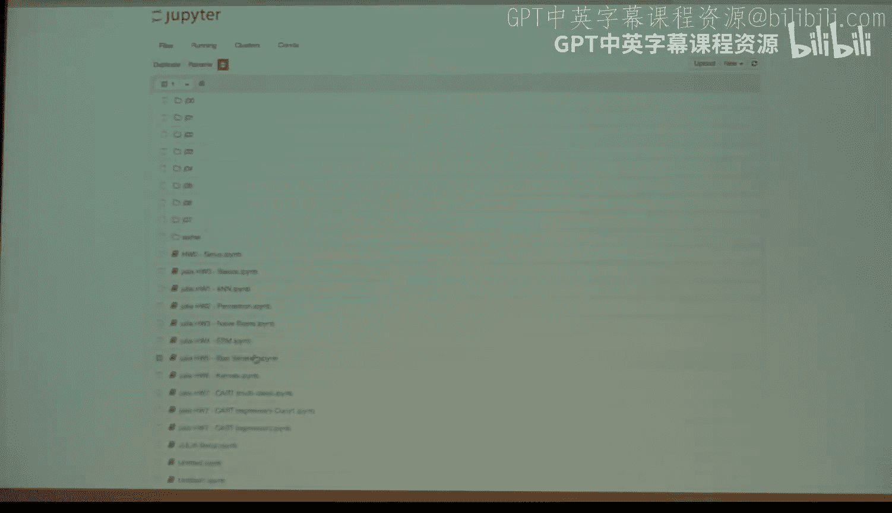

Okay， so。

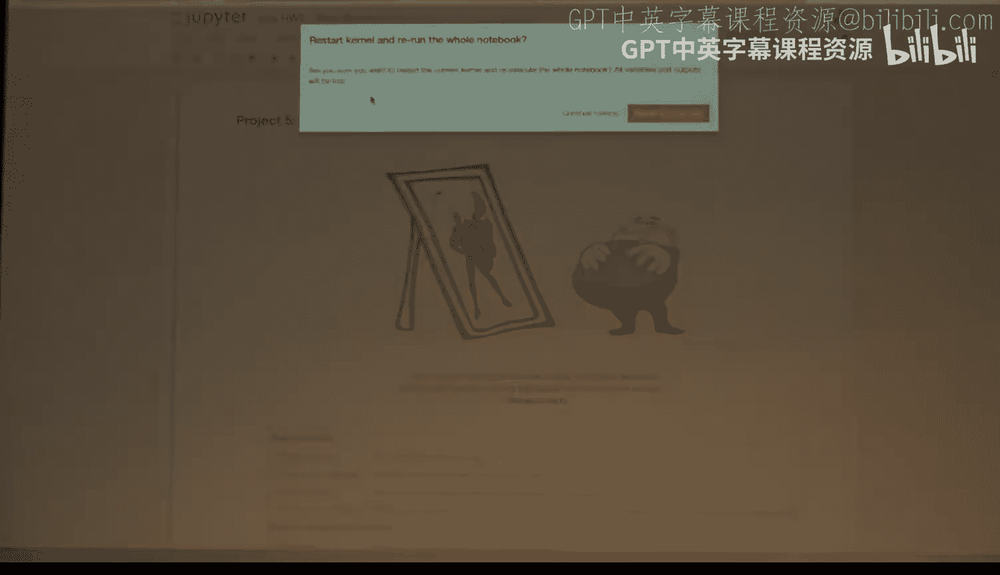

So this is still， this is the prototype。 And this is actually not exactly what you will see。So。

One second， is this running？Okay， good。 So here's， here's what we do。We draw a data set。

 So what I want to show you is that the error is the sum of these terms。 And this is， in some sense。

 what you're going to test in this in this project， right。

 to really kind of see like a that the error really decomposes into these three terms。

 And then how large is each one of these three terms as we vary the settings of a classifier。

 So please pay good attention。 You only have seven days to complete this project。😊，So。😡。

Here's the key。 So that what we do this time is we draw our data from a very specific distribution P that we know。

 right， So in this case， we are playing God， right， So we know the data distribution。

 which is typically not the case。 But by doing this。

 they actually have control of each one of these terms。 They compute them very， very you know。

 to arbitrary precision。😊，So here's what we do。 We basically draw。 have two Gaussian distributions。

 the red one and the blue 1。 And I say all the blue points are plus 1 and all the red ones are -1。

 I believe that's the labeling or 01。 I don't， I don't remember。

 And so now we draw a certain number of points。 And the first thing is。😊，You know， if you would now。

 if you know these distributions， right， then you could actually use the basees optimal classifier。

 right And the base optimal classifier give you predictions。

 And these points that are highlighted here with these gray circles。

 are the ones that the base optimal classifier would get wrong So because there's an overlap。

 for example， here， this is a blue point。 But it's much much more likely it's actually red based on its location。

 So the basees optimal classifier would say that this point is red， despite that it's actually blue。

 right， And in fact， in this case， it makes a 9。7% error。

 So this is basically the overlap between these two distributions。 And that's you know。

 anyone tell me what that measures。😊，Of these three terms。The noise， right， That's exactly the noise。

 right， So that's the stuff you can never ever get right， right。

 So that's basically the expected label here would basically be red， right？ But actually。

 it turns out it's blue， right， So there's no， you have no chance you can't possibly get this right。

 right， based on this two dimension of representation。😊，Okay， so then what we do。

 And I'm gonna pretty scroll this by that don't see the solution。嗯。What's happening here。

I know people gonna watch it on on the video in slow motion。Oh， I see。Okay， wait one second。

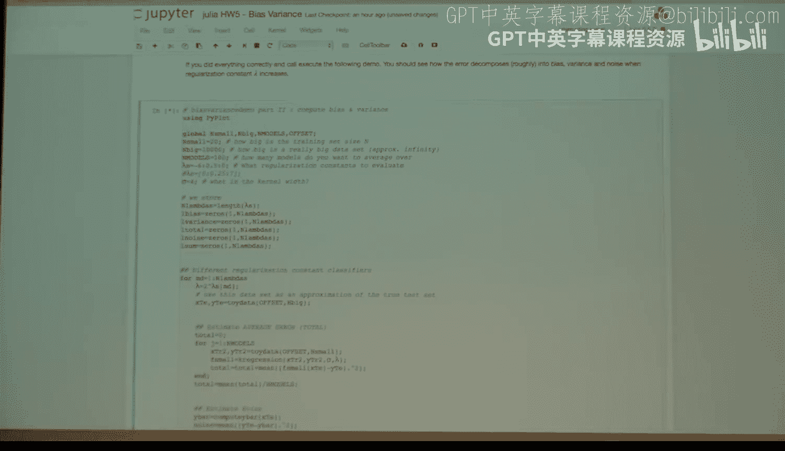

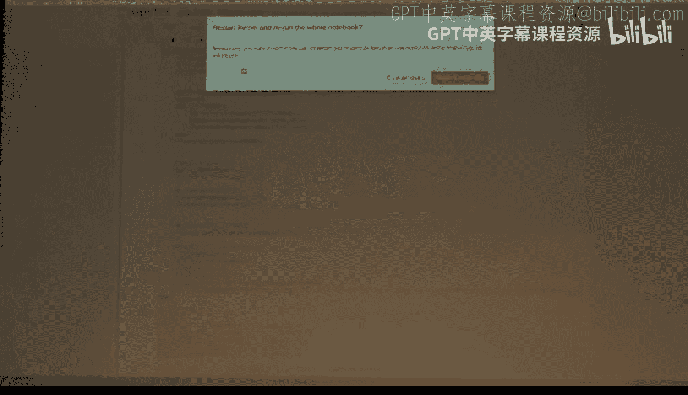

I didn't save。 So I one second have to save all the time。Okay。

 so let me just tell you what I'm doing is still running。So， so here's what I'm doing。

 I Take this data set。 Yeah， So here， here's， okay， now you can see it's running。 So， so。😊，Basically。

 what I'm doing is I draw initially， I draw a lot of data from this data。 And then basically。

 what you have to implement in the project is a term to actually compute bias。

 compute variants and compute the noise。 And then actually sum these up。

 And the way we we estimate these is by sampling。 So let me first show you the examples。

 So the classifier that we're using here is actually just a linear classifier that's kernelized。

 So kernelized we haven't done this yet。 We will do it in two lectures。

 So it's basically just to make put linear classifiers on steroid and make them really really powerful。

 So we need to do this because otherwise they they don't have theyre too simple。 So。😊。

Don't worry about it for now。's for all you means just a linear classifier。

 We just take the data and project it into some other space where they。

 where data is always linearly sparable。And so then we have a regularizer。 And so this here。

 this regular riseizer Lada is set to 2 to the x。 So as we go to the right， basically。

 we have more regularization。😊，Okay， and so if we have more and more regularization。

 what are we doing， we are forcing the classifier to be simpler and simpler。 right。

 So if you regularize a lot， at some if you just get the00 classifier。 right， If you here regular。

 you know，2 to the -6， that's very， very tiny。😊，And so here's what's happening。

 That's the only thing we are changing。So if you're changing the regular。 So basically from very。

 very small to very large。 And one thing you can see here。

 or basically the red line here is the bias。 the black line is the variance。

 and the green line is the noise of the data。 And if we add these three up right。

 then we get the dotted line。 and the dotted line is very。

 very close to the blue line and the blue line is the actual error youre making And the reason they are not exactly the same is because I set it up。

 So it' actually runs pretty fast because you guys we need to run this on  vcarium。

 So the way we actually estimate。😊，The bias and the variance here is by actually， for， for example。

 the variance， what you do is you learn 100 classifiers， right， And then you base the。😊。

Compute the average versus the average classifier， and then you compute the variance from these0 classifiers。

 It would be a lot more accurate if you would train 1000 classifiers。

 but it would take 10 times longer，😊，So。Okay， and similarly， we approximate the bias and similarly。

 we approximate the noise。 Okay， and so here， you see some very， very beautiful trends。 So the first。

 unfortunately， this box is right over this blue line， but。😊，You see something very， very nice that。

 you know， you can really see how these， basically these two lines dancing around each other。 And so。

 you know， they're basically the same thing up to the approximation error that we get because we only we sample only 100 functions。

😊，And so the second trend you see and that's， you know also very beautiful is that the bias， here。

 the red line， right， as we regularize more， the bias goes up， right So the proportion。

 the portion of the error that is explained by the bias gets larger and larger as we regularize more right？

 So basically what happens here is that the model is too simple， right。

 And that is why we have this large error， right So you know。

 a huge portion of that error is basically you know， the area up to the red line。😊，Does。

 does the figure make sense to everybody， any questions about the figure。Yes。

 you can absolutely have this。 You can， you know， and that's not good。So that's。

 that's called a terrible classifier。 I think that's a technical term。So in this case。

 you don't see this， right， because we' are trying to trade these two off， right。So so basically。

 if you make the wrong assumption about the data and then you have a， you know。

 high variance classifier， right， So there's little value in in going。

 theres usually you try to avoid these situations。will show you in a minute how to recognize this。

Okay， so basically， the second one is variance。 And one thing you see， variance is very high here。

 right， So what's happening here here， the the classifier is。😊，Not regularized。

And so a large proportion of the error that it's making on the test set can be explained by the fact that it's essentially memorizing the training set。

 And that's why there are so much variance across the different classifiers。 right So yeah。

 we train 100 classifiers compute how much they vary。

 they vary a lot because each one overfited to the very specific training set that it was trained on。

 So does that make sense。 So that's the failure mode on this end。

 And here's the failure mode on this end。 It's basically that the classifiers are too simple。

 When the classifiers are very simple。 They don't suffer from that problem anymore。

 The variance here is low。 right， They are too simple to memorize the data set。

 right But on the other hand， theyre also too simple to generalize well。😊。

And the noise in this case actually is independent of lambda。 And I think that's typically the case。

 right， because Lambda is just the modeling assumption。

 So the noise is really is a function of the data set。 So that's actually constant。

 just I'm estimating it every time。 So in some sense， you see how much the estimation varies here。

 which is roughly over how much this jumps around So the noise is basically， you know， always there。

 And there's little we can do in this case。 if we just change the trade off between regularize it。

 How much we regularize and how much we focus on the last。😊，And so what you。

 as a data scientist trying to do is you try to find the lowest point here， right， So in some sense。

 actually somewhere here。Right to the point where the variance is low。

 but the bind is not quite large enough to you know， to basically mess you up by being too simple。

 And so you basically want to find the sweet spot in your setting。😊，Any questions？

Any questions about this project of this demo。嗯。Okay， all right。

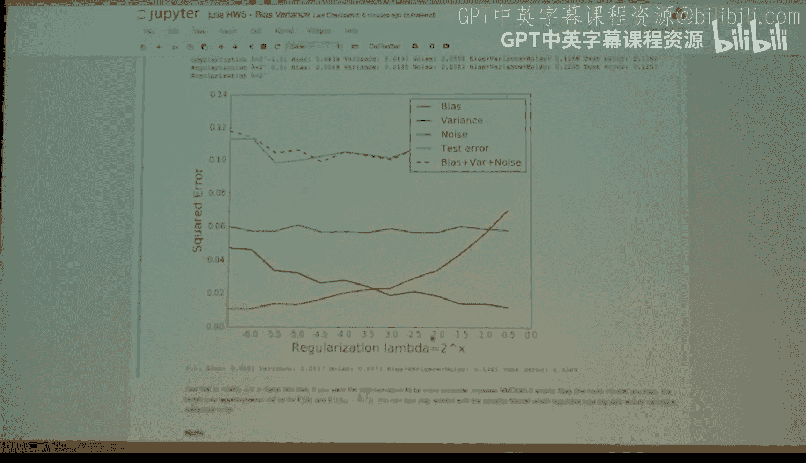

Let me move on。

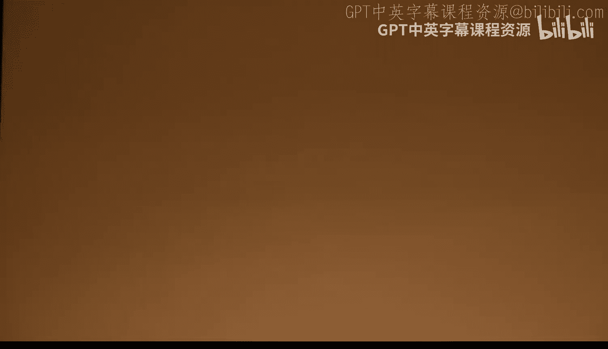

Yeah， question。

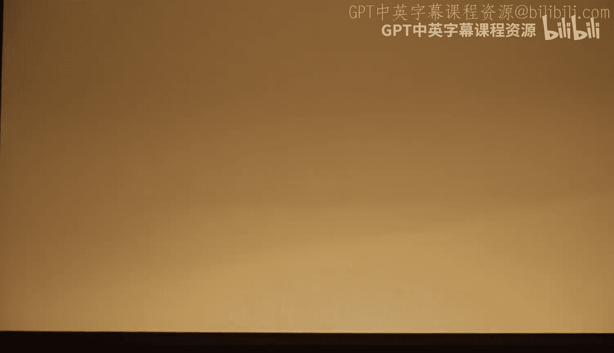

W quiet was speaking。到。

系。

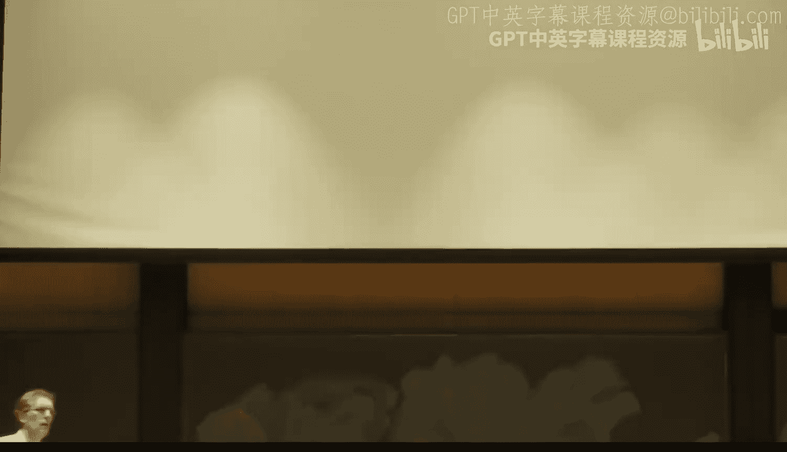

So I say a one more time。呃，喂我。呃换怀的。咗一。結ッ構。that this。快月干始。Right。

 so the base optimal classifier can anyone tell me what is the variance and what is the bias of the base optimal classifier。

Any ideas？Yeah。So the variance obviously 0， right， because the base optimal classifier， you know。

Computer based on the distribution and the distribution， you know， the training set。

 in some sense has nothing to do here， right， So there's no variance across classifiers。 There's 0。

 right， And the bias is， how much does the expected classifier。D from the expected label。

 the prediction of the expected classifier， differ from the expected label。 Well。

 that's exactly what you predict with the base optimal classifier。 So you also have 0 by0 bys。 right。

 So what you're left with is the noise。😊，So the the noise is something that even the base optimal classifier gets。

Does that， does that make sense。So on the time， variance is basically this， right H bar。

There's the variance， right， The base opt classifier always outputs the expected classifier。

 It doesn't。 It doesn't use training data。 It uses the distribution。So this year is0。Right。

 then the bias is the following。 The bias is H bar of x。Minus y bar。Squared， right。

The base optimal classifier， what does it do in regression In regression。

 you output exactly y bar of x for every single x。😊。

That's what that's the output of the be outcome classifier。And you always get exactly that。

 So that's also0。So the only thing youre left with is wipe the noise and the noise has nothing to do with much model you're using。

So。You still stop with that， yes。So then when' picking the case， why do we consider knowledge。

It's just always there。Like。我这这话发的。Greated and like， random。Yeah， but but how do you。

 how do you get rid of the noise， you cannot remove it。so biically， you just observe the error。

 which is the sum of these three terms。Okay， any more questions。Allright。

So what I want to look at today is basically the setting。 you know， let's just go back to E RM。

 And so this the setting that we just saw in the project where we basically say you want to minimize some parameter W。

 We have some loss function that we sum over。😊，You know， well。

 I think you wrote it this way X come a Y。W。Thus， Lada times some regularizer。 And this could。

 you know， it's typically the L2 norm。For example， something like this。哎子。And。

So the first thing I want to basically now depict is the graph that we just saw what happens when we change our land And so I will convince you or try to convince you that Lambda is actually one way of trading off between two different concepts。

 And we call these underfitting and overfitting。😊，And let me just draw a little， you know。

 this is very dirty。 Let me just draw a little picture。

we want to look at the error as our lambda changes。 And so in the project。

 we looked at the test error and the three different terms。Let us for now。

 just look at the test error and the training error。 And so as Lada becomes large。

 and this is the error。嗯。So as lambda becomes large， if Lada is is very， very small， right。

 then basically， we're putting all our weight。So here's our last function。 right。

 So assume lambda is 0。

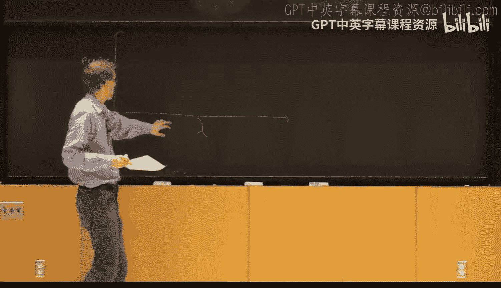

If Lada is 0， then this optimization。Has no weight on the regularizer。

 And the only thing we are trying to optimize is the loss on the training dataset。

So this means the training error must be very， very low because we're not doing anything else but minimizing the training error。

在。And as London gets larger， if London is really， really large， what happens？

Then this term is completely dominated by trying to find a simple solution。In the extreme case。

 you have an all zero vector。Well， the old zero vector is basically as good as random guessing。

And so your training error will be really high，So your training error basically looks like this。

It's not it's not linear。 Let me let me draw this again。嗯。Maybe might like this。嗯。Okay。

 this year is my train here。And my testing error。关了。Here are， the two things。 So clearly。

 if my lambda is really， really large， I return the old0 vector。

 my testing error will also be really large because I just return a bogus classifier。😊，哎。

If my lender is really， really small， then the problem is。

 I'm just minimizing the error on the training dataset。

 and I'm focusing too much on the training dataset。And so what I get is the following。

 right I basically get a decomposition layer。 So this here is my test error。😊。

And this is exactly what you will observe in the the， in the project。 what we just saw that。

 you know， basically， as my Lada is too small， the test error is high。

 Then there's the sweet spot in the middle。 And then if it becomes too large。

 you're over regularularizing and the test error goes out again。😊，嗯。Whereas the training error。

 the training error only goes up as you regularize more。And we call this regime here overfitting。

And this your underfit。嗯。And so what's basically happening here is if you look at the， the， you know。

 the bias variance， which would have to draw the bias variance curves。

 then basically in this regime here， the bias， the variance is really high， and it goes down。

 This is the variance。And the buyers goes up。This is the bias。

And so the noise in this case is just constant。 So we don't have to look at this。系啊。

And so the question is， how do we find this sweet spot。Speed。Okay， any questions about this？第二。

Does it only apply to which regularizer？Oh I see嗯。Yeah， this is generally， I see what you' saying so。

This is。Genally applies。 But if you have the wrong regularizer， you are increasing bias more。

 I presume。 Yes， yeah， yeah， so。So the question is。

 what happens if you make the wrong assumption about the regularizer。 So， for example。

 you can have Gaussian noise， and you get the two regular riseizer and so on。

 And the curves look similar， but you can actually get affected by how quickly the bias arises。Yeah。

 any it's a good question。 Very good question。Any other questions。Okay， good。

 So we call Lambda here is the hyperparameter of our model。

 And that basically balances this trade off。😊，And。So how do you find the best lambda and the。第一。嗯。

这边个。Actually， let me just characterize this to a little bit more。 So overfitting。

 I think we already talked about。 Overfitting is the variance is high。

 That basically means we are memorizing aspects of the training data that are too specific， right。

 So， you know， the example would be， I take images of， of。

 let's say students and faculty or something。 But it turns out that。😊。

Students are disproportionately more often， you know。

 the pictures just happen to be in front of trees or something。 And faculty tend， you know。

 there's few few pictures in front of trees more in front of buildings。 That's a total coincidence。

 but the classifier would pick up on it， just because it happens to be true in this data set。

 but it does not generalize， right， So these are kind of the the things that basically happen。

 In this case。 The training error is very， very low。

 but that does not translate to the general setting。In the， in the underfitting setting。

 what happens is that your classifier is even bad on the training data set。 So that's。

 that's the key part here。 that I give a certain data sets the data points。

 And even those that it has seen， it can't do correctly， right， And that's because， for example。

 in terms of over regulargularization， My classifier is constrained to be on a small ball。

 and it just doesn't have the expressive power to， you know， even get every single training point。

 right。😊，Okay， so how do you find the sweet spot La here。

 And the simplest thing that people use is called cross validation or K fold cross validation。

 And it's quite simple。 Basically， what you do。😊，And it's also called grid search， actually， well。

 that's two different things。 So grid search and K for cross validation。😊，And。

So the first thing is good chart。 And this is really， really simple。 So here's what you do。

 You just say， well， which lambda is good。 Here's what I do。 I just take my training data。

 I split it up into training。😊，And validation。And then I just try out a whole bunch of different values of Lada。

And for each one of them， I record the error I get。😡，And then I pick the lowest one。

And I say the lowest one is reached here。 and that's the lumbar I pick。Alright， so， you know。

 each one of you would have invented this， and you would be famous， right。

 if you' done it 40 years ago， But unfortunately， it's too late at this point， but。So， you know。

 it's， it's very simple process， right， So you try out all the different values of Lada， evaluate。

 you know， the classifier on the validation set and pick the lowest one。嗯。Idally。

 you want to try as many different points of Lambda as you can。

 different values of Lambda as you can。The problem usually is that it takes a lot of time to train the classifiers。

 You have to find some trade off。 One thing that people do is they do telescopic search。

 So telescopic search is basically first year， very grow gross setting of what。😊，Otherwise。

 lambda is。Then once you think the best one。You， and typically， this can be order of magnitude。

 So you basically you do this in a logithmic scale。 So you try out lambda equals 10 to the -5。

10 to the -4，10 to the -3， and so on the 10 to the5 or something， right。

 So you try out different orders of magnitude just to get an idea of what's the right regime of your lambda。

 Then you pick the best one。 Let's say in this case， it's the best one here。 Then once again。

 you try out 10 versions of lambda。 But just around here。😊。

And then you pick the best one which maybe here， for example。

 so there's a two step telescopic search。 The first you locate， where should I search。

 and then you search， you zoom in in that regime of the hyperparameter axis。

 Any questions about this。😊，Okay， so it's really simple。 There's one danger。And the danger is。

 if you try out many， many different values of Lada， what is going to happen。

Is that you will inadvertently overfit over the validation set。that's that is problematic。

 So what will actually happen。 Some Las may work better just on this particular validation data set。

 just because it only contains a couple hundred points right。

 you have to be careful right of those100 points， maybe you only get five wrong， right。

 So if you get one more wrong， right， that increases your error from 5 to 6%。

 but it's only one data point that's now more wrong， right。

 So is that really something you want to you know， rely on So you have to be very careful So if you validation that is too small。

 you may actually very easily make erratic decisions that you know， basically， you know。

 give you a lower error on the validation。 But again， it doesn't generalize to the true test。 Yeah。😊。

喂。So that's right。 good， good。 So， So that's exactly what I'm needing to。

 So the answer for this is K forward cross validation。 And so K forward cross validation。

 What you do here is you say， well， I don't just pick one validation set。 Actually。

 every single data point in my data should be a validation point。 And so here's what you do。

 You basically don't just make one split。 You make many splits。

 So basically what you do is you you divide your data set into K different buckets。😊。

And you say kmin as one of them are used for training， and one is used for validation。

And I can do this exactly K times。 right I can always leave out another bucket。 So， you know。

 the first time I leave out this this bucket here is then I train classifier here， evaluated it here。

😊，Then I leave out this bucket here。 I train to classify and all the others and evaluate it here。

 Okay， so now for every single lambda， I don't just get one error， one validation error。

 I get actually， I get K validation errors。😊，And the beauty about this about this is that A。

 it's much， much more accurate。 And B， I also get standard deviations， right。

 So I know how much this actually varied across the different validation data sets。 Okay。

 so that can tell me if one point is a little better than the other。

 But that's well within the noise that I guess see anyway， it doesn't make any difference。😊，嗯。

Any questions about this。Yeah， so validation。That relationship。

So the test set is the one you only touch once。 And that's basically what you report to your boss。

 And that' that's the true estimate of the error。Yeah。

What you then do after your boss approve is you train one more time。

 but you stick in the test set and you don't tell anyone。

 And then that's the final classifier you move push out。

 that actually does a little bit better because there's a little more data。 And that's okay。😊。

As long as you never use that test set again。いや。How do you choose K， Good question。

 K stands actually for Kion， and larger is better。Now。Though the larger， the larger K。

 the more buckets you have， the better the estimate of validation。The problem is the slower it is。

 So typically， what you want to do is in some a trade off of how much time。

 how exactly accurate you want to find the best lambda And sometimes how much does your boss pay you in a bonus。

 You know， when you actually get the lowest possible error。 That's in some sense， What is。

 how much do you really care about it。 It also depends on how big your data set is。

 So one thing is in the extreme case， K equals。呃，K equal and。嗯。So in this， that's the same thing as。

It's called leave one out cross validation。 So in this case， actually， you basically have。

 you run at n times and you only leave one point out。 And you just see。

 do I get it right or do you get wrong。But because you average over all n point n times。

 you actually get a very accurate estimate of the error。 The only problem is really， really slow。

 If n is large。 So that's however， often used when your data set is small。 So， for example。

 I you know， Ive used medical。 I worked with medical images。 And there each image， you know。

 MRI scans of people's skulls。 and brains， you know， each one of these cost several thousand dollars。

 So we could only afford， you know， maybe 11， So what we did is we trained on 10 and left one out and we did this exactly 11 times。

 And that basically then gives us you know， that's basically our cost validation and this scan。😊。

But very good question， Any other questions？Alright， awesome， so。

So one way to regulate regulate overfitting is regularization。 Another one that's also very。

 very common is over early stopping。 And so early stopping is something that basically this is exactly what you think it it does。

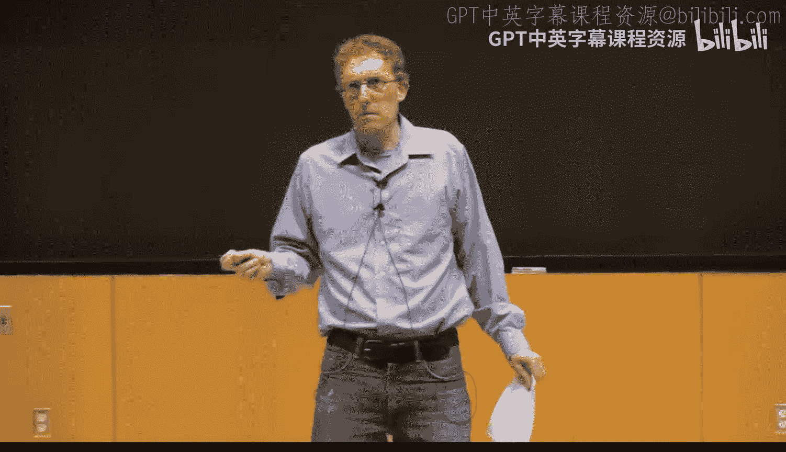

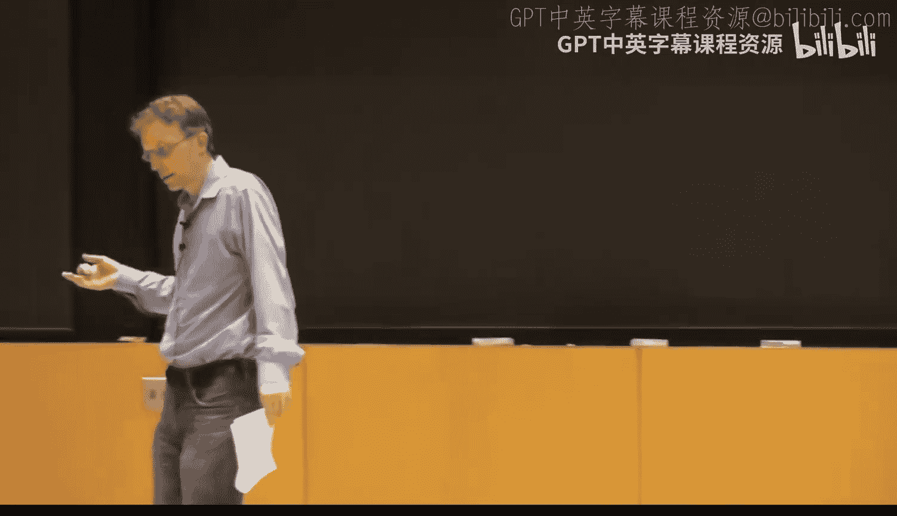

Basically， is a part of your optimization process。 So when you try to find your parameter vector W。

 you basically don't optimize all the way to the to the end。 You just stop early。So， for example。

 let's say you do gradient descent， right？ So one thing， you know， typically。

 the way we describe it is you keep doing gradient descent。

 you keep improving it until your loss basically doesn't change anymore。 That's， that's totally fine。

 But one thing you could do is you could just stop early。 right。

 And return basically some suboptimal results。😊。

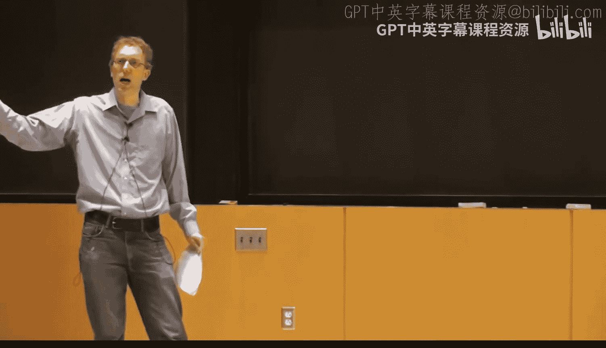

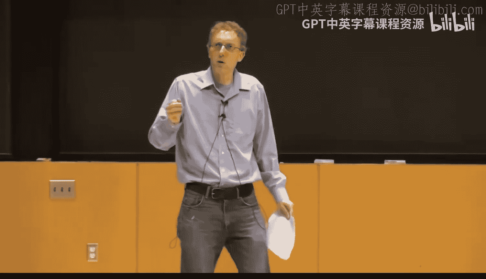

And turns out there's a very deep connection between regularization and early staff。

 And in some sense， it's actually quite similar， similar can anyone。

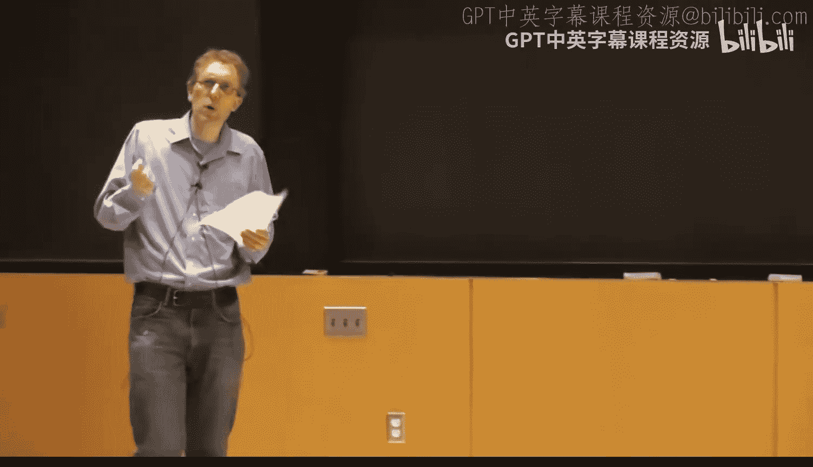

Think about why that is。Maybe I give you a minute to discuss that with your neighbor。

 So what's the deep connection between regularization and early staff。

 So think about logistic aggression or something。

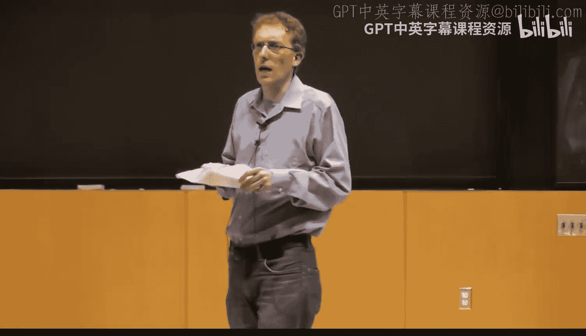

プ。The last。Yeah。4大0。Yeah。Yeah。Yeah。我。对。Right。Yeah。Yeah。Okay。Yeah。电话。他。YeahRight。Yeah。Yeah。Yeah。

This is so I clear please。Yeah。Yeah。Re。I that。Yeah。Okay， any， any suggestions？What is the connection。

 yeah。电哪里。That that's exactly right。 So in some， you know， in both cases。

 basically we control how much we minimize the last function， right。

 And one is basically we stop it at the edge of a ball right of an L2 ball And so you can't go any further。

 right， That's the ir regularization point of view。 So we kind of view it as。this thing here。

 we start with some W around here。 This year is our last function you're trying to minimize。

 We're trying to get to this bottom of here in regularization。

 We basically put a glass ball around here and you know， minimizer， moves down。

 but hits the glass ball and can't get out of here。

 That's basically the regularization basically says you have to stay within a ball of some radius whereas early stopping basically days。

 you move you。 you move with eventually you stop。😊，another way of looking at it is if you basically。

 you know， if you would only take zero gradient steps。

And let's say you start with the all zero vector， which you typically do with last functions。

 Then you actually get an old， you know， a vector with0 norm， right。

 And as you keep adding gradients to it， right， like the first time you。

 the body you do the first time， right， you say w becomes w， you know， minus alpha times G。😊。

But alpha is a very， very small number。 That's the， that's the zero vector initially。

 So now you add a vector at times， some very small constant。 So the norm is tiny at the beginning。

 right， because alpha is tiny。 Does that make sense。😊，So after one step。

 you still must have a very small norm。 right So if you would take the norm of this。

 you could take the alpha out of the norm Al has a very， very small numbers。

 So the norm must be very small。 So you need， as you basically degrading descent for more motivationations。

 slowly， your norm can grow。 and the regularization， you're basically saying。

 I just put a cap on the norm。😊，so there's a very， very clear relationship between these two。And。

So basically， what the X axis is， in some sense， inverted。

 So more iterations means less regularization。 So the way it works is the test error looks the same。

 but actually the training error looks like this， right， so。😊，So this has the training。

 and this has the test。So as we keep going， we will more， you know。

 make fewer and fewer mistakes because that's exactly what we are minimizing with our loss function。

 But at some point， you know， at the beginning， what we are fitting generalizes to the test point。

 But at some point， we will start you know， learning things that really don't generalize anymore and then we are overfitting and then we move up if you think about it in terms of。

😊，嗯。If you think about it in terms of variance， right， if you had two different data sets。Right。

 what would that look like if you have two different data sets。

 the last function would look a little different， right， So say this is my data sets 1。

 This year is my data 2， right。

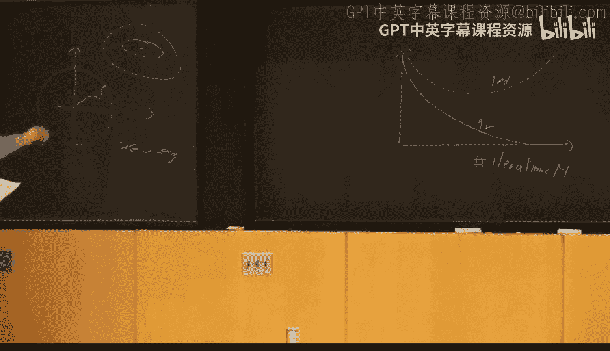

So they have slightly different， different minis。 Okay， this will be actually an extreme case。

 But what happens at the beginning at the beginning， the kind of， you know， they， you know。

 we're moving up in this general direction。 So the beginning， the variance is very small。

 I just take a few steps of gradient descent。 My， my。

 my parameters won't matter won't vary very much because they're all going in this direction where the minis are。

 Okay， does that make sense。Whereas as I keep， keep iterating and I'm minimizing my loss more and more。

 eventually， you know， I'm going down to exactly the minimum of this particular loss function of this particular data set right And I'm not ending up at this at this minimum。

 which would be a different training set， right So as I'm minimizing more the variance between these points becomes larger Okay。

 because I'm getting more and more directly into the minimum that really only is the minimum for this particular data set and a different data set。

 actually， this may be actually not a great solution。😊，Okay。

 that makes amazing hand did that make sense。Okay， awesome。 Okay， terrific。😊。

I will see you all on Monday。