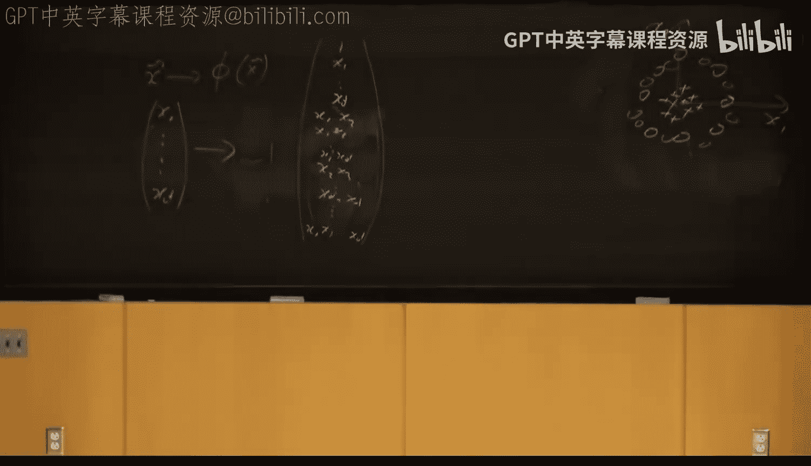

# 康奈尔大学《智能系统的机器学习｜CS4780 Machine Learning for Intelligent Systems 2017》中英字幕 p21 -21-Machine Learning Lecture 21 ＂Model Selection _ Kernels＂ -Cornell CS4780 SP17 -BV1Lo6gBxEKE_p21-

Hello， everybody。helello。Okay， please put away your laptops。😊，Okay， quick thing about the exams。

 so ultimately I think it went very well。A lot of students seem to do very well。

 I was 90 points in total。Nobody got a perfect， perfect score， but several people got really。

 really close。Two people get 88 out of 90。That's certainly a very good sign。Although。

 the distribution is extremely smooth。 So pretty much every single point assignment you could imagine。

😊。

Up to。Some level。You get。呢个点D咧。And not this idea。No， I don't have。Yeah。right， this is the oh Yeah。

 this is just the sorted。 There's not even the CF，There's just every bar here has one student。

 I just thought you guys。 O， that's what that is。So this year is the top two students of 88。

And then basically got sort of number of points。 So ultimately， if you're between 60。And 88。

 you're doing， you know， I'm not worried about you。Down here， these are very concerning。

I just want to remind everybody today is drop the deadline。L me down， me no， I didn't just。

Being honest， yeah。嗯。And。And I'm also worried if you have below 50 points，50 points or lower。嗯。

I mean， you know， this region here。It's very low。 I consider this as like the exam。 If you admit。

 if your final exam is not much different， That's 50% of your grade。So。I。

 I am concerned in that case。 So if you decide to stay in the class。

 please come to office hours and we can chat and see how。😊，Maybe debug。What went wrong here。嗯。

And mean， clearly， other people have had。You know。嗯。Less problems on this exam。 So， you know。

 try to figure out what went wrong if you are in this this， you know， in this region here， right。

Certainly， below 45。Doesn't look very good。 Any questions about the exam。Are they online。

They on piazza。 Yeah， yeah， the solutions are online。 So for those， some people took it late。

 And so the the， the T A did a heroic effort of trying to get basically as many grade as possible before the dropped deadline line。

 I did not ask them to do this。 but they actually did this。😊，You know。

 because they thought it was important to you guys。

 So they basically came in Saturday and Sunday and basically graded pretty much the whole time to get everything done on time。

 So unfortunately， the lady exams are not graded yet。 But the solutions are online。

 So maybe take a look and estimate how well you did in case you want to know， yeah。😊。

This isn't about the winter， but on the course website it says that homework4 is due on the day before written break is。

That's， that sounds accurate。 I say， home back  for， oh。I think that's incorrect。

 That's the one that just homework 4 is the one that just came out。Yeah。PM。Oh， I say， yeah。

 I know that that's， that's a mistake。 So the project is through the day before me term。 the day。

 Yeah， its sorry the day before。😊，What is it called spring break， yeah。Okay。If you can。

 maybe post something on piazza。That I guess， Any other questions。Okay， awesome。So overall。

 actually pretty well。 And I'm actually very impressed with the first question。

 So I think the median score was 100% of the first question。😊，So that that's very， very impressive。

 Over half the class got every single question， right。All right。

What actually got people was the naive base， for some reason。

 apparently naive base was the hardest one。Which I wouldn't have predicted， to be honest。Okay。

 so we have still talking about the biased variance trade off。And so， last time。

诶。Or two lectures ago， we basically showed you that you can take the error。😡。

If you minimize the square loss， but it generally holds。More or less。

And decompose into three very interpretable terms， the first one is the variant。

 second one is the bias of your classifier， and the third one is the noise that's inherent in the data set。

And then he looked at these curves and the curves kind of looked a little like this。

 Last one we looked at was early stopping， where we said。嗯。There' two things either， you know。

 you can do regularization。Where you increase your lambda or you can change the number of iterations that you optimized for。

And if you start with an oh0 vector， then that's actually a pretty good way of of， of。

Regularization as well。 And so what you get here is that basically as you integrateerate more。

 the training error goes down。😡，And the test error goes down， and then goes up again。

And so this year has again a sweet spot， sweet spot。😊，哎。And so what's happening is here， basically。

 the test error is too high And because it's underfitting。

 So you're not fitting the data set you know， well enough yet。 We have more weight improvement。

 And here we are overfitting。Overfitting means we are learning too much about the training data。

 but it doesn't generalize the test data anymore。 So those are the two regimes。And。

Turns out in practice。 there's these two things that are very similar So one is basically change the lambda。

 the weight in front of the regular riser。 The other one is to change the number of iterations for which you optimize。

Typically， I just。There's one advantage that you have when you do this。

And you change the number of durations。 And turns out it's a lot faster in practice。

 Can anyone tell me why it's a lot faster to find the sweet spot than you change the number of durations rather than trying out many different values of lambmbda。

😊，Any idea。So actually maybe let me just remind you of what I'm talking about So you。

You're minimizing。 you have this weight back to W that's in the two dimension cases。

 This would be the first dimensions， the second dimension。 You start with 0。

And you have this last function。 that you minimize the last function looks something like this。

Here's the minimum。 So as you optimize， you kind of move along this path to get here。

And early stopping basically says， well， I don't go all the way there。 I just stop somewhere early。

And regularizationization says， if you do L2 regularization， and it says， I'm staying within a ball。

Of some radius。 And that's dictated by this lambda。So， and so basically， once you hit the ball。

 you basically， you know， you make normal progress。 You stick here， right， You stay here。

And if you do L1 regularization， this ball just turns into you know， a diamond， right。

 So that' that's slightly different shapes。嗯。So if you want to find the sweet spot。

One option is to basically we talked about cross validation。

 So what we said is you take your train dataset set and you split your train dataset set into K parts。

Right， or， you know， one thing you just do we can。In the original， if you just do one for。

 then you just have training and validation。 If you do K cross validation， then you do this K times。

And you train your data， you classify here， and you evaluate it here。Okay。

 and that's basically how you can get a peak at the test error。

 The validation error is an approximation of the test error。 right， So in some sense。

 you can basically look and you these kind of plots only have observed as a training error。

 But when you evaluate your classifier on the validation data set。

 then you can look at what the testing error is， you know， an approximation of the testing error。

 And then you do this for many different values of Lada。😊，So。

 and you pick the one that actually has lowest error on the validation set。

But turns out that's a lot faster if you do this method。 or can anyone tell me why。Yeah。That's right。

 That's right。 That's exactly right。 But here you don't have to do this right， So when you。

 when you try when you try to find the right value of lambda。

 what you have to do is you basically retrain your classifier over and over again。

 And then once it's strained， it's converged， you look at the validation error and you say， okay。

 for this value of Lada， this was my validation error。 And you try our 10 different values。

 then you pick the best one。😊，When you do early stopping， here's what you do。

 You just optimize and you just optimize ones。 And every couple of iterations。

 you estimate the validation error。 You just keep a track， right， basically， you save。

 save the weights in some file and say this was the validation error。 And then you keep optimizing。

 You keep optimizing all the way until the end。 And then you look into your files and say。

 which one was the one that has the lowest validation error。 was this one here。

 So that's the one I'm picking。 Okay， So in one sweep。

 basically you get all these different values of n。 Okay， so it's very， very fast。

 And so that's with expensive models like neural networks。 this is what people do。😊。

So you just train your neural network once for a couple of thousand iterations。 And then at the end。

 you save after 700， maybe that was the best， you know， best model After that， I started overfitting。

 So you use that as your final answer。😊，Any questions about this。都完。所以。

While it doesn't work for all methods， right， So not all methods actually have an optimization like this。

 So， for example， SVM， you may just call and solver like a kdratic programming solver。

Then there isn't really a notion of early star in that sense。嗯。Yeah， so so thiss not。

 space is not always applicable。Any other questions？第二。😡，Howly said yeah， well， you do exactly this。

 right， You basically you train your classifier and every couple of iterations。

 you evaluate the classifier you have right now on the validation set。

And you keep note of what the error is。And。That's basically this curfe here， right。

 there's an approximation base。 The validation error is gonna look very similar to this。

And then you basically evaluate this over and over again。 then you say after you're done。

 you go back and say that was the best one。And so you save the weights。

You save the parameters at this time。 and that's what you return。Does that make sense？

How does it save time， Because for everything about， you do them all in one step。

 as patients just go through it。And you keep iterating if you try different values of lambda。

 you have to every for every value of Lada， you have to do the whole optimization until convergence。

I said the other plot is this。 If you basically say， what's my value of Lada， right， my Lada is very。

 very large。 My training error， This the other way around， right， So my training error goes up。 Wait。

 How does it go。ESo it goes this way， right， this way and。That way， is that correct。 So。

 So here actually try all the different values of Lada。 But for every single value。

 actually have to do the whole optimization。😊，Whereas here。

 you just do the optimization once and you get all the different values for free。但是的。Okay。

 any more questions。Yeah， the test errors is。That， you know。

 continuous how do you know it looks exactly like this。 And the answer is。I'mline。 It doesn't。嗯。

It looks， in reality， it looks like this，The principle I looks like。So。I mean。

 it won't be that smooth， but it's pretty smooth。It good pretty。Yeah， I mean， you have noise。

 right you always have noise so。Okay， any more questions？Alright。

 so what I want to do next is kind of say。Put you in the shoes of a data scientist。

And imagine your boss tells you。Train a new system， right， So， for example。

 to do spam detection or to predict the stock market or I don't know， whatever you want to do。

 right so。Choose your industry。And。Your boss gives you a lot of data。 And then she says， you know。

 like， here's， you know， you have to train a model and the test error should be less than 1%。

And so you train your model and your error is higher than 1%。So what do you do？

And so that's called machine learning debugging。And so basically。

 what you need to find out in this case is if your error is too high。We've now learned one thing。

 right？You have to know which part of the error is too high。

 So the error consists of three different parts that are added up。 And this is your overall error。

 It's going to be variances， bias， noise or something， right。

And so if you know which one is the largest one。Then you know what to do in order to reduce the overall world error。

 And it can be very lopsided， right， It could be something that， you know。

 you have massive variance problem。 you have hardly any bias at all， and you don't have much noise。

 right， So in this case， if you try to reduce the bias， you know， you won't have any luck。you。

 you try to clean the data and spend， spend a lot of money to， to reduce the noise by half， right。

 Well， it won't help you much because you actually have a variance problem。

 So you have to address the right aspect of your， of your problem。So the question is。

 how can we debug this？And so what I'm telling you now is a very。

 very simple trick that you can use in practice。 and I hope you will。 And so here's what you do。

You plot， you make a plot。And this year is the number of training data。

 training instances you you use。So you basically take your training data。

And you just randomly reduce it to sub sampleample data。

And so this year is basically using my entire training data set。

 And this year is only using a small fraction of it。And so four。Basically。

 what you do is you train your algorithm many times。 First。

 you just train in 1% of the data very little。 and then 2% and 4， you know， and so on。

 And you slowly crank it all the way up training in the full mark。

 And what you want to see is how things change as you increase your data。And so。This is error。

And let's say your boss dictated you here。 This is the error rate that your boss tells you。

 if you get that much error， then we be able to ship it。 And you get you。bonuson， you move on。

 you get a， you know promotion， etc cetera。 You may even get a cubicle near the window。

It's very rare。And。So， basically。You have to move your test error below this， right。

 And my test error， essentially， I mean， you know， in this case， validation error。嗯。So what happens。

 right？ So the first let us plot the training error。 So the training error。

 when you have hardly any training instance at all， you just have one training instance。

What's your training error？With any respectable algorithm can still look at itself in the mirror。

I just give you one training example。 what's going to be the training error。0， right。

 So it's going to memorize that one example。 you hope， Otherwise， you， you may have a biased problem。

哎。系。And so as you increase your training data， what happens is the training error will only go up because your problem is only getting harder。

 The more data you have to basically be consistent with。The heart are your problem。You basically， as。

 you know， the beginning， your training error is very， very low。 And then you keep going， keep going。

 keep going going。 And so here theres kind of what。嗯。And。What happens with the test there。Well。

 the test error， if you just say one training sample is going to be horrible。

 because probably most of the most of the world will not look like that one example you down it。

 So at this page you error is very， really high。 And then test error goes down， goes down。

 goes down goes down。 And the important thing is the test error is never lower than the training error。

So the training error is a lower bound of the test error。嗯。So this is what your figure looks like。诶。

And depending how much data you have， you would either stop here because that's now you've reached the maximum of your data set。

 or you stop here if you have a lot more data。😡，嗯。All right。So let me just。

 I just found this is training error。And this is testing。And so I claim there's two regimes。

In which you could be in， right So I'm excluding here。

 the regime where you test errors lower than epsilon。 right， If you test errors lower than epsilon。

 then why are you doing this， if you're wasting your time， right， just go to your boss， you know。

 show the results and you get a promotion， right you know， and move your stuff to the window。😊，So。

So in this case， were always， you know， the test error is always above the ep。

 right So there's these two regimes。 So either you increase your training data。

 and you get stuck here。はい。And this's the regime number one。And this is regime number two。Okay。

 and so without looking at the notes， one of them is high bias and one of them is high variance。

 Which one is high variance， Which one is high bias， Who can tell。

Maybe actually should discuss it with your neighbor for one minute。 Don't look at the notes。

 Is it in the notes。Is it very bacon？OhThat's very big， all right， okay， never mind。😊，Okay。Yeah。

Giving it away， all right。This is high variances。This here has high bias。 so high variances。Hi，Yes。

 by。And so let us just think about this for a second。 right。

 So what's happening in these two regimes。 right， So let's first。Think about this Thank。

 So here we have the high bias regime。 So what's happening。

You're training your algorithm you're using， in both cases， by the way。

 I assume you use all your training data， right， So basically。

 you increase your training data and you're stuck here。 So this。This is where you stuck。 Basically。

 you've used all your training there。 right， you move from the left to the right。

 Does that make sense。So if you're in this regime here。

The important thing is your training error is higher than X。So that's very， very important。

Like your algorithm cannot even achieve the error rate that you want on the training。

 on the training data， the data was allowed to look at。😡，So this means something is wrong， right？😡。

You're somehow modeling the wrong。 You know， you， you have the wrong model for the dataset set。

 right。You have a bias problem。😡，Okay。So in this case， a few things are important。If you're here。

More training data will not help you。 Can anyone tell me why more training data will not help me in this case。

😡，I've seen this many times。 people in this scenario and they go like。

 our error is still too you know， too high。 Let's add more training data。

 It's going to help always helps。 It doesn't。 Why does it not help， yeah。Right right。

 so adding more training data always decreases your test error。 That's good。

But it only decreases the test error。Like the gap between the test error and the training era。

 test error will never be lower than the training error。

 and the training error will only go up if you have you add more training data。

So the training thing will go up and the testing thing will go down。

 but it will never move beyond Epsilon。 It cannot， right。

 because the training error is above Epsilon already， and it will only go up。Okay。

 so you're shrinking this gap。 But this is not your problem。

 Your problem is not that that gap is too big。系。That's very， very important。

 That can save you thousands of dollars。 If you spend a lot of money on new data。

 and then you realize afterwards， it didn't help。呵。Okay， so what do you want to do in this case。

 I I guess I maybe I don't。Write them all down I like， you know， So how do you detect this regime。

 the important thing is that the training error is above epsilon。

 the training error itself is too bad。 And number two。

 the second giveaway is that the test error is only a little bit higher than the training error。

 There's a small gap。 And both of them are bad。 That's a high biased region。

So if you' are in that setting。What you need to do is you need to make your model class more complex。

 So you have to increase the power of the algorithm。 Clearly。

 your algorithm has a hard time understanding that basically the shape of the decision boundary on your dataset。

So， for example， because you made a linear assumption and it's just not a linearly separable data data set。

So in this case， what you need to do is you have to change your algorithm to be more complex。

 There's a few ways of doing this。 So one thing is kernelization。 we will talk about is。

 maybe still today。Add features。 so something is not expressive enough。 If you add more features。

 your algorithm may be， you know， maybe more expressive。嗯。Sorry， where are we doing out of water。

Yeah。And boosting。 And boosting is something we will cover again in a few classes。 So in some sense。

 you see what we are doing here。 So right now， I'm telling you how to detect the two regimes in the next couple of lectures。

 I will then show you what to do about it。 So we will cover boosting。 We will cover。😊。

Colonization and adding new features that's kind of on you。Any questions about high bias？Alright。

 so the other one is high variance。So what， what does the hiberian say？Again， two giveaways。

The training error is below epsilon。 So on the training data， you're doing great。

If that was the error you wanted。 But the problem is the test error is too high。

 So you have a big gap between training and test error。So what you need to do is shrink that gap。

 That's basically what happens。 So all the remedies here will move up the training error and move down the test error and if you're a little lucky。

 then they will basically converge below that eilon and then you're done if you're unlucky。

 they will converge above it。 and then you in a high bias regime。

 then you have to address the bias So that means you still have too much bias left。😊。

So you're trading off one for the other。 as that's the w mobile thing。

 right to reduce the same thing， by the way， here， If you address the bias， you know。

 if you do colonization， you add features， you do boosting。

 what could happen is that now your trading error goes way down。 right。

 The testing error probably also goes down， but there could now be a big gap。

 and the testing error is still above epsilom。 That means you now move。

 you trade it off bias for variances。 So now you have to address the variances。

 right And so that's in some sense， this balance that you have to strike。😊，So in this case。

 from more time， the training error is below epsilon。 That's good。 but the testing error is above it。

 So there's a large gap between the two。So what can you do？

One thing for sure is you can add more data， so in the high variance case， adding more data is great。

😡，Because adding more data will move training error up and test arrow down that closes the gap。

 right hopefully below Epsilon。 then you're done。😊，🤧嗯。Another thing is baggging。

That's something we will cover very soon。It's pretty cool。

And so another thing is you can reduce the complexity， right。

 So maybe you're using a model that is too complex and it's hard to get the regularization right。

 So reduce。😊，Model complexity。One thing can do decrease。Decrease regularization。So I increase。

 sorry I increase regulation。And here， by the way， we have to do decreased regularization。😡。

Do I have that here。I just have decrease and increase regularization as in terms of model complexity。

 I guess， in this case。😊，Okay， any questions about these two settings and what to do， Yes。

 if your joint is higher than epsilon， what do you do， If your noise is higher than epsilon， Oh。

 then you blame the person who collected the data。诶。That's hard。 right So if you're noise。

 then even remember， what do you do in case your noise is so high。Yeahep。You can add more features。

 right， So that that's one option。 noise is a function of the features。 right。

 you can also do data cleaning。 So if you do this a couple of times and you're always above epsilon。

 then at some point， you seem to suspect that you of these bars， right， of this variance。😊，You know。

 variances。Bs and noise， right， Maybe that in itself is larger than Epsilom， right， So that I could。

 of course， be， right， that that's too large。Then you have to do data clean。

I'd also look into are the labels correct， etc ceter。 But certainly adding features is a good one。

Yes， good question， yeah。The or everything。It's the same thing。You just divide。

 just divide by the data set。差唔到嚟我哋就要吃。Oh， I see。 I see。 Yeah， yeah， you have， Yeah。

 if you compare with more data， you always have to average。 Yeah， yeah， yeah。

The error is usually a rate， right？😡，In some sense。

 the error means if I put an example a point randomly。

 what's the probability of getting that point wrong， That's， that's what an error is， right。

If you have more data， the training error will always go up if you don't change your model。 Yes。

 because it's harder。Well， you mean， it may stay the same if it's totally separate。

 but it would never go down， yes。应对了好。Without the particular。对。Yeah， at some point， you converge。

 right， So this， this graph you converge right， So at some point。

 A doesn't make any difference anymore。 But more data will never bring the training error down。

 That's the important thing to know。And test error is always greater equal the training error。第二。え？

じゃなく。One more time， sorry。Yeah， yeah。 In this case。 Yeah， just to get this graph consistent。 Yes。

 one thing you can do， by the way， is if you could do cross validation。

 then you could actually get standard deviations， right， And that actually is not a bad thing。

 when you to be honest， I do this graph， I do K for cross validation。😊。

And then I actually draw error bounds around here。Because that's actually very informative。

 How much does it actually vary。Yeah。第二。売れ必要ない。我。在可下。你 get这个。But then adding to data to that。No。

 no no no。 Adding more data would not help you， right， Your training error is still 0。Like if you。

 you have， it's a linearly seable data set and you get it completely right。

 and you have  zero training error。Adding more data。 if it's still in the inceptable， it's still 0。

And if you're really unlucky， you get some point that now makes the data not linear step of linear。

 And now you get a larger error。But it cannot。 It' is not going down。Yeah， by the way。

 it's always a little noiseisy。 If I say it can't go down， you know。

 that's up to the fluctuations that you get， yeah。Okay， any more questions？

So please keep this in mind， right， You will be later on。

 if you use machine learning algorithms in in real life， right， you will be in these scenarios right。

 But you basically， I mean， that's in some sense， all we ever do， right。😊，If it just works。

 then you just stop， you know， then you're done。 But typically the reason they hire a data scientist is because it's not easy。

And so you always have algorithms that don't perform well enough。

 And your job is it to now improve this algorithm。 That's exactly why they hired you。

 So if you now you know， use a systematic approach， right， you can actually， you know， do much， much。

 much better than if you just randomly try different things something。😊。

And so what we will do now is actually go through the different settings。

 So there's a lot of stuff here that I actually wrote down that we haven't covered yet。

 And that will be the next couple of lectures。 So basically attacking very systematically highvari setting and high bias setting。

 yes。😊，N be。You per sample。 So you divide by the size of this dataset set。 I that damn。Okay。

 let's just。Move on to Colels。Sorry， see yeah can I get this to。是， yeah。Actually。

 let me give you a few， sorry。A you over here。Yeah。

So。Yeah。All right。And what I want you to do just to you know。We start with a little quiz。

 So here's basically the idea。 Imagine you have the following data。

Here are my crosses and here are my zeros。 So my O's and nods and crosses。And as you can see。

 basically， these are drawn from some kind of distribution where the the o's are basically in some circle and the crosses are right of the。

 you know， origin。 right， There's some small Gaussian distribution here， basically。

 of crosses and the circles are around it。😊，And this whole data set is just two dimensional。😡，So。

There's an old trick is basically， and people came up with this long time ago。

 is to make classifiers more powerful。 One way is just to add more features。 right。

 Does anyone remember in which regime do you want to add more features， high variances or high bias。

😊，I heard both of them。High bys开 high bys。So let's assume me in a high by setting。

 And why is this because we use a linear classifier， right your cousin， who you usually trust。

 tells you this data is linearly sparable。 Don't even look at it。 Trust me， right。😡，So youう。You know。

 you invest in this and you buy a linear SVM。 You even pay the patent fee and everything。

And now you want to train this turns out because pretty badly。

 So what it would do basically change something like this， right。So you get roughly 50% error。

 So you feel like something is wrong。So you look at the data set。

 and now you've already invested so much in the linear classifier。 You don't want to give it up。

 right， You've already paid the royalties。So。What can you do， I the old trick is to basically。

 you know， in this case， what you know， you could， of course， know more about the data。

 try to extract more features。 But one thing you can also do is you can take the existing features and try to construct new features out of it。

And so basically， what you do is you take your vector x and transform it into phi of x。

 But phi of x is higher dimensional。Can anyone tell me。A transformation。You know。

 of just one more feature to add to make this here linearly sparable。

 I give you a minute to discuss it with your neighbor。😊，I know some people already see it it。Okay。

そですね。Yeah。就在。Yeah。Yeah。Yeah。Yeah。Okay， any suggestions？Yes。Sorry。Oh， polar coordinate。 Oh。

 that's good。 I this one。 Yeah， yeah， that's right。

 So I could just take X 1 x2 and just change it basically to the， you know， radius， I guess。

 and what do you need the the angle。 I guess， right。

 the angle So if you just have the radius in the angle。😊，Radius in the angle。

Then that actually works pretty well。 It's very nice。 I like this a lot。😊，That certainly works。

Any other suggestions。Yeah。That's right。 You could add another one。could say X 1， X 2。

 in distance from the origin is x 1 plus squared x2 squared， right， square distance， whatever。😊。

That's exactly right。 And there may be others， as well。So。

So the crucial point is that if I basically add more features to it。

 So if I take my existing features， just add strange transformations of them。

 I may make it very easy problem。 a very hard problem， easy。 Okay。

 And so instead of actually taking a much more complicated caifier， maybe I just take some， you know。

 add some features。 That's cheap doesn't cost me very much。

 And now I can use this beautiful linear framework， right。

 And the nice thing about linear classifiers is， for example， SVms， right。

 theyre very easy to learn you know exactly what they' are doing。 So， you know， why not just do this。

😊，Any questions about this。They have a demo here， but the computer is acting up。

Yesue I have no Internet anymore。Yeah， why do we keep x1 and x2 inside our。Right， so in this case。

 you don't need X， you''t need X1 x2 anymore。 But typically。

 the idea is you just add more features that then actually make your problem easier。 right， I mean。

 you know， it seems pretty bold， pretty confident to remove them。 And that that would really。

 you know， And this is a very， there's a toy example， right。

 but you actually happen to know the perfect feature， which is， you know。

 in polar coordinates basically the radius。 you know， the distance from from the origin。 typically。

 you don't know that。😊，Okay， so so this is great， right。 So typically in this case。

 we know exactly this is exactly what you're saying。

 We know exactly which features to add because we can just look at the data and the data actually it's trivial。

 Typ， this is not the case， right， Tpically， we have a data set。 We have a bias problem。

 and we want to add more features to make our classifier more expressive， But it turns out。

 of course， we don't know which features to add right It's actually very hard。

 And so a good thing to do is actually say， well， why don't we just add any possible feature we can think of。

😊，I asked to grab back， and so here's the idea。We can take our x1 to X D。

And so one transformation we could make is say， we take any kind of non nonlinear interaction between any two features。

So the first thing we just say， just add a bias term 1， why， Well， why not？ And then we have。

X1 to xt。We just keep our old features。And then we take any two interactions between them。

 So let's take second order， You know， of you know， first order interactions。

 That's basically x1 squared， right， and then。Wait is that correct。Ohm sorry， X X1 times x2。

That x1 times x3。X 1 times X D， then x 2 times x3 and so on。 until you basically get at the end。

 X D -1 times X D。Then you take three， any three features multily them with each other。 right。

 and you do this all the way until the end until you get x1 times x 2 times X D。

 So that's any D features multily N together， right， So basically。

 I'm saying there may be some interactions between features that are non nonlinear， right。

 if we have something if this feature is large and this feature is small that actually tells me something。

 right。😊，If I just have a linear model that's really， really hard to capture。

 So what I'm doing is I multiply the features with each other。Okay， and this way， I get these。

 you know， for example， here， X 1 times x 2， right， That's suddenly a non nonlinear， you know。

 relation that I can now capture。😊，嗯。Can anyone tell me how high dimensional is this。Nectctories。

I give you a minute to work it out。Yeah。Yeah。Yeah。Yeah。Yeah。Okay。Yeah。Yeah。Yeah。Yeah。Yeah。

They letteraught Congress， we didn't make up。Okay， can anyone tell me？Yeah。

shall be true to the party。 That's right。 So each one of the features can either be in or not in。

And so you have a binary decision so you have two to the D， right？嗯。There's no internet in this room。

 apparently。But I managed to get it on my cell phone。So I wanted to show you a little video。

 so let's see if this works。

Okay， awesome。 So what you see here。It's。Is a data set。

 You see the blue dots in the middle and the red dots around it， right。

And so the classification boundary that we would like to have is the circle around the blue points。

 you know， that separates the blue and the red points。 But we have a linear classifier。

 so we don't know how to do this。😊，But I now show you basically。

 I just want to visualize you that you know， if we basically now add more features。

 you just have to add this one feature that basically is the distance on the origin。

 Now this turns from a two dimensional data into a three dimensional data。Oh yeah。

 it's the good stuff。And now the decision boundary now't iss no longer line。 It's a plane， right。

 and they can fit the plane exactly to cut off the blue part， right。😊。

And if we now go back to the original data set and visualize this decision boundary， right。

 this is what we get。so we get exactly the decision boundaryer we want。Just only。 thank you。

All right， I see you all on Wednesday。