# 康奈尔大学《智能系统的机器学习｜CS4780 Machine Learning for Intelligent Systems 2017》中英字幕 p22 -22-Machine Learning Lecture 22 ＂More on Kernels＂ -Cornell CS4780 SP17.zh_en -BV1Lo6gBxEKE_p22-

Welcome， everybody。Please put away your laptops。Okay。One quick reminder。

The project on ERM is due today。You may want to use some some late days。 I looked at the top scoring。

Teams and。I really like。 people have done very principle things to， to get to the top。 So' it's very。

 very nice。 I will。😊，Maybe donate some time after the spring break to talk about the winning。

giveive the winners some chance to kind of explain what they did， but it。

Seems like they know what they're doing。 Any questions about logistics。

I' to use slipt to try aim for the top of the leaderboard。Sure。Yeah。Okay， any other questions。

All right。And。Okay， so we've been talking about bias variance trade off。😡，And so a few lectures ago。

 we basically established that the error and machine learning decomposes into these three terms。

You know， a noise， bias and variance。And what we will do now is basically try to debug or give you tools。

To kind of address each one of these carefully。 The last lecture we talked about how to identify if your problem is a high bias problem。

 have a variance problem or neither one of these， then it's a high noise problem。

 And now we are getting into how do we combat these， And we are focusing for now in high bias。

 So high bias， Can anyone tell me how you diagnose how you diagnose high bias。

 What happens when you have high bias， How do you recognize。😊，Who remembers。第二。

High training error is And the small gap between training and testing error。

 That's the important part， right， So your training error， in some sense。

 is already too high and your test error is actually not much worse， right。

 So the problem is not the gap between training and testing， which is variance。

 which is the high variance， But instead actually is that you classifier itself。

 can't even do it on the training dataset， right， that's clearly high bias。Well。

 it could also be attributed to noise， but typically， it's high prices。

So one thing we did last time is we said， well， I give you this very simple problem where we said we have these circles in the middle and then we have crosses around it。

 And we said， well， we really want to use a linear classifier because we just get a discount on S VMs。

😊。

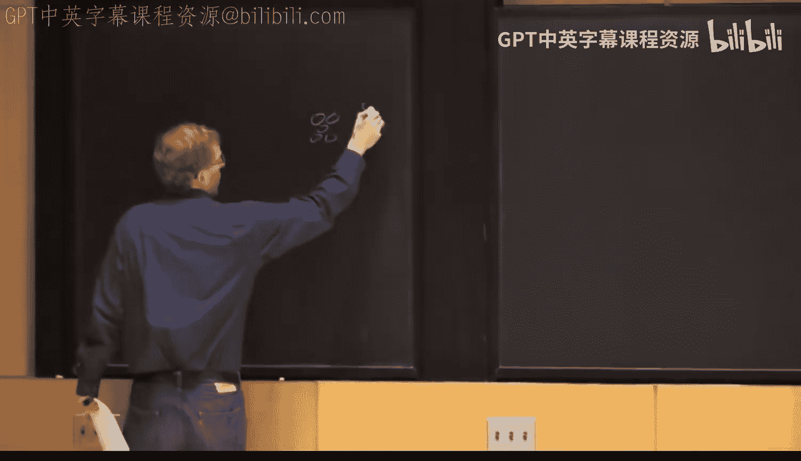

And。How can we apply a linear SVM on this dataset set。 And turns out this way， it doesn't work。

 right， there's no way you can kind of divide these into crosses and and and nods。

 But one thing you can do if you just do it add some features。 So in this case， actually。

 if you take X 1， x2。 and you will just add some features。 for example， X1， you know。

 one person actually suggested polar coordinates， But you know， you could also just add， for example。

 X1 squared x2 squared。 the sum of those two， right。

 that's the same thing because if you assign weights to those， you sum them up。😊，And then actually。

 suddenly， this becomes linearly separable。 and it's really， really easy。It's a really easy problem。

 so。That makes us believe。 Well， maybe that's what we should do， right。

 So maybe one good way of addressing high bias is just adding more features。 And， you know。

 of course， if you have data specialist， you could maybe extract more features from the data。

 by basically you have house pricess。 maybe also get the school district or something of the average grades and school district or something。

 That's one。 That's the kind of the data creation part。 We're looking at just。

 you know you have some features already can be somehow combine these features to create some。

 you know， to capture them nonlinear interactions between different features。😊。

One idea。 So in this case， it' it's simple。 we can actually look at the data and we can just figure it out ourselves。

 Its more like a puzzle。 Usually that's not the case。

 Usually can just plot the data and just you know fus around with it。 Instead。

 you know you actually have to do know， let's say the data is0 dimensional。

 Well you wouldn't really know how to visualize that in that way。

 So one thing is if we just try to model all the different interaction between different features。

 So one idea is we have this vector vector x1 to X D。 And one thing I propose is we say， well。

 what we do is we just add features between of any possible interaction between any of these features。

 So the first one is just a constant that means no interaction between any features and we you know。

 we say， okay， this is just the feature itself。 And then we take any square terms。

 So x1 times x2 x1 times x3 and so on x1 times X D。 and we have x2 times x3 and so on。

 And we keep making three way modifications until。😊。

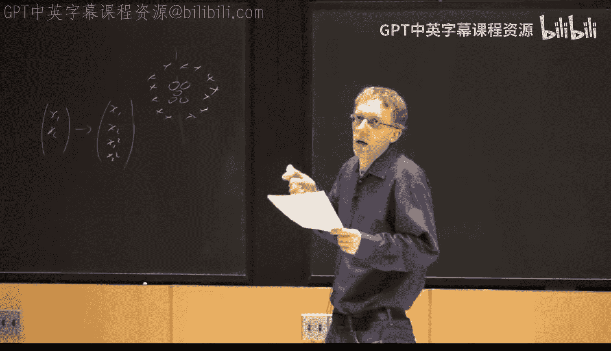

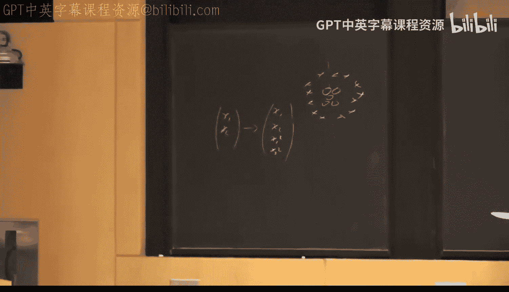

At the end， we get x times X D。And that seems like a good thing and probably captures a lot of the。

 you know， possible non nonlinearities you could have in your data set。

 So that's very effective for decreasing bias。😊，But there's one downside。 And that's， you know。

 how many dimensions this is。 And last time you， you figured this out very clearly。

 Does anyone remember what's the dimensionality of this vector is。第。There's two to the D， right。

 Why is the two to the D。好的。い動で出していく番。Yeah， that's one way of that's right。

 another way to looking at it you just always have X1 to X D。

 and each one of them can be on or can be off， right， And then actually。

 this is where you get exactly two possible options for each one of these terms。

 This is the option where everything is off。 So everything is just one。😊，And here is basically。

 you know， everyone is on。 So we have exactly two to the the possible switches。

AndThat should scare the living daylights out of you， right。

 because you could easily have 1000 dimensional data set。

2 to the thousand is more than theres electrons in the universe， right。

 So there's no way you can possibly write down that vector。So it's great。 But right now。

 it's not very feasible or only for very small data sets。😊，Let's not get scared by this。

And let's just continue and pretend we don't have that problem。

 That's kind of looming over our heads， right， So you want to do this stuff。 But let's just。

 you know， ignore it for now。So what I want you to show you today is， you know， basically two tricks。

 how to deal with。

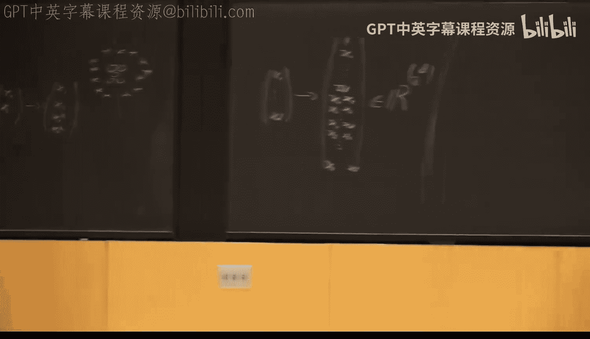

So you would like to extend the dimensionality of our data by it kind of combining features with each other。

 That seems like a good approach。 And the problem is， this is really high dimensional。 that it is。

 you know， the first thing that's really， really slow and B that needs a lot of memory。

 So the first thing I want to show you is just a simple trick。 basically， and I just you know。

 thats a lot of mathematical reasons why you want to do this。

 But I now show you just a very pragmatic reason。s well。

 one thing we can do is if you have a linear classifier， turns out， we can actually。😊。

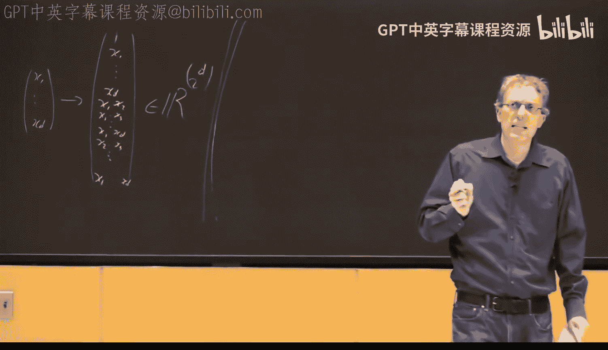

Express the economy acidifier in terms of inner products。

And if we only access our data to inner products， then you can pre computeute these。And therefore。

 you can kind of store them， compute them once。 And then during the training， we， we just save them。

 So we just pull them up。 So， so let me just explain this。 Let's say you have a matrix K。

 We say K I J equals X， I transpose X， J。😊，Okay， so basically， what I'm trying to convince you of。

 And this was part of the homework。 So I kind of primed you here。 So I think one Woberg ago。

 you had to do this already is， well， if I can express my entire classifier in terms of inner products。

 then one thing I could do is I could precompute the inner products。😊，And the advantage is。

 then I just have to look them up。 I don't ever have to compute them。 And， you know。

 one reason you may want to do this is because you already have the feeling。

 These are going be really expensive。 These in the car。Okay。

 so let me show this that we can actually do this， right。

 that basically we can express everything in terms of in products。 And so let me， for now。

 just look at the square loss just because I like the square loss。

 but it also holds for all the other losses that we actually talked about。😊。

So if I remind you the sta loss is w equals with sum over all odd points，1 to n。

 and the last is w transpose X I minus Y I squared。😊，Okay。So what's the gradient of this。

 the gradient。And we look great in descent。It。Please correct me if I'm wrong now。

 Da your transpose I for this。X， I minus Y， I X I。Okay， so this year is the last function。

 This is the gradient。It's called this G。OK。So far as the good。Now， I'm。

 sorry did the the notes are a little bit different。 I just realized just now on the， you know。

As I walked over。That maybe I can explain this a little bit。More content。嗯。So。Here's the trick。

 The first thing I want to convince you of。Is that at all times during our algorithm。

 This was part of the homework， if you remember。Our W can be written as a linear combination of our inputs。

So I claim that W equals。1 to end。Alpha I， X， I for some assignment of alpha of alphas。Okay。

 so that's， that's a claim that Ill show you prove to you in a few seconds。哎。And if this is true。

Right then actually think about this what happens here， right And this。

 the only X is our data in terms of W transpose X。Right。

Here we only our data in terms of W transpose X。 Well， there's a little tma。

 But don't worry about this for now。 So when we have W transpose X， Well。

 W actually is this thing here， right？ So what does W transpose X become。

Let's say W trans X J becomes the sum over I1 to n Al I X I transpose X J。😊，Well。

 this year is just K I J。Okay， so just to be clear。

 what I'm trying to do here is to express everything in terms of inner product because then I can。

 then I can precomp the inner product， save them somewhere memory。😊。

And they just look them up every time I access one。 right They don't actually have to compute them。

 And the nice thing is now my vectors can be very high dimensional。

 It doesn't matter as long as my inner products are pre computeutd， I'm good to go。 Okay。

 let's not worry about the precomp computation of the inner products。😊，So。Alright， so when we。

During training， basically， you know， we only access our data to this W transpose X。

 If W actually has this form， that it's just， you know， a linear combination of my x。

 which I claim is true。 and I' will approved to you in a second， then actually， everything is good。

 right， then W transpose X J for any vector X J， my train here said just becomes this following thing。

 which is just， you know， the sum over alpha I and then K I J。😊，Any questions at this point。No。Okay。

 good。So let me briefly prove to you that。Of W really is of this form。😡。

Who remembers the proof from the homework。🤧哇啊。B was it not on the homework？It was on the homework。

 right， okay。Okay， I well， I'm glad I didn't skip it。😊，Who remembers there was a homework？A couple。

 I could。嗯。Okay， Chris， so here we go。

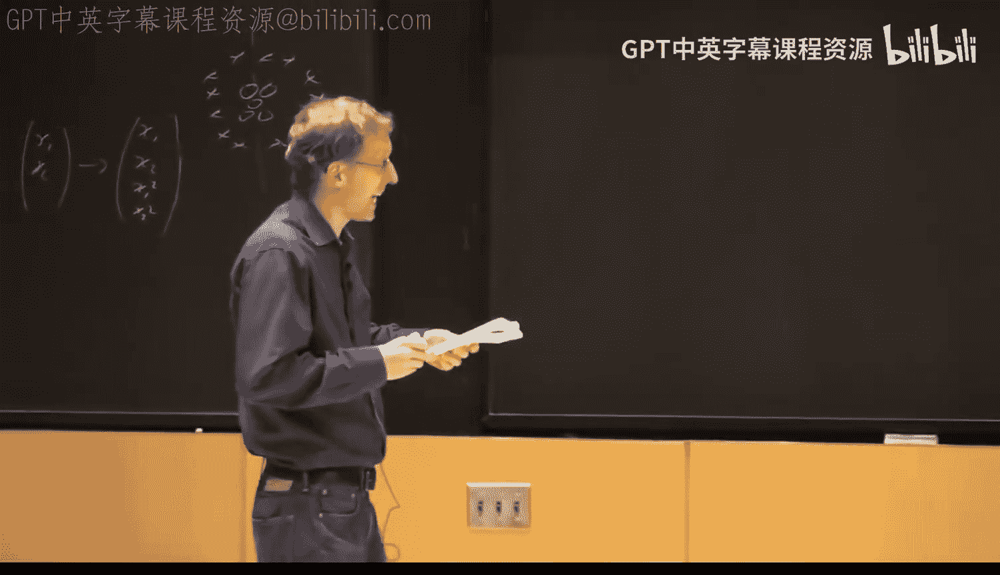

あ。So， here's the algorithm。

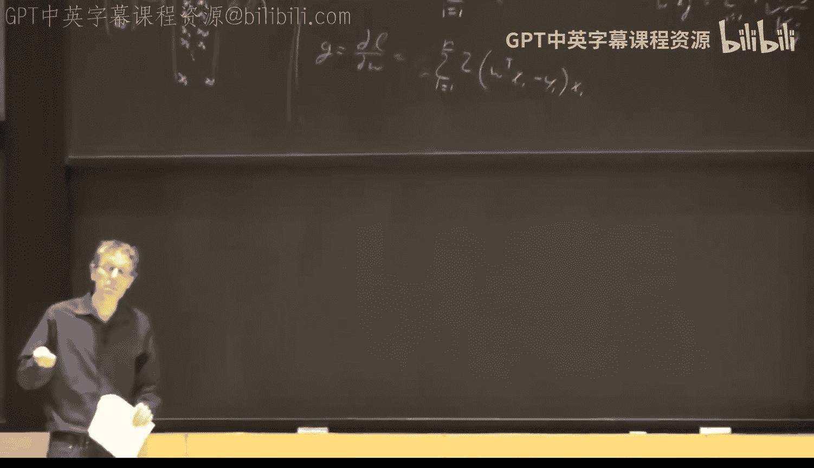

We do gradient descent。 The square loss is quadratic。 So it's comevex。

So the beautiful thing is that we can initialize our W any way we want initially。

 So let's just say initially， I do it by induction。 Okay， hoop by induction。

 So W 0 equals the all0 vector。😊，That's how I start， right， I just start there because actually。

 if you have a convex function that you're minimizing。you gradient descent。

 It will always get to the minimum。 It doesn't matter where you start。 You can start here。

 It can start here。 It doesn't actually make any difference。 So I choose the starting point。

 And I choose it to be all 0， right， And the reason I'm choosing it all 0 because now I can actually write。

 Well， obviously， that's a combination of my X' is。 What are the values of alpha in this case。😊。

It's allier， right？Alpha I equals 0 for all I。Okay， so check， right， You're good。

That at the beginning， we start out in our vector W is a linear combination of all our inputs， wait。

😊，Now we make it update。😡，嗯。And so in some sense， assume basically the case already。

 assume that now theit T and W I W。Equals some over I equals1 through N Alpha I X， R。 Okay。

 this is just proof by induction。 Now we use the induction hypothesis。

 do you know proof by induction， Who knows proof by induction。O， thank you。 thank you。All right。

So we assume this now we do one more update。So what is the update， The update is W becomes。

W minus step size S times G。Okay。So what is G？Gus。I have it up here。Is this turkey here， right？

And the sum of I went to n two times this term here times X， some of them all X。😡，Well。

 I can call this a gamma eye。 This is just a scalr， right。This is a scalar。 This is a scalr。

This is theスだ。So， my G is。Gamma I， X I。Okay。And。

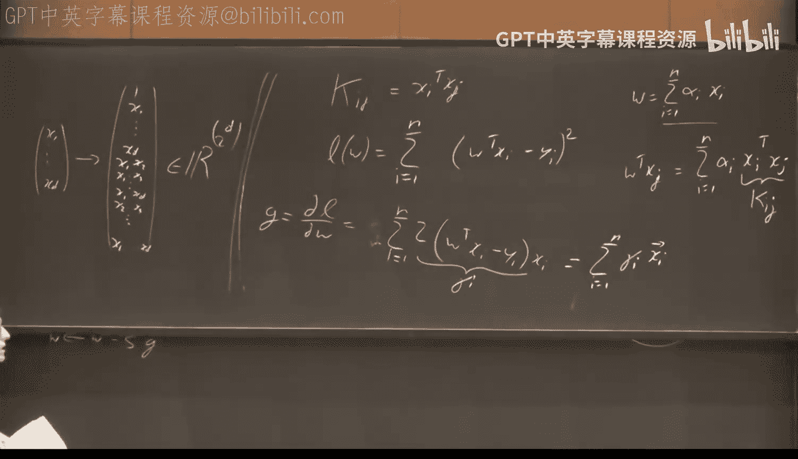

So what does this mean， This means this becomes。This is by W。It's just。Alpha I， X， I。

 that's the induction hypothesis。inus S times G。 Well G is this thing。Gma I X， I。

And if you write this。What has this become， This becomes。Some of I equals one to n。

Alpha I minus S gamma I。X， I。So this is my new alpha。Right so there's actually proof。

 There's already we are done with the proof。😊，Right， so it is true initially， or the alphas are 0。

If it's true at the beginning of any iteration， it will still be true the true at the end of the iteration。

Let we just change our Al Al I becomes alpha I minus S gamma I， right。

So another way of looking at this is what we could do is we could actually change the gradient descent algorithm by saying initially alpha I equals 0 for Oli。

😊，AndNow we iterate the compute gammas， Comp gamma I for， you know。这些。Now， the loop。Compute。Gma I。

 and then update the alphas by saying alpha I becomes alpha I minus S gamma I。And now， loop around。

Any questions。Yeah。あ后は。that's fine。 It's still just the number。It's just a scaler。 That's okay。诶。

Right at the end。You know， this is still just a linear combination of my access， right。

 where this gamma comes from doesn matter， right。😊，To put in the age of my motherin lawaw， right。

 That's fine， right， now depends on the age of my and my mother-in law。

 but it doesn't actually matter， right， It's still a linear combination of the X。Yeah。

Any more questions？There's only twopoli classifier。So what we have been trying to make。

 you're holding onto the linear classifiers。 We want to make them more powerful because linear classifiers are beautiful。

😊，Okay， any more questions？Okay， awesome， so。Here comes a beautiful thing。 So now we can basically。

 we have our linear classifier， and we can basically write it instead of actually computing W， right。

 We just have to compute n alphas。😊，Now， why is that a big deal？😡，Right。

Can anyone tell me why this is。Incredibly important。😡，When you deal with two to the D dimension。

Think about it。 We started the lecture by saying， we take our feature vector right。

 and we map into the really high dimensional space。 And now were a classifier there。😊。

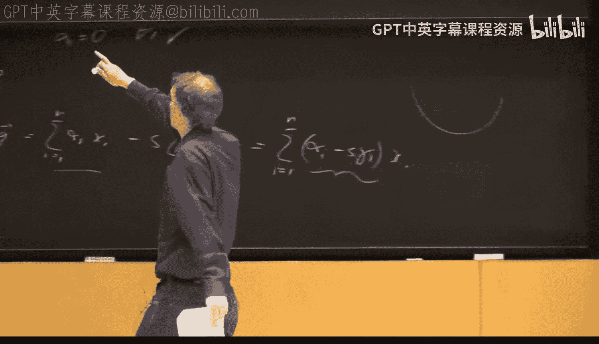

Right。This is true to the D。 This is ridiculously high dimension， right。

If we would have to store the W vector in this ridiculously high dimensional space。

 we would use up all disks on the entire planet， even though in North Korea， right。

It's only a couple，So。What I just told you is we don't have to do this。All you ever need to store。

Is n numbers， your n alpha， right， And that's independent of the dimensionality of your data， right。

So the storage we need to do， to do this algorithm is independent of the data dimensionality。Right。

So that will allow us to go to really， really high dimensional。Spaces， actually。

 by the end of the lecture， we will go to infinite dimensional spaces。So that， you know。

 certainly reassuring that we don't have to store infinite dimensional W。🤧嗯。

So in the the way we now do  gradient descent， we just draw n data points where n is number of data points。

 as is our n weights， these alphas where n is number of data points。

 So it only scales with N N is always finite that， right， We only have finite amount of data。😊。

Any questions about this。Okay， so。We can do the training。嗯。By just storing these offers。嗯。

How do you do testing。Well， if you do testing， your H of X。there's a test point， this w transpose x。

😡，RightW is super， super high dimensional。 We never computed it because we were way too scared about it。

So what we do instead is。We do the following。 We say， well， this is just W is just I equals 1，2 N。

 alphapha I， X， I。😊，And now we just have transpo x。Okay。

 so now we can also do the testing without actually ever computing W。Okay， so doing testing。

 joint training and joint testing， we never need W。 W doesn't exist。いや。Yesス。That's right。

 We still have to do dot products between X， I and X between two different x's。 right。

 That's exactly right。 right， And you couldn't have asked a better question right now。

 because that's exactly the last piece， right， The last piece of the puzzle， so。😊。

I can tell you that you can to do that。So the first magic trick in some sense。

 is that we can train a linear classifier in this extremely high dimensional space without ever。

 ever computing the W that defines the hyperplane。 We just have to store these alphas one for every data point。

😊，And we wrote everything in terms of in the product。Now， what he's saying is， wait a second， right。

 you still have to compute these in product。 So when you compute K I J， that's X， I transpose X J。

 right， or here with a test point。 you have to compute in a product or every single training point with every single test point。

 Have you gained anything。 right， That still seems very， very expensive。😊，All right。

 so here comes the second magic trick， Are you guys ready？All right， Arthur is ready。

Or was that a no？Lis yo。 All right， good。So let me just。

 let's just go back to the very beginning of the lecture。

 where I showed you this description up here。 So let's just go with this for now and say。😊。

We use this expansion， right， just because it's very， very convenient。

 and it would be awesome if we could do it。😊，So。All right， here we go。So here comes the magic trick。

So we call this here P of x。 X goes to5 of x。Now， we want to compute the inner product between two such vectors。

 Let's call them X and Z。So you want to compute。So this means x transpose Z becomes phi of x。

Transpose privacy。Okay， any questions at this point。Rraise hand if you understand what I'm doing。

Okay， so basically， we're mapping our data from this low dimensional space in this ridiculously high dimensional space。

 right， scares you out of your pants， right。AndBut in this high dimensional space。

 we only have to compute in the products。 That's the only thing we need to do。Let's do it。

So we have our our data points。 Now we have to compute the inner product between 5 x and  P C。

 What does that mean when we compute the inner product between this vector。And。

The same thing with disease。1， C 1。ZD。C，1， Z2， C1， C 3。ziiwen。C的。Okay。So if you write that out。

 what is this，' first these two multiplied。1。Plus。X 1， Z1。Plus。X 2， Z 2 plus。Thus X DZD。Plus。

 and so on， and so on。 plus x 1。X C plus times C 1。CD。O。😊，That's a massive sum。

 It has through the D different。Terms that we sum up。But I claim actually， if you think about this。

 what are we doing yeah。That's actually， exactly。1 to D， the product between these terms， one plus。X。

k。CK。That's it。嗯。And this only takes deeration。 This takes a few milliseconds。

 So this year takes computing this。Takes from now until the end of the universe， right， So well。

 the solar system。 let's say the sun collapsed。 the Earth collapsed into the sun like， you know。

10 million years ago。 I don't know how many years。😊，maybe 5 billion years。

 This year takes 10 many seconds。The answer is the same thing。

 You can choose right now which one you're going to do。So maybe spend a few seconds。

 You and your neighbor and convince yourself that these two are actually exactly the same thing。Yeah。

Yeah。你知道非。Yeah。No。Thats。A。Yeah。は。Yeah。Okay。Yeah。Yeah。Yeah。All right。Who thinks it's crystal clear。

 Why did two those two are the same， Raise your hand。Alright， it's a fair amount。 Okay。

 so essentially what we are doing， right， if you basically take these， these terms， right。

 we have one plus。 let's say we just have the simple case where we have。😊，X 1 and X 2。

 when we blow this up， right， This becomes1， X 1， x 2， X 1， x 2， right。And。

If we take the inner product between two sets vectors， let's would you know， correspond to this X1。

呃Z1。1 plus x 2， Z 2。so basically every， you basically take all the cost terms， right， you take1。

1 times 1， That's the very top1。 and one times x 2， Z 2， and1 times x 1， Z1。 And then in the end。

 these two cross terms， which is exactly what you get。 right you get1 plus x 1， Z1 plus x 2。

 Z 2 plus x 1， Z 1， x 2， Z 2。😊，Right， and that's basically all possible across terms。

 So the number of cost terms we have is exactly2 to the D。

 And that is the exhaustive risk that we have here。Any questions about this。Okay。

So what I just showed you is that we， we take our data， right， we， we do kind of do crazy trick here。

 right。We take our data， the map terms of infinite or not infinite。

 like exponentially high dimensional space。And we run our。Algorithm in this high dimensional space。

 But actually， we never once。Compute a single instance in that high dimensional space。

 We can't because we couldn't even afford it。But because we only need inner products in this high dimensional space。

 we can compute those very， very cheaply。 So you have no idea what these vectors look like。

 You never have to compute this guy。Because you all you ever have to compute is the inner products between two such vector。

 right You can do training in this in high dimensional space。

 And the the solution is exactly the same as if you would nap your data up there。

 it's extremely powerful because now you you're capturing any possible non nonlinear interaction or。

 you know， a pairwise interaction between any two features。😊。

Yet you never compute a single one of them。And the answer is exactly the same。

 So all you need to compute once is this kernel matrix。😊，K， I， J equals phi of X I。

Transpose phi of x day。RightFor any two points， which is just order de computationutation。

 So each one of them takes a few millisecond。So it's not a big deal at all。So suddenly。

 he took a very simple classifier that just can make linear decision boundaries and made it exceedingly powerful。

😊，Another way of looking at this is that all we need。😡。

From our vector space is it in the product function。

And you can also view this as kind of saying we just redefine in a product。

 We say the inner product between two vectors is no longer just X I transpose X J。 Instead。

 the inner product between two vectors is K of X I comma X J where that is some kernel function right。

 And where that actually equals this， right， So this here actually equals。😊，K of x comm Z。

And so I just define a new in product。And I run my algorithm with this different in a product。

And I know this is well defined because I know it corresponds to some extremely high dimensional vector space in which it's just the good old the product that you all remember。

 right from high school。😊，Any questions？这是本来的。Do we SBO on thermal material。这个毛人。And about。嗯。Yes。

 you have to be careful now。 The dimensions are no longer。They are particularly interpretable， right。

 because you have an excessive number of them， and they really kind of capture different combinations of existing features。

嗯。But the notion of the margin is exactly the same。That the classifier doesn't change it all。Yeah。冇。

The last。Yeah。So here's what you do。Whereas。No， oh， you raised it。 Sorry， Okay， well。

 let let me write it down again。So the last was the following， right， My loss was。L of。

W was sum over I equals one to n。 W transpose X I minus Y I squared。 right。

 So I did square square regression。 Okay， so now we we realized that W can be expressed in terms of alphas。

 right， So I can write my whole loss in terms of alphas。😊，And W becomes。I equals1 J equals 1 to n。

 Alpha J X， J transpose X I。Minus Y I。Squared。Right。

Now I have everything in terms of in the products。Now I plug in my new inner product function。

And just say， this is actually。K of X， I， comma X， J。Which is this function up here。

and now I can just compute the loss。 It takes， you know。Subse， right， No big deal at all。Super。

 super easy。And you take the gradient with the spectral alpha。

 and you get exactly the gradient descent algorithm that we wrote down earlier。

How well does this Carolina other law？It works for all of the ones we talked about。Yeah。

Interactions stuff。Good question。 No， you just use all of them， But because why not， right。

 Because you could just assign0 way to them。 So so he comes the crazy thing， right。

So he's lazy saying in the following， right， He's saying， wait a second。

 You have those two to the D possible features。Right。

 and some of them have captured interactions between features that I don't care about。

 I don't think there's any interaction between these two features， right， So why do we blow it up。

 right， But it's not a big deal because。You assign a weight to each one of them， right。

 You have this gigantic weight back to W， and you can just assign  zero weights to these。

 right that you don't care。Now， the cool thing is that you never actually compute those those W vector。

 right。😊，But implicitly， right， by choosing your alphas， you actually assign zero weight of these。😊。

来。That。It's， it's pretty crazy that he can do this， right without ever computing the vector。Yeah。约定还。

Sorry if you yeah， okay， good， good。 So the question is， is it linear。

 is it data not always linearly separable， Let me， let me show me a few。 So。

 so let let me get back to this question in three minutes。So。One thing I just， I just showed you。

 I just showed you this very， very carefully constructed feature expansion， right。

 but we basically take every， any possible cross you know， correlation between different features。

 And I showed you that that can be written in a， you know， in this very compact form， right。

 The question is， is there other， Are there other inner product functions that we could use。😊，And。

Turns out， actually， theres tons of them。ItTns and tons and tons of them。 And you can make your own。

 actually。 And if it catches on， you can name it after yourself or after some loved one or something。

😊，So let me give you a few examples of in the product functions that we use。So the first one。

 we call these kernel functions for， for good reasons。Because they actually， what we' are doing。

 actually， is we are， by doing this， we are actually mapping our data in the reproducing Colonel Hilbert space。

😊，And it actually is defined to that tunnel。So the linear kernel function is very simple。

 That's just K of x comm a Z。Equals x transpose z。Right， if you use the linear kernel。

 the algorithm becomes the good old linear classifier that you're all familiar with。

 that you all like from， you know， that you did before the midterm。😊。

Another one is polynomial kernel。So here we say K of x Z becomes one plus x transpose Z to the power of。

P， actually， not D， P。 Well， it can ignore D， whatever doesn't matter。some'm constant。

Just raise as non constant。 Well that captures is actually， in some sense， now you get if if P is 2。

 then you basically can model quadratic functions。If P is1。

 it becomes the linear kernel exactly plus some constant， which doesn't matter， right。 So then again。

 you're just learning linear functions。 It becomes quadratic。 You learn quadratic functions。

 It becomes you know，3， then you learn  cuic functions， etc。😊，嗯。The most famous one， this is like。

 this is like the bra pit of kernels， right， This is like people， you know。

 sometimes faint when they see it。 it's like。It's called the radio basis function。哦，方琴看了方心看了。RBF。

 solve code， RBF。And the RBF kernel。K of x commma Z is e to the minus x minus Z squared over sigma squared。

I can write this。Because like， yeah。And so that to look familiar to you。 Does anyone remember this。

 Does anyone know the cousin after the。嗯。Of the RVF kernel。There's a Gaussian distribution， right。So。

So the RBF kernel is so popular， for various reasons。Number one。

You can prove that it's universal approximate。So what are the universal approximation means that actually you can fit any function arbitrarily closely。

 given the few assumptions。 So going back to your thing。

 your question is now everything linear linearly separable。 And the answer is yes。

 right if you use a RVF kernel， suddenly every problem becomes linearly separable provided you don't have two identical data points。

 the only exceptions like if you have two data points that are identical they have different labels。

 you can't do it。 But you know， taking that one point away， like you know you know。

 which is ridiculous。 then。😊，Actually， everything becomes linearly simple。

 So you can learn anything you want with just a simple linear classifier。😊。

The RBF kernel corresponds us to a space that's infinite dimensional。

 so you can't actually write down phi of x， right， It correspond that they exist some phi of x。

Suchし that。You know， K of X C。Equals5hi of x。Transpose P of C。

But this is actually infinitely dimensional。 So you can actually never write it down completely。喂。

But you can approximate it pretty well。That's arguably。The most popular kernel。 And if you， you know。

 in most problems， if you use one particular kernel， that is。

 that is the one that usually works best out of the box。In one。

There's a connection with the Gausian distribution that is， in some sense what it does。

 what the RBF kernel does， it takes your data set。And puts many。

 many little Gaussians around every single data point。 This here is the Gaussian。

 This here is my twining data point， right。And Sigma basically tells me how wide these Gaussians are。

And。What you do is。By doing this， basically， you get some weird space， where you basically say。

 how similar are you to any given data point。And。The reason you can basically approximate anything you want is because if you have enough。

 it's kind of like it's similar to the nearest neighbor proof， to some degree， but。In some sense。

 basically， if you have enough training data， then actually， there's always some training data point。

 you put a Gaussian around that data point。 and that then defines a one dimension in your interdial space。

嗯。Does that make any sense。So it's， you know， it's a little bit hard to kind of picture these infinite dimensional spaces。

 But， but， you know， you get used to it， it's。It's a nice world to live in。There's a few more。

Let me just think， you know， how much time do I。 I want to show you a little demo。嗯。

There's a few more kernels。 I wrote them down。 few people use them。 The most common one is。Its。

 it's the RBF kernel。Now， here comes the important part。 And next lecture。

 actually will go to this into this a little bit more that。You know， the natural question is。

 what is a welline kernel， right， Can you just do anything。 Can just make my killian kernel， right。

 and just， you know， take any kind of function and just say， that's my， you know。

 take two inputs and say the output is the kernel。 And the answer is， no， It has to be a positive。

definite function。😊，So what does that mean， that means if I take compute this matrix K。

For any set of vectors， that matrix set has to be positive semidefinite。

 Who knows what positive subdefinite means。😊，Raise your hand。

 It was mentioned briefly on the homework。 So a matrix is positive semi defite。😊，If。诶。

If and only if there's a few definitions， the case is positive of some definition。

 this is how we write this。If and only for every vector Q， Q transpose K Q is greater equals 0。

And that's the case。 if and only if K can be decomposed into Z transpose Z。And。Another one is。

 if all the eigenvalues are non negative。And it's real and symmetric， in this case。

So this here is the one you really want。 This is， this should make it obvious why。Why。

 why you have to have this definition。 These these， Can anyone tell me why this is。Why you know。

 if if you know this is the case， then it must be a well well defined panel。 Can anyone tell me this。

Yeah。Yeah。That's right。 That's right。 That's exactly right。

 So each column here in Z is one particular phi of x。 right。

 So these zs are basically the really high dimensional feature representations， right。

 And if I just in， you know， basically， you know now it's in a product between in a product function right。

 This doesn't have to be ridiculously high dimensional。

 And the reason is because this matrix case is only over a finite number of points。😊。

And if you have a finite number of points， they always like in a finite dimensional space。 right。

 so you can just do PC A on those points。 So that's why this doesn't have to be even if you have an RBF kernel。

 you can take the kernel matrix and compute these。 That's fine。 You know。

 So the important thing is for any set of points。😊，If you compute the kernel matrix K。

 you can do this decomposition。So that's basically that's that's the only condition you have to have。

 So the beautiful thing about this is that that's extremely it's extremely flexible。

 So once this came out， people went nuts， right， people in biology define kernels of a molecules。

 right And over DNA sequences， right， Theres no vectorial representation。 you don't need it， right。

 you just have to define some of the product matrix that's actually always positive semi deffinite。

 So it's extremely powerful。 You can define in the product over sentences， right。

 over all sorts of weird data constructs。 And now you can use all these linear classifiers like SVms。

 right， suddenlyly， they apply to data sets， but you don't even know how to write a vector。

 yet you can define a linear classifier。 All you need to know that is in principle。

 that exist some mapping from this data into some infinite dimensional space， which I don't know。

 it doesn't matter， because as long as they can compute in the product。 I'm fine。😊。

So it's incredibly powerful。 And when this came out， the whole， you know。

 machine learning world went crazy。 This was in 2000。 You know， this was basically with SBM。

 So Corriina Cortez and Iagon。 And and they basically introduced this for their support vector machines。

 And that's why I support vector machines became so incredibly popular。 And for， I think for。

1010 years， the whole machine learning field did nothing else。 But you know。

 mapping everything into kernel spaces and analyzing these very， very thoroughly。😊。

Let me show you a little demo that you see a little bit what this looks like in practice。

Any questions about I'm putting the。Why are some hrdles better than other hrdles for certain data。

Why are some so you can have really terrible kernels， I guess。Right。

 the zero kernel maps everything to 0 or something。So what you want is that a kernel。

So similar points are similar when they have similar labels。Right。

 and so you can encode that if you know a lot about your data。The better you encode that。

 the less data you need to train。Yeah。We just thought is it， is it to another one like。Ultimately。

 people typically use the， the RBF kernel。Yeah。Any more questions。じゃ。

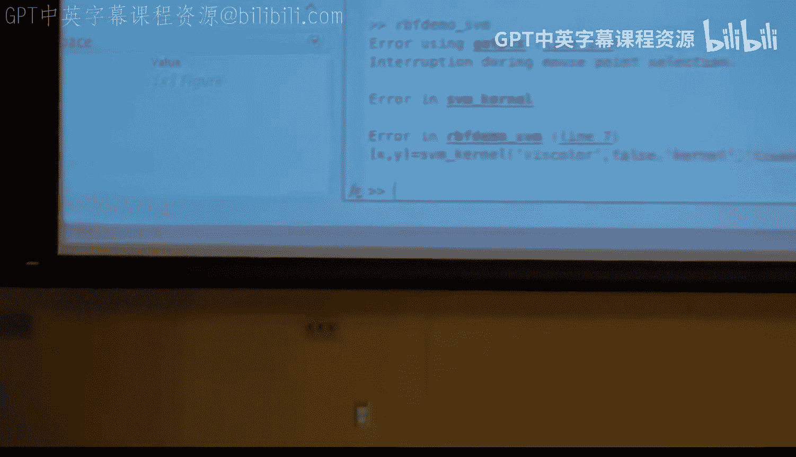

By our rights。 So basically， it has one。好费。完了。So we are still limited by alphas， What does that mean。

We can our over it。The more generation to have the more accurate policy。That's right。ああビオ。No。

 it's convex。 All these last functions are convex。 so you can。

 you can optimize them to arbitrary precision。So you can use， you know。

 second order method like the Hasian。 and， and you can。

 you can make as precise as your computer can represent it。Okay， so let me show you， this is an SVM。

嗯。Well， let me actually first， okay。So here's an RBF。 kind of， this is a rich regression。

 So rich regression。 I just draw some points。And。And now I have the RBF kernel。

So what you see is the following。嗯。So。What I'm changing here is basically my regularization term。

 and my sigma。And down here， actually， if my sigma is very， very wide。

You can't see this because the blackboard is in front of it。在。And this becomes the linear classifier。

 This becomes the Gausians of the RBF kernel， really， really wide。But if I just change my signal。

 I make it smaller。 and that' that's going upwards。It if I regularize less。Right， then actually。

 you see on top left， you get extremely powerful classifier right。

 So you basically and here somewhere in the middle， right。

 you get something that actually captures this， this data pretty well， right。😊，Here。

Right I basically become， you know， I have a variance problem。 right。

 I'm totally over specialized to every single point I ability have a spike that just hits exactly that point。

 right， So I'm memorizing exactly my training de， right。😊。

That just shows you the RBF kernel can learn anything， right， but this is too much。

 That won't generalize well。 But if you go on here in the middle， right， you see beautiful curves。

 right that capture your data set very， very nicely， right。

 So what you now just have to do is you have to basically the。😊，you Lada and your s。

 basically you find the right hyper parameters， and you can learn any， any data set you want。

Let me show you another demo。For actually classificationification。

So let's make some really nasty data。 What's a nasty data， Any ideas， Any suggestions， A smiley face。

 a smiley face。 Allright， good。 So what are the two classes in the smiley face。😊， I guess。

So these are positive。 What are the negative points， Just the smile curve。

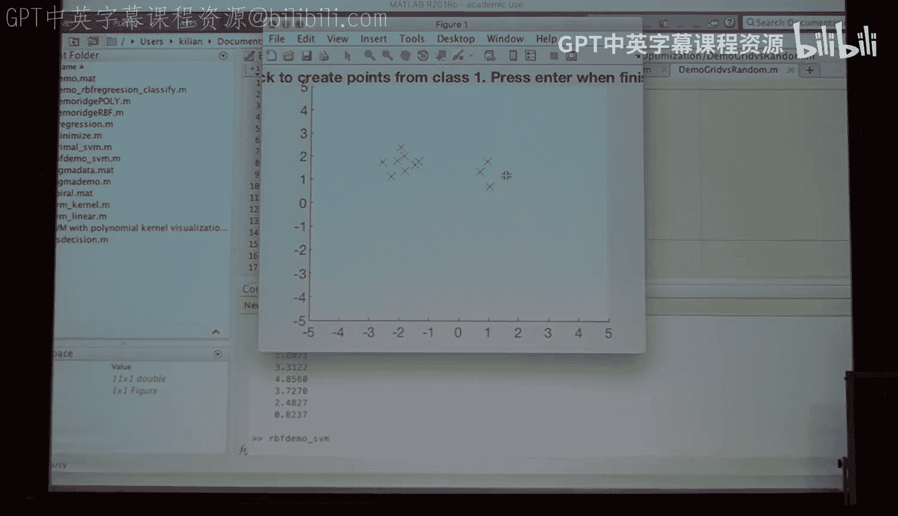

Oh， see， wait， wait， okay， wait， I guess I already made it wrong。 So let me just do this。

 So let me just put the other ones all around it here。😊，So this guys like， you know。

 smiley person who has freckles。Okay， good。 So now let's run this。 right。

 So this is now now you're running a linear classifier on this， right， A few lectures ago。

 you would have laughed at me， right， hopefully。😊，So let's just do this。But。

 there's a linear classifier。 It was just about a linear classifier It doesn't do anything。

 The decision boundary actually is so， so it doesn't even draw anything。嗯。It gets a precision errors。

So this here is， if I take a linear classifier and I now show you the prediction values between positive and negative。

 And what you see is it classifies everything at 02 because it has no idea what to do。😊。

So now I run RBF kernel， right。 And so what you see here is。😊。

Right so the blue is basically negative。 cross the positive。

 and the white line is actually exactly the points that are11 margin1 away from the decision boundary。

 These are my support vectors。 right， So we have the same thing。 And by the way。

 this is a straight line in this high dimensional space， right， It's just curved， you know。

 because we are so limited。 now， you know， in 2D。😊，And I can now show you the value， You know。

 how much a certain point is positive and how much is negative， if I now。This year is actually。

And I can tell， yeah。I can now actually make， you know， show you this in 3D。 And you see a landscape。

 right。😊，You see the smile basically， right Like it goes negative into these carves out these valleys。

😊，All right， let's leave on a high note。 See you next Friday。😊。

