# 康奈尔大学《智能系统的机器学习｜CS4780 Machine Learning for Intelligent Systems 2017》中英字幕 p24 -24-Machine Learning Lecture 24 ＂Kernel Support Vector Machine＂ -Cornell CS4780 -BV1Lo6gBxEKE_p24-

Welcome。To one more episode of machine learning。嗯。All right， please put your laptops away。

Or close them。Okay， hope you had a great spring break。嗯。So a few things I want to go over。

And so we had the survey。

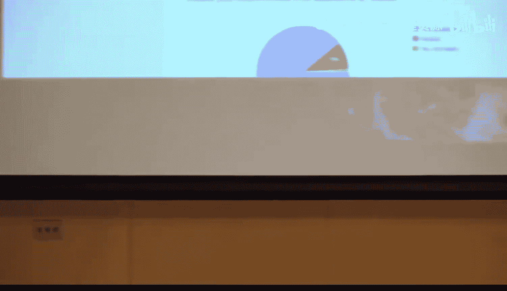

And I was really interested in how can I， What should I change。Was there anything obvious to change。

 so。Turn out it's a little tricky。And there were some concrete recommendations， but for most things。

 actually。嗯。Most things look pretty good。The biggest biggest complaint was actually， vulcarium。

I took all the vquaium feedback and sent it to Vquaium。Some of it was pretty harsh， but I， you know。

哎。I did not edit it。嗯。But a lot of it actually got fixed。 So， you know， we are working very hard。

 I mean， they， particularly are very， very interested in making this work for us。

 So a lot of people over the road， like Bukium was really terrible。 And now it's O and。😊。

And the majority of you actually won would say we should use it again next year。

 So that's encouraging。In terms of most other things， it seems。呃。Reasonably O。 So the workload is O。

 And there's a few people who basically say this is a lot of work。 But theres， you know。

 and this is typical for， I guess， these questions。But yeah。

 what I'm looking for is a really lopsider， right。 So in this case， basically， I have， you know。

 actually more people who say it's amongst the lowest amount of workload than there' people who say it's the highest amount of workload。

 So I feel like， you know， obviously with 350 people。 there's， I can't， you know， satisfy everybody。

😊，It seems the workload is roughly。Alright， well， if I would change it。

 then I would basically upset one group or the other。嗯。The most people actually use。

Claim they go to class all the time， which is surprising we have more people in the class than there's seats in this room。

😊，And。And there has many empty seats every time。 This is just a question to see if you're honest。

 actually。😊，嗯。😊，And overall， I think things seem pretty good。 So a few things， I guess here。

 as you can see， the first part is always vulkium， vkarium， varium。😊，And。

So I I passed all that stuff on。 I'm not a huge fan of the material。 it's little I can do。嗯。

Then what what people gonna to cover。 Everybody wants to have deep learning。

 So there there will be deep learning。 Don't， don't worry。 There will be deep learning。And examples。

 a few concrete things。 there weren't very weren't many things that I could really change immediately that I saw。

 One thing is post the grades on C M S for the different projects。 So we've done that right away。

 The other thing is make the homeworks more connected to the class。 We're trying to do this。😊，嗯。

I guess， there are some people grumbing about T A。 Some T A is not being prepared。

 So I will talk to them about this。 And then other than that。

 some people say the cast is way too fast。But then there's also a lot of people who say the class is way too slow。

So I I don't know how to do that one。嗯。Okay， and then I guess。

Some of the math devations are very dry。 I'm trying really hard to make it entertaining。😊，I agree。

 I agree。 It's try。 But there's not， you know， I don't really know how to。

 That's just the nature of mathematics。嗯。One person said like none of the algorithms are really intelligent。

 I like that one。Computers are just not intelligent。You know， actually。

 I'm not even sure if humans are intelligent。 So it's just the way it is。 in some sense， you know。

 like the media sometimes makes it look like machine learning is， you know。

 as close to becoming conscious or something。 No， right， like these are really just。😊，You know。

 the way machine learning works is you have a train data set。 And then the test set， in some sense。

 you try to。See， how similar is that to stuff that you've seen in the training set， right， and。

That's how all of these algorithms work。Okay， good。 But otherwise。

 most people seem reasonably content。 So I， I'm glad about this。

 And thanks for participating in the feedback。😊，One thing I want to go。

 I couldnt want to look at the last project。 actually this last second to last project。

 the E RM project and look at the leaderboard。😊，And maybe give those people who are leading a small chance to。

Save what they did so。Number one is storm in Paris。 storm in Paris。 Is that right。

We' a storm in Paris。 O， can you maybe give a。Brief explanation。 What you did。

To get such a high score。I guess actually the three but equivalent class。 But yeah。You consider bys。

 right？Okay， stoppers。Okay， awesome。 So， but basically， what they did is two things。 number one。

 that remove stop words。 So stop words are words like the and A and so on。

 that could dominate your email， but really mean nothing about。

 Don't tell you anything about the content。 So you can just take most common words that don't actually have any。

 you know。😊，Don't contribute to the meaning of the sentence and just remove them。

 drop those features。 That helps。 It's called stop word removal。

 And the second thing they did is bygram。 So bigrams is basically。

 you don't just look every word and see if it's in the in the email。

 but you also look at two consecutive words， right？ So， for example， if you have Killian。

 you have Weinberger。 Then you also take you say Kiian。

 you say Weinberger and you also say Killian Weinberg， right， those two together as as one。😊，And。

 of course， there's many more biograms， and there's unigrams， Uniigrams that are just singular words。

 but sometimes they can be very important because you know， how you use words can be very predictive。

 You know， if it's spam or not spam。 So those are great， great methods to improve your spam filter。😊。

How about the second team， D K， Where's D K， D K， What did you do， okay， right。And then okay， same。

That's what it can improve the icon。I see。 Okay， okay， good。

 So I guess like you didn't do the normalization， did you。

So I guess normalization didn't didn't help much， I guess in this case， but。は。It that Oh。

 interesting。 And maybe had a different stop word list。

 So he did the same things that the other team did。 And he did one more thing。

 He took the vector at the end and normalized it。 And so can anyone tell me why that may be a good idea to do Like normalizing basis。

 you divide every entry by the basically have word counts。

 Why you divide by the total number of words in the text document， Why is that a good idea。😊。

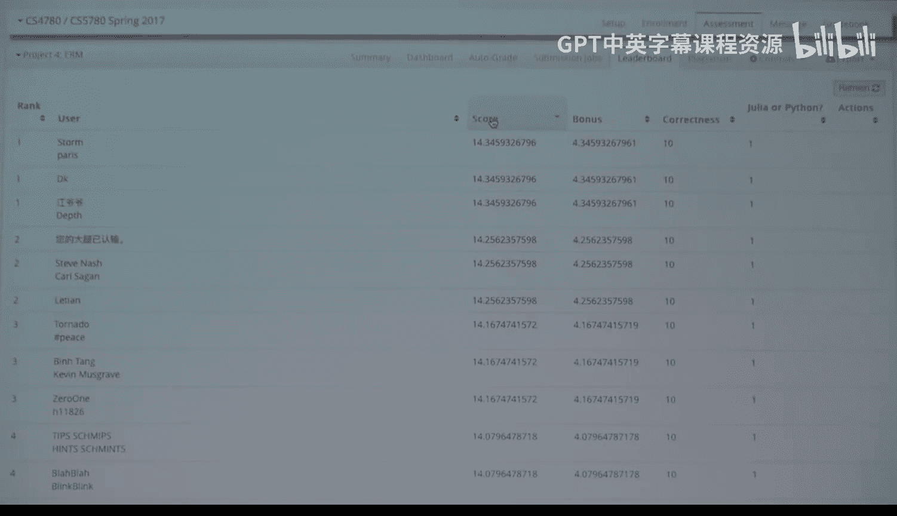

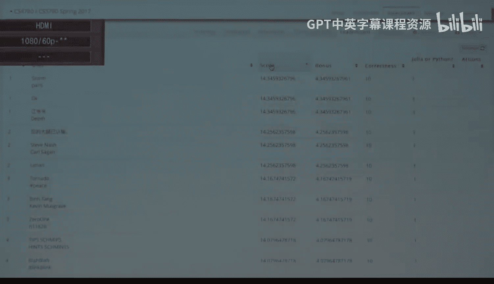

Well， you can tell us。So that explanation possible。国民に落ちて解しない願。didnt it was just a technical reason。

 Okay， good。 So you just did it because otherwise， the code would crash。

 But that is a very good reason to do this。 And that's because， you know。

 if you have a long email or a short email， that really， you know， probably is not that indicative。

 if it it's one class or the other， So if you just divide by the number of words。

 then actually you know your feature vector becomes invariant to the length of the email So it's not that。

 you know， it's probably not the case that longer emails are more likely to be spam or not spam or something maybe it is。

 But that's one rationale， know， you able to do this。 certainly for example。

 if you classify news article by category， if there's a sport article or politics article。

 the length really just dictated by the newspaper， how much space they have。

 So you would always divide by the total number of words。

 because the length has nothing to do with the class of the of the document。😊，Maybe the last one。

 depth。Where is the team there's something else。 I don't know what that means。Because I cant read it。

 I hope it's nothing dirty， okay。😊，Can someone tell me what that。That team in depth， are they here。

I guess they are skipping lecture。 Allright， so maybe that's。嗯。The next thing。😀， I don'。

 I didn't know how to pronounce this when I。😊，Can anyone tell me。

 can anyone at least save what this team is called that I can call them out。Who speaks the language？

 I don't even know what language， I guess it's Mandarin。How about Steve Nash and Carl Sagan？😀Yeah。😊。

They you actually won last time， right， Like， so yeah。Interesting， Okay， I see。这个I。Oneたら。と。I see。

 I see interesting。 So I guess what they did is they basically picked special words that they thought was very predictive or certain symbols of spam versus not spam。

 And then they actually has them differently so that they don't collide with， with the other words。

 And so give those words a little bit of an edge。 right that that's certainly very reasonable。 Co。

 very， very nice。 the。😊，One thing， I guess that so by the way。

 one thing I really like is that these methods that you guys discovered are actually the typical methods that Spmforders use。

 So if you， for example， take your Gmail or a hotmail or whatever， Spmford or right。

 They use exactly these things。 They remove stop wordss， they。😊，You know， they use bygrams。

 One thing they even do is use， you know， skip gras。 So skip gras are actually。

 you take any two words。With。You know， a flexible number of words in between。 So， so for example。

 say。Like the way you could encode it is word 1。 and then star， star。

 star by star star star could be anything。 And then word 2。 And you basically， you know。

 whenever you see that pattern， you increase a counter。

 And the reason that's very indicative towards what that's good to capture spam is because spam emails are actually generated with templates。

So， the way。Sppanimuel's work actually， is。Its I don't know。 Well。

 let me spend two minutes explain your spambergs。 So spammers。

 typically what they do is they infiltrate botnets。

 So there is botnets are basically infected computers。 people use， you know。

 download stuff on their computer。 And so their computer gets infected。

 And then what the spot bonet does is basically， you know。

 it doesn't show the user ever that anything is wrong。 What instead it does。

 It's a little program that basically communicates back to the botnet owner and the botnet owner can now use this computer to send out spam right send out emails。

😊。

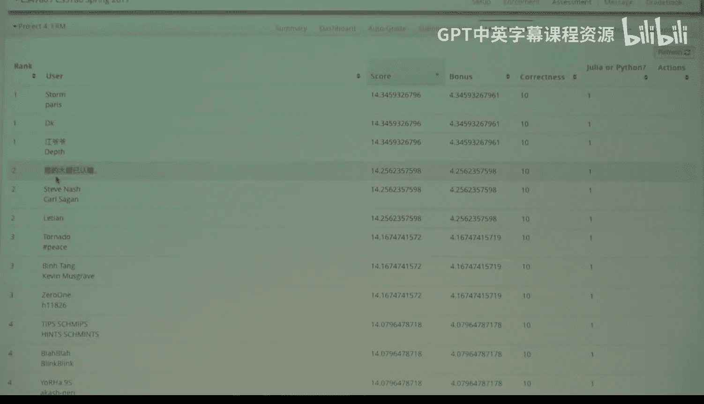

And so the reason they do this is because they can't send out the spam from one particular message send there because then their IP P address would get。

 would get locked up and would be blocked。So they have to have many， many different address。

 They have many， many computers that send out these spam messages。

 The other thing they have to do is they have to make sure that the spam messages are all different。

 So if you would send spam to Gmail， right Gmail has so many email accounts。

 that if you would say this exact same message a million times。

 what all these email providers are doing they hashing incoming emails and they realize， oh。

 there's the same email already get sent 10000 times。 So we just block it right and not only this。

 they then go rich reactactiveively through the email accounts where it was delivered and remove them。

 right， So you basically wouldn't get through， right So you can't send the same message you know。

 too often。 So what they do instead is they they create templates of emails where you basically say here's the message I try to convey in between。

 you can basically randomly put in certain sentences。

 And they make sure there's millions and billions of possible configurations of these email。

 So that no email is exactly the same。 So that's the idea。

 So you know in some you might basically want to put in sell viara cheap or something right。😊。

But what you put in between is can always be different， right， to regain strength or to， you know。

 whatever， like all sorts of different。 I'm not gonna go there now， but， you know。B。The the reason。

 by the way， I keep bringing up Viaggraras because when I。

 I used to work on spam filtering and the biggest problem at the time was viagrapan。

 So it's not that I'm really interested in Vigras。😊，第一。The哎。Anyway， anyway， so that's basically。

 and the reason， reason， because of these templates， basically。

 you have to have certain words always occur in the email and some random words in between。

 And so you can capture that with skip grants。 That's basically one way of finding signatures in emails。

😊，Allright， awesome。Any questions about this competition， the E R M competition and the spa Fgery。

 yeah。全的につ。in time， But do you think those techniques。ETpically not。 So they are stemming。

 for example， you take words and you basically go back to the root of the words of。You know， running。

 you just say run， you know， usually this stuff only helps if you have little data。

 If you have enough data， then you see all versions of the word often enough。

 and it does make a difference。So in some sense， nowadays， that we have enough data。

 these methods go away。 So that used to make a big difference when we had very little data。Like。

15 years ago。Okay， good。Yeah。All right， long time ago。Before spring break。We talked about kernels。

And in particular， the last lecture。What we talked about is how to define a。

 we talked about two different topics。 One was how to define a kernel matrix。

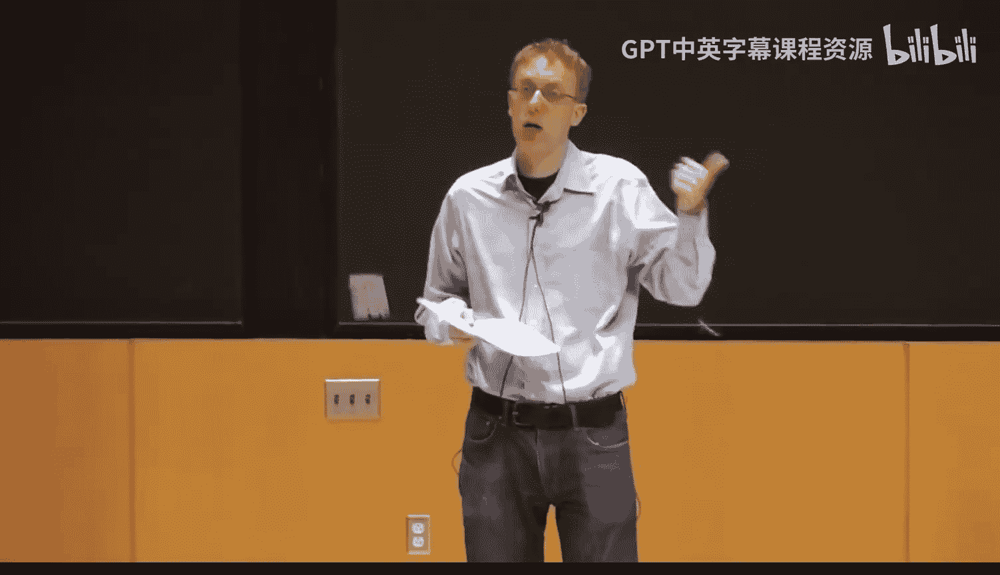

That is well defined and how to show that a kernel matrix is well defined。

 And the second thing was how to kernelize an algorithm。So for the first one， basically。

 we had certain rules。 So the one thing he said is， So let me just actually remind you。

 I know it's been a long time and。

So what does a kernelel do， right， So we basically。

Colonization came from the fact that we had linear classifiers that we liked a lot， right。

 So linear classifier just says。

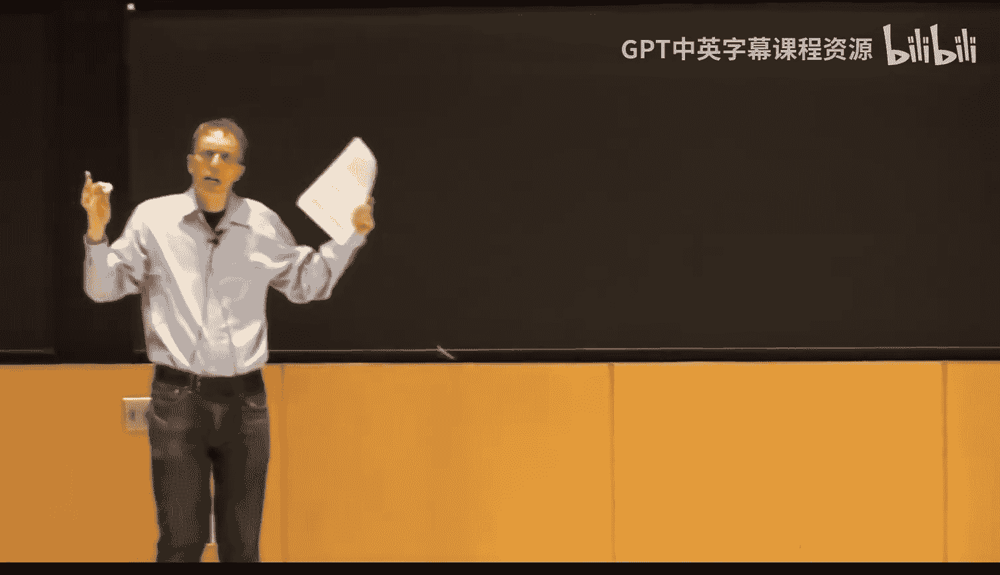

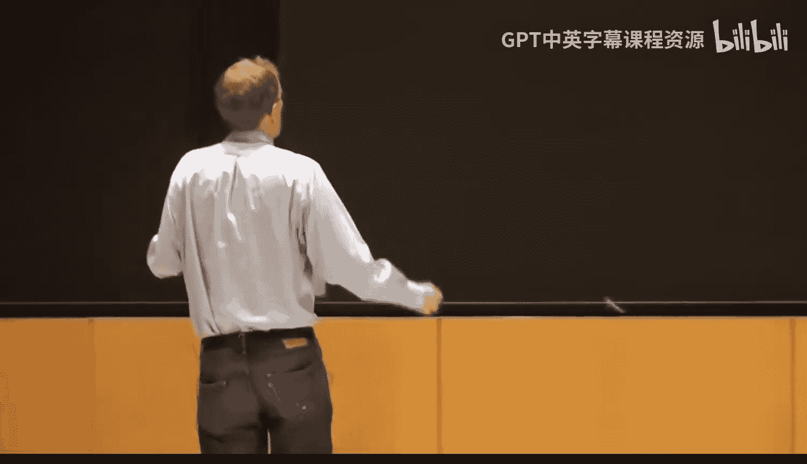

H of x equals W transpose x plus B。 That's a linear classifier。 And those are great。

 We have very efficient algorithms like the SVM that the perceptron to learn these things。

 But theyre also highly biased， right you know， they have a very strong biased problem because they are。

 they can only learn linear decision boundaries。 And so we talk about the bias variance straight off。

 And if your data is not linearly separable， then these algorithms will never get it right。

 even if you have in unlimited amount of data。😊。

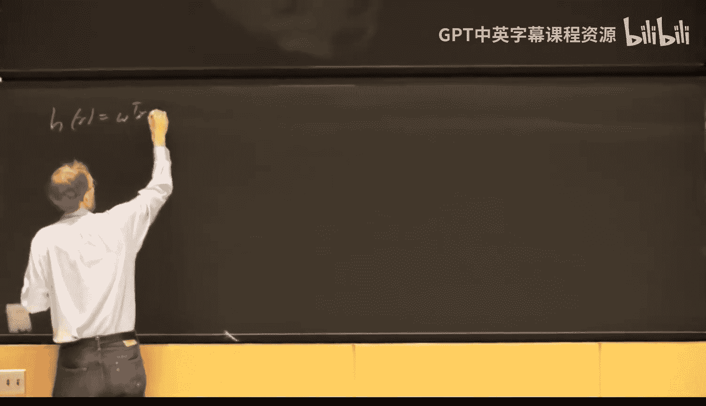

之后。How can we reduce the bias？ And the one way to reduce the bias is to extend to map our x into a high dimensional feature vector。

 So if you go into very high dimensional space， then it turns out， you know。

 your data is much more likely to be linearly separable。😊。

And so that seems like effective thing to do。 But on the other hand。

 the problem is now this is really， really high dimensional。 And now you have a very large vector w。

😊，And so what we did then is we could show that for most of these algorithms， you know。

 the data is actually never really accessed as a vector itself。

 It's only ever accessed in terms of inner products。

 So all we need if we are a little clever about choosing this spi of X。

 Then you can actually define a kernel function， such that。😊，嗯。

This kernel function that just computes the inner product after the data is map into this high dimensional space very。

 very efficiently。 right And so some examples that we had was the polynomial kernel that goes into an exponentially high dimensional space。

 But you never have to compute it。 You just compute the kernel function。

 which is very fast to compute。😊，Or the RBF kernel， radio basis function kernel。

Which just basically puts a Gaussian around every data point。 Again， very， very simple to compute。

 And the RBF kernel， in fact， corresponds to an infinite dimensional file of X。One question is， well。

 can we just come up with any such function K to define in a product。 And， And the answer is， no。

 right， it has to be a well defined function in a sense that if you take any set of vectors。

 if you take any n vectors in a computer matrix K。😊，さした。Cital K， I J equals K of X， I， X， J。

This matrix here has to be positive semi definite。 So has to give rise to positive semi deffinite matrix。

 And one thing we talked about is basically， you know。

 I give you8 rules how to take any kernel and kind of modify that kernel。

 So once you have a kernel function， you can do modifications。

 you can apply modifications to that kernel function。 And you still get a kernel。

 And so then you can start with the simplest possible kernel， which is the linear kernel。

 The linear kernel just says that is x transpose Z。😊，That's a well defined kernel。

 That's just the inner product matrix。And you start from here。

 and then you basically massage your kernel function around by multiplying the exponentiating and so on until you actually eventually get to the kernel function you want。

 And one thing we did last lecture is that we showed that the exponential kernel。

 we could prove in a few steps supplying these rules that starting from the linear kernel。

 we can basically arrive at the exponential kernel。 And we maintain the positive semidefiniteness。

 So the exponential kernel is provably a well defined kernel。😊，嗯。All right。

 so that was the first thing。We did last lecture。 And then the second thing was， okay。

 now that we have such a kernel function。😊，And so， you know。

 you're free to design your own for whatever application you have。

 So by the one thing I just want to emphasize is one thing that's very powerful about this kernel function is that these don't have to be vectors。

 right， So these can actually be be of defined kernels over sets or can define kernels of a string。

 That's， in fact， what you have to do。 And the homework。😊，嗯。And。

So once you have such a kernel function， how do you now kernelize an algorithm。

 And so there's basically two steps。 The first step is you show that your algorithm only accesses inputs in terms of inner products。

 And the second step is you swap in the inner product for the kernel function。😊，And you have to。

 when you show that everything is accessed in terms of inner a product。

 you have to show that during training and during testing。

 So in both the inference time and during training time， you can only use in products。Okay。

 and then I walked last time we walked through one of the algorithms。嗯。And that was Colel regression。

And let me just remind you。 Let me just quickly go through it one more time。

Because I will continue there。Today。嗯。And that was basically the economic regression is oh。

 let me study。For kernel regression is basically the kernelized version of linear regression。

If you remember linear regression minimizes the following loss function。

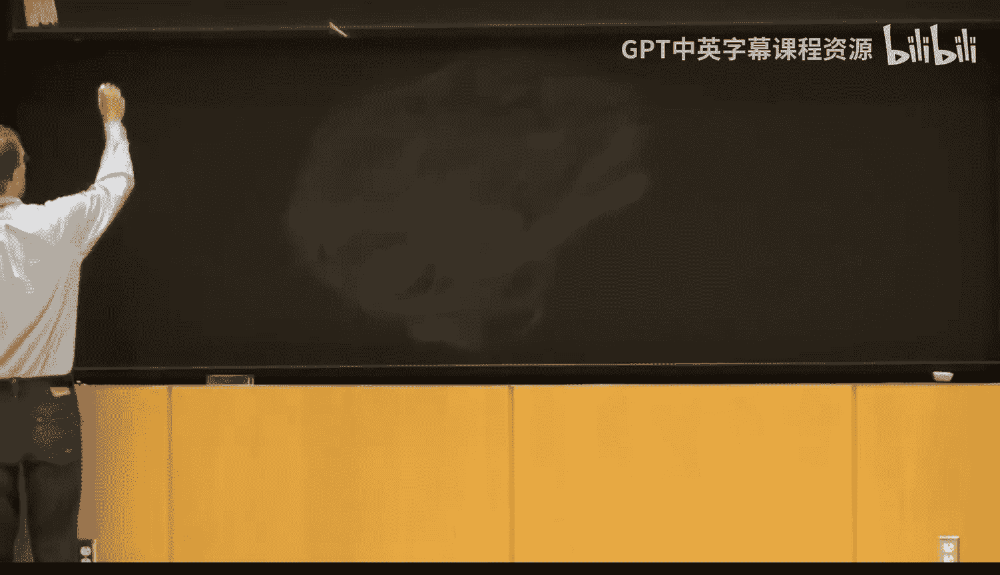

嗯。

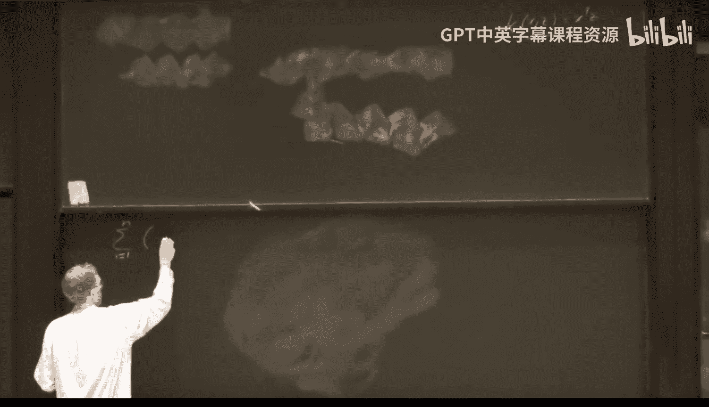

But， actually， let me do this。W transpose X， I minus Y I。

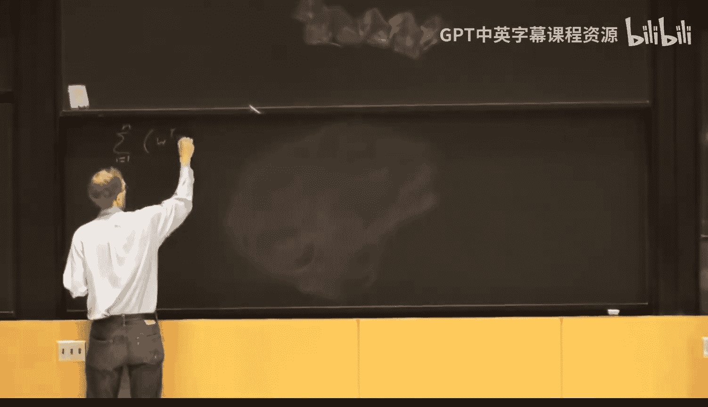

Square。Okay， so that's just a square loss。 And if you have a， that's。You can solve this。

 if we do M L E。 We get ordinary E squares。 If we do map， then we get a bridge regression。

 which basically has a regular writer。😊，And we can write this。

 And I'm just gonna quickly one more time， do the kernel version because it's just a three liner。

 If you want to， if you write this as a matrix。😊，With this here is my matrix， X 1。Next N。

And have a vector Y。Y 1 to Y n。Just be careful。 That's the other way around that in the the transpose of the way Python or Julia store it。

Then you can write this thing here as just minimize。嗯。X。Well， x transpose W minus Y transpose。

Squared。Any questions at this point？嗯。Okay， and if I write out that square， well， that just becomes。

 oh， sorry。And let me you to something else。 Now， this is my W in there。 in order to kernelize it。

 I have to get rid of this W。And so the proof that we showed earlier is that W actually is a linear combination of my X。

 And so what we can write is W equals x times alpha， right， which is basically saying。😊。

And sum over all my alpha X I times alpha I。AndSo my W is just a linear combination of all my axis。

 And you have to show that if you do this， that you're not restricting the number of solutions。

 It turns out you don't， because it's just gradient in descent。

 And this is the proof we showed a couple lectures ago。So if you do this， if you plug that in for x。

 then actually this year becomes x transpose x alpha。 So I just4 W， I plug in this term。

And now you see x transpose x。 What's x transpose x。There's a matrix。

That can anyone tell me something about this matrix。What's the I Jth entry of this matrix yeah。

It it's symmetric， good， good， It' symmetric。 What else is it。Yeah。It's the covariance， almost。

It's the inner product matrix， right， So if I take x transpose x。X transpose x。I J equals X。

 I transpose X， J。How does that make sense。 I take my。X transposees this， X 1。X n。Times x 1。X， n。

and so the， the first column of this matrix is the inner product of X1 with everything else。

 then X 2 with everything else and so on。 So I J is X， I in a product with X J。😊，So what is this。

 that's exactly the kernel matrix。哎。That's K。All right， Mccky is just the inner product matrix。

Rraisezy hand that makes sense。Okay， awesome， good。 And now if you minimize this， well， actually。

 that becomes now pretty simple。 we can just do。😊，嗯。Right down here。You know。

 if we just complete the square， then we get alpha transpose K。Transpose K alpha-2 y。Okay。

 alpha plus y transpose y， I guess。That's what you're trying to minimize。

With respect respect to alphapha， how do we do this， We take the derivative。

But respect to alpha derivative here becomes two times cage。Well key chance was the same。

 as you said， a symmetric。嗯。Minus， and then actually， this becomes 2 K， Y transpose。So this is。

 if I take the derivative respect to alpha。This term here， there's a quadratic term。

 that just becomes two times K K times alpha。 This is a linear term， something。

 some matrix times alpha。 that becomes the matrix transpose。😊。

This is just good old taking derivatives of vectors。And if you set that to 0。

Then I can move this term to the right。And so I get。Not divide by 2。Now， I get K， K alpha equals K。

 Y transpose。They're almost there。I imagine， by came。Inverse， like get rid of this thing。

Now get K alpha equals y transpose。Im multi again by k inverse。

 and I get alpha equals k inverse by transversese。And that's the answer。So。Colonnalized。

Regression has a closed form solution is just K inverse times y。Or why transpose depends on how you。

Organize you by any questions。第二。Is there any way to interpret the results。

 If you use colonized regression， is there any way to interpret the results。Well。

 what do you want to interpret。Which features were important？Yeah， not really White that gets lost。对。

Depends， well， if you use a linear kernel and it is identical to normal regression， then yes。

 otherwise， no。Any more questions yet？There some intuition behind why the thermometric are。Yes。

 otherwise it's not in the product。SoSo the kernel matrix， all it does， right。

 it defines it in a product。And if it's not positivede it's not an in a product。

 it's an if and only of statement。那。Otherwise， it's just a rent， you know， its just not。

 It doesn't solve that anymore。 But you're no longer learning about your function in a high dimensional space。

Okay， any more questions。 Yeah， last question。When you're trying to actually cost。啊。

Do the inner product。一分。Very good question。 Okay， good。 So his question is。

 how do you actually do this on the test data， Is that your question。Okay， let me go there。

So now we have our offers。Right， let's go back。 take a step back。 So what is。

 what is the linear classifier， Linear classifier actually is。嗯。H of Z， Z is my test point。

 W transpose Z。Right。Now， we don't have W。Vcon compute W？So what do we do， We know W， what W is。

 W is。This guy here， right， X times alpha。So that's x times alpha transpose。

 Al transpose X transpose Z。来。嗯。What's alpha。A vector here。

 what's x transpose Z is exactly what you just said is the inner product。😊。

Of Z of the test point with every single point in my training data。Okay。So what is that。

 I would make a kernel matrix with one more point。 But the test point。

 that would be the slice of the kernel matrix that basically corresponds to that test point， right。

 So we can call this。😊，Kase start。RightThat's a vector in some sense， where the I entry。K star。

I is Z transpose X I。Okay， it's the kernel。 or if we do a kernelized version。

 that's the kernel function of Z and X I。Right that， that's what thats。

And here comes the amazing thing。This year is again a linear classifier。哎。So， we basically just get。

A vector alpha， which has n dimensions。And the course we just transform our data。

Into basically a long vector of n in products。And now we are back where we started from with a linear classifier during test time。

嗯。But instead of in D dimensions， we actually in n dimensions。 So one more time。

 we had our original data。 that was in D dimensions。 right。

 We implicitly maped into a ridiculous high dimensional space。 You know， X goes to5 of x。😊。

We do the whole learning in this ridiculously high dimensional space with millions or， you know。

 infinitely many dimensions。 What we get out is actually a classifier that operates an end damage。😊。

And that's actually not surprising。 That makes perfect sense。 Why is this。

 Because in this very high dimensional space， I told you。

 W is a linear combination of my N training points。Well。

 N data points can only span an n dimensional space， right。

 So we must lie in an n dimensional subspace in this infinite dimensional space。😊。

And that's exactly what we capture here。So ultimately， for classification。

 we only need an n dimensional space。Raise the hand of that make fence。Okay， here's the question。

Is kernel regression parametric， or is it not parametric。And give you a minute。

 discuss it with your neighbor。No。Allright。So we have a vote。湖山。Yes， it is parametric。

 Raise your hand。Who says its non parametric？Who has no idea what I'm talking about？All。哎。

So I guess there was， there was a majority of nonparmetric。

There was a tie between no idea what I'm talking about and parametric， I guess。

So let me just repeat remind you of what parametric is non parametric is。

 So parametric algorithm is one that has a fixed size of parameters that you learn during training time。

😊，And then you apply during testing。 right， So if you have more data。You don't learn more parameters。

A non parametermetric algorithm is where the model size grows。As you get more training data。

 So an example was Kener' neighbor classification。So the question is。

 is kernel regression parametric or non parametric， And the majority of you say it's non parametric。

 Why is it non parametric， Who wants to say it。😊，Anyone to explain why it's not pra。Yeah。

TheNumb of parameters， the alphas are n dimensional。 So if you have n training points。

 you have n parameters。 So the number of parameters grows。With a data set science。That's correct。

 Why is it parametric， Who can explain why it's parametric。第。月2。Like the outcome we learning。的名字。

That's okay。 That's okay。 about it。 The question is like， if you would train again with more data。

 would you have more parameters。So that that would make it non parametric。

 But it turns out it's also parametric。 Why is it parametric。Yeah。

I it because the parent work in the tunnel。No， it's because essentially what you're learning is still a W。

 right。You know， H of x。Is W transpose phi of x。And this is a finite number of parameters。Right。

This is basically in some， So if you a poly polynomial kernel， there's maybe 10 billion dimensions。

 So you can at most have 10 billion parameters and not more than that， right。

 because that's actually， that describes you classifier fully。😊，So it's somewhere in between。totally。

 if you have an RBF kernelel， then this reputation wouldn't even make any sense。

Because this will be infinite dimensional。So you only can use the alpha representation。

 and that grows with a number of training set。 So it's clearly non parametric， right。

 But if you actually have a kernel that gives rise to a not so high dimensional space。

 then you can also view this parametric。 General， it is considered a non parametric algorithm because people typically use kernels that are extremely high。

 high dimensional。😊，Okay， any questions about this？All right， so now I want to go to the most famous。

Coized side。嗯。And this in some sense， how the whole frenzy started with kernelization。

 So for 10 years， the entire field did nothing else but kernelized everything， right。

 starting from their breakfast， right。😊，And this was to the invention of SM。

 The support vector machines became exceedingly popular because that was actually when colonization came up。

😊，And so I'll just remind you of the optimization problem of SVMs。

 This is the SVM optimization problem。 We minimize the norm of W， and then。😊，You know。

 and the violation of our parameters that actually say that every data point has to be on the right side of the decision boundary by at least one。

嗯。Now， it turns out。You can actually go through this， and you can find that。This is， you know。

 everything is just accessed in terms of inner products。

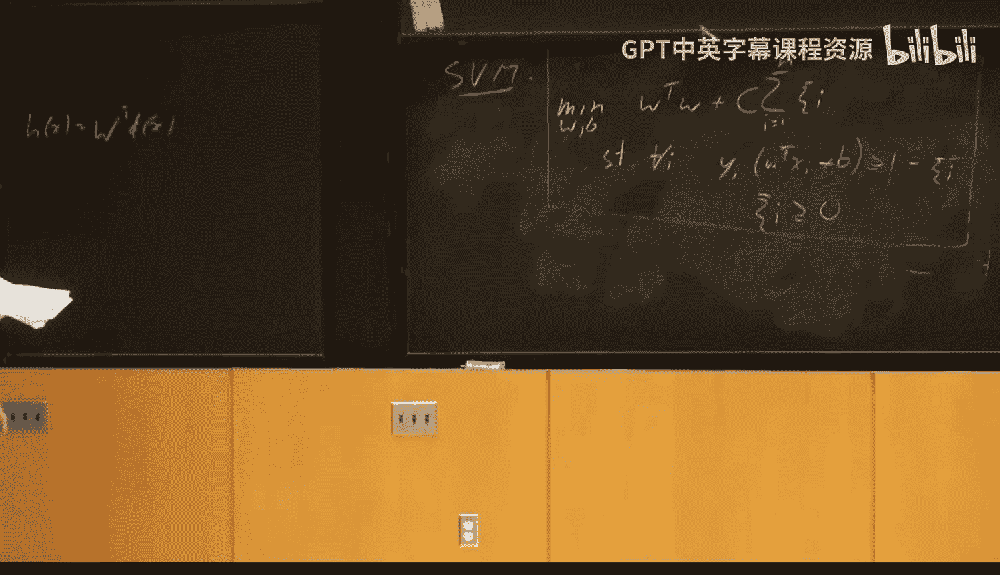

But actually， it turns out， here's a very， very beautiful way of deriving a colonized version。

 And that's actually， that's why people went crazy。 It' like， you know， people just saw this。

 And it was so beautiful。 They， they stopped doing everything else， right。

 They stopped attending their kids and loved ones and just， you know， in pursuit of this beauty。😊，So。

Basically， what this is a quadratic program and it's convex。And so I used to inform classes。

 I mean I used to teach this class。 I always used to derive it， but it。I think some people， you know。

 never really recovered from it。 So I I， I。I stop doing it。

 I'm just going to give you the high level intuition。 So this is a convex problem。

And this is my problem。 You know， for every value of W， I get some function。You know。

 it' objective to value。 and I try to find this minimum。 This is my W star。

 It is the best possible W。And there is a convex problem。 quatic problem。

 we can we know how to solve it。 There's another thing we know about convex problems。

 If you know a little bit about optimization theory， then you know that this is a primal problem。

 And so every optimization problem that's convex has a dual problem。

 dual problem is somewhere like an alternate universe right where everything is reversed。😊。

But everythings upside down。 It's like anti Superman and Superman or something。 I think， you know。

 that's like， so the dual problem is a maximization problem。😊，So it's some other function。

 but we try to maximize the function。And these two problems， because they， this one is convex。

 turns out they have exactly the same solution。Right this is something。

 This is a good known thing from optimization theory。 right， This must be the case。

 It's always the case， right。And this the first thing you learn if you take a class in optimization theory is like given such a problem。

 how do you derive the dual problem， It it's like a standard ways of steps to get from the prim problem to the dual problem。

 The dual problem is now a maximization problem that you try a maximum。😊。

And the reason you may want to do this is because sometimes these dual dual problems can be quite different from the primer problem。

 and sometimes they can be easier to solve， right， or there may be some properties that become possible or obvious to the dual problem。

And。Another reason why people do this is there these primal dual algorithms。

 They solve the primal problem and the dual problem at the same time。

 they basically take a step in the primer problem， and then they take this。

 plug this into convert it to the dual problem and take a step here and so on。

 And one thing they do is they always。😊，Measure the gap between these two solutions。

 And they know when they're at the minimum， this gap must be 0。 So this way， it's a very。

 very effective way to see that you actually achieve the minimum。This is what primer dual。

 It's like the primer dual gap。 if that downuns0。So when the event of the SVA came up with the primal problem。

 like this optimization problem， The first thing people did was they， what's the dual problem。

 And so when they arrived， and they wrote down the dual problem。 And I'm just going to state it here。

😊，Then actually， what you see is that that actually clearly only accesses the data points in terms of inner products。

And it basically does the following。You have n variables， alpha 1 to alpha n。

And the opt the function is the following and sum over I J， Al I， Al J， Y， I， Y， J， K， I， J， but K。

 I J is the inner product between I and J minus the sum over all alphas。😊。

Such that each alpha has greater equals 0。Unless equal C。And some of a。F I， Y， I equals 0。

And so here is when people saw that here he basically had X I transpose X。 They realized。

 wait a second， this only access data points in terms of inner product。 right， It was inescapable。

 It was so obvious。😊，And so they plugged in these different products。

 and they suddenly realized we get much， much better results。 right。

 And so that's kind of where the whole colonization came from。😊，And。So actually， by the way。

 the next project will be for you to implement the primal and the duall of an optimization problem。😊。

And。One thing you're going notice is that this， of course， doesn't you know。

 doesn't contain W anymore。 And so when people then solve for W。And again。

 it's not very complicated to derive， but it requires a little bit of optimization theory。

 And so that's why I'm not doing it anymore， because。

It seems like a silly prerequisite for this class。 you know， if you just need it for one lecture。

 but if you solve for W， what you get is the following W equals sum of I equals 1 to N， alpha I， Y。

 I， X I。嗯。So that's pretty much exactly what we had just now with kernel regression。

 the only thing is we also multiply by a sign that doesn't really make any difference。嗯。

So we multi by the label。 The label is plus  one or -1。嗯。Alright， And so solving this。

 this dual problem is just as complex as solving the primary problem。 There's no difference。

 There are some algorithms that are particularly suited for for the dual problem。

 But the beauty of this is， and this is actually what what gets really。

 really interesting is that this dual problem， assign basically these alpha I。

 That's basically the weight we assign to every single data point。😊，Between 0 and C。

 and almost all of them are 0。Only those that actually are the support vectors。

 And that's why it's called support vectors。 So only those points that actually。

EHave here inequality or actually have nonze Psi。 So only those points。

 if you look at the classifier。You know， he is basically my data。And I have my， my classic。

 my decision boundary here。 Yeah， the second line is this margin。

Only those points around the margin have nonzero alpha。嗯。嗯。Whats。Okay。I around there。嗯。I guess not。嗯。

Alright， And if we now plug in this definition of W。H of x equals W transpose x plus B。

W is just this thing here。 So we just get。I equals  one to n alpha I， Y， I， K of X， I。

let's call the Z， the test point。The。Plus， B。One question is， where does B come from。And。Well。

 that's actually。It actually turns out it's very easy to solve for because you know that basically。

 you know that this equation here in the middle。 Basically。

 you know that this constraint here must be satisfied。 So if you actually plug in these equations。

 you can actually solve for B。 So that's the idea。😊，Have' written it on， did I write it on the notes。

Oh yeah， okay。 So we know the following is。Alpha I is greater equals 0。 That's the case。

 if and only if。Y I W transpose P of X， I。呃， plusus B。Equals one。

This here is basically a row of the kernel matrix。This is basically K K I。 This is the I column。

 And you can just solve this for B。 And that's how you get B。So。

I'm saying this because you have to do it in in the project。 So actually， maybe。

 maybe I'll show you the project real quick and， and give you a little overview。😊。

So the project will be pushed out very very soon when it's already done。

 We are always testing it before And instead of testing students just to make sure everything runs smoothly。

😊，And。So the first thing you need to do。Is write an SVM primal problem。

 So that's the good old optimization problem that we are that we know， right， the linear SVM。😊。

You have to divide this as a quadratic programming problem。

 And then you stick it into a quadratic programming solver。 there's one for Python。

 There's one for Julia。嗯。And you stick it in， and then you run this。 And this is what you get。

 So basically we generate a data that's linearly sable， a random one。 And then the。

 if if you did everything correctly， it should be able to classify this， you know， perfectly。😊。

That's the first part of the home book assignment。 You get 0% training in。

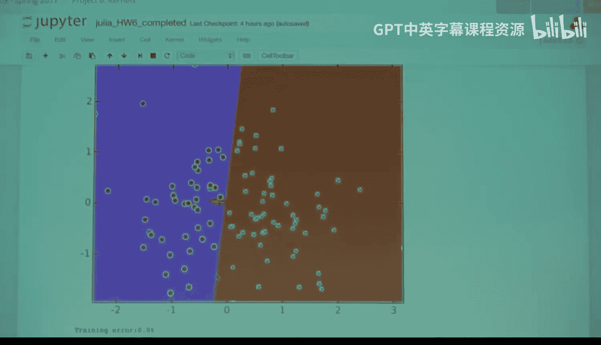

This here is the output of the this solver。 So then we give you a data set here that is no longer linearly separable。

 All， So this here now we have positive points and negative points。 And clearly。

 you can't separate them。 And so the first thing you do is you run the code that you just wrote through this data。

 And you will see that it won't work。 right， So this is what you get， right， you know， well。

 you're setting this guy up for failure。 It' a suicidead mission， right。

 So you try to find a hyperplane， It doesn't work， right。😊。

So then you basically have to convert the prim problem to a dual problem。 Now。

 we give you the dual problem， right， So you don't have to do this。嗯。

As you have to define a kernel matrix， this has a kernel matrix。

 What you see here is the I and the J input。And this is the kernel value。

 Can anyone tell me why it looks like has these funky， you know， Star Wars rebel alliance shape。

Any idea。Because the spiral data。 and so data points that are very close together are very similar。

 right， And so this is， actually， these are the training points。 And this are the testing points。

 So basically the， theyre kind of in order。 So points that are close together are very similar。

So if you compute the kernel， the RBF kernel， that's what it should look like。 You know。

 this is a good， good way to debug it。 And then here's the dual problem。 And the question is。

 please implement this dual problem now as a quadratic program。

 So you have to figure out how to do this。 I'm gonna skip past it。

 And the first thing you now do is to debug this to make sure your code is correct。

 You take the original data set that's linearly sable。😊。

You solve the dual problem with a linear kernel。 So if you do a linear kernel。

 you should again get out exactly the same linear classifier。 and you run this。

 and this is what you get。 Okay， so otherwise it's hard to debug you know， you know。

 kernel that's actually solving some problems of elusive high dimensional space。

 But if you just use a linear kernel， inner product you know。

 K I J is just the inner product between two vectors。

 Then you should get exactly the same result as before。

 So this is a very effective way to debug your your code。😊，And then actually， you， you you run this。

 And then this is what you get Once you kernelize it， right， then actually。

 the classifier can do this spiral thing very， very。😊，Effectively。And。

And I think that's the last thing。 There may still be a final competition where you actually are asked to。

😊，Run a。E cross validation that you basically try to optimize for the different hyper parameters and try to find this matrix here tells you you have one parameter and the other parameter。

😊，Which one gives you lowest error。 You basically try out different hyper parameters of your algorithm。

 And so here， red means high error。 Blue means low errors。

 This is a way to find the right settings for your S VM algorithm。

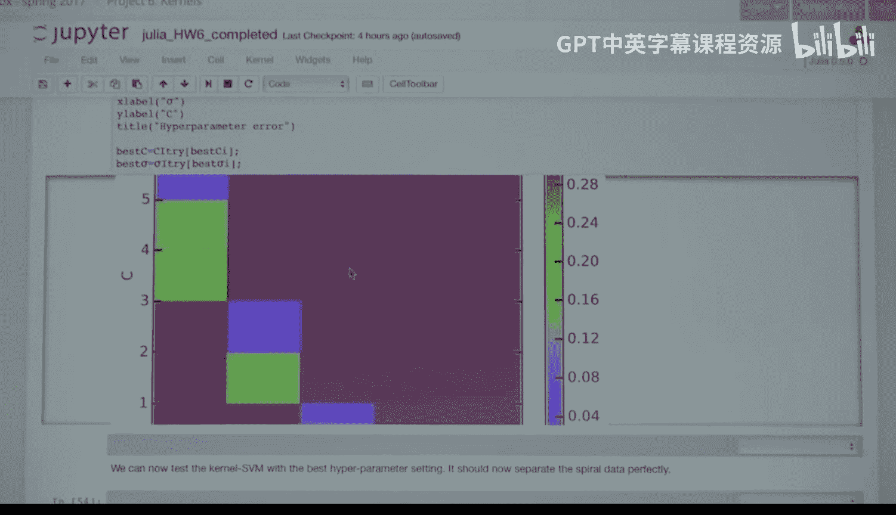

All right， see you on romance Day。

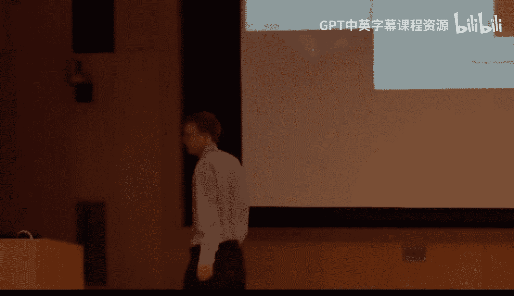