# 康奈尔大学《智能系统的机器学习｜CS4780 Machine Learning for Intelligent Systems 2017》中英字幕 p25 -25-Machine Learning Lecture 25 ＂Kernelized algorithms＂ -Cornell CS4780 SP17.zh_ -BV1Lo6gBxEKE_p25-

Yes。2 brief things。 So one thing is。

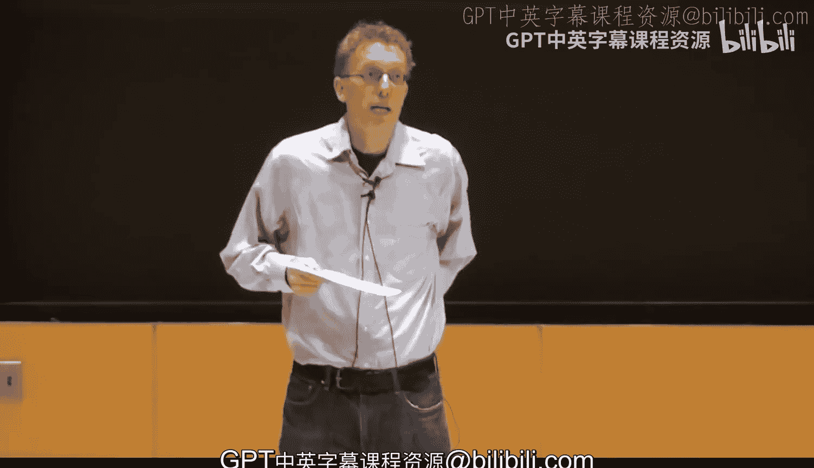

One comment that I saw in the survey a lot was people asked for recitations in addition to office hours。

 or maybe Ts go over problems。

So maybe once or every other week， Ts would have a session where they explain some topic one more time。

 you know， and。

诶。Go over some example problems。So I thought that's a good idea。 And I asked one of the T As。 So。

 you know， on the PhD T S to actually do this。 kind of a quick poll。

 Who would be interested in attending such sessions。😊，嗯。Okay， this is a fairmount。 Alright， Okay。

 good。 So we will do this。 And， I guess the first session will be on kernels。

 The second one will be on Gausian processes。 and then probably。😊。

Boosting and then deep learning， I guess。One additional thing。

 So one thing that people said that I thought was very interesting was that one complaint I also got this actually less in the survey。

 but more at lunch talking to students is that， you know， the vquaium setup is very neat。

 And in some sense， oh， cut out that you just have to do a small portion of the code。

 the problem is that some students said， well， I wouldn't really know if I get a data set now how to attack that data without having a vium set。

😊。

And so I thought what we do is we do a competition。😊，Where I give you a data set， and that's all。

And you have to basically is a training data set with。

 and you have to submit the test data set without labels。

 and you have to submit predictions on the test data。And this will be for extra credit。

 So that's also an opportunity for those who didn't do so well on the exam to kind of bump up their grade。

 And it will also be a great opportunity for you to kind of do machine learning in the wild， right。

 so you actually can just do anything you want。 Just pull out all the tricks that you've learned and really make it work。

 right， simulate the setting where you just give in a data and now， you know， see what you can do。😊。

So， we will， hopefully。Push that out by the end of the week， maybe Monday， next week。

 That's the current plan。And this will be a kggle hosted competition。嗯。Any questions about this？第二。

And what we do on the last day of class， actually， possibly even on the 17s。

 So the last day that is possibly due。 So you have a lot of time。And， you know， the moves everything。

 right， feature of preproces， you know， you can use SM， deep learning and whatever you want。 Yeah。

 is it going to be regression or discrete。 it's gonna be a surprise。😊，Okay。

But likely discrete classes， actually。😊，So， we are still debating。

 You have like a few data sets that you're discussing right now。 Which one be you。

But it looks like it will be。classification plan。Okay， good。Alright。

 so then last time we still talked about kernels。And in particular， we talked about kernel SVM。

 So first， actually， we talked about kernel regression。And。Con of regression。 Let me just write down。

 you know， we derived this and。

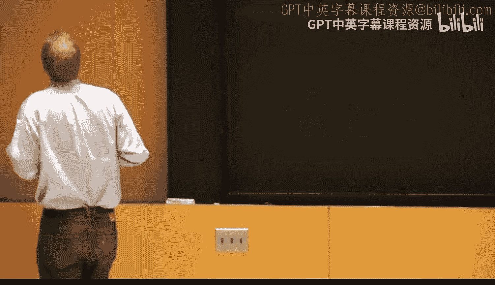

Wait， didn't they used to be as， oh， wow。😮，Okay， I never realized this。So。呃嗯。

We talked about kernel regression。 and there basically。

 we actually came up with the following formula that。

H of Z。Equals K star。Tranpose K andverse。Times y。 So it's， it's very simple。

 The K star is actually the kernel。case star。I is the kernel of X I with the test point Z。

 This is the kernel matrix。😊。

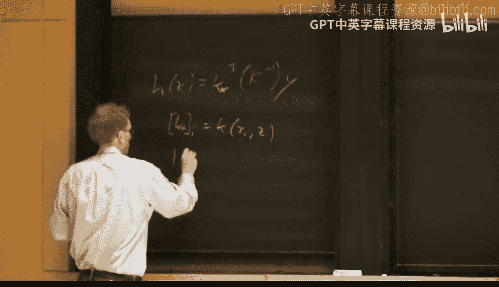

K， I， J equals the kernel of X， I， X， J。And。So you just multily that with with a vector y。

So this will come in handy later on。 But it was just one example of how to kernelize an algorithm。

 Then we talked about kernel SVM and kernel SVM be kernelized an unusual way。

 We took took advantage of a wellknow fact and optimization theory， optimization theory that says。

 if we have a convex minim problem。😊。

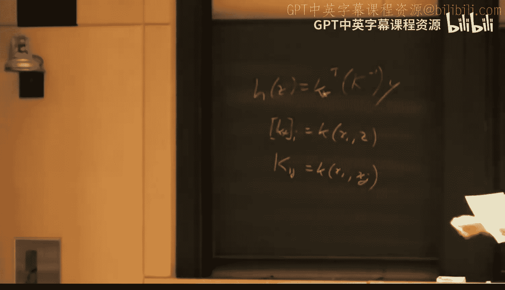

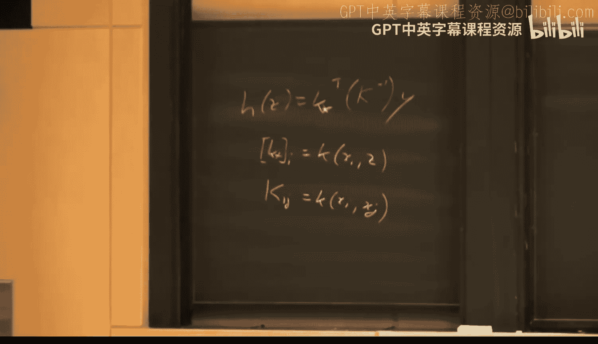

Then there must be a dual problem， which is a maximization problem。

 These two is exactly at the solution。So they have exactly the same solution。

And turns out that the dual problem actually accesses the the data points only as in the product。

 And if we solve the dual problem， it's actually trivial to kernelize it。😊，You just。

 instead of putting the in product matrix， you put in a kernel matrix。 So it's a very。

 very elegant way of。😊，Of colonizing the， the SVM algorithm。

 And this is actually where everything got started。TheJust to put the equations out one more time。

 I'm not going to write down the dual problem。 I hope you still have it in front of you。But the。啲诶。

Wight vector， at the end， becomes。The sum of all data points times Y I times alpha I times phi of X I。

Where one more time， Phi is basically the snapping to really high dimensional space that we never actually compute。

 But as long as we only do in our products with other points， it's， it's correct。 it's okay。

 And then if we actually do a classification of any point Z， then what we get is it's the sign。😊，Of。

W transpose X， which。Then becomes Y， I Al I K of。X， I comm a Z plus B。Okay， any questions about SVMs。

 dual SVMs before I move on。Okay， so Ch SVMs。You know， just by doing， you know。

 solving the optimization problem， and using this here as a， you know。

 e classificationification function is extremely powerful algorithm。

 And one thing I want to do today is actually show you， you know， we actually move on today。

 and we talk about Gaussian processes。😊，But I want to do five more minutes on SVMs and just show you something kind of neat。

嗯。So， if you。You know， I want to just examine this equation a little bit。So remember。

 we started out this class with the simplest possible machine learning algorithm， which was the。😊。

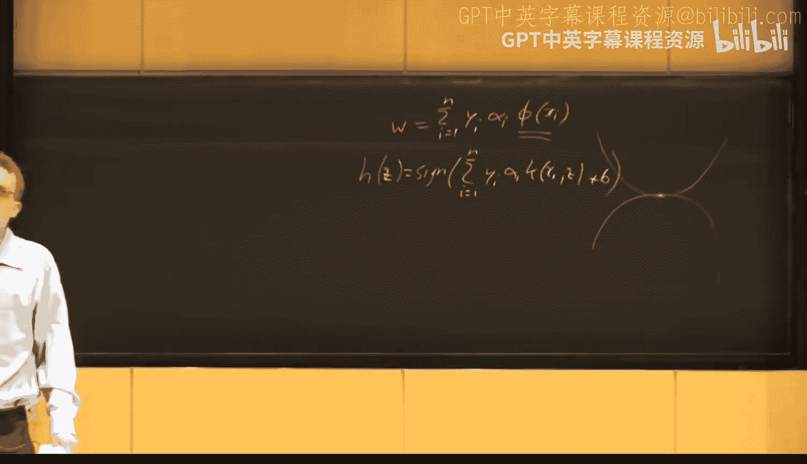

One nearest neighbor， k nearest neighbor classification algorithm。

And so thekenous neighbor algorithm， what you do is you take。

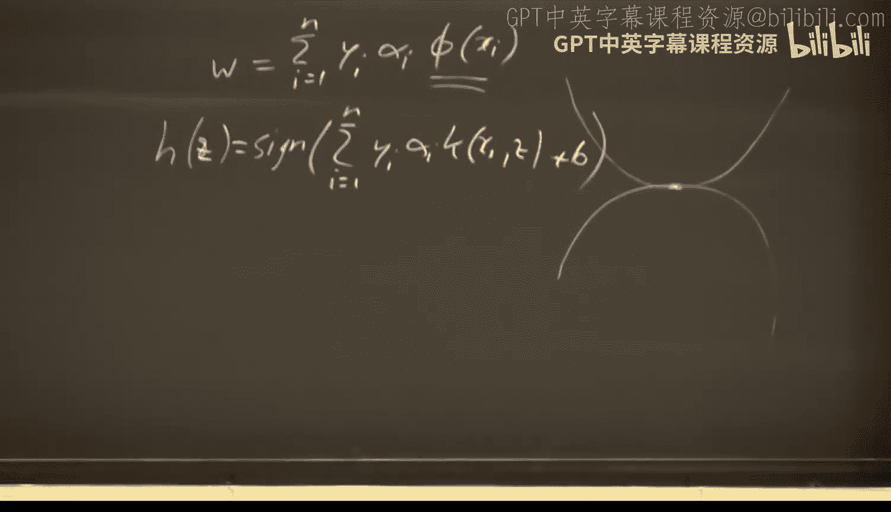

You know， do you remember this， right， You have data data like this。

And what you do is you have a new test point。 you find the k years neighbors and you average the label。

 So that's a these plus 1。 This is -1。 So you have two times plus 1，1 times -1。

 So that's positive so that you would give this a positive label。😊。

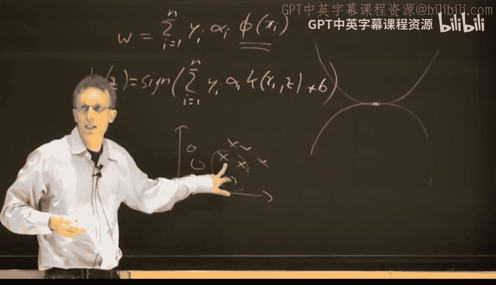

I can write this decision function of the Kenius neighbor algorithm as the following equation。

 I can say what we do is for De point Z。😊。

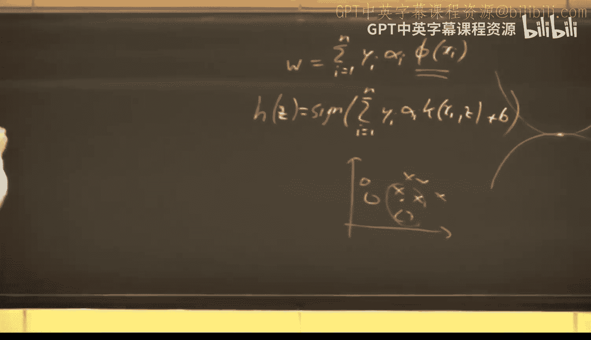

Be some of all the training points。And I'm sorry， we do the sign。And so assume for now。

 my my label is are plus 1-1。Then I some of all my training points。

And I take the label of that training point。EIf it's a nearest neighbor。

So I have this deelta function that says， if X I is the nearest neighbor of C。Okay。

 that any questions about this line。So this is the nearest neighbor of Simon Rule。

 So I'm basically saying， I'm just summing over all points。And in some sense。

 are' basically summing up the labels。But I'm only taking those points at the nearest neighbors。

 So this is either one or the 0， right， So this is one， one if。1， if X I is a nearest neighbor。

Of the。0 otherwise。That's， that's this function， right。So in this case。

 I would basically take  one plus 1-1 is plus 1。 So it's actually a positive label。

 So I assign a positive label。 Yeah， question。😊，Oh， that's sign， yeah。呀。All right。😊，Any questions。

Now， compare this。With this equation here。Where we say， H of Z。Is it sum of all points？Their label。

Times alpha I K plus and bias。Okay。So something should strike you， right， This is really。

 really similar。's it's almost the same thing because I'm gonna to all the data points。And here。

 everybody just say， oh， well， let's only take the nearest neighbor。 Everything is， you know。

 on the nearest neighbors are one。 Everything else is 0。Here we have this term here。 Now。

 let's look at this term。Apha I K of X I Z。Now let's just first look at only K of X I Z。

 What is K of X I Z， Let's look at the Gaussian kernel， the RBF kernel。K of X I。Z equals。

E to the minus X I minus Z squared over sigma squared。So what does that mean？This。

Z is really far away。 So X is really far away from Z。Right， then in this case， I'm assigning a 0。

Because it's not a nearest neighbor。In this case， what am I doing。

 I say X minus Z is really large because they are really far away from each other。

Each of the mine is something really， really large。0。Right， because exponential decay， right。

 It goes down exponentially to 0。So if points are really， really far， both of these rules。

 what they say is。😡，You just disregard them。 right， They don't affect our classification。

So we only look at close points。So if X minus Z is small， then each of the minus something small。

 while that can be， you know， reasonably large still。 So what is the SVM doing。

It's actually doing the same thing as can years neighbors。 It's just not making a heart threshold。

 It just doesn't say， oh， we take three years neighbors。 What it does instead。

 it puts a Gaussian distribution around the test point。 This here is my test point。

 You put a Gaussian distribution around it。This is my Gaussian distribution。

 This's kind of like a bump that comes out of the。The blackboard。

And if you get far away and this value here is really， really small。 So these points don't matter。

 right if they are really， really close， they're very large。

And so we basically do an a baed average of the neighbors。 right， That's basically what it is。

 So Kenya SVM， really， what it is， is the soft， nearest neighbor algorithm。

But instead of saying you have canous neighbors， you say， you know， I put a Gaussian around myself。

 And if I put a Gausian around me here， right， you guys here will still get some probability masss。

 right， So I busy averaging you guys， But you guys in the very back， you have zeros。 You don't。

 you't man anymore。 it's very similar to can neighbors。

 It's just that I'm not have a hard threshold cutoff。 instead of have a soft cutoff。😊。

That's what the K does。 What does the alpha do。Now， remember， the authors are basically， you know。

Weights that be assign。 But there's one thing that's really important。

 if you look at the dual of problem。The alphas are always not negative。They either between 0 and C。

So what are we doing， We are assigning additional weights to these points。 In fact。

 a lot of them are 0。 So what does that mean， that just means we take some training points and just remove them。

Because we don't need them。Right， that makes a lot of sense。 If you have many points here， right。

And there's no other labels。 But why do you have to keep all these points。

 You can just set all of these to 0 and just remove them。Right， they're not changing anything。

 Everything here will be classified as positive so we can just set them to 0。

 That's exactly what the SVM is doing。😊，It's。You know。

 these are basically the points that are not support vectors。

 Those are points that are a region that gets classified correctly anyway。 Just set them to 0。Right。

So。SVM is， in some sense， especially with the RBF kernel。

 a smart nearest neighbor algorithm that does two things。 Number one。

 it takes you trained data set and thins it out and removes points that are obvious， right。

 And so you don't have to carry your whole your entire data around All the points that have00 alpha you don't need。

😊，And then the second thing is then before a test point。

 it basically has some soft assignment where it says， you know， if there's some dense region。

 I take on more neighbors， if it's a sparse region， I take on fewer neighbors。😊，Any questions？Yeah。で。

Yeah， so， so。

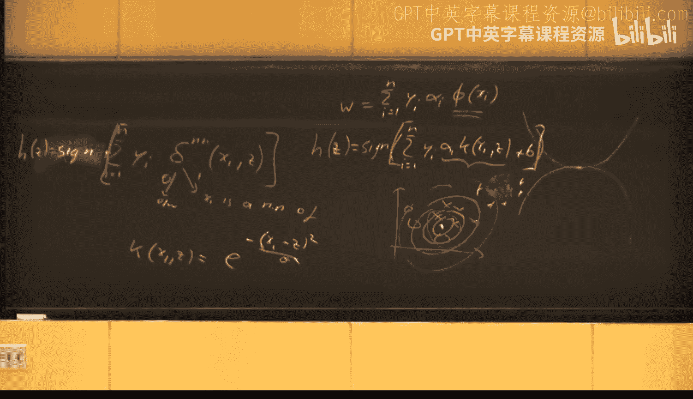

In these high dimensional spaces， you typically don't need to kernelize， right。

 This is only a property of the kernel。 If you don't kernelize anymore。

 then you just have a linear caifier。Right。The， the RBF kernel does not work so well in in if you the RBF kernel is affected by the cur of dimensionality。

Just because everything is far away from everything。哎，要错他。So but the fascinating thing is， right。

 we started out with the Ken' name algorithm。Let me introduce something totally different， right。

 a linear classifier。Then we map that linear classifier into an infinite dimensional space。😊。

And what did we get？The canous neighbor algorithm。 So what we're basically showing is that。

You know this。In this infinite dimensional space， actually。

 a linear classifier is basically doing what akenous neighbor algorithm is doing。 It's just better。

 though， SVM is because you're weighing data points， you know， by these alphas。

 and because you have a soft assignment， it typically gets tends to get much lower error than than nearest neighbor。

😊，The last last but on least actually， we also assign a bias。 So that's just this。

A small detail that you don't really need monster。Okay， any more questions about SVMs？いや。Yeah。What。

The question is， are there any scenarios in which non kernelnalized SVMs are better。

 And the reason is， yes， So if you have very high dimensional data， like， for example。

 text documents， there's no need for you to kernelize， right， Just use a linear SVM， right。

 Of course， that's identical to a kernel SVM with a linear kernel， right。😊。

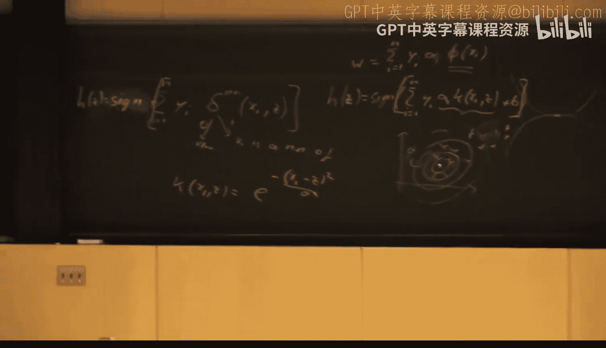

Any more questions。Okay， good。So then what。Oh yeah， perfect。 Okay， good。

 So let me just hand out next thing。😊，So I have to warn you a little bit。 the next topic。

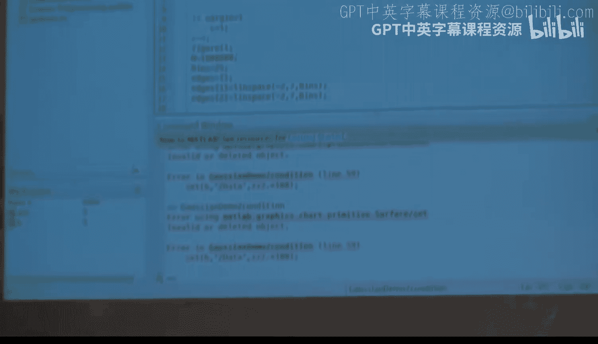

Is。Not complicated。But students perceive it as complicated。I don't really know why。

I'm trying every year。 I'm rewriting this lecture every year for the last， you know。

 I don't know how many years and。It's one of the most beautiful algorithms， but。😊，I'm just want you。

 please pay attention now。 It's like' there's a really high cost。

 If you don't get it the first time reading up afterwards is quite tricky。

嗯。

It's the。It's borderline， non trivial。O。Sorry， I gave too many to the these guys in the front。Okay。

Okay， but just because actually， just to wrap this up。Let me show you。One more time。Okay。

 this is one more time。 the SVN demo。Because now that you understand it better。

It may make a lot more sense to you。 So let me just create a data set。

So here's a data set that is not linearly separable。 for example， I have。

And a bunch of points around it。And so these are my my negative points around the circle。

 My positive points are in in the center。😊，If we now run a linear classifier。

 this is what the linear classifier tries to do。 right， It basically says， well。

 here are some positive points。 I can put this line here and I get reasonable error。

It doesn't really make all that much sense。 It's it's just， it's。You can't really do it。嗯。

But here's what the SBM does， right。And。Actually， this is maybe a little bit too large of a C。

 actually。 So in this case， actually makes everything super vectors。 This is the only point it drops。

 actually。😊，So it looks like I made my C a little bit too large。嗯。If you look at the 3D plot。

You can see how it， you know， here it basically carves out this， this valley in the middle， right。

 And so you can now see how it's the nearest neighbor algorithm， right。

 basically wherever you have this， this dot here， you see it's very， very red， right？

 That means it's very positive， right， around these data points。😊，And this is exactly this Gausian。

 Gaussian kernel that you basically put around all these data points。 So here it's all， all red。

 right， So because you're closest to one of these red points。😊。

And then you get in here and busy in here， you have all these blue points。 So， you know， again。

 it's the darkest ride where you have one of those blue points， right。哎。

So you can see it's kind of a smooth decision function of the nearest neighbor algorithm。

What are the white line， the line Oh， good one。 The white lines are the。

 the lines where the decision boundary is exactly one。 So those are the support vectors。

I can also show you one more demo on。嗯。I also showed this last time。Here we have， you know。

 we do a one dimensional plot。This is now our kernel regression。

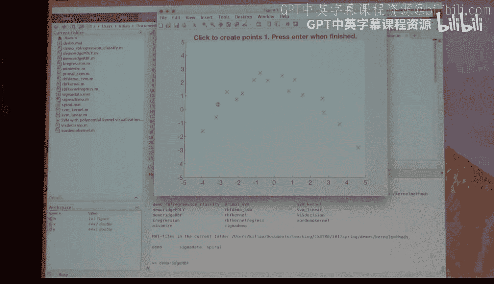

Yeah， and so what you see here。Is。There are two parameters。 One is the kernel width that Daisy says。

 when I do my RBF kernel。嗯。How wide is that Gaussian。RightSo my nearest neighbor algorithm with How。

 How wide does it go。 And the other part of the lambda is basically how much do I regularize。

 And what you see here is this year， right。Right so here in this case， basically。

 it's kind of like a linear classifier because I， I have a very， very my， is extremely regularized。😊。

But this whole thing is very smooth function。 This is because my， my sigma is very wide。

 So I have very wide Gausians。 This means in some sense， what am I doing。

 I have a nearest neighbor algorithm that averages over many， many points， right。

 So that changes very little。 right， This is a low variance， high bias classifier still。

 despite that it's kernelized。😊，And if I， if I lower my sigma。

 then these Gaussians become smaller and smaller。 And what am I doing， essentially。

 basically I this is kind of like canius neighbor of a large K。

 And this year is can name is a very small K。 right。

 So what you see here is that basically right around this data point， it gives a large value， right。

 But then it falls off already， right， because you're no longer close to that point。

 So it really just。Pdicts exactly what your nearest neighbor does。 And if you're too far off， well。

 then you just falls back to the meat。 So it's a very， very sharp。 This is a high variance。

 very high variance， low bias classifier。Any questions about Carel big question？Yeah。

This is rich regression， yeah。That's right。 Lada and Sigma。 So Lada is the regularization。

 and Sigma is the kernel width。So this here is the grid， right， So you basically。

 I change my land in increasing order to the right。So this is low lambda。

 as I go to the right that Lada becomes larger。 are regularized more。

 So these are all flat lines because they're over regularularized。

 And as you go down and increasing my sigma。So that basically means I make my Gaussians wider。

 the kernelel wider。 So that's kind of equivalent of making a， you know。

 like if you look at if it wast SVM， it would be a large can now。 Like， you know， sorry。

 Kenya's neighborhood classified fire would be a large can now。

 So you averaging over many different points。Okay， any questions about this？Okay， all right。So。

哎，就这个。嗯。We are not quite down yet with kernels。 So the next algorithm makes is it still a kernel algorithm。

 Then， then there's the last kernel algorithm。And the next algorithm is called Gaussian processes。

And。It's basically an extension of。诶。L kernel of A。And I I always typically。

 my view is that Gaussian processes are kind of the regression equivalent of S BM。

 So S BMs are kind of。😊，You know， really good classifiers。 If you have classification problem。

 S V Ms are great algorithms， and they are low errors。 They're very reliable。😊。

They don't really work well for regression。 There， there's many people whove tried to make SVM regression。

 and it's awkward。 It doesn't really work， right， because you have this hyperplane。

 you try to point points on one side the another。 And basically， what they do is they say， well。

 if you're kind of off the hyper planee， I still kind of classify you with the same value。

 It doesn't really work。 It's awkward。Gausian processes are。Really good for regression。

People have tried to made Gaussian process classification。

 and that's awkward and doesn't really work properly。 right So they are really， kind of。

 I would' say equal partners， right， They have very complementary strengths。嗯。For Gaussian processes。

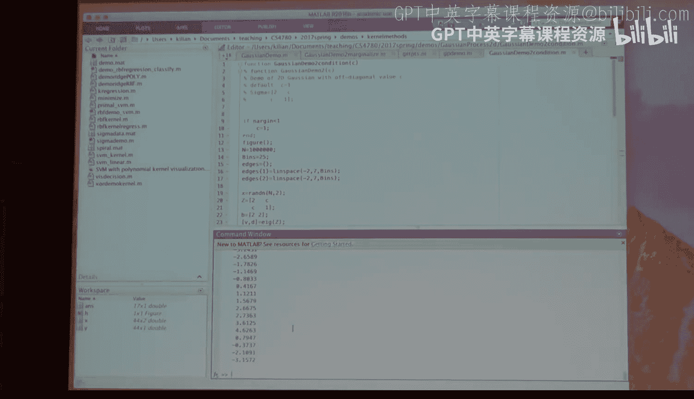

To get into this， we actually have to think a little bit about Gaussian distributions。

And gas distribution is a wonderful distribution。😊，And one。

 the reason why Gaussian processes is so awesome is because they are all based in Gaussian distributions and Gaussian distributions is really easy to work with。

They are very very， very nice properties。 The first thing is。

 can anyone tell me anything thats that's truly Gaussian distributed。😊，It's like。

 I'm trying to blank this。Does anyone know anything that's Gaussian distributed。Yeah。

Height of people， right， exactly， right， height of people is something that is Gaussian distributed。

 right， So in fact， actually， height of people is actually not Gaussian distributed is bimodal。

 right， So you have men and women。 And， but if in condition， you say， given that。

 you know the gender， it's a Gaussian distribution。嗯 actually。Actually。

 have a friend who who actually wanted to， to show this in this class， right。

 And he collected some data。 He thought， where can I get data。

 I just want to show my my students that humans really have a Gaussian distribution and height。

 right And so what he did is， you know。😊。

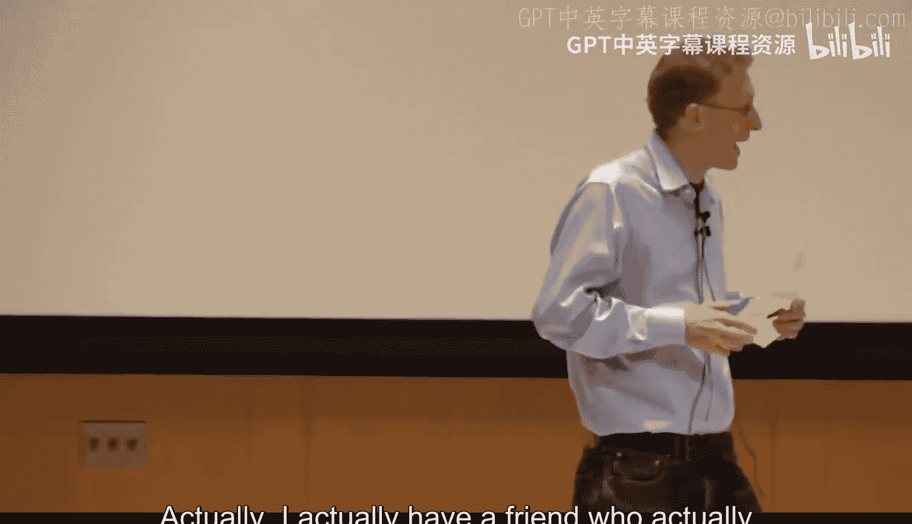

He went to O K， Cupid。And so O， Cupid actually'， it's a dating page that's free。 And so the data。

 you know， the deal in some sense is the data becomes available for researchers。

 And so he looked at all the， you know， this is great， right。

 because people actually put in their height and all the stuff and the agenda。

 So he just looked at men and he， you know， collected， you know， ten of thousands of men。

 their height。 And then he plotted it and distribution looks great， right， It looks like this。😊。

And looks like this。哎。I was like， well， that's odd。What's going on here？

 And does anyone know what's what's here。At' 6 feet。 That's exactly right。 That's 6 feet。Yeah。😊，So。

So apparently， people who are 5 F，11。Generously round up。Which is interesting， actually。

It frustrates me a little bit because I'm exactly 6 feet。 And I feel like I'm， I'm， you know。

 people are kind of。I'm not， you know， I guess that the recommendation for ladies is， you know， to。

 you can trade off 1" right， and get someone who's really honest， right， If you someone 5 11， That's。

 that's an honest guy， so。😊，Or if you want to talk hike， you know， then maybe go for 6 foot。

2 or something。Anyway， but is the sc distributed it。Another one is another thing is IQ。

 IQ is Gaussman stupid。 Actually， people also them that experiment， but they ask people。

 what's your IQ， And that also looks nothing like Gaussian， Actually。

 The average average person has a way above average IQ， according to self reports。😊。

But so the reason that many， many things are Gausian distributed。

Is because of the central limit theorem。 So who's heard of the central limit theorem。I'll prove it。

 Okay， beautiful。 So let me just show you， I made a little demo where I can actually show the central limit theorem。

 So central limit theorem says something very simple。

 It says if you have any distribution that has finite variances， that's most distributions。😊，嗯。

It yeah， that's what I want。

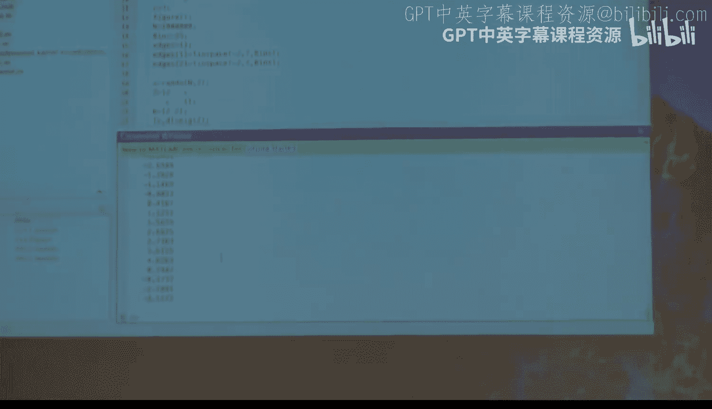

Then。If I then sample multiple points and average them， this average becomes Gaussian distributed。

And so I thought， well， let's test this if it's true。So here's my demo。And so here's。

 here's what I'm doing。 So I have a distribution。 And right now， it's a uniform distribution。

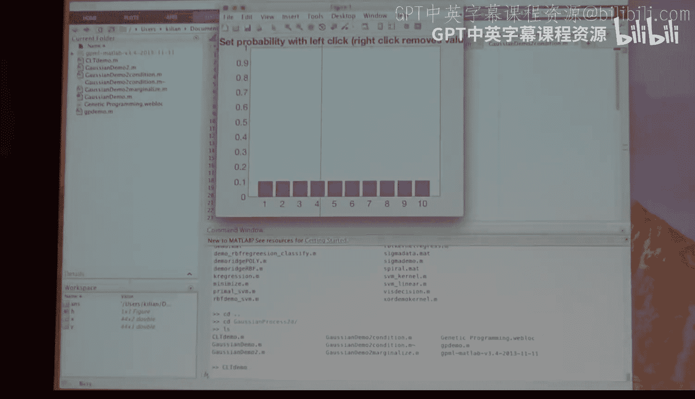

So。So here's a uniform distribution。 So I sample points from this distribution。

 and have basically a die that has， you know， can then take 10 values。Oh， at all。

Can take on 10 values。And each one of these 10 values is equally likely。

 So I draw samples from this and average them。 And then I look at the averages。

 I do these averages multiple times。And if I do two averages， I。

I I average two values and do that many， many times。 This is a distribution that I get。

And if I average  four values and so on， and if I average 1 to256 values。

 you see this is a perfect Gaussian distribution。😊，RightSo here on the right。

 despite that this here looks nothing like Gaus Gaus。 And now， now we can see like， you know。

 does this really hold。 can try to break it， right。

 Let's try to make this distribution look really non gaus， right， So， for example。

 let's make a lot of probability mass here。😊，A lot of probability mass here。

that's that's the opposite of a Gaussian， right， You have like， you know。

 nothing in the middle but everything on the the the outside， right， even said to say get to 0。

 right， Like， you know， let's really get rid of these things。Oh， I just broke it。 I made it negative。

 but that doesn't work， okay。Okay， good， I can't make it negative。 Allright， let's make these really。

 really large。Okay， good。So now I Ive basically nothing left， right？

 And what you see here is like you have few samples， right， it doesn't look Gaussian。

 But as you actually get more more samples， like even with this crazy distribution。

 which is really odd， right either  one or 10， right， you're never in the middle， right the。

The mean actually becomes scarce， right。And so。I guess that means if you， you know， in。

 in real world， if there are something that depends on the average of many random variables。Right。

 for example， you height， right， What does your height depend on on your genes， right， on your。

 you know， what you eat， right， Well， I don't know what else， but you know。Probably many things。

 And these are， you know， these are basically the heightest， you know， in some sense。

 an average of many factors， right， So it tends to be Gaussian distributed right。😊。

Another piece of people use a lot of Gausian distributions， actually in the stock market， right。

 So the stock going up and down， you know， people make a lot of money predicting this。

 But there's also many， many factors that factor into this。 So， you don't really know what those are。

 But， you know， you know， they are roughly Gausian， right， So that's actually， that's。

 that's your angle， right， because， you know， the distribution， you can actually attack。Okay。

 any questions about this demo。So is add the number of samples you're taking or the size of your and is actually the number of。

Value that I'm averaging。 And then I take many， many averages。

 And I think my notes may have a mistake there。 I gonna correct it on the slide。 So， yeah。嗯。Okay。

 any more questions？Okay， here comes the beautiful thing。 right？

 So one thing we have is that many distributions， like if。

 if random variables are the averages of many other things， many factors。

 they tend to become Gaussian。😊，哎。But， that's not enough。

To explain why we see so many Gausians in the real world。There's a second thing。

 The first thing is things become Gausian as we average them。There's a second thing。

 The second thing is the Gaussian is the black hole of distributions。Once you're Gausian。

 you stay Gaussian， you can't escape。哎。Like if you add up to Gaussians， they stay Gaussians。

 If you multiply to Gausians， They stay Gaussians。 If you conditional on onebear， it stays Gaussian。

 right， If you marginalize something out， it stays Gausian， right， So it's kind of this attractor。

 the sinkhole。 right youre stuck in it。😊，And that's a very。

 very important property that we will take advantage of。Actually。

 I make a little demo like actually in the past。Actually proven all these things that it's kind of closed under all these different operations。

 I thought maybe that's a little boring。 So let let me， let me instead。I just had a meeting。

 actually， a faculty meeting。 So doing that， I secretly made that demo。😊。

I hope none of my colleagues watch this video， but。😊，嗯。here we go。 So yes。

Here's the first Gaussian them。 Okay， good。 So here's the first thing I want to set test。

 It's like I take two different Gaussians。 These are two variables， X and Z。

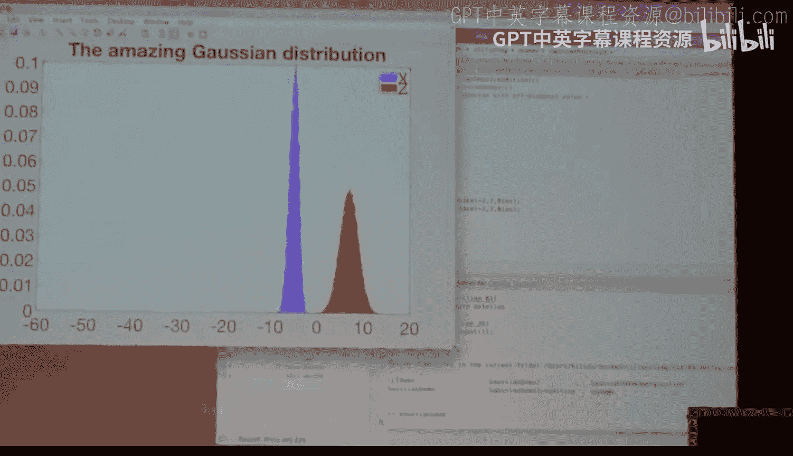

So X and Z is like， I'm just drawing points from this distribution。

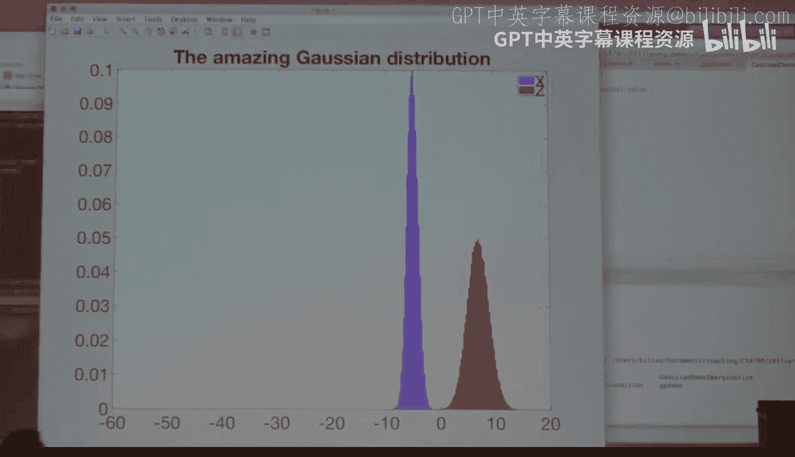

And I'm drawing points from this distribution。 This is my X。 This is my Z。Now。

 I want to look at two new distributions。 The first one is x plus C， and the second one is x times C。

 Where do you think these two will lie。EMaybe I give you a minute to discuss it with your neighbor。

And think about where will x plus C， Where will x times Z be。Yeah。Yeah。Yeah。Yeah。I。Yeah。Yeah。Yeah。

Yeah。Okay。可个。Yeah。Yeah。Okay。这。Yeah。All right， and he guesses， where' is X plus C？

Who wants to guess and wants to describe or x plus Z。What's gone。 alright。

Not hole。 That's right。 That was it。

Any he guesses， wheres x plus Z， yes。Its it's around 0。 That's right。 It's kind of between these two。

 right。And maybe a little wider than the blue 1， and。Let's see it。Here we go， right。Well。

 it's not exactly that around 0 because this guys， they're not actually exactly symmetric。

 This guy' is a little further off， because it has more variance。

What you can see is a beautiful Gaussian distribution， right？

 So what I'm doing is in some sense I take a sample of value here。

 a sample of value here and add the up， right， So that's it's going to lie somewhere here in the middle。

 right。😊，Where's x times Z。Any guesses。I ignore you guys because answer you answer too many questions。

 Z is a compliment。😊，Yeah。咁就呢张。Sorry。小。咱们。in- 20， minus-30 in here。呃。Yeah。不服。哎 right so这次。😊，Yes。

 it's here。 but actually， the spread is much， much white， right。 So here， the variance here。

 this mostly affects the mean， right， But if you multiply them， right， if you。

 you could actually get a large， large negative value here， a large positive value here。

 that could give you a very large value。 You could have -10 here plus 10 here。

 that goes to you a value of -00 right So this is a very spread out distribution。😊，嗯。嗯。Okay， so。

The important properties that I want to go over today that we will take advantage of is that the Gaussian distribution is。

Is close on the。4， four operators， the first one。Well， normalization。 Well， that's that's。

 that's interesting。 actually， it's like。It is already normalized。So it sums to one。 Well。

 that's that's a trivial one。The second one is actually， let me just bring up the course notes。

Because I afterwards， I'm going show you the demo again in two seconds。

So there's no point going to the blackboard。Okay， here we go。So we have this first thing。

 The second thing is marginalization。So what does that mean if we have a。

sorry the one thing we looked at， Let's just do them out of order。 sum Asian， sum we've just seen。

 Let's say we have two distribution。The first one is why and by prime。 They're both Gaussian。

Then if I sum them up， Y plus y prime becomes a new Gaussian distribution where I sum up the two means。

 and I sum up the two variances。 right， So that was the green thing in the middle of the red and blue。

 right， So the mean was kind of in the middle and the variances get a little， you know。

 the variance get a little wider， which is exactly what you said。😊。

Then we have two more marginalization and conditioning。 So what does that mean。

 marginalnalization means if I have two different I Gausian distribution over two values。Right。

 and now I marginalize one of them out。So， I。You know。P off， what do I call them here。Yhy A and Y B。

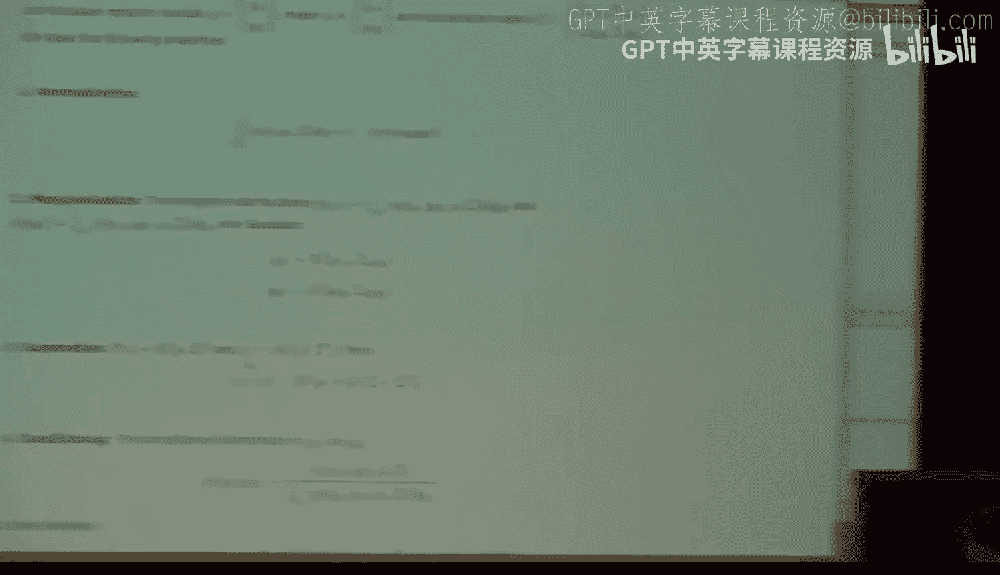

Why A and Y， B， And that's a two dimensional Gaussian。はい。And if。

 if I now compute the probability of P of Y A。What is that， Well， that's the integral of a Y B。

P ofY A， common on Y B。I B， right， So that is， again， a Gaussian distribution。 Okay。

 So if I have a high dimensional Gaussian distribution and I take any one of the dimensions and basically collapse it。

 right so。Well， I have a demo。 I can show it to you。

If I basically take all the mass one dimension and just sum them all up， squeezee them together。

 what I get back as a Gaussian distribution。Let me show it to you。See， it was a large。

 It was a long faculty meeting。 So actually it's multiple， multiple demos。

 So this is a two dimensional Gaussian。 right， So you have x 1 and x 2。

 And this is the heat maps that I've been drawing on the whiteboard all along。 right？

 So imagine this， for example， this could be， you know。😊。

You know， Ill get this example later on。 But I've mentioned this in the past， you know。

 housing pricess， right， So let's say I want to sell my house， right。

 But my neighbor has basically the same house in the same street。 And if my neighbors。

 let's say is X 1， I X 2， right， so。😊，These are correlated in this case。 right。

 So you look at this the distribution。 What you see is that if the value of x 1 goes up。

 the value of x 2 also goes up。I can actually make you a 3D plot。Here's a 3D plug。

 So now you can see very nicely， right， They're basically saying the value of one affects the value of the other。

 right， So these two are tied together。😊，Okay， and this is a two dimensional Gaussian distribution。

 And if I now marginalize it， what am I doing， right， let's say I want to know the value of x 2。

 I don't care about x 1。 I don't care about my neighbor's house， right， you know。

 I want to sell my own house， right， So what I have to do is I have to sum up of all the possible prices that my neighbor could could sell his or her house for。

 And I can show you， how this works。 So let's say I do this。 and I。😊，Okay， wait one second。

This's just the same thing on a different scale。And now I， I， I'm summing up all the。

 all the different columns。 So I'm just summing up， summing up， summing up， summing up， summing up。

 summing up， Car all the way to the end。 And what do I get Da， right， right here it is。😊。

This is the Gaussous abuse。I do always stay Gaussian， right， That's the beautiful thing。

 we will take advantage of exactly that property later on。 Let me do Gaussian processes。😊，嗯。Okay。

 so the， the last thing that that the Gaussian distribution is is。

The last operator that they can do is conditioning。Right，This one here。And conditioning says。

 if I have a two dimensional Gaussian。And now， I know the value of one， one of the values。

The second one stays Gausian。So。Going back to the example of the of the my house and my neighbor's house。

 right， there's some Gaussian distribution that says， you know， they' are tied together， right？

 And now my， my neighbor moves and sells her house， right。Well。

 that now affects the price of my house。But， it remains gousing。So this is basically the following。

 I have Gaussian distribution of Y Y A M I B。 And now I know the value of Y B。 That's my neighbor。

 That's no longer uncertain。 There's no distribution anymore。 That now。

 that random event now happened， right， My neighbor sold her house。 It's done， right， and。Now。

 what I can do now， I can take this information and compute the distribution over the remaining know random variable for which I don't know the value it Y A。

 right and that changes。And so if you compute that and that's the good old， you know。

 it's basically the joint distribution divided by the marginal distribution of a Y P， right。

 this is just。Good old stats 1，01， right， turns out that becomes a Gaussian distribution。

 And here's the the variable。 It's basically。The mean here， plus this term。Thats this time。 we get。

 I will explain this in a minute。 Let me show you a little demo。So， here's the the。Conditioning。

So here's， again， our Gausian distribution。And so once again， you can see that， you know。

 just want to highlight the fact that we have this structure here， right。

 This structure here shows that these two are correlated。 right， if x1 goes up， if you see in the2 D。

 if X1 goes up。😊，X 2 also goes up， right。 So if my neighbor sells her house， you know。

 for a large price， that means my house is probably also worth a lot more。

 And now what I can do is I can now condition on something。 I can now say， well， let's say my。

 by the way， this is now， these， of course， these are not house prices， right。

 These go from -1 to 6 or something。 But imagine I just say， well， the houses。

 you just remove the average house in Ithaca or something。 right， So then you could say。

 are you selling below average price or above average price。😊，So now I can say， okay， well。

 she now sell her house at a certain price。 This is the price， right。

 And what happens is the probability mass of everything else gets sucked into this， right。

 that disappeared。 This can no longer happen。 This is probability 0 now， right。

 All the probability mass ends up here。 And essentially， all I'm doing is I'm renormalizing and。😊。

What I'm getting is。You know。The Gaussian distribution。

One thing that's really cool is I can now actually say， well。

 what happens if she sells a price for a house for a different price， right， then， you know。

 So let's say I'm moving the value of X X X1 that changes distribution of x 2。

 So this is the distribution of x 2。😊，O。And it happens at a particular value on X1。

 So this is conditioned， given that my neighbor sold her a price for a house for exactly this value。

 this year is now the distribution that I get for my house。 And one thing I can now do is I can say。

 well， what if she sells a house for a different value。 How does that affect my， my， my price。

 And I can now move around， right？ And what you see is that the Gaussian shifts， right。😊。

The Gaussian shifts around。 And if you look at x2， what's happening， right。

The more valuable her house gets， right， the more valuable my house gets， right。

 So as her house becomes more expensive， this goes up to 6， my house also was more likely to。

 you know， to birth that much money。😊，O。😊，Any questions about this demo。Yeah。

 so it looks like the variance is rather constant， is it just for this particular case？

The various for this thing， yes， does stay pretty constant。 Yes， yes。没。And one thing I can do now。

 I can actually show you another example。 What if we。

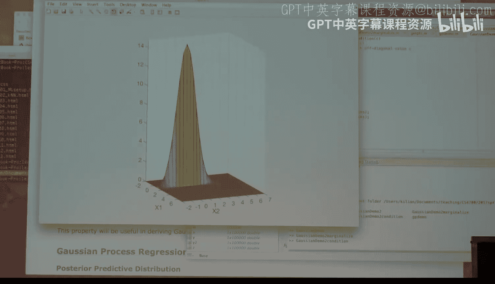

What if my neighbor actually wasn't my neighbor， right？What if my， you know， for example。

 said my wife tells me， oh， by the way， my， you know。

 our neighbor sold a house and that's going to affect our house， right。So。What if instead， actually。

Steve Bamer， of Bill Gates sells his house， right。So Bill Gates has a house in Seattle。 It's worth。

 you know，$50 million。That's a little more than my house。And。And essentially。

 what happens when he sells this house， there's absolutely zero impact on the price of my house。

 right， because totally different people buy these houses， right， theres there's nothing in common。

 right， you know， I probably， he has， he has more bathrooms than I have rooms in my entire house like。

 you know， factor of 10， probably。So。The Gauss distribution would look different， right。

 It would look like this， right so。嗯。Basically。You know， there's X1 goes up。 Well。

 X2 kind of stays the same， right， There's still some probability mass that's kind of here the center that says there。

 you know， there's still something， you know， at some point that is most likely。

 depending on what X1 sells for an X2 sells for because you know。

 Bill Gs house may only sell for certain， you probably reason we like to sell here。

 But it could also sell for that much or for that much， it won't affect my house price at all。

 I can show you this。 If I now look at the conditional distribution。😊，What you see is that basically。

 you know， this distribution doesn't change at all。 It as moves around。Right。

So if I look at the just the view of my house， the fact that Bill Gates changed Soda's house has no in fact impact on my house at all。

 And so the way I encoded this。Is in the， in this matrix here。 So this here is the covariance matrix。

 So Gaussian， two dimensional Gaussian basically have a covariance matrix。😊，Where。

The diagonal entries， the two and the one。Show you how what the variance of each particular entry is。

 So this year would be， you know， what is the uncertainty about my house。

 What is the uncertainty about Bill Gs House， And this value C says how correlated are they， right。

 How much does my house inform me about Bill Gates House and vice versa。

And so the first example I set this to  one， I believe this constant C was one。

 And the second example， I set this to 0。 basically said they have nothing to do with each other。

 right so。嗯。The Gaus distribution is very， very neat in that way that you can basically know。

 connect different renderending variables。With each other in a very obvious way。 Let me stop here。

And。If you get a little time， maybe read through these notes。 It helps a lot to understand。

What we will be doing on Friday。