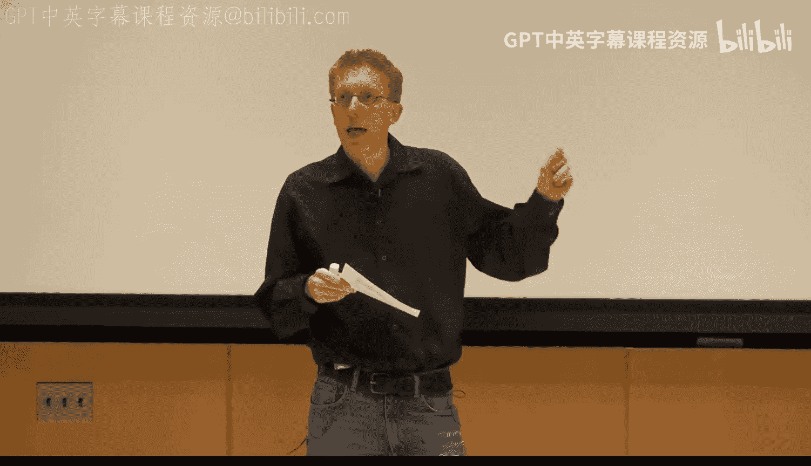
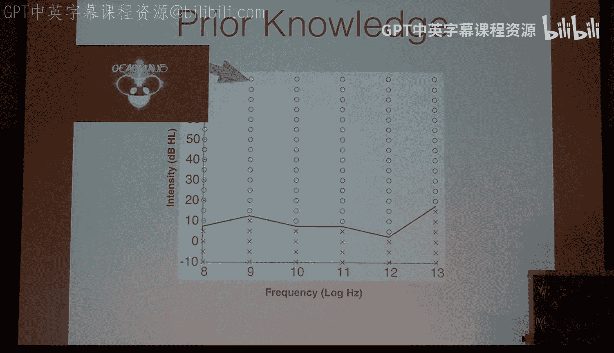
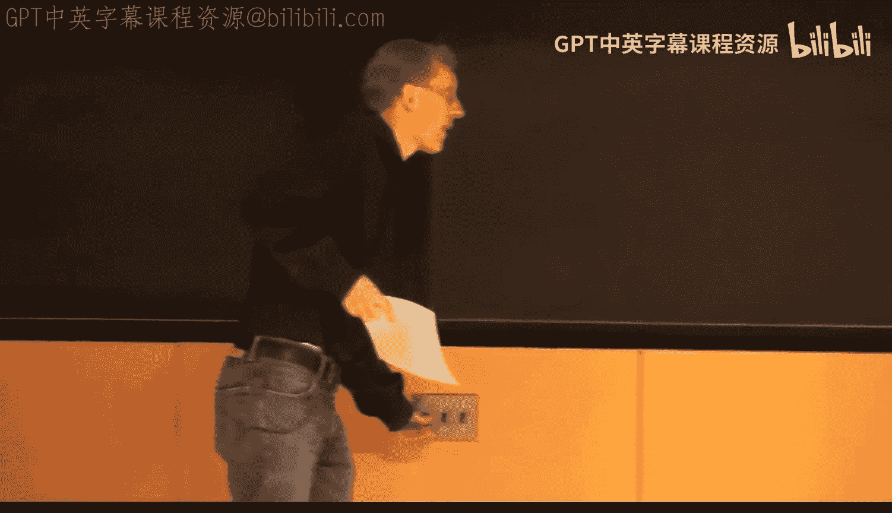
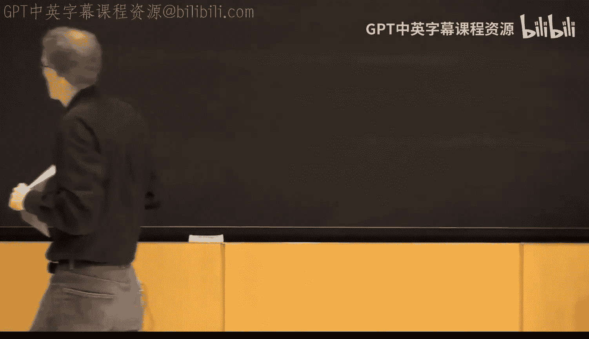
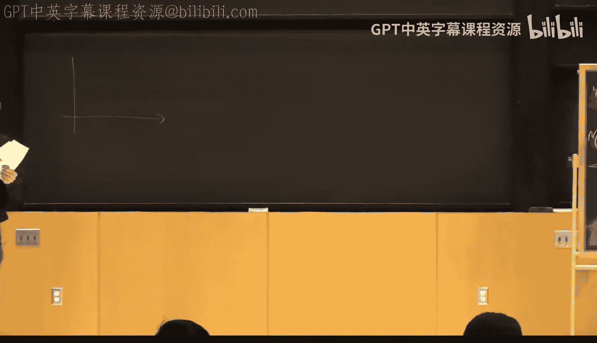

# 康奈尔大学《智能系统的机器学习｜CS4780 Machine Learning for Intelligent Systems 2017》中英字幕 p27 -27-Machine Learning Lecture 27 ＂Gaussian Processes II _ KD-Trees _ Ball-Trees＂ -BV1Lo6gBxEKE_p27-

I come。嗯。Today， we will be finishing up Gaussian processes。😊。

I would just show a little demo and then you move on to something completely different。嗯。

Also briefly about logistics， so the new project is out on kernelels。😊，And。The last homework was due。

 The next homework will be shipped。Very， very soon。 It's currently being tested。

One thing that's important about the next homework assignment is you have to do it before。

The next project， I guess we currently have Project 6。 That's the kernels。

 After that comes Project 7 on。😊，Trees boosting and bagging。For that， you。

 it will use something that we don't cover in class that you have to derive in the homework。

So please keep that in mind。 So there's a project that you don't know how to do。

 it's probably because you haven't done the the homework yet。 right。 So it's， it's the。

The question where you have to derive a linear time update for the regression tree。 Yeah。

 so how many projects and homework do we have， there's a lot。So， there is。Hopefully。

 eight projects in total。 So the6 right now is online。 there are 7， and then comes 8。😊，Aです。

I think it's a 90% chance that you have Project 8。And there's also the carrying competition。

 which will go alive。ETomorrow or on Wednesday。And that's all set up now we're just testing it one more time。

Okay， any questions about it sorry。This the last。 No， there's one more after this。

 So the homework that will come out now。 and then there's one more after that on， on deep learning。

 And that's it。Yeah， any more questions。Okay， so what we did last time。 Let me just briefly review。

You know， the high level picture of Gaussian processes one more time before before I show you a little demo。

 So basically， what we did is we showed， we went back to this linear model。 and we say， well。

 if you want to do regression。😊，And we had this linear model where y equals w transpose x plus B。

 And then we add some Gaussian noise。 And in that case， actually， the question is， how do we。😊。

Learn that W。 And what we've done several lectures ago。

 we've introduced two different methods to learn this W。 It's either Emily or Matt。

In the last lecture， we said， well， that actually there's another alternative。

 It doesn't have to be Emily and Ma。 Emily and Map what they do。

 They both give us one particular model W。 And then once you have to have model。

 you make predictions。MLE MLLE gives you the model that maximizes the probability of the data given W。

 MA gives you the probability of W given the data。😊，And so we introduced another alternative。

 which is， you know， I just called the fully Bayesian or the the true Bayesian approach， which is。

 but you said， well， let's just get rid of the model altogether and instead of say， well。

 the probability of a y given X is and the data。😊，Because here my test point iss basically， you know。

 the distribution。It the is the the prediction under every possible model it could possibly have。

 So we save well for any W that I could have。 I get a prediction。😊。

And every W has some probability that I would actually get it from my training data。

 and I integrate that out。😊，And so if I do this， basically。

 I'm giving you the prediction that's really the outcome of every possible model I could learn。

Waied by the probability that I actually get this model from my training data。

Then it turns out because everything is Gaussian， Everything is just product of Gausians。

 and the product of two Gaussians， again， Gaussian。 By the way。

 that's exactly what you had to do in the placement exam。

 That was one of the questions in the placement exam to prove that。😊，And。

What we get us this year has a Gaussian distribution。And then he said， well， why。

 why are we actually doing all this stuff。 If you just know it's a Gausian distribution。

 we can just fit that Gaussian distribution to begin with。

And so that's where Gaussian processesthe come in。 You basically say， all right。 Well。

 that sounds great， right。😊，Does anyone know how to move this thing up。I don't， okay。That's right。嗯。

So what we then do is we say， well， actually， we can just assume our whole data is Gaussian distributed。

 right。And that makes sense， because in some sense， here， the。

 all the assumptions we made are pretty reasonable。 right then we arrive at exactly that conclusion。

 So let's just assume that， right， I basically what we're saying is all our data。

 all our training data。😊，And our test data。Come from the same go。

We have some huge distribution in this n plus one dimensional space。

And so in this high dimensional space， we now have the Gausian distribution。

You can always assume it has 0 mean just because you can just subtract the average label from your labels。

 Then you have zero mean。So that just makes the math easier。

And a Gaussian distribution has a covariance function， So it has a mean has a covariance function。

And so this covariance function is a big matrix。 That's M plus one by n plus one。

 And so in some sense， what you're doing when you have such a gausian distribution。

 you can now draw labels， right， So what is， you know， if you now draw a sample from this。

 that's an M plus one dimensional vector that gives me a label for every single training point and the test point。

😊，Okay， that's that's what the distribution does。And the important part is that these。EThese labels。

 they are interconnected， right， Otherwise， we wouldn't be able to do any training。 Otherwise。

 the training data wouldn't tell us anything about the test。And the covariance matrix。

 the mean just tells us an average they are kind of 0。 You know。

 that's fine because we subtracted the mean。 That's exactly what you would get。😊。

The Korean matrix tells us how they are tied together。 The first thing you have is the diagonal。

 The diagonal of the Koreanvari matrix tells us for every single dimension here。

 how spread out that is。 If this entry here is small。

 then that means you will always get something around 0。😊，If this is large， this entry here。

 the sigma of 1，1 of one of the first dimension。 And that means sometimes you get a very positive value。

 Sometimes you get a very negative value。In expectation it's 0， right， But sometimes it's positive。

 something it's negative。 It kind varies amount。 right This one， the sigma basically tells you。

 how much does each dimension vary on its own。And you have basically one such entry for every single one of these。

 these dimensions。And then come the off diagonal terms and the off diagonal terms here we have an I J entry。

And that's really where the magic is。 right， The afteragonagonal terms tell us。😊。

When we saw draw a sample， right。How correlated are they with each other。

 The different dimensions with each other。 So what we get here is if I J is a large value here。

 Then this means that if we draw Y I。If we draw a sample。

 then why I and Y J will always get roughly you know， similar values。

AndBecause they are correlated with each other。Okay， so。

You can draw as many samples as you want here， right， But， you know， one of them will。

 these kind of go go together。 Okay， so willll be very aware that one is large and the other one is small because the I J entry in the covariance matrix is is large。

This kind of like imagine these this now goes back to the housing crisis one more time。

 These are all the houses in Ithaca or something。 you know， in the United States。

 I and J may now be my house and my my neighbor's house， right， or two neighboring houses。

 So I can draw different values here。 Maybe they correspond to different times where houses at different pricess。

 But these two roughly always had very similar prices。😊，If the IG entry is smaller。

 if that's a  zero here。Then these are not uncorrelated。 Then actually。

 this can be large and this can be small。 It doesn't really matter。 right， So they kind of。

 they're independent of each other。哎。And so what you as a data scientist， what what your job is。

basically， the first thing is you make this assumption that the data is Gausian distributed。

 That's not a crazy assumption。 This see it proves that you're not crazy。 That's good， right。

 Keep that。 Keep that around。 in case someone accuses you of being crazy， you're not。嗯。

And so after you made that assumption， you have to make a second assumption。

 And that is basically what points are correlated with what other points。

And that's where you bake the assumption of the algorithm。 Remember the very first lecture， right。

 I told you every machine learning algorithm has to make assumptions。 Otherwise。

 we cannot make predictions。 You have to assume something about your data。😊。

This is where you bake it in。 right， And so one such assumption， for example。

 could be like Kenier's neighbors， where you say similar points have similar labels。Then you could。

 for example， say， here the entry。Sigma I J is e to the minus X， I minus X J。Squared over some sigma。

 So basically saying if these two points are similar in features， then this year will be， you know。

 around one。So they are highly correlated。 If they are very different， then this year will be large。

 So this year will be 0。 So they are not correlated， right， But that's your assumption。

 That's just one assumption you could make。 Another assumption you could make is that you say。

Sigma I J is X， I transpose X J。Right， then you're assuming that they are linearly。

 there's basically some line， right， So if you， you may have a value that's pretty far away。

 that's okay， right， That's basically you're saying there's some kind of lines。

 saying if this guy goes up， this guy goes up to。So there's a linear dependency between those two。嗯。

Or you could have a periodic。 It actually says， you know， you have a， you have a periodic function。

Anyway， so you do this most of the time。 we just use the RBF kernel just because the simplest。

 at least in this class。And then once you have this kernel function， then you do the magic。

 The magic is that you can actually just say， what is Y test given all the other ones。😊。

All the training points， and。And my， my coordinates at them。 So if you now condition on everything。

Else， this is still stays Gaussian。 And in the lecture basically， I showed you what。

 what the derivation is what the expression is。 So this is， again。

 Gaussian distributed with some value。😊，K star， where this is K star。Transpose K -1。 This is my K。

And why。 And then you have some signature。And the beauty is。

 this is now a one dimensional Gaussian distribution。Where， this year is my being。

This is my variance。Any questions about Gaussian processes。やゃ。我来。What is the buy without any subs。

 where is it？Oh， I see。 I see。 Yeah， this is my test point。Yeah。Oh， I see。 That's a long vector。

Y 1 to Y N。Yeah， good question。So essentially， all you're doing is you're putting， you know。

 you're putting all your data in one big。 You basically make a big Gaus distribution。And now you say。

 well， I know the name， the values of all the late training data。

 and that now gives me a distribution of the test data。 So in some sense。

 it's not really an algorithm。 It's a formula。there's nothing iterative about。 Yeah， what is sigma。

Sigma is the So this sigma。是。Yeah， so this is basically you have to to look it up。 It's， it's the。

You know， it's the close form solution for the variance of the test point。So it's。

K star star minus K star transport is K-1 K star。So I just didn't fit in。So。

The reason I like aus processes so much is because they give very good estimates for， for。

Regress problems and they give you uncertainty for regression problems。

 And that's usually hard to come by。 right if I regress something like with classification problems。

 you can kind of say， well， how far am I off of the hyperplane， right。

 if I'm very close and I'm uncertain。 if I'm far away， I I'm uncertain I'm uncertain。

 as always as'm very certain。 if I'm close I'm uncertain。 with the regression。

 you typically don't have such a measure， right， So I estimate something。

 but it's not clear how uncertain the algorithm is。

 the beautiful thing here is that you actually get these very well calibrated Gaussian distributions。

 And we know， you know， Gaussian distributions make a lot of sense to us and we know exactly how to interpret these。

😊，EOne place where where Gausian processes has been used a lot is function minimization of unknown expensive functions and。

😊，I mentioned last time the， the Malaysian airline， actually， someone told me afterwards， by the way。

 they never found that planes。 It so good， you know， algorithms can't be decorated。

I guess they did find it eventually， but I I'm I'm not sure the。

But one place where machine learning that comes in a lot is actually hyperparameter search。

So think about the following problem。 have a support vector machine。And I would like to know。

 And one thing you will see in this this project that you're doing now is that， you know。

 we a kernel function and you take your C parameter parameter。 actually。

 support vector machines are very sensitive to hyperpara。

 So if you have the wrong parameter for your kernel and the wrong C parameter。

 you get horrible results。😊，So how do you find the best results。 And basically。

 what you're doing is you try a combination of your hyper parametersameter。

 Then you train the system， Then you evaluate it on your validation set， and then you get a number。

 which is the validation error。 right And so that's essentially what does this is a function， right。

 It's a function that takes， is input to hyperparameter。

 And this output gives you the validation error。 And you would like to minimize that function。😊，Okay。

 and that's my favorite application of Gaussian processes。

 It's called Bayesian optimization or short B， O。😊，Which is the horrible acronym。

And I can now show you an example of Bayesian optimization。Okay， and what I will show you。

Okay， even now， I show you twice， because it's going to be。Basically。

 what I have is I have a function。 I think is actually kernel regression that I'm solving repeatedly。

 And I would like to find the best hyper parameters。 I have two hyper parametersa。

 One is regularization。 The other one is the kernel width。 So the sigma and the kernel。

 And I want to I find which one gives me the lowest validation error。 And I have two methods。

 One is to take grid search to try out any combination of these two parameters and see which one gives me the lowest error。

 That's reasonable。 And that's widely used。 Another one is to use Gaussian processor regression。😊。

And so here's the cool thing that I can do with gaussian positive regression。 I can actually。

 I can always look at the setting that is。😊，You know， where I'm still really， uncertain and say。

 well， I don't really know， you know what， what I should get here。

Or I can look at something where I know a hyper parameter setting that has worked in the past very well。

 And that's called exportation， exportation trade offs。

 I can either try out new values where Im should that may surprise me or I can try something that I think。

 well， that's probably。😊，Going to be pretty good。 And there's nice。Ways to trade these two off。

 And I can now show you a little demo where I put these two heads to head。 So next to each other。

Okay， so here is my demo。 And what you see here on the left。Is this is my grid search on the left。

 So what I'm trying out， I'm trying every possible combination of sigma and Lada。

 This is my regularization value。 This is my kernel width。 And one by one， Im trying these。

 these different values out。 And what you see here on the the， this is actually the test error。

 the validation error。 right， And I'm trying to find the setting that gives me the lowest validation error。

😊，What I'm doing here instead is I'm fitting a regression function to this。

 So I'm trying out some random values at the beginning。

 And then what I'm doing is I try look at more and more values that basically could be promising。😊。

And that's the the red line here。 And one thing， if I show it one more time。But what you see here。

 the surface here is actually whether， you know any given point， Sigma Lada。

 I can get make a prediction。 the k process regression tells me what it thinks my validation  error will be。

 right， That's the surface here。 Okay， and that's not always correct。

 But the nice thing is it total shows me。 It also tells me how uncertain it is。😊。

So the beautiful thing is that what you will see if I run it one more time is that the Gaussian process regression very quickly actually learns that。

 that that the surface very very quickly。 And then I actually have a pretty good idea what the best parameters are。

 So one more time。😊，RightHere I start off with some random ones。

 And here already know what the surface looks like。 And here are the best values， right。

 So only after a couple of runs， actually， Gaussian process regression has already figured out what the best hyperpara are。

 And this guy is still kind of you know slugging away here and trying out values here。

 they're always terrible。 Everything one of the has been terrible It keeps doing it whereas Gauss process regression。

 one thing you see is here we know they are pretty bad and the uncertainty is not enough to convince us that it's worth exploring here。

 right， because we know that the error here is very high And even if the uncertainty is you know reasonable。

 this is not going to give us anything。 So very quickly， it learns to dig here， right。

 and tries to find the hyperpara。 And one thing you can see here on on the bottom graph is basically the number of iterations。

 the number of times I had to train my algorithm And this year is basically the best error that I got And Gaussian process regression very quickly you know arrived at the best algorithm that the best setting after maybe 35 iterations whereas。

😊，You know， only after 80 iterations did the grid search get there。 So that's that was twice as long。

Any questions about this。So keep this in mind when you do when you do hyperparameter search。

 later on when you in industry or something。 right， when people do these grid search。

 you will see people do this grid search， right。It's much。

 much better to use a machine learning algorithm to predict you which hyper parameterameter setting will work well。

😊，Yeah， question it always better。then grid search， yes。Right。

Oh why do you people use the good question。 So people he's asked。

 why do people use still use grid search。 And the reason is because they don't understand Gaussian processes。

 That's right。Yeah。でもと。我我。这个。So Bay optimization just has a two dimensional regression problem。

 The first type of parameter and the second type of parameter。

 and try to predict the validation error in that setting。😊，That's what it is。Right，So in some sense。

 you put a machine learning algorithm on top of another machine learning algorithm。

 And the nice thing is that Gaussian process regression really doesn't really have any parameters。

 right， So that that's why you can actually use it， right， if that again had parameters。

 Then you would have to use another algorithm on top of that。 another one on top of that， right。

 It wouldn't work， right。😊，Theres， there's some hypo parameters， but you can。

 there's good ways of setting else。Any other questions？や。嗯。TheThat's right。 Good question。

 So the first few， it starts randomly。And then after that， it actually， then it fits the surface。😊。

And then it basically looks into what's the minimum and taking into account the uncertainty。

 That's the important part。 So you may have some areas where things is pretty bad。

 but it's so uncertain that it could surprise you。Other areas where it's probably pretty promising。

 but it has no uncertainty。 And then it trades off and basically looks。

 which is the one that's most promising and it。Evaluates that one。

 then retrains the Gaussian process。Last time actually， I gave this lecture。

 there was a someone from the Ver Medicalica school was actually in in in the audience who took the class。

 and he had a very interesting problem。 He was like。😊，Well， actually。

 I'm working on something that's very related。 He works on hearing aids。😊。

And so what he wants to do is he goes to humans and asks them and makes these audiograms。 right。

 These are audiograms where basically， what you do is you have frequencies here。😊。

And this here is the volume， the intensity。 This is logarithmic。 Both of these are logarithmic。

 right， And so what you want to know is at what volume do you do you not hear it anymore So blue means basically。

 you look at this。 Do I have a mouse here。 I don't have a mouse。😊，You have these， sorry， one second。

这个。basically， this is the line。 right， these red ones。 It could not。

 the person could not hear at this frequency。He or she could not hear these。

 And then eventually suddenly could hear them， right？

 And what you want to know what what he was very interested in is how do you， you know。

 once you have these curves， then you can build hearing aids that basically amplify certain regions where you hear badly to kind of make this somewhat a strange straight line。

 That is actually what you want to get。 So when more times basically up here， you know， in the very。

 very top。 Like theres is logariththic right， then this is very， very loud， right。

 So is kind of the volume you know， if you would go to a dead mouse concert， right。

 that we the kind of the volume of a dead mouse concert。 And down here is not very loud at all。

 that's kind of that's the sound that a real dead mouse makes。😊。

，And， and。So what they currently do is they take these。

 these patients and they take a certain frequency and they slowly increase the volume and basically say。

 say something， press a button when you hear it， right， But often it' say elderly people。

 So at some point they fall asleep。 you know， and then they they don't say anything。 or， you know。

 it's a very annoying process。 And they have to actually try every some of these tones multiple times。

 because actually you write it out the threshold， you actually hear it half the time。 Actually。

 you write when your heartbes， you don't hear it。 And heart is not beating。 You do hear it。

 It's like。😊，Anyway， so the what he wanted to do is actually want to use Gausian process regression。

 And so the idea was basically， instead of using this grid。

 which is the FDA approved way of doing it in the United States。

 can't we just actually always kind of find the optimal tone that is most informative。😊。

And so we actually started a research project this together。 And。

 and turns out you can do this very well。 So the first thing what it does is place this tone。

 you hear it。 And this here's the current threshold。

 And you keep playing tones And only after 15 tones， right， usually you subject them 100 tones。

 after 15 tones， you're already much more accurate than anything there was any previous technology could have given you And one thing you also realize it's really really cool is the tones you can actually play two tones at the same time。

 and then see if they you know， hears something or if they don't hear anything tells you something And so actually。

 those guys now went off and then actually they actually this person actually now is commercializing this as a hearing aid system。

 yeah。😊，そういう意味で。You kind of buy。Chame the way that。But。对。You're not yes。てが。I。But。That you are。G。

That's right。 That's right。 That's right。 The same with the hyper。 Yeah， that's right。So you。AndWell。

 Passover has passed， so。The， it is。Is it a slightly different problem。

 It's called an active learning problem。 But you actually generate your own data， right。

 So it's basically you， you get a new data point。 Now you get a label for it。

 and you basically try to find the decision boundary。 it's called active learning。😊，So it's， it's。

 it's totally fine。 And in fact， actually， you can speed up your training a lot。

 especially when labeling points is' very expensive。😊，嗯。

I can show you this one more time here in the。And I think， I。Is this the demo， Yeah。

 so this year is basically the demo where you basically， you get a bunch of data points。😊，And now。

 I fit my my function。And now I want to say， well， where is， you know。

 let's say I find the maximum instead of the minimum or something。Well， you know。

 maximum was probably around here， but it could also be here。

 So maybe add a new data point and get that label。 That's maybe here， right。

 And so then I get this value， etctera。Does it answer your question。Okay。

 any more questions about this。actually， I have one more warning you， actually。

 the Gaussian processes are awesome。 And if you do regression。

 I would always recommend you do Gaussian processes。 They're extremely accurate。 In fact。

 they' are so accurate that they actually became illegal in North Carolina。😊，And I'm not joking the。

Here's actually， this morning。 I' I'm proud to found the legislature that actually outlaws scoutsing processes in North Carolina。

😊，And it's actually。That it's a proud moment。 It's in the context of global warming， of course。

 So basically people used Gaussian processes with nonlinear kernels to predict the sea water levels。

 So North Carolinas in the coast。 and people had to predict， you know。

 it's very important to know whether the sea water levels are going。

 if you take these nonlinear algorithms， not only you know。

 you basically get a very good prediction of where you see water levels are going。

 but you also get uncertainties， you can actually say， well。

 it's at most that bad or it's at most that good， etc。 And unfortunately。

 that was still too bad and people didn't really believe in global warming。

 So they they couldn't really do anything about the data。

 but they could do something about the algorithms。 And so they actually passed this laws。 from 2011。

 This is a while ago， but it's still active。😊，And actually shows here that so if you do predictions on sea water level rising。

😊，EThese rates will only be determined using historical data。 This is fine。

 and the data should be limited to the time period following the year 1900。 That seems fine。

 rates of sea level rise may be extrapolated linearly。

 So you're not allowed to use nonlinear algorithms。To estimate future races of rise。

 but shall not include scenarios of accelerated rates。 That's the nonlinear thing。

 So no matter what your data looks like， right， even if it， you know。

 has this very clear elbow structure， which it does， right？ So basically， the temperature goes up。

 right？ like this， you have to draw a line through it and can tell your voters， no problem。

 Nothing is happening。😊，So please keep that in mind when you use Scian processes in North Carolina。

And don't go to the bathroom。 All right。Okay， and now it's something totally different。

All right。So one thing that the Gaussian process essentially is。It's the nearest neighbor algorithm。

And it's so we be， it's basically a linear algorithm， linear regression that be kernelized。

Colonization always reduces bias。And then essentially。

 what we arrived at when we use the RBF kernel is something that's very similar to the nearest neighbor algorithm。

 So what I want to do is spend one lecture on the nearest neighbor algorithm。

 And there's a good reason why I will do this。 You will see it next lecture。 When we go back to this。

 or when I， you know， build on top of it。😊，And what I will briefly review is Katy Tre。

 Has anyone heard of Ka T trees， raiseise your hand。Okay， very few people。 So here's the problem。

 And I give you know it's in a few minutes。嗯。And Canius neighbors is a very slow algorithm。

 why is it very slow。Because。What you have to do is you have all your data points。

And what you need to do is you need to find the nearest neighbor， right。Let's say。

 this is my test point。 I don't know the label of this guy。嗯。And。

In order to find the nearest neighbor， what you need to do is you to find the distance to every single one of these points。

And then you find the minimum。 And that's the nearest name， alright。

So imagine I would like to find out who lives closest to me， right， in Ithaca。

 I guess most of you probably live in Ithaca。😊，嗯。Well。

 the one thing I could do is I could go to the first person and say， where do you live， right。

 computeute the distance， right， Can then go to the next person， Where do you live。

 Where do you live， Where do you live， Where do you live， right， And eventually。

 basically at the end， I could take the minimum， and that's my nearest neighbor， right。

 seems rather slow。😊，A much faster way could be if I before and say， well， I live in Bell Sherman。

 I don't know if you guys know the different parts of Ithaca。Is anyone else living be Sherman。

 raiseise your hand。Well， I didn't think so。 Alright， would have made it too easy。

 Who lives on North campus。😊，ho lives on South campus。You live on South campus， that exist。Well。

So basically people on North campus， they are pretty far away from Berlin。 right。

 So you guys can probably， you know， I can probably rule you out。

 And so one thing you could do is basically look in the beginning at the global structure of the problem and say。

 well， you know， I have a good hunch， right people who kind of shoot me my nearest neighbors。

 theyre probably， you know， roughly close to me or another way， they put another way。

 like one way to speed up nearest neighbor search。 by a fact that two。😊。

As if before I do this very simple preproces step where basically。

To a hyperplane that divides my data in half。Okay， and I do this at the beginning when I collect my data。

And。Now， what I do is。I have my test point。 And the first thing I do。

 I look for the nearest neighbor only in the half that I'm in。And I do this， and I find the nearest。

 It's this point here。 Okay， this is my nearest neighbor。And I claim， I make an outrageous claim。

 I claim that once I found this nearest neighbor， which is the nearest neighbor of all the points in here。

I came。 I don't even have to look at any one of these points。Why not？Who can tell me why not。

It's not a trick question。第 other。That's right。 So the other points are at least that far away。

And that's already further away than the point that I already have， right。

 So nobody can be closer than the neighbor that I've already found， right。

So I don't even have to look at any of these points。Yeah。No。Any other questions？Allright， good。

 He got me。 He said， well， wait a second。 You cheat it。 just show the point right here。

 What are the points right here， right， And in that case， you have。😊，Have to still look。Right。

 and so the argument is basically most of the time， this won't be the case。 And then you're lucky。

 And occasionally， you just have to have to do as much work as you would have to do anyway。 right。

 So that's not a big deal either， right， So you either gonna speed up or you don。 But yeah， sorry。

 chop your data into half like over and over again。 Allright， Allright， al right。

 That's exactly where were going。 That's right。 Any other question， you have the same question。 Okay。

 good， good。😊，Right， so。Then， of course， you know， comes the same question of all。

 if we can do this once， right， why can't we do this multiple times， right， So if we could。

 for example， now say， well， he split it up like this。

 then me splitit it up again like this and here。 And then the violent side is splitit it up like this and like this。

 You splitit it up like this and like this and so on， right basically you have little boxes right。😊。

And。What you do initially， you just find the nearest neighbor in your box。

 and then you try to rule out the other boxes。O， that's the high level idea。Behind Ka D trees。

 that's exactly what we're doing。Any questions about the high level idea。Okay。

 so here's the first quiz I have for you and your neighbor。

Imagine have the following and have a test point。This is my test point， X T。I have a previous。呃。

 nearest neighbor。This is my previous nearest neighbor。

And I claim that this point is closer to my test point than。呃。This wall。Now。

 I have another point here。That I haven't looked at anymore。Can you prove。At this point here。

Must be further away。Then this point。Okay， doesn't make sense。 So I basically have my X T。

 I have my presumptuous， presumptive， numerous neighbor。Now comes one more candidate over here。

 The only thing I know about this point is that it's on the other side of the wall。

 the wall divides the entire space。Can you prove to me you also have to be mathematically rigorous。

 right， So if， if you do this kind of stuff。Can you prove to me that this point must be further away than that point。

providedvi that。哎。That the wall is further away than。 I give you a minute。

See if you can formally derive it。I mean， I I know it's obvious， right。

 but we have to be rigorous because the next steps will be less obvious， so。嗯。Yeah。Yeah。Okay。Yeah。在个。

Okay。Yeah。Yeah go。Yeah。Okay。Yeah。Yeah。Yeah。る。Yeah。Okay。Yeah。All right。Who thinks he or she has proof。

Oh， no。 if you can't prove it if you can't use it， yeah。要设音句全的。That's fine。Yeah。

Thats the production onto the plane。2。Oh。Okay， good。 I like this。方だから。主是。This point is close on that。

 Yes， yes。在。Yeah， I think you're going in the right direction。

's I mean that's definitely a way to prove it。 That' absolutely right， actually。II呃。

let me just do as one that's even simpler with the notation that I do here。 But you。

 you're definitely right， right， So basically the distance from X T to this point here is C plus D。😊。

All right。Now， I claim this is this theorem by this guy。 I don't know if you heard of him。

 Pythagoras。C squared equals B squared A squared plus B squared， right？

 So C equals the square root of a squared plus B squared。😊，那 me have D。不。This is certainly， you know。

 greater than 0。 So we can just one thing we can z back。

 And that's greater equal than just the square root of a squared。😊，Plus， D。哎，Well， that's just a。

And this here this is a， A plus D。 These is always a positive thing or non negative thing。

 So is greater equal a。😊，Okay， so C plus D is greater equal a。So it's greater than this。

 And a is greater than the distance to。😊，To the nearest neighbor。 And that completes the proof。

Anyone spot a mistake？Now， okay， any questions？Alright， awesome。

 So the important thing is we didn't actually use anything particular here。

 One thing we use here is they used Euclidean distances。 right。

 So we made assumption that it' a Euclidean distance。😊，嗯。Okay， I can now give you the lecture notes。

で。A lot of excitement for this lecture time。 I'm， I'm glad。😊，Okay。Okay。Yeah。Everything。All right。

Yeah。So the goal is to speed up nearest neighbor search。And we basically part the data repeatedly。

 into half。

And so the idea is， the following at the beginning， when we have our data， we build a data structure。

And then hopefully， we can use this data structure just failure later on during test time to find nearest neighbor really。

 really efficiently。😊，A quick thing。 Who did not get a print out。啊，sorry。The printer broke。

During printing。So this is all I got。 The notess will be online， though。 They already are online。

 actually。哎。So maybe those， if someone has。You know。

 someone in their neighbor have they both half one。 And you get along with your neighbor。

 Maybe one of them， you can pass them back to。Those was people in the middle。嗯。All right。

So let's say we， we have the data set。哎，对。I don not tell you how to set up this data structure。

 and the data structure is a tree。Right so all those computer scientists in the room。

 even now be relieved。 right， Finally， something from computer science。

 So you guys all know trees really really well。 And the idea basically is we build a balanced tree where every single noting。

 And every time we split， we split the data set in half。😊，So here's the idea。 It's quite simple。

The algorithm is follows we just take the first thing we do is if we take one dimension of our data。

And it doesn't really matter which one it is。Typically。

 what I recommend is take the one with the largest spread。

 So you compute the variance in each dimension。And you take them one with the largest one。

 But that's， you just use auristic。 Another option is to rotate through the dimensions。 Typically。

 variance works better。So in this case， let's say you take this dimension。

What we do is we find a spinning points I exactly half the data points on one side。

 half the data points on the other side。 That's easy to do。 We just look at this one coordinate。

 We just find the median。Okay be split along the medium。 So now we basically have this here。

That is my first splittting value， T。 And my dimension is， is1， right， So x 1。

So then you basically take your data。Initially， all your data in the first node。 And then you say。

 we have built two subsets。Right the left and the right one。

 So you basically say is x1 greater than T。Like， you know， yes or no。And now you get two new notes。

Does that make sense。 Raise your hand。 That's that makes sense。Okay， awesome。 So I take all my data。

 I find a splitting point， which is find A directions。 So a dimension。😊，For example。

 that dimension with largest variants， I find the threshold which is just the median that's very fast to compute。

I just say if you're larger than the meaning， go to the right， if you're less than the meaning。

 go to the left。嗯。And。Then here I just run the algorithm again recursively。 I find some other value。

 It could be the same value。 And again， I， you know， I keep splititting。So let's say， for example。

 here I split again along this direction like yesterday in this direction。 This is my first one。

 This is my second one。 my first split， my second split。😊，Now we have， for example。

 x 2 greater than T。You know， T 2，1 or something。X 1 greater than T2，2 or something。

 another threshold。And the knees are my， my leaves。So these are the final boxes that I end up with。嗯。

And this is all there is to it。 So it's a very， very simple algorithm to find such a data structure。

And now how do you use this during test time。Well， during test time。

 any questions about how to create this the structure？

So the end is a balance tree because you always split everything in half。 and all your data actually。

 isn't these things at the bottom and the leaves。And a every data point can only be in exactly one leaf。

Allright。 So how do you now do testing。And it's quite simple。What you do is you say。

 you take a test point。And you basically descend into the down the tree。 right you say， like。

 on the first dimension， am I on the right side， am I on this half， I'm on this half。

If you're on this side， you go down here and you say， okay， my。

 my X1 is larger than this this threshold shoulder or smaller。 if it's larger than I go here。

 otherwise， I go here。 So basically just look into which of these leaf boxes do you find。

 In this case， we have these four leaf boxes。😊，Okay， so you fall into one of these boxes。

And then what you do is let' say I end up here。😡，Then you do。

 you do a nearest neighbor search this box。 So that's very fast because you have very few points in these boxes。

 This tree can be pretty big。Going down that tree doesn't take very long。 How long does it take。

I heard it。Log n right， log n time。It's O log to n。 right， What's log n。It's 30， right。

 So no matter what your N is， lock  to n is pretty much always less equal 30。Right。

 because we never work with numbers that are larger than 2 to 30。 That's ridiculous。 right？ I mean。

 even if you're 31， that would be twice as large， right， or 32， that would be four times as large。

 like that you never see that in computer science， right， So that's basically， you know， that's。

 you know， for all means and purposes， a constant。Okay， so you go down here。

And you end up in one of these， these leaves。You find the nearest neighbor。

 you're pretty good about yourself。Now， you're not sure yet if this is your nearest neighbor。

 You haven't looked at all of these data points yet。So what do you do now。

 Who knows that first search， Raise your hand。Okay， this is just stepped first search。So you go down。

You know， into this， you know， one of these， let's say， I end up here。

And what you do is you back up one。And at this point。You know， let's say， I fall into this this。

This's this bucket here。 I find my nearest neighbor here。 That's this guy。Now I go one level up。

 What is this level up that's exactly this decision boundary。And here's where I do the pruning。

So here I say， I've looked at all these guys。 I've found my nearest neighbor。 and I go one up。

 Is it worth going down here。And when is it worth going down here， only if the distance to the wall。

 to this threshold is less than the distance to Mc curtainaneier's neighbor。If this。

 if these points are all behind the wall， right， if these points are all further away than my year's neighbor。

 then I don't even have to go down here。 I can just prune it。Then I go one up。And again。

 I have a whole sub that I haven't looked at yet。 And once again。

 I look into all these points further away than my current nearest neighbor， yes or no。 And if no。

 then I just prune the entire。U tree。 And if yes， and I go down here and I go down in that basically。

 you know， run the algorithm over and over again。嗯。Any questions about the algorithm？第。😡，在这个。关fi。

Yeah。好的这个。sorryrry one more time。 How can be。あで。这个。Well， you basically bound right。

 you basically say， So hes saying you're just looking at one dimension when you。

 when you look at this wall， right， But that's enough， right， sometimes you say in that dimension。

 you're already that far away， right， you look at the other dimensions。

 you can only get further away。Right。So if you're already too far away in that one dimension。

 then I may as well just， you know， not look at you。Okay， does that， does that make sense。Okay。

 last question then I have is put for that。 Yeah。 how far you have to subdivide your data。

 because like。The more levels your treat goes。Right， we will get into that I show you this next time。

 So it depends a little on your processor。 So usually what you want is that these are all in your L1 cache。

第二。O。See you all in two days。