# 康奈尔大学《智能系统的机器学习｜CS4780 Machine Learning for Intelligent Systems 2017》中英字幕 p35 -35-Machine Learning Lecture 35 ＂Neural Networks _ Deep Learning＂ -Cornell CS478 -BV1Lo6gBxEKE_p35-

Only three lectures left to go。you think so。A new homework is out。唉。And。

You need this this is very simple。 This is all very simple stuff。One second。嗯。Like。

 can people hear me。All right， better， okay。Yeah， new homework is out。

A lot of people are doing well on the Ka competition。I had a look today on the private leader board。

 actually on the private set， which will be the one determining the grades。😊，It's very similar。

 It's not identical to the。

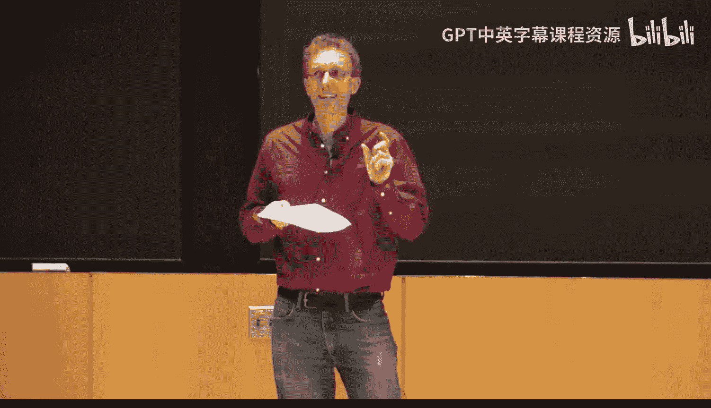

呃。P leader board。

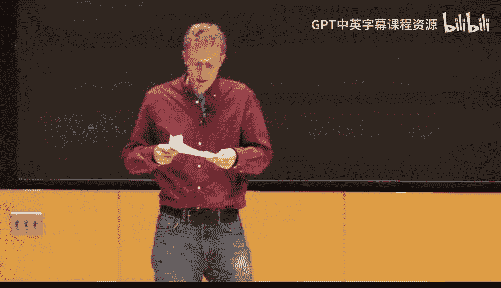

But generally， people are doing very well。 I sincerely apologize for the mistake we had on Project 7。

 That's really sorry。 We have a lot of testings， but sometimes something slips through。

 So for those who didn't catch didn't see it a piazza。

 there was a small mistake in the last function that we wrote。

 So basically in the Python homework only the Python version， actually。

 there was a mistake in the formula of the splitting function that did not match the lecture notes and did not match the homework。

 So it's now should be corrected， in case you still have an old version of the vulcararian thing because once if you checked it out。

 it we didn't overwride it， just ignore that equation。

 just take the equation from the homework or from the lecture notes。

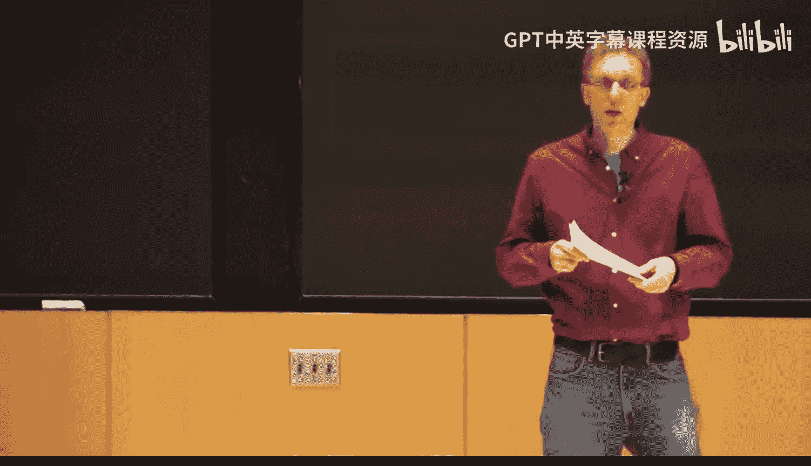

Basically， there was a normalization constant that was wrong。Okay， any questions about this？

There will also be one more project that's being rolled out tonight。That's a very simple project。

 Don't be scared。 It's the easiest project you've ever done your life。So， you know， you just。

 most of the work is just reading through it and understanding what you have to do its。

It's just it's basically on deep learning。 And basically what you have to do is you have to implement。

A neural network and train it。 So that's all there is to it。

That may have sounded complicated intimidating a few months ago。

 but now you know this is very simple。Okay， so。Last time we talked about neural networks。

And just a little recap。 The idea basically is just as before it started basically this came from。

 you know， the same person， Frank Roseveblt， who invented the perceptioncept on。 And his problem was。

 you know， he invented the linear classifier。 And that was too restrictive。 So his idea was。

 how can we make it more complicated。 or more powerful。 That's really what he wanted。

 And the idea was we map our x to5 of x。😊。

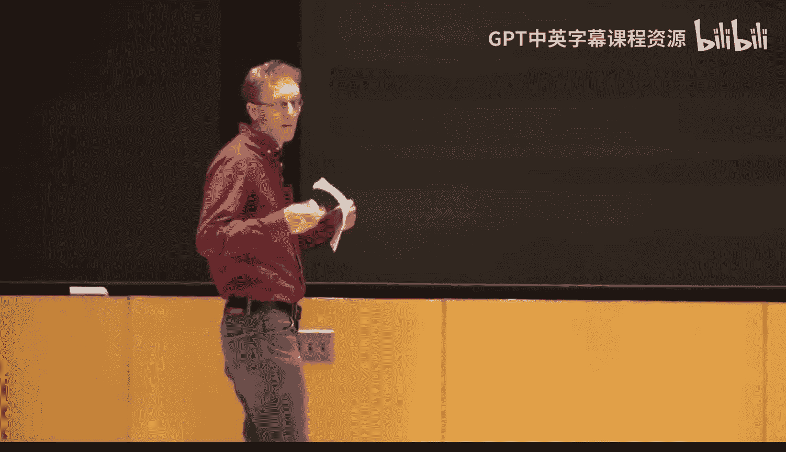

Such that our classifier becomes h of x equals phi of x。Transpose W plus and B。And。So previously。

 in when we talked about kernels， we chose this file of X implicitly by defining it in a product function。

😊，That was a good idea here in this case， we are learning Phi of x。

 So we' basically saying we are learning two things here。 We are learning the W and the B。

 That's the hyperplane。😊，And we' are learning the representation of the data。O。

 if we are mapping the data into some space， we're learning that mapping and that in that space。

 space， we also have a classifier。 That's kind of how you can view it。😊。

So that's a lot more powerful than。You know， then actually just learning a linear classifier by itself。

Ne networks have been around for a long time。 And， in fact， machine learning started out。

 in some sense。 So the modern machine learning started out with neural networks。

And they recently had this renaissance and this is a renaissance that's you know。

 everybody has gone bunnkkerers over it， like for multiple reasons。

But it's not entirely fair to say that it's exactly the same algorithms。

 There is some subtle changes。 And let me just write them down here。

 and we will go through them today。 and some of them we already mentioned last time。

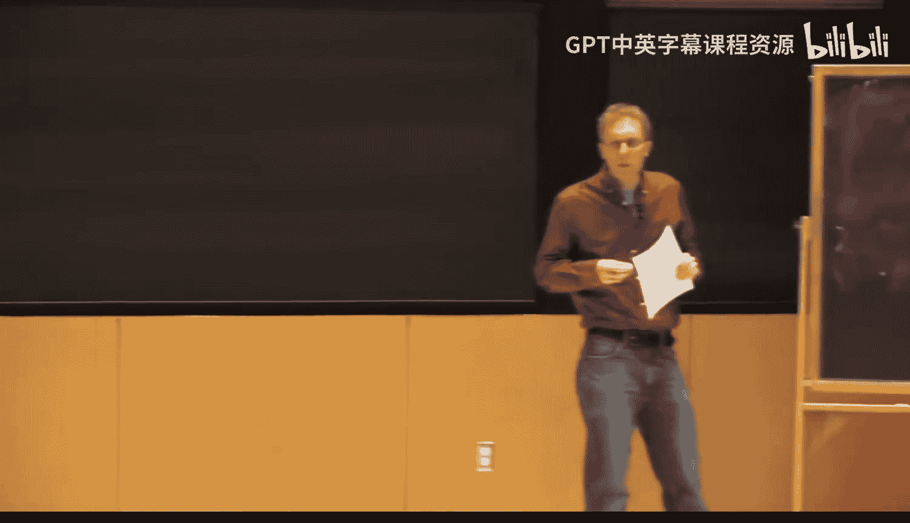

So the first change and that's one thing we mentioned last time is that people used rectified linear units。

Instead of sigoidial transition functions。 So just to remind you。

 P of x actually has the following form。 Phi of x is some function sigma of a of x plus C。😊。

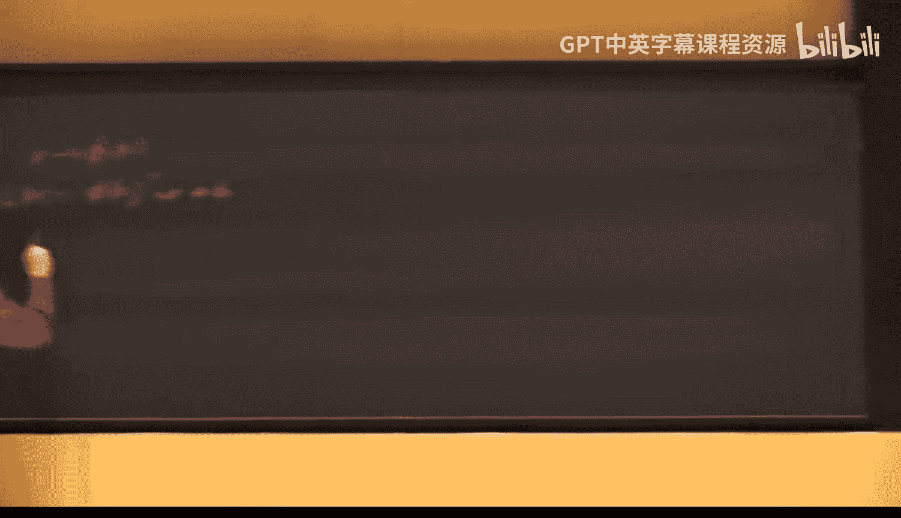

And this function here， people used to think has to be a sigmmodoidal function that basically switches on dimensions。

 Yes to know。 So what this here does is this gives me a vector。 given an x。

 this gives me a new vector， which is a transform vector。😊。

And then the zigoidal function would just set things to  one or to 0。

So if it's above a certain threshold， he said it to one， if it's below a certain threshold。

 says it to 0， that was what people used to think is the way you have to use neural networks。

 And there may be a part because neural networks is the same word as neural networks in your brain。

 And people， is what's really brain inspired。😊。

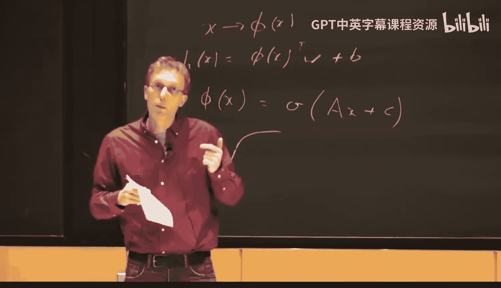

And the brain does something like this。 So neuron space， we have， you know， you know， inputs。

 And if these are above a certain threshold， then there's a high probability of them actually firing themselves。

 So this is kind of how you get cascades in your brain。Ultimately。

 this is a really bad way of doing it for neural networks for artificial neural networks。

 And the reason is because we use gradient descent。 Our brain doesn't use gradient descent。

 If we train them with gradient descent， the promise that this function here is completely flat here and completely flat here。

 It has no gradient。😊。

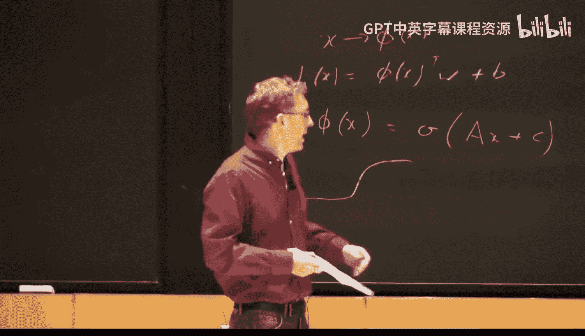

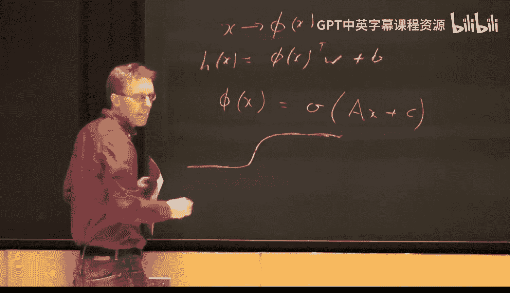

So my people nowadays uses the rectified linear unit， where sigma of Z equals max。😊，Z0。哎And。

By the way， the rectified linear unit was invented actually 20 years ago。

 It's just people didn't catch on。 People didn't realize。

 and there's a good reason why back then it wasn't with it。 But nowadays， everybody， you know。

 rethinking the transition functions has made a big difference。

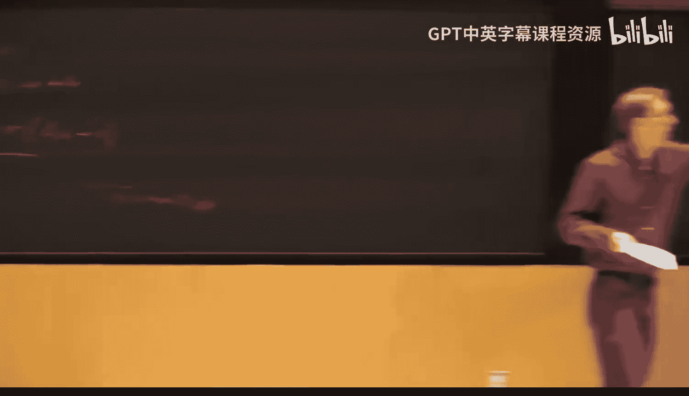

The second thing that made a huge difference， and that actually is really what it's all about is GPUs。

😊，So one thing I will mention today is that， you know。

 maybe in next lecture that neural networks is actually quite expensive to train。

And theyre very slow。 So that was one reason people abandoned them。 and kernel machines came around。

 SVMs were much， much faster， and they were better because he couldn't train neural networks all that much。

😊，But neural network training has a very specific form。

 And what it does it involves almost only matrix multiplications。

 So it's matrix matrix multiplication。 That's all that is。

 So you spend all your time doing matrix matrix modifications。😊，And that used to be really slow。

 so that was basically， you know， people thought， well。

 you have to do all these matrix meetings applications a really slow algorithm instead of just using an SVM。

😊，With GPus。 And we really have to thank you guys， right， because you guys are the generation。

 and you were kids， right， You did not go outside and play。 Instead， you play computer games。

 Thank you。😊，系い。I have any， you know。I can't thank you enough for this because that drove the development of really high performance GPs。

😊，Which then could be used for scientific computing。 And theyre really invented for 3D operations。

 But that's all just matrix multis。 So what GPUs really do really， really well is matrix operations。

😊，AndSo matrix operations is really kind of， it's actually most。

 it's actually very easy to write G code that runs in the GPU。 It's very hard to write code that。😊。

It runs on the GP and is faster than code that runs on the CPU。AndBut matrix modifications。

 in some sense， this golden thing which actually works really。

 really well on GPU because it's so paraizzable And it you know。

 you have enough operations per memory access， etcter。 So because GPs came around。

 suddenly you could train really big neural networks， which before it completely out of the question。

 And turns out then actually， if you train them enough， they actually became really good。😊。

The last thing， and this is a really important one is SGD。

 which stands for stochastic gradient descent。 And this is what we will do today。

 is a variant of brain descent that what considered a really stupid algorithm。😊。

And so machine learning has this history of laughing at things。 And then later on'm going like， oh。

 by the way， that's， that's awesome。😊，So maybe one day genetic programming is going of rule everything。

😊，So SGD really actually made a huge difference。 And that was something that wasn't taken seriously because SGD is actually。

 from an optimization point of view， a terrible algorithm。 you can prove it's a terrible algorithm。😊。

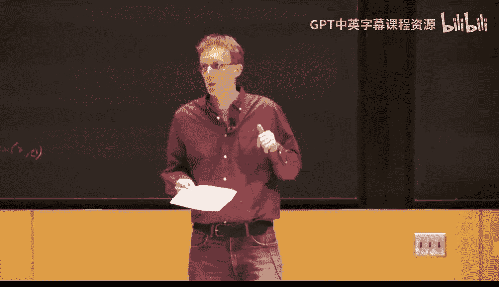

But actually， has some properties that people did not think of and。That those three things together。

 And oh， the last one， you know， rebranding， rebranding。 So， you know。

 so that that was that was the final thing。 right， So in some sense， people figured these things out。

 but they had to rename it to kind of to make people realize this now actually， is this different。

 It now works。 Yeah， so what's the benefit of deep learning overcurs。😊，Good question。

 The question is， what's the benefit of deep learning of deep learning over kernels。

 And theres one very nice thing about deep learning is that it scales linearly with more data。

 So if you get more and more data， let's say you get million give 10000 points to million data points。

😊，It just， you know， it's just 10 times slower， right， whereas kernels actually。

 because you have the kernel matrix， it's actually quadratic。😊，In the number of data points。

And so the actually， the interesting thing is the improvement that you get。 if you draw。

 draw a figure that has number of data training data right， and the accuracy that you get。

 this is a diminishing at the beginning， like every single data point makes a huge difference。

 And then it kind of you know， there's a curve that slowly kind of asymptotes， right？ So，😊。

In order to get kernel machines to work on more data， you have to do approximations。😡。

you can't actually compute the kernel matrix exactly anymore。 Tpically。

 you have to do approximations。 That costs you accuracy。The problem is， at some point。

 your data sets is so big that this improvement here is very little。And basically。

 the improvement that you get by more data is roughly the same about roughly the same word of magnitude as as much as you have to pay for scaling the algorithm up。

 Does that make sense。 So in some sense， you go from here to here， right。

 you get an improvement theoretically， But because you approximate， you actually go down again。

 So kernel machines do not improve anymore。 that's what people realize if you added more data。

 You know， you didn't get the benefit anymore。 whereas neural networks。

 you could actually throw more data at them and do better and better。

 And so people then like companies like Google and Facebook。

 they generate these data sets with you know，15 million data points。😊，That they label。

 they paid people to label them。 And the， the， you know。

 the benefits that you got basically only became apparent with deep learning。

 Other algorithms could not capitalize on that。There' other approaches。 There's other things， too。

 and I will get into this more envision。 So there's a last thing。 deep learning， actually， like you。

 you've may have heard a lot about it lately。😊，It works really well in two domains， right。

 There's really two domains where it's the killer。 It's not the answer to everything。

 This is like people， there's a misconception。 It's not the modern way of doing machine learning。

's silly。 It's， it's really works really well on object recognition and images。😊。

And that was something that beforehand was very hard because beforehand， he had a long pipeline。

 He had to images。 He had to extract features。 He had to put them into an SVM into on make social kernel。

 The nice thing about neural networks is they just take input as images input and the prediction as output。

 And they are much， much， much better。 And there was a。😊，Actually， I'm still going to get to this。

 you But there's a famous competition every year on who has the best result in object recognition。

 Thiss called the Inet competition surrounded by Fee Fei Li and。😊。

This was a competition that's been going on for many years。 And it's exactly like， you know。

 the Kale leader board of this in class competition， basically。😊。

And what happens with every year kind they got a little bit better。

 right So there are new improvements and so on。 And so the way it looked basically is in 2011。

 right like the best performance was this， right， heres my error right， And then you know。

 the other submissions were here。 And then the next year， this is 209 and in 2010。

 people got a little better the other ones， you know， here the other submissions and then 2011。

 you know， we got here， right， And so the things were more and more sophisticated。

 And then 2012 came around。 And you know， the best thing was here， you know， and so on。

 it looked just like the same。 And then suddenly you know。

 Jeff Hton's them theirs and it was down here。😊，RightSo with the ones of mentioned。

 they actually half more than half the error And beforehand basically looked like， you know。

 they would not reach this in like several decades if you would， you know， continue this graph。

 right， And suddenly within within one year， they made as much progress as was to be expected in several decades。

 And that was basically by switching to deep learning that were trained on GPs and used these tricks。

😊，And so then the next year， actually， the result was here。 and then you know， here。

 And now actually， they are better than human performance。 right So at least on this this task。

 computers outperform humans。 And so that was really， you know， in fact， actually。

 CBPR as a computer vision conference at that conference。

 Jeff Finton explained his algorithm and more people came to that talk then came to the conference。

 actually， like， you know， they had to get extra chairs and so on。 like you know。

 everybody just want to see him explain how how the hell did that happen。

 right and that was what really everyone was interested。 And the next year， basically， know。

 now nobody does anything but deep learning in these conferences。😊，系。

And so these the second thing one is images。 And I didn't say what the second thing is。

 Does anyone know what the second application is for deep learning is really， really amazing。😊。

Speech， that's right。 right。 So on that enabled theory。

 So if you have an iPhone or Android phone or something you can talk to these things now。

 And that suddenly that that was this， you have a similar drop， right， So basically。

 people like these had been working on speech recognition for decades。 And suddenly。

 the learning came along。 And and then you know， within a few years， every year。

 they have the error rate until it was good enough that you could actually use it。

 And that started already in 2006。 So that was right when the iPhone came out。😊，Okay。So。

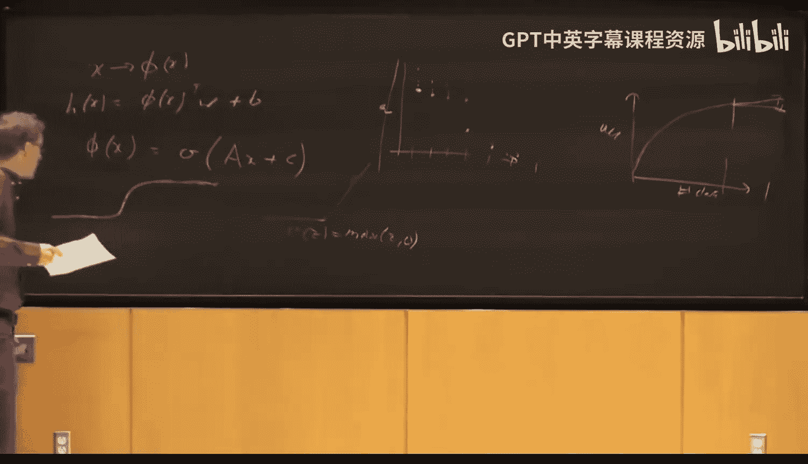

Let me， I actually want to show you a demo still today。

 I promised you a demo because of the screw up on Project 7。😊。

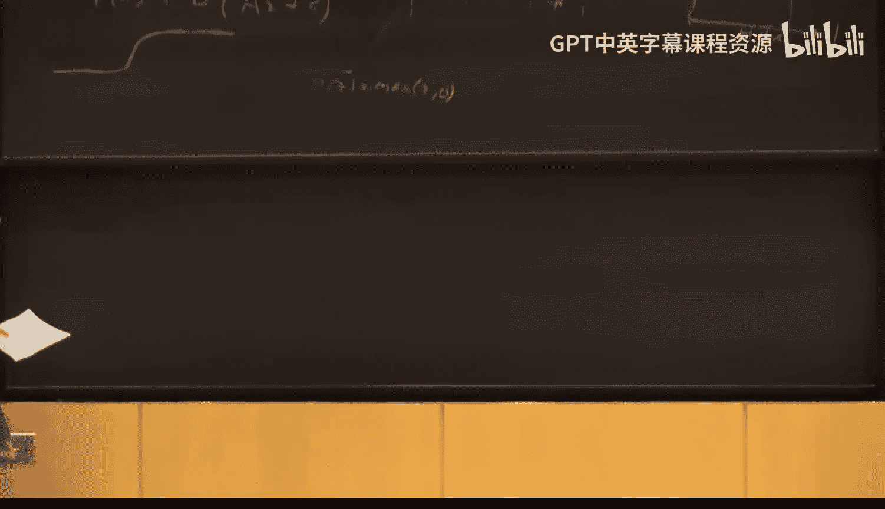

Allright， so here's the idea。We basically want to learn a classifier H of x equals w transpose phi of x。

Where file of X is。Is sigma of A X plus。C， and this here is B。You can see here's the vector。So。

Actually I think I called it you here。All right。It's called this U X。The first thing is people ask。

 how do you learn this， right， and you learn it just the normal way that you have a loss function。

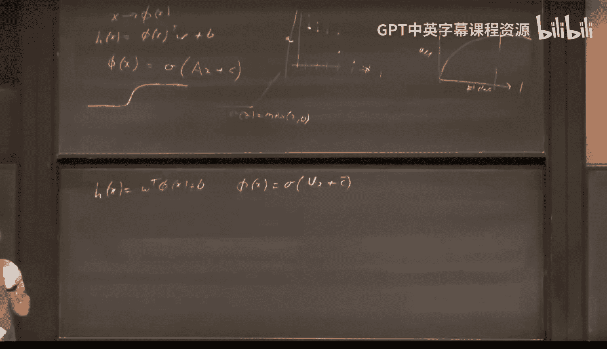

L equals sum of all your data points1 to n。 And then you have some loss of， you know。

 H of X I and Y I， right， This can be the square loss or something， right。

 You have some loss because some convex loss function that tells you how well you're doing right？

 And then how do you learn this thing while you take gradient descent respect to W and respect to U in respect to C。

 right， So there's really nothing different。 Like， You know all the components we've done this now for for several months。

😊，Let me give you a slight， you know。诶。Kind of an inside view of what these。Neo networks are doing。

 right。 So， so one thing I'm not a big fan of is people say， like， all these black boxes， right。

 They just do whatever。 Nobody understands what I think they're thinking of the human brain。

 They're not thinking of these functions， right。Now， it's true that at the end。

 often we don't know what this function looks like that we that be are training。

 But if I train a function to you know， recognize pelicans from dogs or something， well。

 you also wouldn't know what that function looks like， right， I mean。

 what functions separates pelicans from dogs。 So the fact that you can approximate it， of course。

 you wouldn't know what kind of exact function that is。

So let me give you a slightly different perspective on what exactly is going on inside a neural network。

 so。Let's say I want to do a regression problem。So my last function in this case， I just， you know。

 I just fixed this is one to the n H of X I minus y I squared。 Okay。

 and my H of X I is basically the following is， is basically this function here。

 So H of X I is I take my。😊，Let me just write it as one thing。Is W transpose sigma of。UX。嗱师。Plus B。

And so these are my parameters。Okay， and my sigma in this case is a max of 0。Okay， so let me。

 you write a down， Max。This is 0。 This is the rectified linear unit。So what does a max with 0 do。

 A max with 0， this operates element wise。 So if it's positive， it just keeps it。

 doesn't do anything。And if it's negative， it's up to 0。Okay。😊，Got any questions at this point？Yeah。

 so this doesn't like this doesn't change the result what you choose for Sigma。

 Is there any intuition on why it doesn't really matter what you choose for Sigma like。

Regardless of that， yeah， is because。I guess ultimately， they're all universal appmators。

 So you can approximate any function。 It's mostly the transition function is mostly a matter of convenience。

 what's， what's best to optimize， actually。😊，So let's say my the function I'm trying to learn。

 Let's say just have one one dimensional input，1 dimensional output。

 So I'm trying to learn this function here。Okay。All right， this is the function。

 This is a regression problem。And this is my X。 This is my Y， okay。

Raise your hand if you're still with me。Allright， good and。Now。

 here is what what the neural network really is doing， right？ So think of this matrix U。

As the following， think of a matrix U as basically， this is my matrix。

 And I have many little vectors， right？ So these column vectors， U1。You， I don't know。 you age。

 right， So I have each of these。Allright， and my vector C is just C1。C， H。Okay。All right。

So then what is this， right， This is basically， you can write this as this is just a sum。Of。嗯。

You know， of the different dimensions here， W D times。Max。好。UD transpose damage。

 It talk respond point。UD， UD transpose X plus C， D。Coma 0 plus B。Okay， does that Doest make sense。

 That's the same thing。All I'm doing is I'm just writing out the sum here。

I I somewhere away every single dimension。 and here has somewhere away every single dimension。

Any questions？Raise the hand of you with me。Okay， this is just what I did is I just decompressed the matrix vector modification。

Right， this basically you multiply。U times x， right。Here。What is u times X， U times X is。Damn it。

 this chalk is horrible。Yeah， iss this。 U1 transpose X。U H transpl x。There's a vector transpo。

Transpose X。Okay， that's just。Please raise your hand。 that， Does that make sense。Okay， thank you。

Okay。

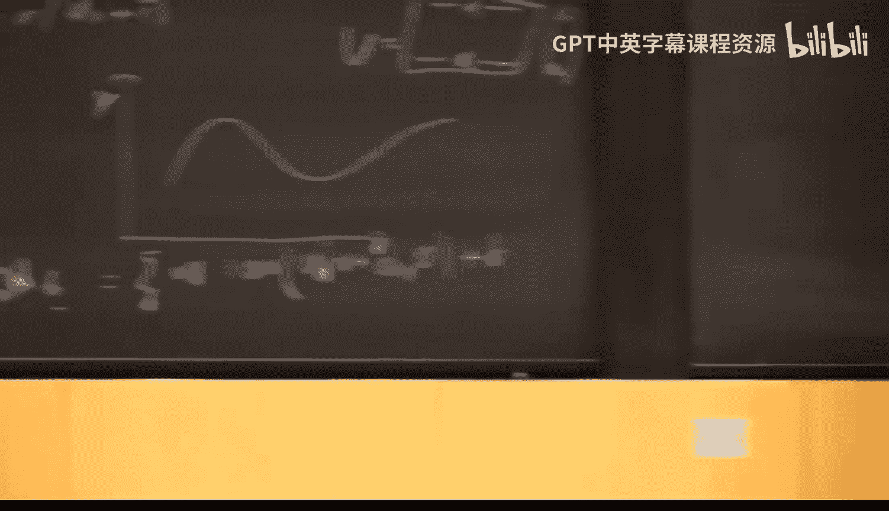

Allright， so then so， but what is this， U just was x plus plus C。That's a hyperplane， right？

 So Hyplane in the two dimension space the line。Okay。😊，So， these are lines。And if theyre positive。

They are negative。 They just 0。 So these things here look like this， right， So you have have。

Some function。That looks like like this， And then suddenly hits 0， and just disappears。O。

 this could be U1， right， U1 transpose x， right， And this here is the C。 Okay。

 so when there is a 0 plus C1。 Okay， this is a C1。😊，Does that make sense。

 This is a line linear function。 And when x is 0， this is exactly C 1， okay。😊，With me， any questions？

Okay， another one could be this， right could be look like this， right， Does U2 transpose x plus C。

 I don't know if people here can see this。I don't know。 And that's basically here， you know。

 my C2 was actually down here， right。So at 0， I'm at C 2。 And then I have this liner goes up。Okay。

 all right。So what am I doing， I have many of these functions。😡，And I add them up。

And I give each one of them a weight。Okay， and at the end， I shift the whole thing up or down。O。

 B is just saying， I'm taking this whole thing。 So what if I add up these two functions。

 What do I get。Right， well， here in this region， this function second function is 0。

 So I just get the first reason function， right。But then here， the second function becomes nonze。

 So what's happening。It moves up， So the sum of these two functions looked like this。Okay。

This here is the first function plus the second function， okay。If I now had a third function。

 let's say I have the third function here that starts here and goes this way。 There's my U3。

 then I would basically at this point here。What do I have to draw， any ideas？

So you can't see anything。 You have no idea what I'm doing，Okay， so this here is my son。 right。

 This is U1 plus 2。 Now I enter a third function comes in here。 What do I have to do。

 How does this function now continue。So yeah， higher slope It gives even even higher， right。

And can see by changing this function， I could also， I could also have a function like this。

 I could actually， you know， have a constant function here that I suddenly switch off。

 I could also make it go down again。 Okay， Does that make sense。

 So you can you can do anything you want。😊，And so essentially。

 what you're doing is you take this function that you're trying to approximate。And you basically say。

 okay， well， this is pretty straighty。 So I just take my first function， right。U to this point。

 where it gets pretty bad。So heres what I'm doing is I switch on the second function， right。

And here have to switch on the third function， Four function， fifth function， sixth function。

7 function。O。And that's all that's going on in the Ne network。So basically。

 what it does is the proxyates functions by piecewise linear components。

So it's actually quite simple。And so internally， if you look at these views。

 this is basically the first function here is this one， right。

Press some B that shifts the whole thing up。And here comes the second one。

 So here you actually have another one that actually goes up， right， You add these two up。

 and then you get this slope here。 it's only actually this actually negative， right。

 So you actually have to。😊，What do you have to do， You have to。Oh， sorry。

 youint actually do this one， and you can have a negative weight here。

But if you have a negative weight， then you just subtract it。Does that make sense。

 So then you actually go down， He can have another one that you're subtracting and so on。Okay。

 any questions， yeah。Sorry， each line is a unit。 each line corresponds to a row in my U matrix。Okay。

And your row matrix， U matrix basically isn't you know，t U is an element of R H by D。

 But D is the input dimension of your data。And H is the number of you something that you choose。

So you have a pre parameter。 How many of these linear components you allow to have， right。

 if you just have one， What you' going get is this， right， It's just a line。And if you have two。

 you're going to get something like this。something。 I don't know。And as you switch on more and more。

 you get a more and more complex fitting off the function。

And very undoubtedlytedly that they decide if the line is divergent。Oh， you don't decide this， right。

 The Union network decide it， but， it minimizes a square loss， right？

 So if you actually imagine you would switch on something else here， well。

 you would actually have quite a loss here， right， because you square the difference between what your prediction is and what the true value is right？

 So the square loss penalizes you for being too far off。 So what it's going to do。

 it's going to shift， you know， that function over the second one， right， to produce that gap。😊。

Any questions？How do Switzerland enough。So you have these little functions here， right。

 And the moment they are negative。They are 0。 and you can shift them around anytime you want。

 right You can， you can change their slope by changing U and you can shift them around this way by changing the C value。

 And if I would lower the C value， the whole function would go down。😊。

And it would be switched on here。It's switched on the moment it becomes positive。

And then I can always add it or subtract it， okay。一二。

The second constant it to chip the whole thing around。全。The you。Yeah。

 it could have a constant function， right， that you were just always。 And actually， that's that true。

You don't really need it。第二。So the question was， why do we need that second B， Well， in some sense。

 you could just model this by one more function that's always positive and always constant。

 And you're exactly right。So the neural networks don't really need this。 And actually， the project。

 actually， I took out the constant。So that's why the project is so easy。All right。Actually。

 you're laughing， but people really that the thing one thing they found out was the constant last time。

 Okay， any， any more questions。😊，嗯。And so。It turns out， actually， it's very simple proof， actually。

 that with neural networks， you can approximate any smooth function arbitrarily close。

 And how do you prove this， Well， it's quite simple。

 You just say if I make my age here arbitrarily large。😊，So I have many， many， many， many functions。

 right。Well， that can， you know， if I I'm allow you。

 if I allow you to have as as many of these linear functions as you you want， right。

 then you can make the error as small as as possible， right。

 So if I say the error should not be larger than deelta， but Delta is something very small。

 Then you can tell me， okay， I can do this。 I just need so so many million linear components， right。

 and then I can show that some of all the errors is less than Delta。Why does that make sense。So。

 that's essentially。You know。The the way you argue that these are universal approximators。

 So universal appximators you know， used to be a big deal。 Nowadays， many algorithms have this。

 you know， can be shown at this property that you can approximate any continuousious function arbitrarily closely。

 right， And so you know， neural networks that's true。 But this age will become very， very large。

 So you basically train a lot of parameters， yeah。😊，The dimension H。Is that a hypothesis。ぱ。No。

 you select this。 So there's something you put in。 Yeah， that's right。 That's right。

 And the more you have， the more powerful is your neural network。😊。

And that like determined by how many layers。Oh， I haven't said anything about layers yet。 Actually。

 layers。 What are you talking about， I don't know。There has no layers。No， you're right。

 So there is later on， we do layers later on five minutes， you will do layers。And so， okay， well。

 let me tell you， layers。 You just， you know， okay， good。You come layers。It out of order here。

 but that's okay。

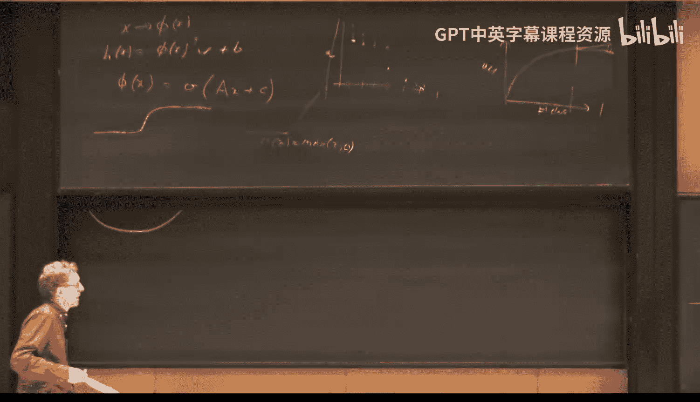

So people have heard of these layers， and basically。We have this W transpose x。sorry。H of x equals。

W transports。Phi of x， right， But P of x is， you know， you know， well， I guess you have here， right。

 P of x equals。😊，Sigma of a of x plus C。Let's call this A。 Why not。 Let's call this a。Al right。Now。

 what are layers？Well， here's the idea。 Well， people want to make this more complicated。

 So call this you。 Let's call this you。You and see。 okay， why not。

So one way to make this more come more powerful is to make this matrix U。😊，Really， really， really。

 really rectangular， right， So increase H a lot。 So have many， many linear components。

Another way to make this more powerful is an idea that comes from Russia。

 I don't know if you know these little ladies， if you open them， there's another lady in there。

 and you open them。 There's another lady in there， right。😊，So here's what you do。 We see， well。

 actually， that's not x。 That's phi prime of x。And phi prime of x。

Is sigma of U prime of x plus C prime。Right right， so now you basically have one more lady inside the lady I don't know。

 I't know I know what they called。 But Mushka， I' that what they called。还な我这か。Right， and now。

 so now you actually have two layers。 You basically saying， I first have a transformation。

 and then I have another transformation。😊，And if you want to， you can say， well， actually。

 there's one more。😊，There's Phi double prime of x。And you can do as many of these， you know。

 as as you want， right Like you can spend your whole life making layers， right。And。So。

 that's actually。One thing that that's new these days is that people have many layers。

 That's where the word deep comes from， deep learning。嗯。

And there's a very good reason why people did not do this in the past。So， beforehand。

Like when I was a student， a PhD student， Everybody just had one layer。

 Everybody knew we could have more layers。 In fact， Frank Rosenlt himself， right， in 1963。

 he already came up with the ideas as that you could have more layers if you want to， right。😊。

But nobody did it。And why did no do it？Yeah， has two reasons。 The first one is， it's very expensive。

 because you always have to modify with matrices and matrix modifications are very very expensive。

And the second one is， that's the practical reason。 There was a practical reason。

 a theoretical reason。 The practical reason is it was very expensive and it took a long time。

And the theoretical reason is that。You could prove。

But there's no function in the world that you can learn with a deep network that you can also learn with a shallow network。

 which's just one layer。😊，So。It's a very famous theorem that says all you ever need is one layer。

All these other layers don't， don't improve your express expressivity of your function。😊。

And so that was great， right， because people say like， well， multiple layers is complicated。

 It expensive anyway。 And I can prove to you that you don't need it。But there's no reason to do it。

So no one did it。And that was， in some sense， you know， it was， in some sense， all but forgotten。

 right like no one， no one worked on multiple layers。 It was considered a silly thing to do， right。

 You could prove theoretically that it， there's no benefit from it。And it's really slow。

 So why would you do it。And it was actually， it really came down to Jeff Hinton and the University of Toronto。

 who basically。Who realized that actually there is a benefit， like， you know。

 that actually in practice， it makes quite a difference。And he。

 he bought a whole bunch of GPUs at the time。 They were very expensive。

 So what he did is he raised his own money。 He started a company。

And it bought tons of Tus and trained these networks。

 And that was actually how you won that imagenet competition。 And then actually。

 that company was bought by Google。😊，So。But， but it took him， in some sense， you know。

 to show the whole world that actually。You know， everybody was wrong in that sense and， and。

The funny thing is， the theory is not wrong。 actually， The theory is right。

 You can go through the proof。 It's correct。AndIt just says essentially。

 that the number of the size of this matrix。 and this is something that people didn't really look into is how big would that matrix have to be。

 And so here come， let me show you a good analogy。😊，And then I will show you a demo。

 I promised you a demo。 Okay， here's。So here's the analogy。When I。

 what I just showed you is the way neural networks work is they basically have these。

These piecewise linear functions。So。Now， I'll pay attention。 You have to see this。

 This like this is my， my prop。 Yeah， I have this prop。 There's actually， this not just my notes。

 This is prop。So what I're going to do。And we just like this。 So a piece of West linear。

 don't do this on your nose。

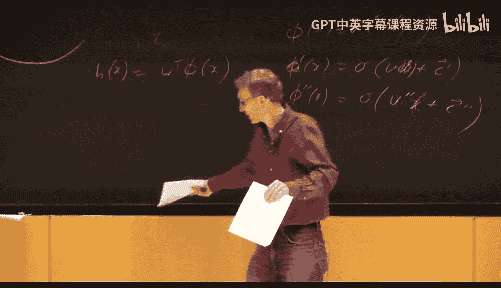

So the piecewise linear functions is essentially what they are。 There's these little hyperplans。

 right， So think of this that I'm folding this paper， right。

 So I have my first piecewise linear function。 So now I have a fold here。

 And now I want the function to go down。 So I have a slightly different fold here， right。

 that goes in a different direction。😊，Alright， great。 So now if you look at this。

 I don't know if you can see this。 a function that goes up and then goes down。 Okay。

 these are my two piecewise linear function that I use to approximate a non nonlinear function。😊，Now。

 here comes the cool thing。 If you have layers。You can do the following。

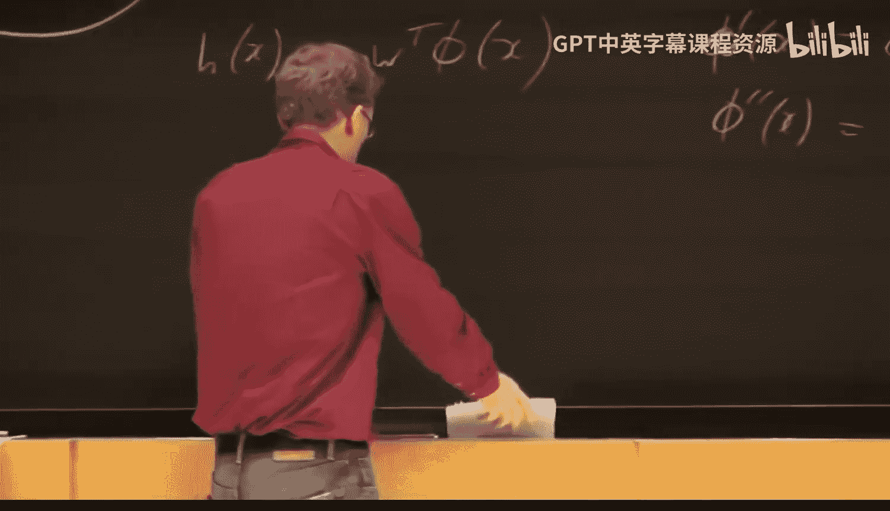

Let me fold this。 thiss my first layer。 Here comes my second layer。 right， So now I have two layers。

 the three layers。 Come on。 right， And now in this there， I define a piecewise linear function。

 So I do this fault here。😊，You know what's happening。

 You've seen it And now now I do another one here。😊，嗯。And now comes a beautiful thing。

 If I now unfold this thing。哎。Well， it looks horrible。What happens is you fold all over the paper。

 I just fold it twice。 and actually， I reuse the same folds over and over the entire space。

 And that is the power of multiple of multiple layers。 And actually the first layer， what it does。

 It does exactly the same thing。 It learns these piecewise linear functions。

 But what does the second layer do。 The second layer takes this entire thing and reuses it The second layer doesn't take piecewise linear like doesn't take simple straight lines anymore。

 The second layer takes this entire construct and basically uses that as a building block。

 And the third layer takes the construct of construct of piecewise linear functions。

 and builds those。 Does that make sense。 So you actually get， you know。

 get a exponential explosion in your capacity by having more layers。

 And that is the powerful thing because the theorem that says that neural networks is a powerful said that this matrix with one layer has to be exponentially deep。

 it has to be exponentially wide。😊，But you get that exponential effect also by actually having multiple layers。

 just having a few more layers， you basically multiply you know， the number of possible， you know。

 lines or hyperplanes that you are putting together， right， exponentially with the depth。😊。

And that is what's so powerful， because before it， you would have this massive matrix right that you couldn't afford to ever use。

 Where now you actually just have a few small matrices， and they have the same expressive power。😊。

Does that make sense， Raise your hand， Does that make sense。Awesome， any questions？Yeah。

 so what's the trade then between choosing a wide， like between how and？

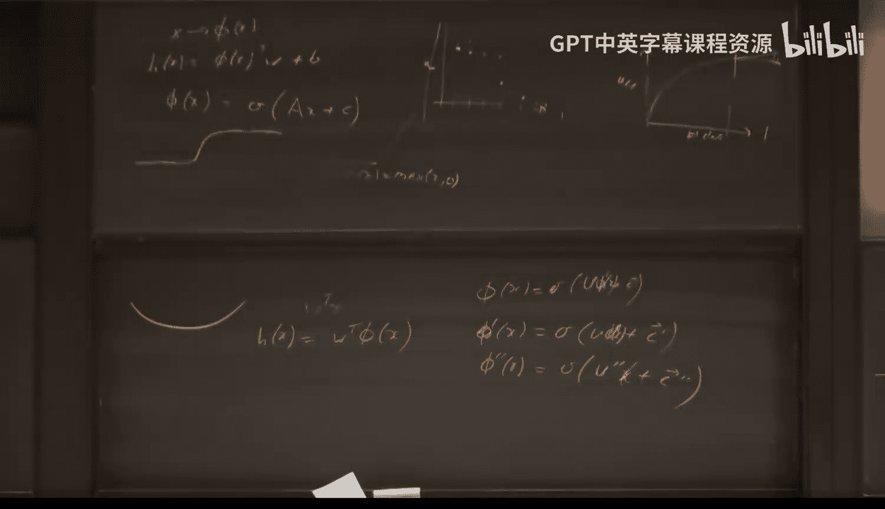

Many， like a white un expression having a cheap like a。

So what's the trade up between having a wide network and a deep network？ And that is a question。

That people argue about a lot。And the answer is， your network should not be too wide and not be too deep。

对对对。You're welcome。I was consulting that would have cost you  a thousand0 bucks。Okay。

That is kind of where we are right now。 We are trying to， in some sense。

 it took the whole community by storm because now we actually， we used to be so safe。

 We had this like this theoretical understanding。 Now we're going like， oh， actually。

 we have to rethink our theory， right， So we actually have to。

 and we're still working on this theory。 Like this theory is not mature yet at this point。😊。

From what you are saying， like I hearing it would make sense just to have two layers that。

Because you'll have like every layer increased exponentially Yeah but the first one only has one function thats also hard。

 right， then then you basically you're right， right。

 And so currently the trend is deeper and deeper deeper。 that's the trend。

 right So people have trained networks。 In fact， actually， I myself am guilty。

 So I just had a paper last year that train networks 1300 layers deep， right， So a few years ago。

 if I checked this， people would have thrown stones at me， right， you know。

 So now you can do it like it used to be， by the way， just to make this clear。 like7 years ago。

 if you had three layers， that was considered ridiculous right It's like five layers。

 nobody even would have you know， like why you wasting energy global warming。 you know。

 now people trained 000 layer networks， right So it's really， really change completely。

 good question。 So why do these not overfit， right？ let me go to the demo。😊，I don't know。

It it's the biggest question right now is why do these neural networks not overfi so drastically。

 We have pretty good understanding， but it's well beyond this course。Actually， it comes down。 Well。

 okay。蓝民加油。It comes down to stochastic gradient descent， which actually I didn't have time to today。

 I will get to the next lecture。 I promise stochastic gradient descent is actually a variant of of gradient descent that's so bad that it doesn't optimize the function properly。

😊，And because of that， you're not overfitting。Yeah。And that that is the trip。Okay。

And so now that was actually crucial。People originally just S GD because it was faster。

 And then it turned out， actually， you know， they just did this to， to， you know， it was faster。

 kind of they knew it wasn't very good。 but actually turned out suddenly the networks didn't fit anymore。

 I I will， but I now we starting to understand this theory pretty well。 And I will。

 I will hopefully get into it more next lecture。😊，A small demo， so。Where are we。Okay， one。

So here's the first thing I can now take a network。And I know。 let me just define a few。

 those are a regression network。 So I just define a function kind of like the 1 I just showed you。

 These here are my training points。There's my X X and my Y X。 and I going fit a network through it。

And what you see is basically here， you know， this is actually the two layers here。

 So as it goes through it， basically， you know， it makes these pieces linear functions actually。

 I have 40 components here。 and then actually another 40 in the second layer。 So this is very， very。

 you know， you can see it basically fits this absolutely perfectly。😊。

I can also do this one more time with fewer components。Actually， I think I can actually。

 I think I prepared this One second。 is the plus demo。I this correct， Yeah， so oh。

So this is not rectified lines。嗯。What is this， sorry。嗯。Let me just do this。诶 ok。Al， just a demo 1 D。

And I just number of layers that just make this one。 And that's how many。

 How many hidden node do you want。Four。Okay， let's do 1，4。 No one's at 4。 Let's do it。

So let me do the the same kind of function。 But now I only have four piece device components。

If you look at it。Well， that looks horrible but。This is actually the rectified linear unit。

 So actually it depends。I haven't got this yet。 So actually depend how you optimize it because you have a lot of zero gradients。

 Actually， sometimes it gets stuck。 So this actually gets stuck。

 This doesn't happen if you have more， more units。 Let me do 8。

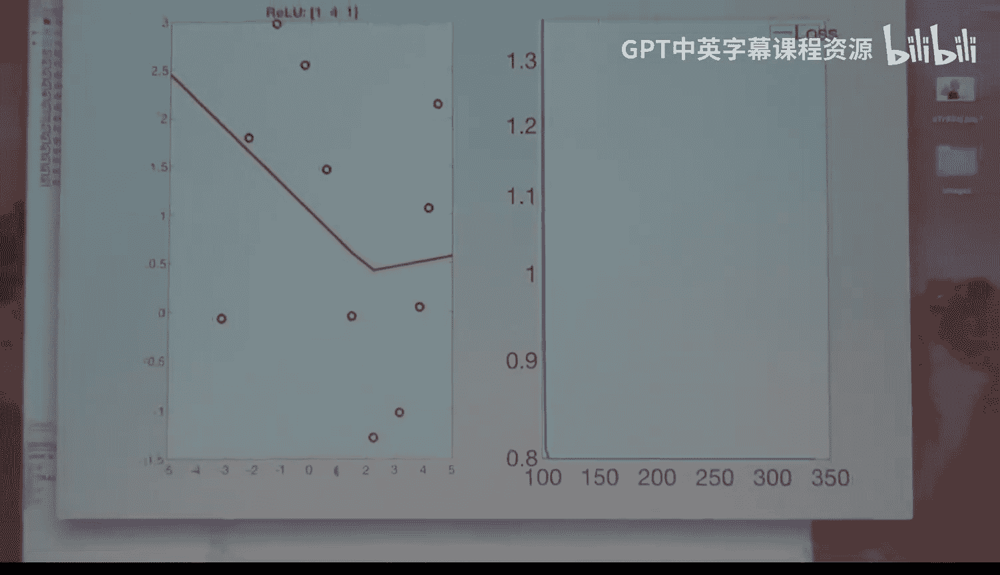

嗯。Here you go。Okay。All right。Okay， so here's the first 1 I have。 is it sorry， What does it do。Oh。

Sorry， I just， I just edit the demo， which was a huge mistakeistic。 Oh here we go。

 Trans is soft plus， sorry。So never change my demos， okay。Why is it to sick my。啊。Sorry， guys。 Trus。

 Here we go。嗯，呀有一个。Okay， good。 Ni your work。 Okay， good。

 So this is just having two different components， right。

 Two different components actually be careful。 if you count carefully。😊，If you have very good eyes。

 you can see this is 1，2，3。Why is it3？ only have two hidden layers。I yeah， I have two， two functions。

Yeah， one of them became 0 and then started。 That's exactly right。 right， So one of them becomes 0。

 and then the other one starts。 So actually， what you get is actually。

 you actually get sweet two turning points。😊，Right， so here's the first turning point。

 Here's the second turning point。 He basically both of them are switched off。 First one switched on。

 Second one switched on。 Okay， so you get actually two turning points。

Now we can take the same function and， and。What's going。 Okay， here。 So now we have 4， right？

 So here's where it does。 It kind of， you see it kind of approximates it better。

 Here the loss loss goes down until it's flat。 This is because the rectified linear unit something has 0 gradient。

😊，And went us for too many iterations。Oh， I read 4000。 Oh my gosh。All right， anyway。

 you get the picture。Okay， so heres。You know what， let me go the better demo。I know this is boring。

right， I have a much cooler demo。So you can actually learn really。

 really complicated stuff with this。 And so some of you have demonstrated this demo before。

 I apologize， but it's， it's good enough to show again。 So here's the idea。

 So I try to come up with something really， really complicated。 So you learn these。

 if you have these functions， you know。😊，It works really well for images， and。You know。

 the amazing thing about neural networks is you can actually learn concepts that are quite complicated。

 So I thought about what's a really complicated concept。

 And so one is whether people are good looking or not。

 because that's something I really have no idea。 So what I did is I took this data of there's a web page called hot or Not。

 You can upload an image of yourself。😊，And then people rate to you and say。

 you're good looking or you're not。And I did not upload an image of myself， but I。

I took the images there， and actually， I rated them all Are they above average。

 good looking or below average。 So I just have two labels。 So 50% men，50% women。

And the idea was each of us says vote one label， right you' either positive plus one above average good looking or -1 below average good looking。

 And I just cropped out the faces。So this arguably a really hard problem， right， So if you just face。

 you know， the questions， are they above average good looking or below average good looking。

 So here's when you run it， the training accuracy， of course，00%。It memorize the trained data。

 But the testing accuracy is 74。 right It's a balanced data set。

 So that's a lot better than a coin task。 So， you know， this is a really hard problem。😊。

So let me test it for you。 So here's， you know， let me just get a few test points that we all agree on。

 So the first one is。Heidi Kum， I don't know if you know， Heik Kum。 She's from Germany。 She's。

A supermodel。And she's arguably very， very good looking by the fact that she makes gazillions。

 you know， with her looks。 So I can now take Add Kum and put that image to that network and see how。

 you know， how good looking she is。😊，-1 is that looking。1 plus  one is good looking。

 So you cannot test this。We get 2。6， that's off the charts， right？

So the Neo network has the hots for Heidi kbs， not bad。So then I thought what about a guy。

 So I don't know what guys are good looking。 So I asked my wife。And see。She didn't skip a beat。

 and she was like， George Clooney。So here's George dutydy。And I got to be honest with you。

 It bugs me a little that I look， I look nothing like George Clinton。But。YeahYeah。

That's a different topic， you know， anyway。So we can put Josh Cloneney through the neural network and see what happens。

😊，And here he is， oh， you know。I told you。So it's not even saving。Allright， then of course， you know。

 I couldn't resist， right， So here， you know here。😊，Let's see this。

 Maybe there's a second career for me a swimsuit model。 you never know。 Alright， let's go。😊，な。

At this point， I was very curious， like how does that， that's pretty bad， actually。That's。

's pretty close to minus1。So how do I do compared to the ugliest person on the Internet？

And so I found the obviousiest person on the Internet， but it is's very easy。

I typed an ugliest person on the Internet into Google。

 And that's the first image that comes up is this。So I was like， all right， let's try。

 This is a lower bound。Let's go on。哎，在买在买。😊，All rightつ on Monday。😊。

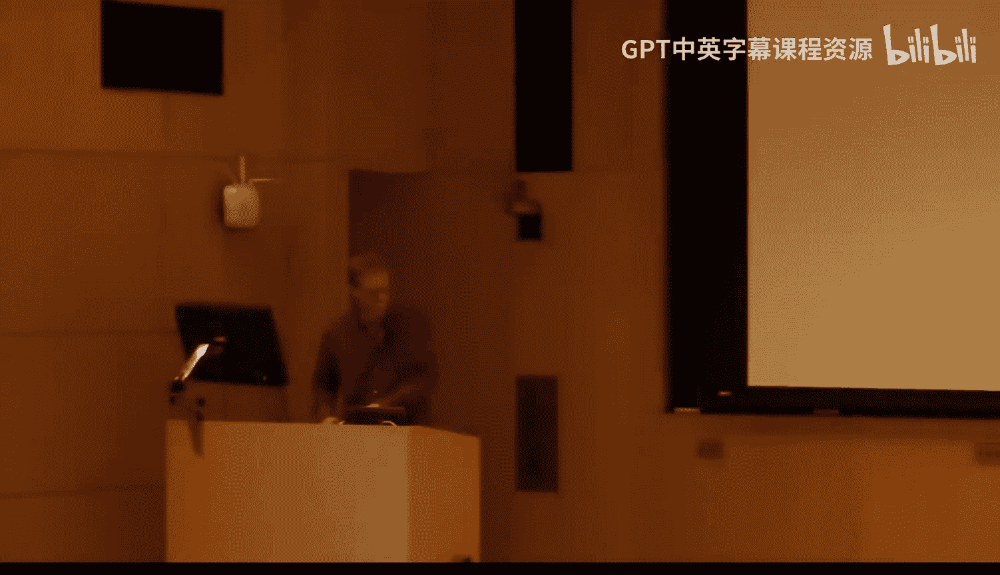