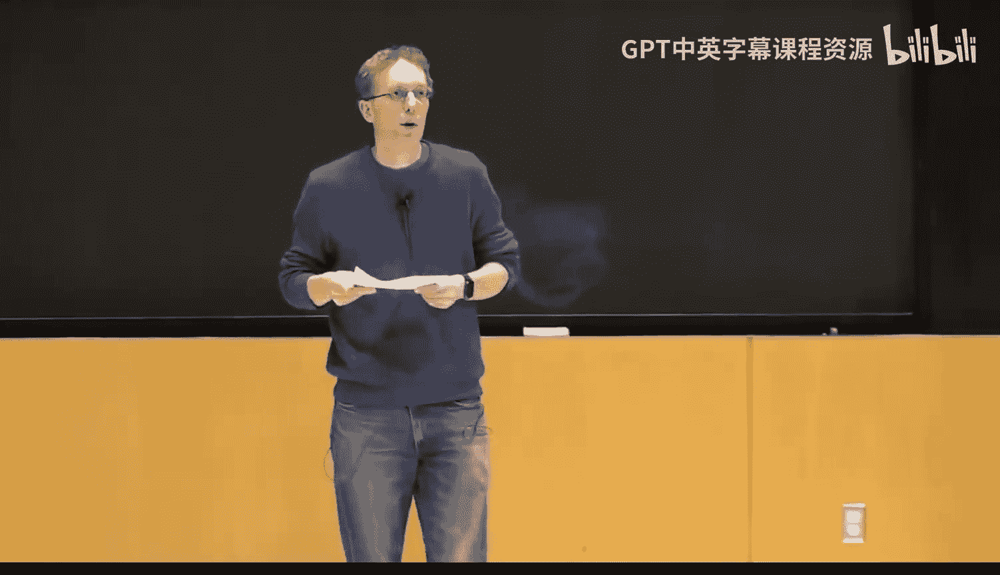
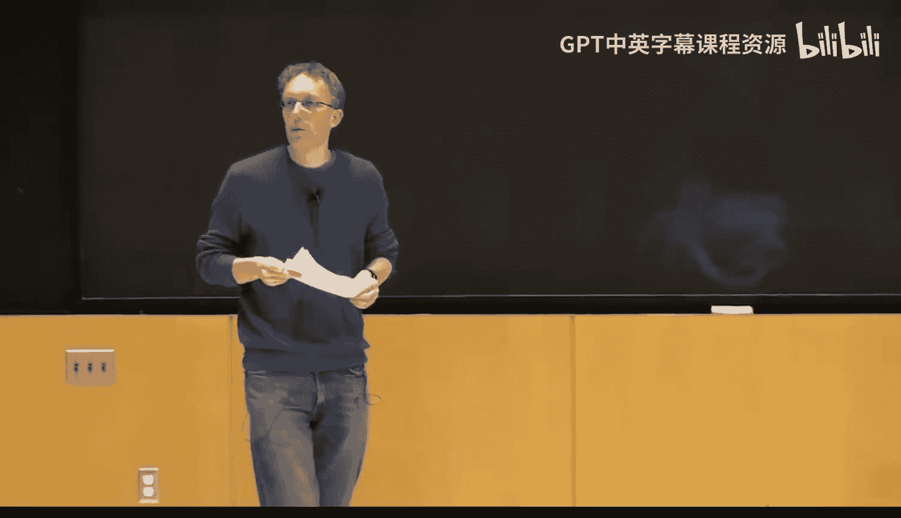
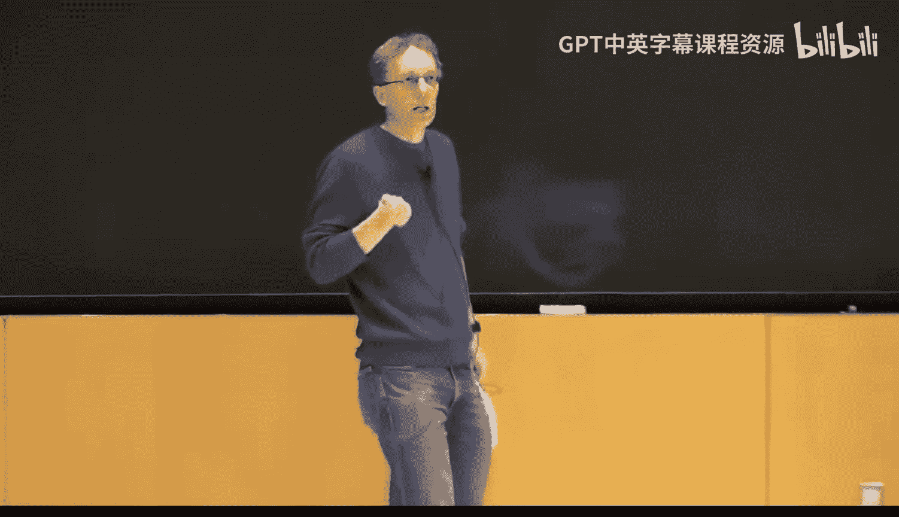
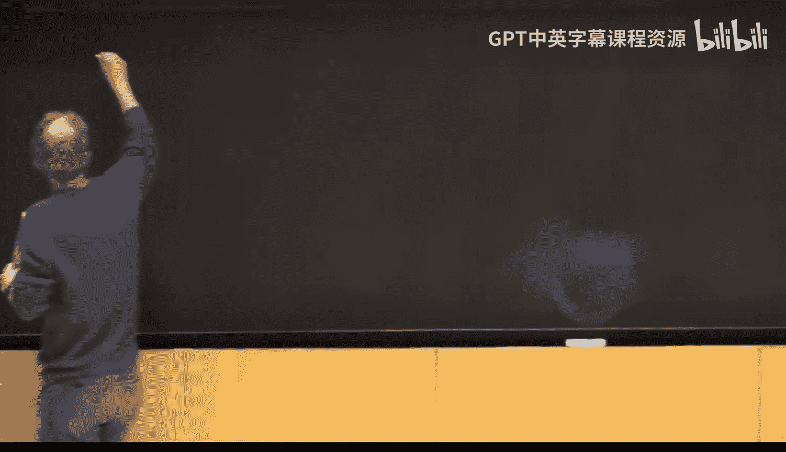
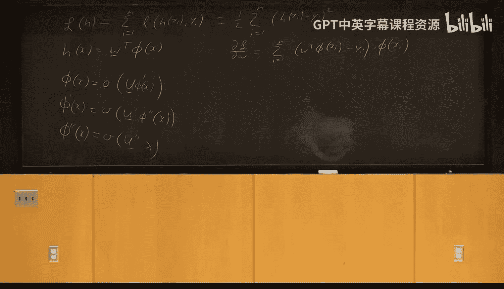
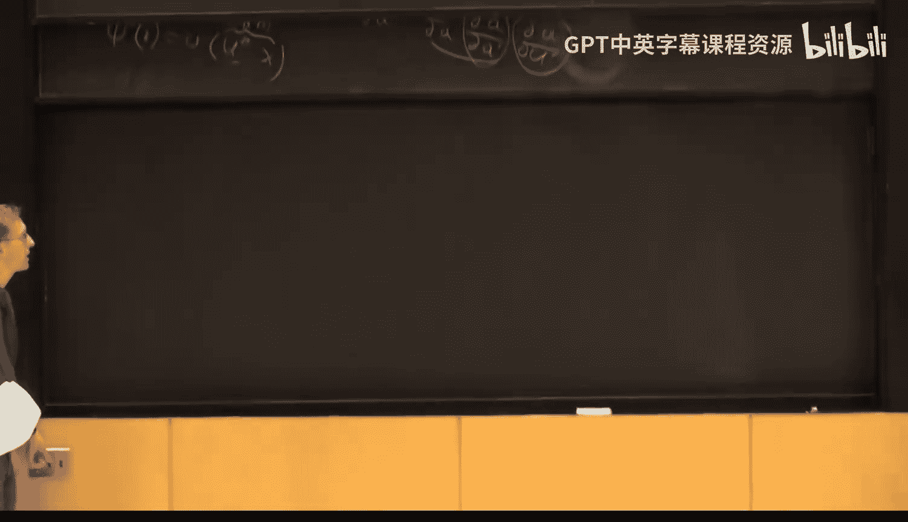
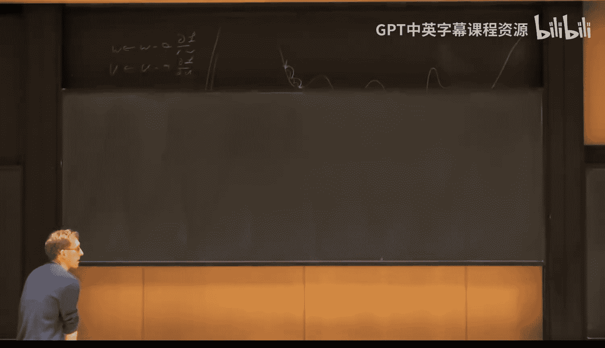
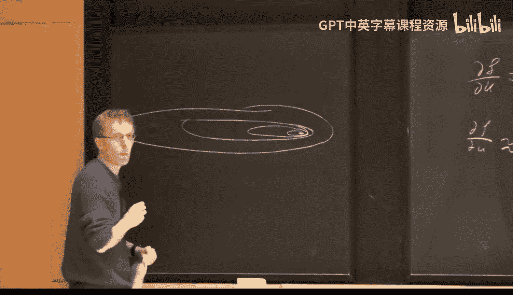
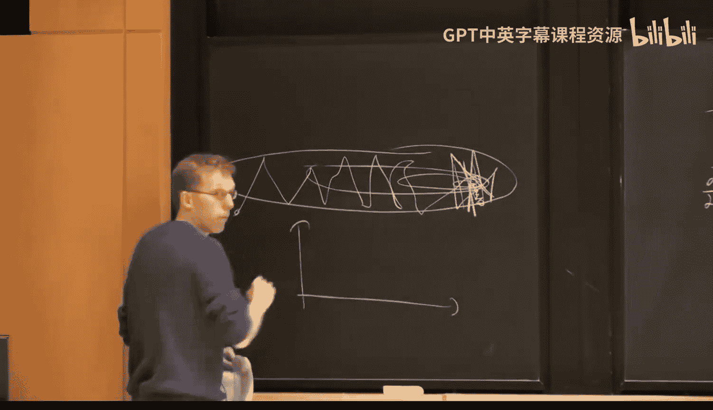
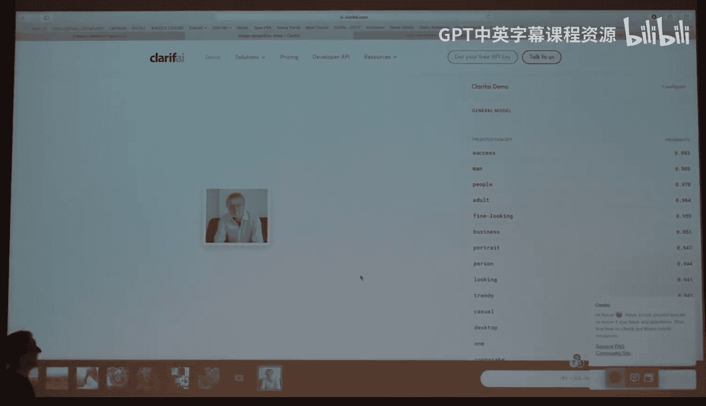

# 康奈尔大学《智能系统的机器学习｜CS4780 Machine Learning for Intelligent Systems 2017》中英字幕 p36 -36-Machine Learning Lecture 36 ＂Neural Networks _ Deep Learning Continued＂ -Cor -BV1Lo6gBxEKE_p36-

Second to last lecture。O machine learning。And please， everybody。

 remove your laptops unless you're in the very last row。😊，哎。嗯。Pelogistic things。

 So that project 8 is out。As I said， don't worry， it's relatively easy。

It's a lot easier than Project 7， which is probably among the harder ones。

And the the also the latest homework assignment is out。That is optional。

So you don't have to hand this in。The， there's two reasons why you should do it anyway。And that's A。

 because it's a good preparation for the exam And B。

 because what you're deriving in project in the homework 6 is exactly what you have to implement in Project 8。

😊，So it helps you a lot if you've done it。 And if you， you know， and project 8 is really trivial。

Okay， also， some people asked about practice exams。 I posted them on piazza under resources。

 So the very top is practice final exams or something。😊。

So please look at those in preparation。

Finally， I believe the early sign up for the conflict exam。😊，It's now over， I believe。

So there will be， I think， only very few people who。

Con't take the exam because of a university recognized conflict。And we will have an alternate date。

 So just be ready。 We will post that today， I believe。Okay， any questions about logistics？Okay， good。

We talk about deep learning and neuraler networks。

And so as we， you know， taught last time， basically， deep learning， you have a last function。

Of our predictor H， our hypothesis。 And this can just be， you know。

 some generic function that goes over all the different samples。😊，And computes subno。For example。

 just， you know。A typical example， may be the squs。H of X I minus Y， I squared。

This is the regression setting。And in neural networks are just a simple extension of linear classifiers。

 H of X。Is W transpose pi of X。And now comes the trick Fx itself is a mapping。So， file of X。Equals。

Some transition functions times U of x。And， you know， let's just remove the bias。And。

That's a one layer neural network。 If you have multiple layers。

 you can just stick another function in here。😡，And then you have five prime effects。

Equal sigma of U prime of Phi double prime of x and so on。 You can make as many layers as you。

Feel is necessary。You double prime， okay。 so in this case， we have one。1，2，3。

 three layer neural network。Okay， so the input comes in here， you multiply with a matrix。

 apply a transition function， the transition function can just be the max for 0。

 So you said everything that's negative to 0。😊，And you take the outcome that's a vector。

 you multi by a matrix， set everything negative to 0。Take the outcome mod power matrix。

 set everything negative to 0。 And then at the end， you have your request。Yeah。

So what I want to talk today is how to learn such a neural network。 So we have a loss function。

And we've seen before when you have a last function and you have a classifier like this。

That we just do gradient descent。 And so neural networks， actually， you do exactly the same thing。

 The only thing is you don't just have that one vector W。You also have these matrices in between。

Right so these are your parameters。 You have that w。 that's the the last， the last layer。

 and then all the intermediate layers， each have a transition matrix。So how do you do。

 how do you do gradient descent。 Well， the first thing is you have to take gradient。

 the gradient with respect to every single one of these matrices。 And then actually。

 it's exactly the same thing as before。 You just take the gradient。

 and then you just take a small step。 just a small update。 So you just say， you know。

 U becomes U minus alpha times the gradient。 So it's just like good old gradient descent。😊。

AndThere's nothing special about it。The one thing that's a little tricky is that you have to take these gradients with respect to these。

 these weight matrices that are hidden deep inside the network， right。

 So you basically have to think about it。 You kind of have to go through this function to this function and so on until you actually end up here。

哎。And turns out that's a very good trick。😊，How to do this。And it's called the chain rule。

 Who's heard of the chain rule。Awesome， who's heard of chain smoking。it's about the same， actually。嗯。

Okay， so here's what you do。 Right You basically say， well， the first gradient is simple， right。

 That's just the gradient。 It's just， let me just write。 This is D L。😊，DW。Okay， so in this case。

 this is just。Some of our I equals one to n。 And then we have W transpose。

Phi of X I minus y I times phi of X I。All right， so that's just the gradient of the square loss where H of x is this thing here。

😊，Okay。Any questions。Yeah， so is X all of our input data as row vectors or is it a single？Oh， yeah。

 no， X I is just a sample， A training sample。I don't need some of all the trainings now。

 That's the gradient。 right， Good question。Yes， any other questions？So so far。

 this is nothing special at all。 right， This is just this is just the square loss。

 You implemented this， right， This was the E RM homework。

 You did exactly this5 of x was your feature vector， right， You just minimize the square loss。

 You just compute the gradient。 And then when we do a gradient update。

 we just say w becomes w minus alpha times this fell of you。😊。

O。😊，Bzy hand of you with me。Al right， awesome。诶。Now comes this guy here， right。

 It now it gets a little tricky。 how to get this guy。Right， and。Well， we just use the change room。

 So you just want to have。The LDU。And if you use a chain room。

 one thing you're gonna realize is well you have to do all these chains right all the way， you know。

 each one gets more and more expensive。 That's what you would think。 But it turns out， actually。

It's very cheap because you can reuse computation。 And this is called back propagation。嗯。

Took actually a long time for back Progregation to be invented。

 like long after neural networks were invented。 people actually， at the beginning。

 they did not train it with a chain。That's， there's good reasons for this。But。So， okay。

 we want to have the gradient input to this first matrix。 It's basically inside this phi of x。

 the first weight matrix that we have。😊，And how do we do this， Well， that's。D L and。

That comes a trick。 You can actually say defy and then defy to U。 But one thing we're going to do。

 is's going to do a simple trick。 because call this here a of x。This year， a prime of x。

Thiss a double crime fix。O， it's just a notation。So。

A of x basically takes the output of the previous layer and just modifies it with the matrix。

And then phi of x is just this transition function of a of x。Okay， any questions。

Does that make sense。 So it's kind of what I do is like， you know。

 we have these Russian women like inside a woman is another woman。 Now。

 what I do is kind of a half woman。 It's kind of， you know， in between right in between two stage。 I。

 I don't know if that makes any sense。 But， you know， you see what I'm saying。Okay。

 raise your hand at， that makes sense。Is8 prime the derivative？え。Oh， no， no， no， no sorry。

 The next layer is just a。 that's just the next layer now。I can all call this one and then two。

 Does that help。This here is my  one，1。那些。0， I don't know。I'm just trying to go into the layers。

Make sense。 Actually， let me go back to the primes。I prefer the price。Yes， so。Basically。

 all I'm saying is inside this layer。 What what's happening。 I take the previous。

 the output of the previous layer and multi by the matrix。 I call that a。😊。

And then I push it to a transition function。 I call that Phi。Okay，Its just just give the first step。

 but it's a two step approach， gives each step now a name。So never the change rule I can just say。

 well， this is the last gradient of the overall last function， respect to this U。

Is by the chain rule， the gradientd of the last function with the respect to A and then a with the respect to U。

Okay。嗯。Raising hand， does that make sense。Awesome， okay， good， good。If this is boring。

 it should be boring， right， I'm trying to make it really like mechanical， right。

 And because it's gonna turn to an algorithm。 this is gonna be a very simple algorithm that computes the gradients and just pops them out 1 by one。

 Every generation you get a new gradient。😊，嗯。Allright， so now let's try the second gradient。

What do we do？All so sorry， this is you。You prime。 It's one prime here。Now。

 I would like to know the gradient of the last function with respect to this guy。

so I first go to the first representation。 The first representation is a transformation of the second representation and so on。

 And now I'm here。😊，So how do I get this gradient。So by chain rule， that's the same as before。

 I first。Go to this A。And then from this a， I go to U prime。呃，BA。So one second， D A prime。D， a prime。

第U款。Okay， so。The trick is that what you do is you always take the gradient with the respect to the function which encapsulates your gradient your weight。

And then the gradient of a with respect to you。Now。

 can anyone tell me what is the gradient of a respect to U？😡，So who knows it。A of x。Equals u times。

Pi of x， right， What's the a。To you。That's just 5 x， right？This's just Fire f。

So it's really easy to compute。 You have this， right， You had to compute it anyway。 when you。

 when you put when you pushed an input through this function， you just save all these file of xs。

 right， And those are actually the gradients that you need here。😊。

So you've already computed this part。Right， so this part is， is done。 right， This is just， you know。

These parts are done。 These are just the five of exits。And what about this part， Well。

 this part you've already computed here。So all you need to do is compute this part， D A， D A prime。

And turns out that's very easy， right， It's just actually the derivative of the transition function。

So I'm not going to go through it in more detail because it's boring。

And it's on the homework assignment。So now I just admitted that the homeworkbook is boring。

 but never mind。It's just something that's tedious doesn't help you much if I do it in front of you。

 The best thing is if you just work through it。So。Please， you know， take the series。

 go through the homework assignment and just， you know， basically like the whole homework assignment。

 all it is It just says， show that the gradient respect to this thing is just the gradient respect to this thing。

 timesome term and so on。 Okay， and you just derive all these updates。

 The beautiful thing about it is that ultimately， what do you get out of this Its a very simple algorithm。

 It just says， all right， here， I want to take the gradient respect to all of these。

 all of these different matrices。 What do I do， I take the gradient of the first one。😊。

And then what I do， I just multiply this by by a vector。And then I get weight with the second one。

 And then I multily this again。 I get waiting with the second third one and so on。

 So It's a very simple photo。 And the fact， I put the pseudocode up in these notes。

 So if you look at these notes。😊，Where it says backwards par， that's actually the pseudocode。

So in Project 8， that's what you have to implement。That code。And when I said it was easy。 It's like。

 yes， it's three lines， three lines of pseudocode in my handwriting， yeah。都啊。So I used it。Oh， okay。

 your question is， whether we use really gradient in descent or stochastic gradient in descent。

Give me two minutes。I get there。 Yeah， that's right。So the key point is that when you go。

 when you compute the gradient with something that's deep down the neural network。

 And let's say you have0 layers， right， all you need to do is you take the gradient of the layer。

 right just beforehand， you take almost all of it。 you just multi one term。

 And now you get the next gradient。 Okay So the computing all these gradient is actually very。

 very efficient。 And that's the key。😊，Taking these gradients is less and less important these days。

 So it used to be， you know， even five years ago that you had to like what PhD students did most of their time is computing gradients and implementing gradients。

 There was a huge pain。 You had to make it fast and all the stuff。 Nowadays， actually。

 there is really just a very recent development。 It said all these languages have automatic automatic differentiation。

 So you actually just compute function。 you just put in the function。 and you say。

 take compute the gradient and it computes the gradient symbolically。😊。

So this is something that only got very efficient in the last couple of years。 And so nowadays。

 if you do， you know， Tensorflow or use pie towards etc all these packages。

 they all take the gradient for you。 So you don't have to do it anymore。

 But it's important to know what's going on。Any questions。Allright， good。

 So now we know how to take the gradient。 And so especially once you've done the homework。

 it's gonna be crystal clear to you。诶。嗯。Okay， good。

So basically， we have our network。And what we get is we get all these different gradients。

 And then all we need to do is just gradient these set。 right， So we just say， you know。

 W becomes W minus alpha times D， L， D W， U becomes U minus alpha times D， L， D U， and so on。

 You do this for all of these。😊，And then you start over。哎。All right。SoThere's two more subtleties。

 two more changes to what we've done before。 So there there's just normal gradientd descent。

 And we've done this now。 And you've implemented it。原上。A subtle very important difference。

 And this was one of the reasons why people mocked neural networks for years。

And that is that the function is not comevex。So all the loss function that we've had in the past when we derived gradient descent。

 And we just had linear classifiers， we had a convex function， convex function。😊，look like this。

 So we said， you cant just start anywhere you want。 So we just started with a zero vector。

And then we just take gradient。Steps， you know， and every single time you take a little step。

 we go further down。 Eventually， we will go to the minimum。 right。

 So that was gradient descent on a convex function。

We still use convex loss functions for neural networks， but it's not convex。 Why is it not convex。

What's happening。So my curly L on the very top left is a convex function of the square loss is the parala。

😊，Yet， I'm telling you， it's not comevex。 Why is it not Comevex。啊。

Because a phi is essentially by because of the transition function。 That's right。

 So you have a nonlinear function in there。 So it's convex with respect to W。

 but it's no longer convex with respect to U， U prime and U double prime。 right， So the function is。

 you know， because you have these nonlinearities， if you take the second derivative it's very easy to show that it's not a convex function。

 So what you're trying to do is you're minimizing a function。 It looks like this。😊。

I something like this。Right。And so you're trying to find the minimum here。 The first thing is。

You may as well forget about finding the global minimum。 You will never find the global minimum。

 right， There's exponentially many local minima， like little， little values like these。

 And you will always get trapped in one of those， right。

So that's out of the window Find the glow minimum。 What you want to do is you find to find a good local minimum。

😊，The first， so the most important thing is， the most important change to previous is that suddenly initialization matters。

Where you start is no longer irrelevant before it was always irrelevant， right， You just。

 you start somewhere。 Just take the all zero vector because it's convenient。

 That's no longer the case。 right， If you start here， need a gradientcent， what's gonna happen。

 You're gonna take steps down， steps down， steps down to yeah R。

 and you're gonna converge to this minimum， Because gradient descent。

 you converge to the local minimum。If you start here， you're going to go here。 If you start here。

 you start here。 So initialization is a big deal。第二。Of course， if you can， if you can afford it。

 train 10 different networks and take the minimum。 What's even better is average the outputs。😊。

And unsemble them。But yeah， you're right。嗯嗯。Okay， so initialization is now really important。

 And in fact， if you initialize with the O zero matrix。

You will actually get horrible results because then actually， every single dimension is the same。

 Remember what we said last time， what did the low level features learn， right。

 these low level features learn very simple functions。😊，And then basically。

 the next level learn more complicated functions build out these little functions。

 But if they're all initialized the same， actually。

 what happens is every single function is the same。

 So what you want to do is visualize them randomly。😊。

So people just initialize these U matrices and the W vectors with random noise。Low order。

 Gaussian noise。So that's， that's， that's a really important difference， you know。

 between neural network optimization and and， for example， SVMs。

 And that was one of the reasons people loved SVM so much， right， because they were global。😊。

So they optimize things globally。 You got to global minimum。

 You get guaranteed that everybody trains the same SVM on the same data gets exactly the same answer with neural networks。

 You and I train neural network on the same data。 We initialize randomly。 We get different answers。

 right， So that confuses people。 either people didn't like it。😊，Okay， good， any questions about this？

Allright， so here comes to the second thing。 And that was something I mentioned last time。

 is stochastic gradienting descent was really important。So here's the problem that people did people。

The first time round in neural network Square rounds。They use these very aggressive solvers， like。

 you know， gradienty descent that are kind of approximated Hesian steps and so on。

 And these are great optimization algorithms because they get you to the minimum as quickly as possible。

 right， So if you know， you can't usually can't afford a Hesian a Newton method。

 But people do approximate Newton's methods， which are very good， very， very effective。 right。

 And so people have known these for a long time or the optimization community has developed these。

 and they converge to the minimum and just a couple of steps。 and they are much。

 much faster than gradient descent， right， So people said， don't use gradient descent。

 use these much faster optimization algorithms， right， And so you start here。 And it turns out， yeah。

 you're right， right， just with a few steps， right， youre actually at the minimum。 That's awesome。😊。

The promise this is。And so， you know， that worked great。 But neural networks didn't do very well。

 And so the problem is that you're in a highly noncom space。 So where you start。

 there's always a terrible local minima right next next to you， not far away from you。And now。

 if you use these very aggressive optimization algorithms that basically， you know， find and。

 you know， immediately converge to the local minimum， right， you will go right there。😊，Right。

But often these are not the great mini， often the mini over here， right very far away from you。

So what you would like to get is somewhere like to a deepen minimum， which may be know， further away。

And that's where stochastic weight descent comes。So let me tell you what schastic a into sentence。哎。

哎 here we go。

So， the gradient。Of every single weight， iss basically the LDU， right？😡。

It's basically the sum of all the data points I equals one to n。You know， D， remember little loss D。

 right， So basically the。We sum every single data point， and we sum up。

 every single data point contributes a little bit to the gradient。And you compute this overall。

 And then that's our final gradient。Now， here's， here's the idea behind stochastic data。

So imagine you have a function like this。This is my function。 I'm trying to minimize。

 And I'd say it's non convex。13。Other holes around here。

So stoacastic gradient descent is something very， very simple。 You's saying， well。

 instead of computing the gradient over all the data points， which is the correct thing to do。

I just approximate it。And approximate it with a single point。 So I say， now， D L to U。It's roughly。

Just。Thats H of X， I。It's roughly just the loss， the gradient of the loss of one single point。

That's totally wrong。 So the gradient is an average。

 this year basically an average of many little gradients。 right And what I'm saying is， okay。

 I'm just looking at one training sample at a time。 I just compute one training sample。

 and that gives me， you know， just compute the gradient that that sample gives me。😊。

I pretend that was my only training sample。So let's say I'm here， for example。

 the gradient points in this direction。😡，Because it's orthogonal to this function， the last function。

But if I just take a single sample， I may take you in point in this direction。😡，哎。That's terrible。

But it's something we've seen before。Where have you seen this before， lot of terrible gradients。

Posting， right， it's exactly the same idea。So if you have a lot of noisy gradients。

 all you do is you just take a tiny little step size， right， and take a small step in this direction。

 right。😊，And you know， on average， these gradients are exactly the correct gradient。

 So sometimes a little bit to the right， a little bit to the left， etc cetera。

 right give me are back to the drunk， drunk gradient descent algorithm， right。

 So you take a bunch of steps， right， you know， on average， kind of going in the right direction。😊。

And the cool thing is。This takes you compute the exact gradient。

Takes you and operations because you have to go through your entire train dataset set and compute the gradient that。

You know， the contribution of each one of your training points and sum them up。So that's， that's a。

 right。Takes you order and time。😡，Now， what you do is stochastic gradient descent。 in this time time。

 you can actually take n steps。So you take a little step， another little step， little in step。

 and so on。 And as you do this。You move along and your gradient changes because if you're here。😡。

The gradient actually points more in this direction， right？

So after you've kind of passed half your data already， you've you've actually made some progress。

Right and now the future they half the data point， on average。

 don't point in this direction anymore of the original gradient。

 They now point in direction off the gradient at the very point where I state， right。

 which actually goes more in this direction。😊，So if in the original gradient descent。

 I agree with them。You basically take some large steps， right like this。

 And you take a step like this and like this and so on。 In stochasticically in decent， you take many。

 many teeny little steps， right。But。Because because you can of adapt your direction already as you go into the data。

 you actually get to the minimum faster。😡，Any questions？Yeah他。Okay， good， good。 He's saying like。

 well， wait a second。 Well， you know， you， you switched the story。

 initially you started out with a local minima。 Now you're telling me something about drunk people。😊。

Fair enough， that was not exactly what he said， but yeah。So， here's。Let me get to this。フレです。You know。

 that's one reason why basically people didn't take stochastic gradient decent seriously。

 The stochastic gradientcent was known。But actually， people。

 people thought it was terrible algorithm。And I can tell you why。Because if I try to prove。

 how many steps does it take me to find the exact minimum up to 10 to the -5 accuracy， right。

 It turns out that stochically descent， it takes you forever。Why does it take you forever。

 Because initially， you get very close to the minimum。And then once you're there。

 you take a lot of random steps。 You just never really hit it。 right， So that's again， once again。

 we this， you know， the drunk guy walks home， right， he gets to his house。

 and then he can't find the damn keyhole， right， So that's the problem。 right。

 you're right here because it's too noisy。 you just never really converge。😊，Right。

But that's not a big problem because in machine learning， right。

 we don't actually care about the exact minimum。 The whole loss function was， was made up anyway。

 right。But heres an even better thing， right， And that gets us back to the optimization。

Turns out now we are walking home， right， and turns out there's many little holes here。 right。

 This function is non convex， right， And there's many attractors here。 There's little holes here。

 There's basically the function。 The function looks like this。😊，Okay， when you're walking downhill。

 right Now， if you're an exact gradient method， what you're gonna do is you compute the gradient here。

 and you always gonna find exactly this minimum， right， But stochastic gradient said is so noisy。

 What it's going to do is it's gonna to go past here。 It's just not gonna find the stupid minimum。

 It's gonna walk right past it。哎。So because it's such a terrible algorithm， it's actually great。

 right， because it doesnt doesn't fall into every single hole along the way。

And you only end up at some of the large holes， right， where it can't escape from。

And so people hadn't thought about this， right， But it turns out that's exactly what you want。

 You want these large holes。 Why is this， And people thought you want to have the really deep holes。

 You want to minimize your loss and get really， really deep， right。

That's what gradientding descent is really good at in these second order methods。😡。

But technology don't actually want this。Imagine function looks like this， right？😡，All right。

 so the minimum is actually here。 this very， very steep loss， right。

But I claim that's a terrible loss to get into。 What you really want is you want to end up here。

Can anyone tell me why？Any ideas don't exactly right。This is your function。But theres a function。

 right， my last function。What is my last function。 My last function。Is a function of my training set。

 right， L of H of X I。Yhy are。😡，哎。It's a function of two things。 My data。And my my function。

All right by my hypothesis。If I fix the data， which I do here。

 then I just get a function of my hypothesis。 and I try to find the minimum。

But what are we actually going to do later on， right， Later on。

 we're going to throw away the training data， and we going to switch to test data。

The moment we put in a different data set here， the function is going to change。😡。

And we have these really， really speed localco minima。 What happens right now。

 basically they optimize this thing。 And now during test time， actually have a different function。

 Maybe it looks like this。😊，儿子。Well， oops， right， I was here， now I'm here。哎。Suddenly。

 the minimum I found is really， really terrible。Does that make sense。

 So if you have this very narrow minima， right， They tend to be very specific to the specific data set that you're trained on。

 If you take very wide minima， right， it's unlikely that if you change the data， it would actually。

 you know， would change a lot。 So if you what you really want is to get as low as possible in your loss function on a really wide minimum。

😊，And that's the only thing that SGD is capable of finding。And so that was actually。

 that was crucial。Yeah。好。I have a afraid architect。

If you have a very large data set and you can afford to overfit。

But then you're not overfitting anymore， I guess。Then these effects。 becomes less dangerous。Right。

 that's crazy what it means。 Like if you have a very large data set。

 then the change of function becomes very small。That's basically what it is。是对。

ep getting to this point， if you have a large data set， but you have a narrow local minimum。

 then you'll still。It may have been okay。 It may have been okay。But， but it's， you know。

 what is a very large data set， right， So you know。

 there's always a lot these are very high dimensional spaces， right， You're always undersampled。

 right。So what people found that initially they just found it empirically。

 and nobody could really answer it that if you train your neural network with SGD。

It suddenly worked a lot better。And took us a long time to understand where they came from。

Is the number of gradient steps bound by the number of training points。 No， no。

 you go over the data set over and over again。 So in gradient descent， one time， basically。

 what you do is you just go over all the data points， compute the gradient， take a gradient step。

 right， So now what you do is you take a data pot at random。

 compute that little approximation of the gradient。

 make a gradient update and just keep iterating this。Yeah， so you can't really guarantee it。

 It's just that they。If you have a very narrow neural network。

 then you base sorry very narrow minimum， right， I mean this's a high dimensional space， right。

 in the one dimensional space， it seems obvious that this thing falls in here， right。

 But even a two dimensional space， right， Imagine this is my function。 And heres a tiny little hole。

 right。😊，I， I get too close actually fallen here。 right。

 The gradient suddenly points in this direction doesn't point in this direction anymore， right。

 But because the SD is so noisy， O you're going point out of it again and take a step out of it。

 I'm not clear， right。So it seems unlikely that you actually will end up there。

It's just busy shaking it。 right， And actually the trick。

 what people really do actually to optimize these things and do two tricks in practice。

 The first one is。😊，They don't actually just take one point。 that's at random。 They take around 64。

128 points and take they call it mini batches。And the reason it's just very simple is just because if you propagate a single point through a network or 64 is about the same cost。

 that just because your computers have these little parallel vectors and so on。

 right So it's actually you have an L1 cache， etc cetera。

 So it's actually it's just efficient to do this。😊，1 one second。 Yeah。

 and the second thing is that what you do is initially。 and this goes back to your question。

 how can we guarantee that you don't fall in these local minima。 Initially。

 you take a pretty large learning rate。😊，Okay， so then you get a really noisy， you know， kind of a。

 you know， But the the， the good thing is this prevents you from falling into small local minima and you get close to the actual area where the local minimum is。

😊，So maybe you do 100 epos，100 epos epoch is you once go over your entire data set， right。

100 epos with a large learning rate。And then after that， you're kind of somewhere here。 right。

 now you're just jumping around， right， So this looks a little like this。 Like you function。

 you know， now youre in here， right， And what you're doing is you're jumping back and forth between this。

 because your steps are too large。😊，And then what you do is you lower your learning rate by factor 10。

And then you basically take small steps。 And that means now I'm converging to the actual local minimum。

 Let me， let me draw one more time。 which here's kind of the idea。 right。

 imagine your function typically looks like something like this。😊，And so here's the minimum。

 So what you want to do is's say you start out here initially， you take a lot of steps。

 like random steps。 right， they're very noisy to get you somewhere here。

 now you're just bouncing back and forth。

So you do this for a couple steps until you basically don't make progress anymore。

 And then once you hear， you take a small learning rate。

 and now you basically move down here until you get the。O， and when you look at the loss。

 it literally looks like this。 Like if you look at the loss of modern neural networks。

 it kind of it looks like this， right， And then you drop the learning rate。

And it looks like。And sometimes you'll drop the learning wait moment time。Okay， yeah。我给。那就是。You can。

 You can。 absolutelysolutely right。 So His question is， you know。

 once you've done S GD for a while and now you're pretty confident you're near the local minimum。

You know， why don't you just now use a second order method。 And you can。

 And practice is just typically not worth to implement it even because now you， you know。

 you did a lot of your， you know， you just take a couple of iterations of the small learning rate。

 and you， you're good to go。 But yeah， you could。 absolutely， yeah。啊。

Or technical explanation a lot behind。The guarantee that SGD makes that it's eventually able to climb。

对对。Be know it。Yeah， oh yeah， yeah， yeah。 There is。 It's just， it will take me you know。

 a month to explain it。 But， you know， if if you're interested in there。

 there basically there is a whole body of literature now that analyze。😊，I'm sorry， the question was。

 is there a more rigorous answer， Why S GD gives us good local minima And the answer is， yes。😊。

Ne there's multiple， you can formalize this in multiple ways。 And if you want。

 if you come after lecture， I can give you a few intuitions to why that is the case。Yeah二。清。Oh yeah。

 yeah So the ghost question is like， what what if function looks like that。 right， That's a bunch of。

 you know And actually， that's what it's gonna look like。 Like， you have millions of parameters。

 You're in a million dimensional space， right， There's not just a few of those， right。

 There's billions of minima right。😊，You will end up in one of them。😡，嗯。

One thing that's nice about this， though， is that if you want to do baggging with neural networks。

 you typically have enough randomness。That you don't have to sub sampleample your data。So typically。

 when you do bagging， you subsample end data points with replacement with neural networks， because。

 you know if you just initialize your network randomly。😊。

You start a very different part of the space。 You end up in a lot different local minimum without even subampling your data set differently。

 You actually get quite differently behaving neural networks。 Sururprisingly。

 they tend to have roughly the same error rates， but they make very different mistakes。

And this makes neural networks amazingly well suited for ensembling。

 So if you really want to get the lowest era， for example， in the kg competition， right。😊。

So what you do is you just train 5 neural networks and you average their results。 right。

 And that actually makes a huge， huge improvement。Okay， any more questions？Alright， so。

I want to show you a few things。Okay， good。 two last things。 So actually。Before he finished。

I want to get to one thing， what's the neuron and neural networks？😡。

And the people always talk about like why is it called neural networks？And so this is all functions。

And I try to explain that way， because I think that's actually kind of， it's really。

Not that different。From what we've done so so far in the class。

But let me quickly explain to you why people call it neural networks。 And what's the neural view。

 And I'm not a big fan of it， because it leads to weirdga articles in wired magazine or something。

But basically， what people say is， well， you can write this as a graph in some sense， right。

 So you have your X comes in and I。I write。Like theres kind of these。

 these images that people draw for every single dimension of X。Is a little ball here。

 a little circle。 Okay， so this this is a vector X。

 this is the first the value of the first dimension， Second dimension。 you know。

 this is like a five dimensional vector。 Okay， makes sense。 It's just a vector notation。

 raiseise your hand That makes sense。😊，Okay， awesome。 So now what do I do， I stick my accent here。

 I remove the。😊，And what do I get I get。Yeah， my access has taken to this double， you know。

 into this， this first function。So。I get a new representation。It's called this5 double prime length。

Right， and this has a bunch of dimensions。And the transition here is x goes to u times x， right。

 U times x， basically， That's what it is。 right， So Phi x x equals or u is now its sigma of U double time times x。

that's one of this。O。Makes sense。 Raise your hand if that makes sense。Okay， good。

 And now we invite again， this has my5hi prime of X。😊，This is my fire of X。This here is my H of X。

And。Now， if I think about this。What is this here， Well。

 this here is a function of every single input。 So what people do is they draw， draw an arrow。

I just say this value would be the first dimension of this guy ist it's basically the first row of this U matrix times x。

 So this is。So they just call these these connections， and they have。

So everything is basically connected here。嗯。And then you do this for every single single layer。

 Now you have a network， right。哎。I don't like it。 I could tell you why I don't like it。

 It's because people then have done these analogies with the brain and people have then analyzed these neurons and said。

 like， what。What do these neurons do etc of and。The problem。

 the reason I don't like it very much is because it's really just a。And you know。

 a D dimensional space， right you could just rotate the space and you get totally different representation。

 but its exactly the same output。 right， So in some sense。

 it seems odd to interpret the different dimensions of the space。 I don't see too much value in this。

Right but but also has LED to a lot of misinterpretation of misunderstandings between people think。

 a， this is what the brain does， which is not true， right， or they say this is kind of， you know。

 these these neurons are doing a lot more than they are actually doing。

 It's really just a function file x。 And， you know， of course， that's， you know。

 some d dimensional vector。 So each one of these vectors has a value。But just， you know。

 it's important for you to know when people say， oh， I take a look at a neuron。

 the value of a neuron。 What they really mean is just， you know， one of the dimensions of this， this。

U perfect。Any questions？By the way， initially， it was inspired by the brain， right。

 So the original neural networks。E came from that direction， yeah。Okay， good。 in practice。

 do people use anything else in a rectified linear unit。 And the answer is， nowadays。

 rectified linear units are very， very popular。😊，And。

The reason is actually quite simple is that these， but people use before so。

People thought you have to use a continuous function and differentiable function。

 It a rectified linear unit。 If you paid close attention， you realize it's not differentiable。

 So you de gradientding this on a non differentiable function， right， That seemed crazy， right。

And that leads to all sorts of problems。Turns out if you do S GD， it's so noisy Anyway。

 it doesn't really matter。 And so when people started using S GD。

 you could actually use rectified linear units， right。And then actually。

 the advantages over these tan H and sigmoid functions became apparent because these tan8ian sigmoid functions are very。

 very flat。 So remember what they look like。 They kind of they map everything from to0 to one。

 essentially。 And you get basically what these networks with。😊。

Sigmoid and1 H functions get is they saturate very quickly。

So rectified linear units tend to be better at not getting trapped in local minima， yeah。え？Oh。

 see weight T K was a big D when you use these sigmaoid functions because you want to keep them in the middle。

 weight T K is just another word for L2 regularization。 There's nothing else， right。

 It's just something was just invented parallel was called V D K。

 So people also use regularization on the weights。😊，But yeah。

 so it's less important for react linear units， but it's still good to avoid overfitting。Okay。

 so quick。Okay， good。 listen them。 I want to show you last time， and it didn't really work。

 So So now he here it is。So this， heres this this function that I。

 the black dots are basically my training points， and actually。

On the left hand side is a neural network with rectified linear units。And you see here。

 the structure has one input，2 hidden nodes and one output。

 So two hidden nodes means my first function。Maps my one dimension input into two dimensional output。

 And then the next layer takes the two dimensional output maps into a one dimensional output。

So what you basically map here is the number of dimensions。

And what you see as directed by linear unit has two nodes。 So what it does is it basically， you know。

 has first you know， these two has basically two， two change points。And you see，1n age is much， much。

 much smoother， right。I can now。Introduce four notes。And one thing you can see here。

 this is the reason people thought T H is much better， right。

 because T H here almost hits every single turning point。 right， The error is much lower。

Whereas rectified linear unit is kind of， you know， they are kind of struggling here。

 But the reason is these problems the rectified linear units have is because they are hard to optimize。

 Go away when you have millions of them， right， Then basically。

 there's always some that point in the right direction。

 And so rectified linear units tend to be turn out to be better at complex problems。

 but they are worse at these little demos。Which was misleading。So now， you know， I can。每A次。

8 dimensional hidden representation。And， and so on。 So， you know， I make it more and more complex。

 you see。You know， one thing you can see here， the chat H function to optimize this very。

 very nicely。And here， you still have these these。P by linear functions。

What thing you can see here is that in some sense， it's hallucinating some thing here。

 right So the function goes up here， despite there's no data to support this。's， that's fine。嗯。

All right。One thing I still want to show you real quick is So here's， one thing。 Tensorflowlow。

 So I don't know。 Tensorflow is a free package from Google。😊，Actually， most people prefer Pytorrch。

 actually， that comes from Facebook。 but I think Cansorflowlow is a little easier to use。

What you can see here is we can take a little data。 These are my data points。Poitive and negative。

 And I can now construct a new network。 You can play with this if you just type in Tensorflow playground。

 It's a nice little demo that they provide。 And so here's my input。

 This is the first dimension of my input。 This is the second dimension of my input。

 So is either basically these is my X coordinates， my Y coordinates。😊。

Then I have a bunch of a four dimensional learn， a four dimensional representation。

 This is my fire of X。 And this here is my output。 Let's just make a one dimensional output。 Why not。

 And I can now train this thing。 And what you see is here， Here' is the output， right。

 So it has now trained this。😊，And you know， gets it all correct， right。

 And so one thing I can now look at， I can actually look at this， you know。

 one layer neural network is this actually looking at these neurons makes sense。 So here， actually。

 what you see is it learned a bunch of functions。😊，Can now type an ex， make it a little harder。

Optimize this。You can see here。Right， oh， it's struggling。 Come on。Right so here's what you do。

 you know， struggles， You just add more， more neurons， right， here we go。All right， here you go。

 better， right。So， and， and what you see is these， this is my inputs。 And I can now look at。

 when I' going hover over this。 You can see this imagery on the right changes。

 So what it shows me is what the activations are of this particular function。

 And so you case see it learns these individual little functions。😊。

And the final is now composite of these functions， which is exactly， you know。

 nails the the X or data set， right。Now I can do something really hard， but I can do this one first。

 This one should be easier。 This is now。It should be able to nail this No time。 Oh yeah。 Oh。

 beautiful， right。😊，诶。And now the spiral， spiral is actually very hard， right？

 And so we can now see if this works。 It probably won't get it， actually。😊，What is it doing， Oh。

 yeah。So one thing you do now is we can add a lot more neurons。See what it does。No。I right。

 they had another layer。It's like a lasagna。 More layers is usually better。All right。

Is it doing something？嗯。Start starting。嗯。The whole thing is once it's jascript and my laptop。

 So it's a little unfair， right， I mean。There's like。Oh， right it's doing something。

We can add a lot more。 I don't know。 Let's just， you know， okay， let's just max it out。

 It's through rectified linear units， okay。And see what happens。No， not yet。It it。

 it will get there eventually。 it， it will， It can do it。 It can do it。 It just takes a while。

AllLet me interrupt this。One last thing， so。Just last time I mentioned that this has become extremely powerful with images。

 And so there's actually， just to show you， here's an example is cl as a startup。 They actually。

 they sell their deep learning community。 All they've done is train deep nets to you take input images and classifies on the right。

 the classes that it gets put into。 So thiss an image the basically says the sunset， water， dawn。

 dusk， and so on。 And so one thing we can now do is we can try our own image。 They can actually。😊。

Go Google image search and。嗯。And what should I search for any elephant。Killions， al right。

I used have my？😀Yeah。That's my search。Co。So。All right， so here the image。 That's a little small。

 we can try it。He said， this， this， how about this。 This is a picture of when I was younger。

When I still lived in Germany， I thought， okay， never mind。 said here's the image。😊，哎。All right。

 I'm not a robot。Okay， what does it say， it says successuc， oh my God。

Hi， we gotta leave on a high note。 So thiss the last one。 See you all next on Wednesday。😊，Yeah。😊。

