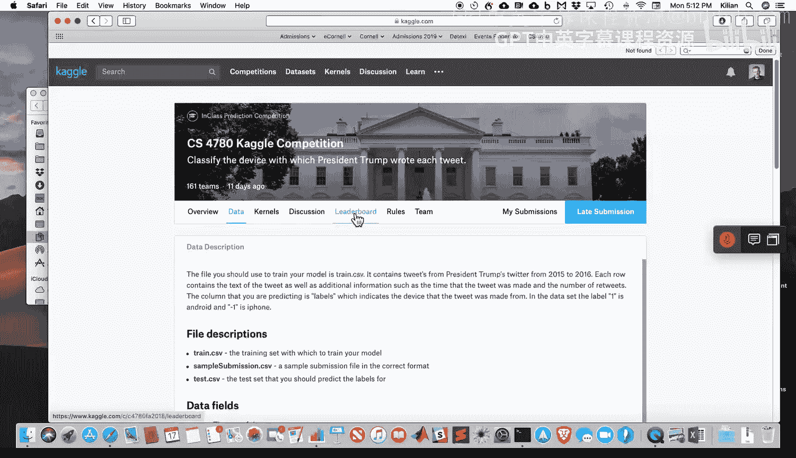
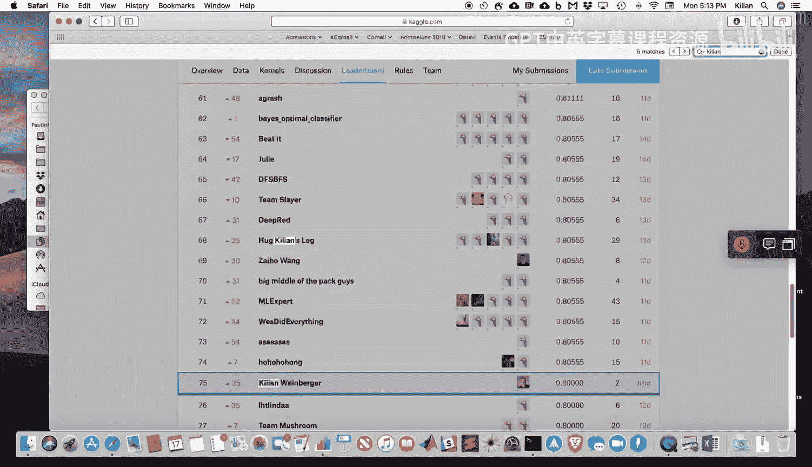
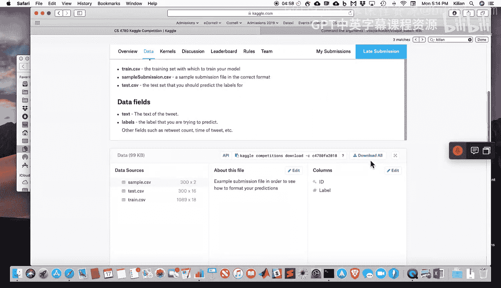
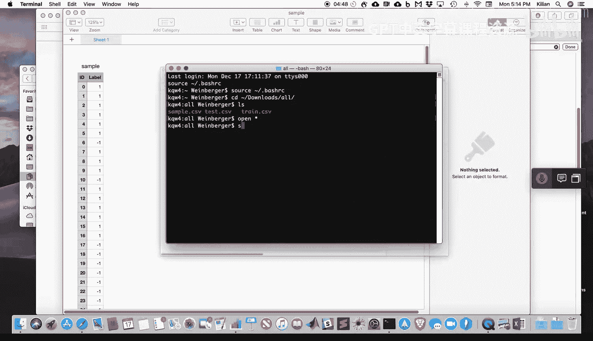
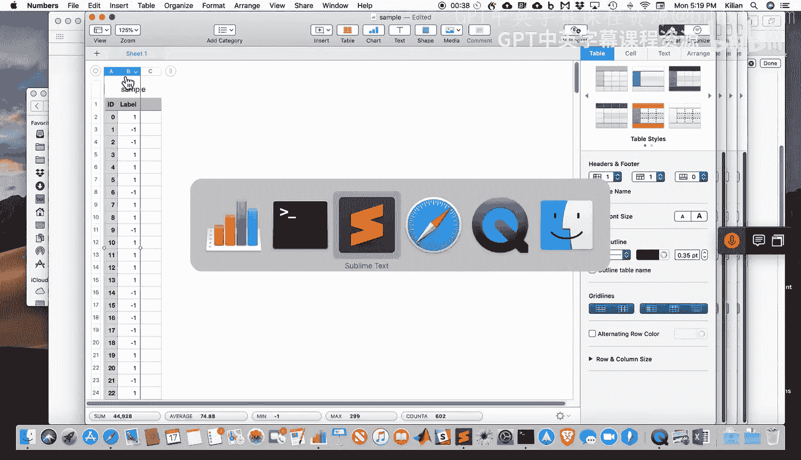
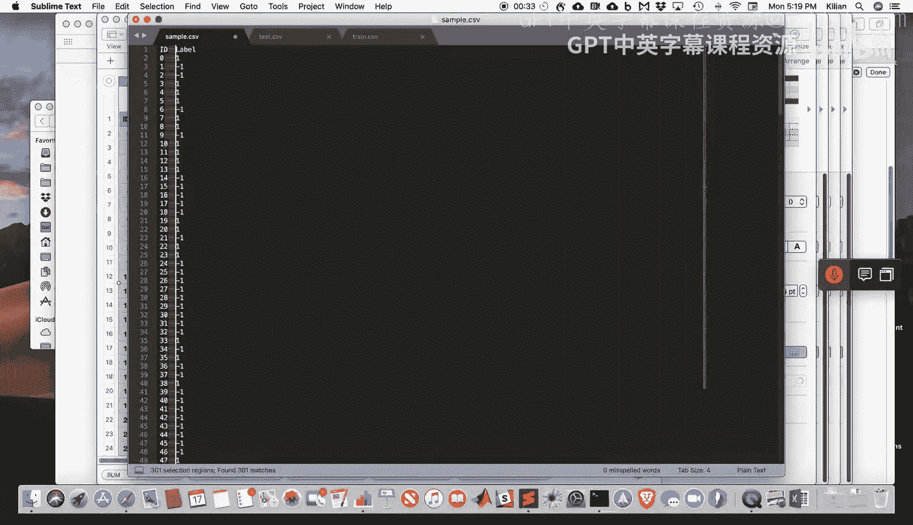
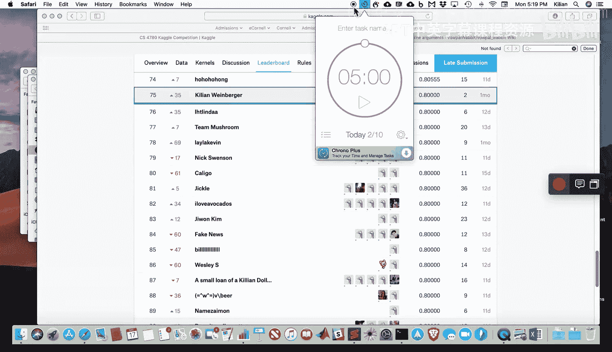
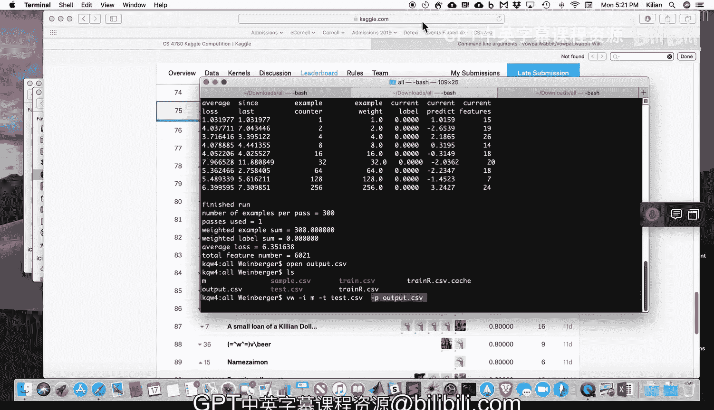

# 康奈尔大学《智能系统的机器学习｜CS4780 Machine Learning for Intelligent Systems 2017》中英字幕 p38 -38-In-class Kaggle Competition in less than 5 Minutes.zh_en -BV1Lo6gBxEKE_p38-

Time。In my class， we had a competition， a kggle competition where we gave students tweets from the president Trump。

 and they had to identify if these tweets were tweeted from a。IPhone or an Android phone。

 And the hypothesis was that maybe。The president himself uses an Android， and his。

Staff members use an Android phone or an iPhone and so。

If these are really different people tweeting under the same account。

 then we could train a classifier to differentiate between the two。

So what we did is we made this leaderboard， and I actually submitted my own submission。

 when am I down here。 initiallynitially， the leaderboard was just me and the game was the following。

 I gave myself five minutes。😊。

To。Submit something。 And the idea was if you can， the students can beat me in three weeks。

What I did in  five， five minutes， then they would get 100% on this。

Project and so a lot of students did， turns out it wasn't very hard to beat me。

 here you can see I got 80% accuracy and here at the top players actually got 90% accuracy。

Its prettyty significant。 And this's actually the private data board。

 There's also the public data board， but it's， it's quite different here。 slumda Kiai， think。

 and so here，82% accuracy versus 87。5。And okay， so since then， though。

 students have challenged me want to see a screencast video of me actually training the classifier to see if I can really do it in five minutes。

😊，And so sure， I can show you how to do this。And what I will do is I will actually use the tool called Vel webbbit。

 Vel webbbit is a classifier。 Let me just search for this V webbbit。

So here you can see it's actually a classifier that's made by John Langford。 when he was at Yahoo。

 he' at Microsoft Research。 It's a。Very， very fast。 very， very fast logistic regressiong classifier。

 but actually can do many， many things square losses， many different loss functions。

 and it incorporates feature hashing。 so you can just take words。

 stick them in and it hashees them into the right bucket。😊。

So here's kind of the command line description and so on。So。And installing Vw is very， very easy。

 He just。You know， pull it with whatever your brew or whatever your favorite appcat tool is。Okay。

 I can now get dotted。So let me just set a timer I download this timer app， so I have five minutes。

Let's go。

So the first thing I'm doing is I'm downloading the data。This is now in download all。

And I open all of it。And I open all of it and sub limeme as well。

And good。 so here's now the training and the test data。AndWhat I do in the。Test data。 I just need。

 I just need use the tweets。 I don't use any of the metadata that I gave you guys。

 It turns out the metada is actually really， really good。

 So this is how most people beat me because they had the metada。For example。

 time of day when you tweet， that's a very very， very good feature。Some people say that。Now。

 some people may be tweeting on the toilet。 I don't know if that's true， if it is。Good for him。

So here we go。 Here's the training data。 And now Ive pasted that in。

 So we just have the label on the left and the tweet on the right。 for the test。

 we don't have this yet。 So we kind of add a label like this。

And then I just add a feature domain F for the training data。 I have still the tab。I don't like tabs。

 tabs as a losers。 So what I do is I make this also a feature domain。 Now。

 one thing I need to do is I need to change。I have to remove characters that VW can't swallow。

 So for example， a column column would kill it。Because I would think that's the means a value， a dot。

It's not a good idea。Excaation point back slash。 I mean， these are generally。

 you should just remove these。 Okay， here we go。 semi column how about this So remove this too。

 And now the most important thing， I made everything lower case。Lower case。Here。

 I may go to everything lowercase。And。No case。 right。 it's good stuff。 Now I have my files。

 as I want them。 Actually， I still have to remember， remove the front line。The heada。

 there should be no head。Okay， good。And here we go withs three minutes left。Okay， good。

 So now I need to shuffle them in random order。 sort our train train R。 don's see this why not。No。

 no， I I kidding me。Blue。Install source。 Okay， it has no sword installed。 Alright， Never mind then。嗯。

Right。So， okay， good。 So are train at CS train art at CSB。Right。

 doesn't Why doesn't know source sort。嗯。Okay， oh， see。 I I see what's going on。I have to pipe it。

Okay， good， good， good good。 And now I can run VW。 So what I need to do is I train R or CSV。

 my loss function is logistic。 My learning rate， how one passes。

 how about 5 I have to make a cache file， the final model I save as M。😊。

And I have think that's pretty good。 Obviously， how about initial T equals one。 That's pretty good。

In this。Shehield is the typo。 Okay， good。 And now I can see BW。The initial， the model。

 I think I called it M S。Then诶。T is that。Test at C3， the prediction going into output to3 V。

And that didn't work。 Why didn't that work。Okay， here we go。 I have a double T。 here we go。

 So open output that Cv。And here are my predictions， ladies and gentlemen。

And now I can paste these into the sample file。 And I have a whole minute left baby。

 What I can now do， I can even be fancy。 I wouldn't have to do this。

 but I I'm just showing off that I have so much time left。嗯。sign this thing。And I can now。

T convert them into。Just draw science， yeah。And then， I can。Haded paste formula results。

 And now we have these wonderful predictions here。嗯。And I can now do this。

Right， sample CSB。 and I can。Replace this via comma。 And here is the file I need to upload。

 And ladies and gentlemen， I' am done。 I can now upload this。

嗯。Can I do a late submission。Upload files。E。Open。Here we go。 I can just drag this in。Sample of CSV。

And I make a submission。 and I'm done two seconds left。 All right， that was it。And she is the timer。

How was my submission， It was， yeah， okay， it didn't change， actually。And that's all there is to it。

 So the key thing is I just used Val webbbit and I use the logistic loss。

 I can now actually go back here。 So initially I just once I got the command line right。

 So the key thing is I made the training data in random formats。

 I use logistic loss learning rate one， you can probably do better than that。

 five passes over the data。 that's just because my data is5。 So I thought it's a good number。

 normally you would cross validateate this。 but this was really just meant you know as a mission that you can beat right the C here just means create a cache file。

 you need this if you have multiple passes over the data。😊。

D F means save the model in the file that is called M terribleible naming convention。

 and initial T just means that the first situation is T， that's just how you said。

 how the learning rate decays。And for testing， I basically say I start with my model M。

 I test this file， and these are my predictions。And that's。It's I hope you enjoyed the class。

And how do I stop this video？

