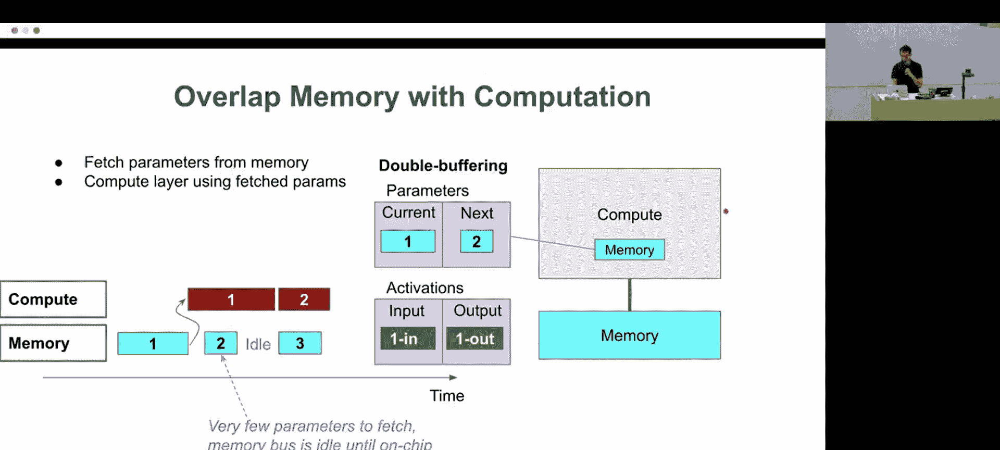
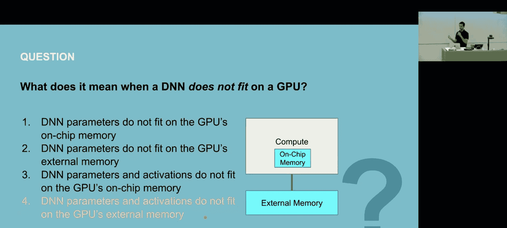
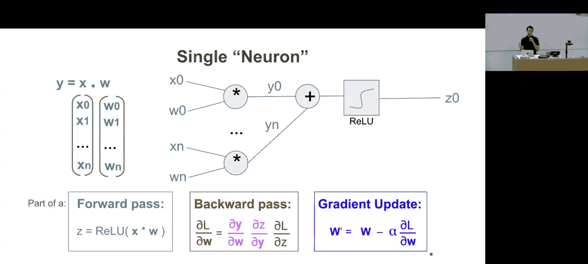
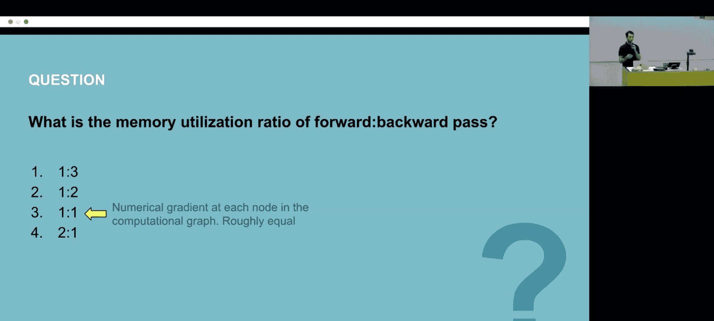
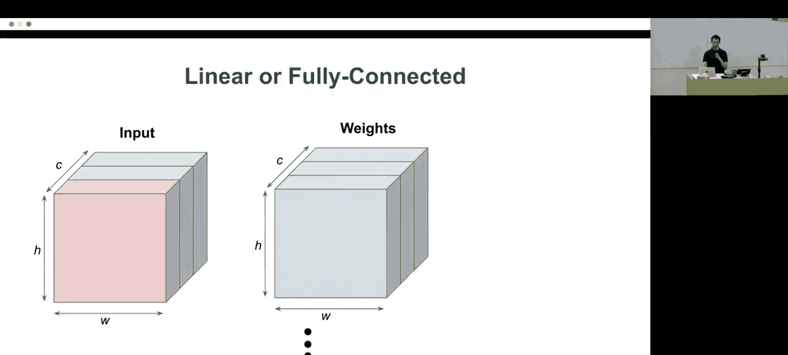
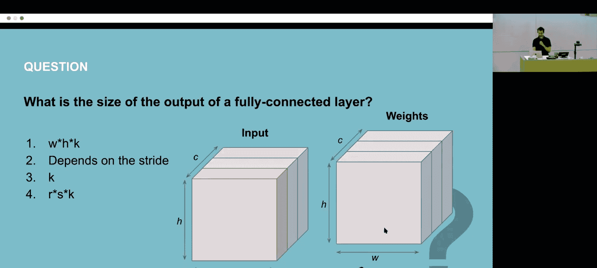
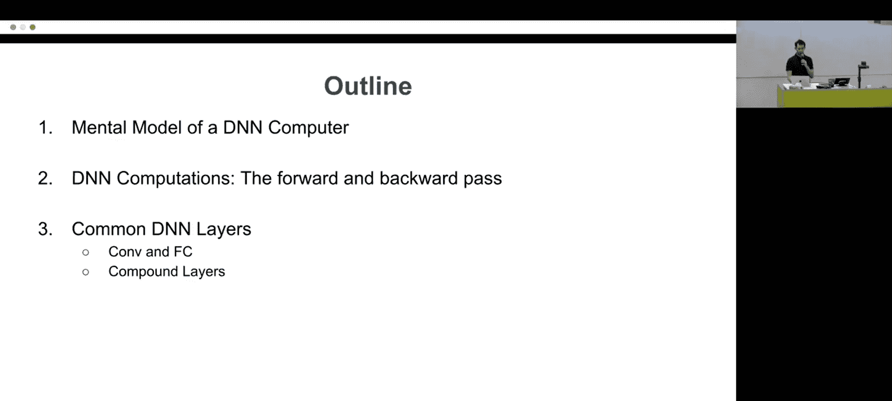
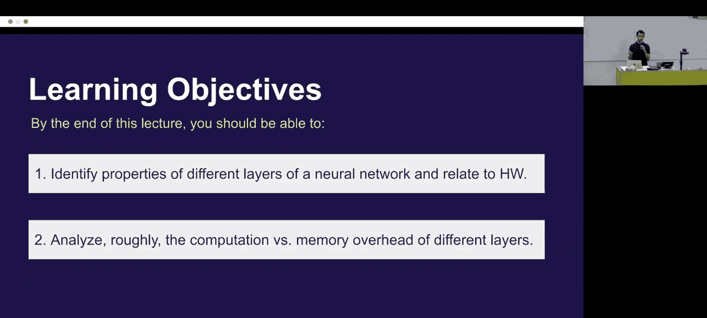
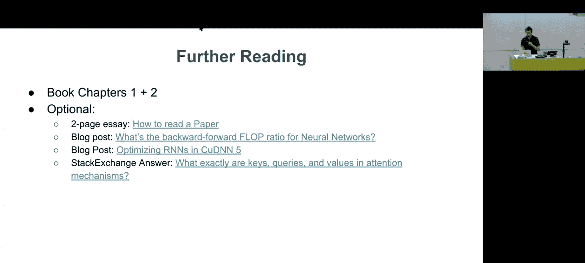

# 康奈尔大学《机器学习硬件和系统｜Cornell ECE 5545 Machine Learning Hardware and Systems》中英字幕 p02 -02-Lecture 1_ DNN Computations.zh_en -BV1CCqPYSEP5_p2-

Welcome to lecture2 so this lecture will broadly cover introductory material to machine learning。

 but I'll try to present it in a way that computation centric so what kind of computations do we have at different layers of a neural network what is the ratio of compute and memory in the forward versus the backward pass so things like that we want to kind of gain a better intuition of what it takes to run a neural network on a computer what does that computer even look like like what should the mental model of this D computer look like in my head when I'm thinking about it so that's the purpose here some of this and most of it should be stuff you covered already in a machine learning course but again like I'm trying to look at it from this different perspective of computations。

So， let me。😔，Share the screen。😔。

Sure。对。Right， I think that worked。So yeah so this is lecture one just a few things to get out of the way a0 is released on GiHub classroom so if you don't know how to get to a0 look at the discussion page there's a link you click on it and it creates a Github repository for it。

 you should see your name on the class roster and you should link your Github account to that name if you don't see it or anything let me know and I should be able to link it myself if you're using your net ID as your Github。

Username so that should be fine。AnyAny questions about a0 so far， it should be quite simple。

 very straightforward introduction so。嗯。Okay。So yeah。

 please use the discussion if you have questions about it。

So what have we been talking about so far I mean last lecture was mostly logistics but we started talking about machine learning hardware and machine learning systems and one of the things that we talked about was that know we're not getting faster hardware for free anymore we need to build our own hardware we need to build domainspec architectures to get improvement in hardware efficiency and hardware performance and the main reason is because of the slowing down of Moore's law and the end of Den art scaling so these are two kind of terms if you know anything about hardware you should be able to kind of just say them and say oh yes because of Moore's law and Den art scaling I'm doing this so I think part of the kind of benefit of this course is that you get to know a lot of this computer architecture lingo as well if you're a CS person or machine learning focused person。

 it's good to know this language of hardware designers and computer architects。

And so if we're not getting chips that run faster through the scaling laws。

 we need to build our own hardware。We won't be talking about hardware yet。

 at least not in detail that will happen next week in the next two lectures。But in this lecture。

 we will kind of try to develop a very simple mental model of a DNN computer， whatever that means。

 something that runs a deep neural network。So what does it look like it has these two components they're connected this way。

 so that's what we'll figure out in the next few slides。

We will also go over just the forward and backward pass first principles very simple and look at the number of computations and count the memory overhead of these passes in a deep neural network。

And then in the third part of the lecture， we'll just go over common deep neural network layers。

 so you may know we'll do them already， but again we will look at it from a memory versus compute perspective and whether each of the layers and each of the components is memory bound or compute bound and what takes more time and things like that。

So here is an example， deep neural network just to agree on some kind of definitions we I'll call each kind of computational block a layer which isn't a great way of labeling it because you know layer  two and layer3 here or in the same layer so to speak。

 but but let's call each one of those blocks a layer， now when I look at that neural network。

 what is it doing it's looking at images it's classifying them and giving me a class the output of that neural network and so when I look at it computationally what should I be thinking about so first I should really think hard about the memory overhead of this neural network so what is the size of the parameters does it fit on chip on that chip that I'm using for computing。

 does it fit in the external memory chip connected to that compute chip that I'm using。

How long does it take to load these parameters from external memory。

 so that will include kind of knowing something about the memory bandwidth or the memory speed of this memory chip connected to my device？

Okay， while I'm loading that those parameters， what can I do something else。

 can I overlap that loading of parameters with computations or is it just wasted time of like starting my computation？

Is there reuse of those loaded parameters so when I load those parameters on chip。

 can I use them multiple times or do I use them once then I throw them away and I need to load new parameters。

 so this is the idea of reuse。Again similarly during the computation itself。

 there are these huge tensors being produced， what is the size of those activation tensors。

 do they fit on the chip or do I need to spill them to external memory。

 how long does it need to remain a live value on chip so is it used in multiple branches downstream and it needs to stay buffered on chip for a long time or not？

And a lot of the activation。A lot of the stuff that pertains to activation is kind of very highly correlated obviously with the input in this case image size and the obviously the batch size as well so how big is that how big can I afford to make my input image resolution and things like that。

And so other than memory the second thing is compute so basically how much computation do I need to make and what is the parallelism in each of those layers and that will help me figure out how to map those computations onto a piece of hardware I remember at Samsung we were optimizing a speech recognition model for for one of those phones and we cut the number of layers the number of channels by almost I don't know by almost 40% so close to half of the channels were pruned away but the improvement that we got was just I don't know 20% or 23% in terms of actual runtime in the end and what we figured out quickly is that the computation on those mobile chips was done in multiples of 32 so if we didn't prune the channels in multiples of 32 we were essentially paying for。

Like a whole step of computation for three or four channels whereas we could have been using that for 32 channels if that makes sense。

 so basically even the number of channels you have。

 do they map well on the number of compute elements you have One chip is a consideration that you have to make and as I said you can a very important aspect is also whether you can overlap compute with memory access。

So there's a question from James， is that usually done with ablation studies for layer pruning？嗯。So。

It， it can be done with ablation studies。 and usually what happens there is that you will find。

 you know， I don't know if you guys can see the board， but。And this doesn't work， okay。嗯。No。Yeah。

Okay， maybe we'll use our imagination。So。So basically， if you have。

If you have number of channels on the X axis and runtime on the Y axis。

 then you will see that runtime is like a step function。

So every time we fill up our compute element so every step of 32 for example you will see a spike in runtime and then it stays constant because we're still filling up the same kind of compute array and then it spikes again and so on so that was the case for this specific NPU that we were targeting and that's why。

And that's why it wasn't as fast so yes you can do it with ablations obviously and benchmarking basically writing some micro benchmarkchs and figuring out how it runs。

 but that's treating the hardware as a black box you can also kind of go and dig into the like the instructions of that hardware and see what is the vector size for each of the operations sometimes that's harder to do for complex hardware but usually it maps fairly well。

So data dependencies， so data dependencies are a huge thing in general computer architecture。

 there's this large portion of a CPU chip dedicated for obviously caches， but also branch prediction。

If I have an if statement or any control flow statement。

 I need to figure out or predict where that branch is going to go so that I can fetch the right memory。

嗯。In neural networks that's not much of an issue， so data dependencies are few。

 as you can see in this example layer4 has a data dependency on layer2 and3。

 so most neural networks are feet forward， there are recurrent neural networks but they're mostly feet forward and sometimes when you have branches you just need to wait for the branches to complete before you compute your next layer。

 but we will go through a few examples where data dependencies become important especially in the management of on chipI resources and so that's coming up in the later part of the lecture。

嗯。Okay， so as I said， I want you to have a mental model of computer when you're thinking about how to map a neural network onto hardware and the general model that people have and the people have been using for the past four decades。

 maybe or more， is what's called a Fonuumman architecture or the Princeton architecture。

That's another piece of computer architecture lingo that you can kind of talk with when you're talking about computer architecture and machine learning together。

And so what is the funu architecture， it's very simple really。

 it's the model of a stored program computer， you have a program stored somewhere and you load it。

 you load the data， you do some computation， and then you write back the data。

And so what it looks like is you know you have this central processing unit or some processing unit。

 it has some control unit， which is unimportant for us。

 but it has also the arithmetic and logic unit on it。

And then it's connected by a low bandwidth bus to an external memory unit。

And so when you're executing a program， you have to load the program data and the program instruction using this low bandwidth bus。

 and so that's typically what's referred to as the Faonnoyman bottleneck。

And that's what limits most of the performance in computers in general。

 why is that because you either need to wait for data to be loaded from external memory or you need to wait to be able to write data to external memory or the program instructions themselves。

And so what people have been doing to get around that obviously with CPUs is to create all of those big caches on chip to get data to be here。

 so they avoid the bottleneck by preloading the data and putting get right next to the arithmetic logic units and we'll see in the next week actually what most chip startups are doing for new machine learning chips is exactly that they're just building chips without external memory unit and they're trying to make these chips as large as possible in some cases and putting all of the neural network memory on the chip itself very close to the computing elements you might also have heard the expression processing in memory where the opposite is being done we're taking arithmethtic and logic units and sticking them in the memory unit and so these are always to get around this funuumement bottleneck。

But for our purposes and for today's purposes anyways。

 what we really care about here is you know you have some arithmetic unit that does math and then you have a low bandwidth with bus and then you have a memory unit which has all of the data and so how do we get that data onto the chip that does compute yes it's through that low band with bus but how do we do that efficiently？

And so yeah， so that's what I want you to think about when someone says computer or mapping something onto hardware。

 and now we'll try to figure out how to map a deep neural network onto this funra architecture。

So which part of that neural network is the program。

 which part of it is the instructions and which part of it is the data。

 so these are some of the things that you should keep in mind as well。

Okay so that's kind of a simpler cartoon of this Fnein architecture。

 I also added this memory on chip because that's a very important consideration again in CPUs it's called caches but we'll just call it a buffer or on chip Prem or on chip memory so these are all kind of synonymous。

So as I've been alluding to so far， it's very important to figure out whether your workload is memory bound or compute bound。

 so basically does it take longer to fetch memory that I'm going to use in the computation。

 or does it take longer to do the computation itself。

 like the multiplication and the addition and all of that stuff？

So obviously this depends on a lot of things， it depends a lot on the hardware。

So how fast is that memory bus that will determine how fast I can get stuff on chip。

What is the size of the opera this depends on the neural network What is the compute speed and parallelism available to me right what are what are the sizes of the intermediate results do they fit in this on chip memory or do I need to spill them out to external memory and so on So so these。

These factors can roughly be divided into factors that just depend on the hardware and we won't cover those today and factors that depend on the neural network。

 and though that's what we'll be focusing on right？

So things like size of the opera and the ratio of computation in each layer to the memory of that layer。

Yeah， so we'll focus on these D related factors。So a very common。

 I want people to kind of ask questions if they have any so far that I'm notm trying to take it kind of I'm trying to slowly build this idea of how computations are made on a standard kind of computer architecture in your head so far so you know you have compute。

 you have memory， you have on chip buffering and we have a deep neural network that we want to execute。

And。So。So a key technique to use when。When running computations is to try and overlap the memory axis with the computation。

And so here for example， I'm showing like a time graph of compute and memory for a layer of the neural network。

 let's just call it layer1 and so first what I need to do is to fetch the parameters of that layer one from my external memory。

 put it on the compute chip so on chip and then I can do the computation now that I have all of the data dependencies resolved。

And then when I want to execute layer2， what if layer2 has a lot of memory and it takes a very long time that to fetch that set of parameters from external memory。

So in this case， you know， that's what happens， you have lots of weights to fetch。

 so that stalls the computation of layer two， and that will slow down your execution。So in this case。

 can people guess whether that's compute bound or memory bound in this case？

And someoneone just unmute and shout。嗯。Anyone。没有。Memory bound。Memory bound， Yes， great。 Okay。

 so people are awake and lots of people wrote in the chat as well。 Good to see。 So。

 so this is a memory bound layer， right， So we have a lot of stuff to fetch from off chip and the computation is really fast。

😊，And so。So in this case， the hardware is being installeded for this amount of time。

 and that means that even if my hardware has a lot of multipliers on it。

 if it's a GPU with a million coa cores， it doesn't matter because all of that extra speed won't really affect how fast my computation runs。

So in this case， I would need to go and build a higher bandwidth connection to my external memory chip to make this workload faster。

So the opposite can happen， of course， when。So yeah I have a question from Amman does this assume that there is enough space to store both the weights for layer one and layer two yep so that makes that very simple assumption so far and we'll talk a bit about chip memory in the next slide as well。

So in this case， we have the opposite， so we have very few parameters to fetch from the external memory。

 but the computation takes a long time。And so now my memory bus is id for a while and so can people think okay。

 is that a problem or you know I'm fully utilizing my compute chip so that's okay。

 so that doesn't matter or is there any problem that could arise because my memory bus is idle。

 is this an inefficient architecture now or is this perfect is this efficient？嗯。So。

So I mean think about it for a bit， usually when we're optimizing hardware and we see an idle memory bus we don't worry too much basically but what's actually behind it is that then that means you've overdesigned your memory architecture and your memory controller that means and an overdesigned memory controller means that it's fast for no reason。

 obviously if this is just this happens in just one layer then that's okay。

 but if this happens for all layers and you're always underut your memory bus。

 that means that you have dedicated a lot of chip area for a very expensive memory controller。

 you've dedicated a lot of money to pay for this very fancy memory controller but you're not really using it for this workload and so that's just chip area that's power and that dollar value that's kind of going to waste so usually it's not a huge issue if you see that and you're kind of happy fully utilizing。

GPU or my hardware， but at the same time you should keep in mind that I probably paid a bit too much for that piece of hardware or it's over designeded for no reason。

So。So James saying inefficient because， yeahep， the memory bus， yeah， So James hit its spot on。

 It's inefficient because the memory bus is actually too large and power hungry。 That's right。

In this case， can we prefetch the next batch of parameters for efficiency？

So I mean that's a good point， so why am I staying idle here when he is asking if I can just you know fetch the parameters for layer 3 instead of remaining idle and I can just get it early and then I'll fill all of the bubbles in my memory bus this goes to kind of the limited resource that's called on chip memory so the difference in size of on chip versus off chip memory for traditional computer architectures this orders of magnitude right like you could have megaytes on chip and gigabytes off chip so three orders of magnitude at least。

And that's kind of comparing the size of caches to the size of DDR chips or something like that。

And so usually what we do with deep neural network accelerators and again。

 we won't go into do much depth of the on chip buffering architecture in this lecture。

 but again to further develop that mental model of that deep neural network accelerator。

 we usually use double buffering。And what that means is that if I'm currently executing layer one。

 then I'll have layer one input parameters stored on chip and as I'm doing that I'm fetching this stuff for layer two in the second half of my buffer。

 so that's why it's called double buffering。And usually usually you don't have enough space to do more than double buffering。

 basically。I mean， sometimes you do， but usually that's kind of the simple mental model that I want you to have in mind。

And the same is true for activations double buffering in this case means that you know you have both the input and the output of that layer being stored in on chip memory because that allows you to perform the computation really fast and then you can use the output of that first layer is the input of the second layer and so on and so you keep kind of pingpononging so sometimes it's called a double buffer sometimes it's called a ping pong buffer and it has maybe other names as well so that's kind of what's happening on chip it's quite a limited resource and managing that is very important to the performance of neural networks especially when you're designing your own architecture。

And we'll talk a little bit more about this on chip memory and scheduling algorithms to kind of take full advantage of them。

 both briefly in this lecture， but also in the mapping lecture later。

Okay。Oh， a question， yes。So I mean， I'm hoping that most of you trained a neural network on a GPU before。

 and so what does it mean when you get kind of a couda out of memory error or you know。

 your neural network doesn't fit on chip？So does it means that the parameters don't fit in on chip memory。

 does it means the parameters don't fit off chip yeah or is it both the parameters and activations that don't fit on chip so think about it for a minute and I think I launched a poll just yeah give me your answer there is the single right answer by the way for this one I know the thing allows multiple。

嗯。By external， do we mean VRA， I mean， you can call it VM， yes， in general。

 D Ram or external memory yes。Okay， almost there，75%。Okay。

 so the answers so far are all over the place。嗯。O。So， yeah， so。

 so the majority of people actually picked three that the D parameters and activations don't fit on the GPUs on chip memory。

A lot of people also picked one that the D parameters do not fit on their GPUs on chip memory。

 so in general people are thinking about on chip memory。And that's the wrong answer， actually。

When when you get a co out of memory error。That means that the HM or GDDR 5 chip attached to the GPU doesn't fit the model and the images used to train that model or do inference。

Right， once you have the。Yeah， so only five people answered the right gave the right answer。

 it's you know， both your deep neural network parameters and the training data and intermediate activations need to fit off chip。

You can always break down computations and tensors。When you're doing the computation on chip。

 you can always break it down into finer pieces of computation。

 right but you need the whole thing to fit in your memory system。

And I mean GPUs are quite unique because you know GPUs have memory of what maybe 10 gigabytes like very expensive GPUs go up to 32 gigabytes。

 does anyone know why they have such a small memory capacity compared to CPUs that have typically I don't know。

 128 gigabytes or something， I think this laptop has 256 gigabytes or 512。嗯。So does anyone know why？

3号。😔，系 okay。James， yeah， so James answered。嗯。Etor Speds， Alexander and Nikki。So。

 so all of the answers are in the right kind of vein because this memory is much faster and it's。

In memory systems， you always trade off size with speed basically so if you have a very large memory chip。

 it can't be really fast just because of the electricals of it and how it's organized and how it's connected the to the compute and so on and actually it's not a CPU versus GP thing。

Some very high performance computers that are built。

 especially for performance and have some very complicated instructions。

 they're still considered CPUs， but they have like two gigabytes of external memory just because they need very fast memory to run these scientific applications。

 whether it's kind of climate forecasting or other things。So so yes。

 out of memory means the external memory is full， always remember that you can always break down computations and put them on memory to fit the on chip memory。

嗯。So I mean， I gave you this very simple mental model of hardware based on this funuumman architecture where you have you know external memory。

 compute， on chip memory， but it's good to also know that there is such a big diversity of hardware out there ranging from you know a1 watt chip。

 so a very low power chip all the way to like a 300 watt GPU or something。

They're dedicated chips doing things in a brand new way， there are non foru architectures。

 there are systems on chip where you have just a small part of the chip dedicated for。

A neural processing unit and it shares the same memory system with other devices like a CPU and a GPU so this is the case for kind of mobile chips and so so you know so take this simple model with a grain of salt that you know there there are also other ways of doing this computation。

But at the first order， still the same the memory versus compute argument usually applies to most of these chips。

Okay， so that's kind of the first part that I wanted to go over if anyone has any questions at this point about you this mental model of a DNN computer。

 just let me know。Otherwise， we can move on to the second part of the lecture。

 so basically we'll go back to kind of machine learning 101 and talk about kind of the forward and backward path in a deep neural network。

So。Let's talk about a single neuron。So we have an input X and a parameter W。

And you know they're being multiplied and then there is an activation function。

 maybe it's reallu or something else， and we have an output。

So what happens in this small piece of a neural network in the forward pass， okay， we are getting。

 you know， we're doing one multiplication。So you know。

 multiplications are some of the most expensive operations and that's what we'll be counting in this very simple model of a neuron。

So we have one activation function and one multiplication。So now what happens in the backward pass。

 so we have kind of the lost gradient coming in。And。And then it propagates through the network。

 we have these local gradients in pink and then we keep you know using the chain rule and back propagation to compute the gradient downstream during training and then finally you know in the backward pass we compute the gradient app so we take the downstream gradient we multiplied by the local gradient here and then we multiplied by the local gradient here and we're finally getting kind of the。

The derivative of the loss with respect to the parameter at this weight value。

And so if I count the number of multiplications here。

 and this is a very rough way and a very inexact way of doing it。

 but there are roughly two multiplications right compared to the forward pass which had one multiplication。

😊，And so we will take that as kind of approximately how expensive is a forward pass versus a backward pass。

Oh and you know during training， for example， after doing the backward pass obviously you take that gradient and then you update your parameters with it and this is basically one subtraction which is much cheaper than a multiplication and it only applies to the weights as opposed to all of the nodes in the graph so in general when we talk about forward pass versus backward pass versus a gradient update。

You know， the backward passes the heaviest part， the ratio is approximately two to one。

 and the gradient of data is typically very cheap。Of course。

 what I drew here and said it's a single neuron that's not actually a single neuron。

 I was hoping someone would stop me。But this is part of a single neuron so again when when you're thinking of neural networks you know sometimes we go back to these biological inspirations and I don't really like that because it's very disconnected from the biological part these days but basically we have more than one branch coming in so we have these dendrites each one of them is a scaled input right and then we have。

An activation function and a downstream thing called the axon。

 So basically here I'm showing just one dendrite。Connected to an activation function。

 whereas it should look more like this， where you have many dendrites or many inputs scaled by a parameter。

 trainable parameter， and then they're all added together and then they go through an activation function。

It doesn't really change the simple derivation that we went through though。

 but now at least for these boxes we can say this is part of a forward pass and part of a backward pass。

 whereas the complete forward pass is actually a do products between all of the inputs and all of the scale factors or the trainable parameters。

And then they're all added together。So in the further reading。

 I'm linking to a blog post which looks right to me。

 that goes through a more detailed derivation of kind of the ratio of flops in the backward to forward pass and forward to backward pass。

So I recommend reading that it's not required， but I think it's fun to go through it and kind of do it with your own hand to grasp this idea of you know how much computation is going into each one and there are some details like the first layer has a different ratio convolutions will have slightly different ratio compared to linear layers and things like that so it's good to go through that blog post you'll find it in the end of the lecture。

But at first order， when you're thinking about it， yes， the ratio is approximately two to one。

So， I mean， we talked about the。The flops ratio or the compute ratio of forward to backward pass。

 so what is the memory utilization ratio， so how much memory does the forward pass take compared to the backward pass？

And。😔，Oh can I relach， I can relaunch the poll。Okay。So I relaunch the poll。

 let me know what you think in terms of memory utilization。

So I mean this is all we'll be talking about today， compute and memory， how fast does it run。

 how much memory do I need to fetch from object， that's what we really care about as kind of hardware designers for deep neural network accelerators。

🤧嗯。😊，Okay， so most of the answers came in 84%s I can live with that。

 so the answers are split exactly between you know two and three。Ah two just one。

So 12 answers to two and 11 to three so and some people answered one and four as well。

 so I mean the the way I think about it is well I mean I think the right answer is one to one and the way I think about it is that we have a computational graph。

In the forward path we compute all the values along that path along that computational graph in the backward path we're computing all the derivatives at these same points in the graph right so the ratio of the forward forward propagation is the same as the backward one but the values are gradients instead of you know activations and。

So during training during the backward pass， we actually have doubled the memory utilization just because you know we need to store the forward pass and use it in the computation of the backward pass。

 but I mean in isolation， each one is taking roughly the same memory， if I'm not mistaken anyways。

Okay and I mean one way to improve this is called model checkpointing which is quite a neat technique and works quite well so if you don't have enough memory on your GPU what do you do you can skip some of you don't have to store all of the forward pass so basically in this neural network here I store the activations at the first input layer but then I didn't store the activations at the hidden layer one and then I computed the activations downstream。

And so during the backward pass， now I have a third of the memory that was required for the forward pass。

 essentially saved or conserved because I didn't store these values during the backward pass。

And so what does that mean， how do I compute the gradients at these points then？

So what happens is that I just recalculated so during the backward pass when I need to compute the gradient here and I need the value of this activation。

 I would go back and use the input layer and recompute the value of that hidden layer to compute the gradient and then I would throw it away again and so that's DNN model checkpointing and I thought I would mention it as a way that people are using to again trade compute for memory or in this case trade memory for compute。

So。Okay， so that's kind of the brief section2， just going over the forward and backward path and now we will talk about common deep neural network layers and important deep neural networks that we're using these days。

 what layers do they actually use and what are the memory and compute properties of these layers？

Again， if there are any questions， just type it in the chat or or shout so。Okay。

 so throughout this course we'll focus on you know these three important applications。

 there are many more important applications related to deep neural networks and deep learning in general。

 but most of the research is being done on those three domains and most of the important applications are actually derived from these three domains as well。

 so speech vision and NLP。And so before we dive into the various layers or the various model topologies that。

That are used in those application domains。We will just kind of see， okay。

I mean what what is the state of the art in each of those and so most of you may be familiar with this website papers with code I think Facebook made it to kind of keep track of all of the machine learning research and to see what's。

They basically have these leaderboards of what's the highest accuracy in on each data and things like that and so I just copied those graphs from there and in speech recognition for example。

 you know we started five or six years ago with RNNs people were using RNNs mostly LSTM based RNNs to do speech recognition this quickly shifted to 1D convolutions which were found to work just as well in many cases but were computationally much cheaper。

Then kind of at the turn of this。Decade transformers took over in speech recognition as it took over in many of the other domains。

 as we will see， and then now people are using a mixture of transformers and convolutions and in the case of speech recognition people are calling itconers in other domains they're calling it something else by the way。

 do people know what transformers are in general， like if you type in the chat yes or no。

 that would help me to kind of gauge whether people know。Yes， yes。 Se attention。Yes， no， okay。Good。

 so some people know， some people don't know。So we will go briefly over them hopefully we willll have time。

So， yeah， so the one of the key things here is that a we've been moving from。you know。

 more and more sequential computations to more parallel computations and that's by I think influenced a lot by the nature of GPUs used for training。

 but also the scale of training you need to finish your training faster to support larger data sets which has also been the trend the speech recognition and other domains and so that's a main reason why we're moving towards those highly parallel kind of architectures。

image classification， so the popular dataset set there is IageNe and so we started you know with convolutions and fully connected layers or linear layers。

 and then we moved tovol fully convolutional or convolution only then again transformers take over starting 2020。

 but then people again took a step back and thought about it a bit more and now they're using a mixture of convolutions and transformers so or self- attentiontention basically which is the main building block of transformers。

So。NLP， it's a very similar story to speech recognition except that transformers stuck there。

 convolutions were never really useful in the very sequential natural language modeling domain。

 and so we started with recurrent neural networks， obviously focused on LSTMs at some point and then shifted to transformers。

So yeah， I mean we'll talk about these two important layers next。

 so convolutions obviously was a common one that came up in these important application domains。

 the other one is fully connected layers sometimes but also just generally matrix multiplications which are also the building blocks of self-attention and transformer networks。

 so we'll talk about those two layers in a bit more detail just to make sure we're all speaking the same language and talking on the same page。

And I have this somewhat blurry image of kind of the breakdown of computations in a simple neural network on both the GPU and the CPUU。

 and I mean what I want you to get from this picture， hopefully I'll update。

 I don't think this is the best picture to show that basically most of the time goes to the convolutions and the linear layers so that's what this is showing on either the CPU or the GPU。

Okay， so what is the convolution again kind of taking a very simple introduction to what convolutions are and we'll talk about 3D tensors in this case so my input has you know a height width and depth or a number of channels C。

I have filters and these are the parameters of the convolution。

 they have height R with s and the depth is the same as the input and they have k of them and when I perform a convolution between those two things they produce an output that has HW and K now as the depth which is the number of filters。

So how do I perform a convolution， how do I compute a single output of that convolution？

It's basically a dot product so we've already looked at dot products in the you know the single neuron view of neural networks。

 so this is simply a dot product between a piece of the input that has the same shape as the filter and the filter so so you know I sweep the filter across the input tensor so I'm doing a dot product between all the values here so multiplying all the values in that shape with all the values in that shape and then adding them all up to compute a single value in the output so just one number。

And then you know I sweep the filter across the image so I go to the next part of the or the input。

 I go to the next part of the input that looks exactly the same as the filter I do a dot product with that and that's how I compute the second output and then I repeat that for the third output and for the fourth output so that's how a convolution works and I mean you'll notice that you know I did all of these computations using a single filter that I have loaded on chip so we're loading actually a very small amounts of data and doing a lot of computations by sweeping that whole filter across the whole image。

嗯。So to compute kind of the second channel or the second output layer of my output。

 I use a second filter and I sweep it across the image and that's how I construct my output tensor during a convolution。

So can you maybe think about it for a minute or two and count how many total operations do we have in a convolution and we're talking about a very simple convolution so we'll assume that the filter have odd sizes in the face or an SRU and we have padding equal to our divided by  two and as divided by two so that means basically I can perfectly sweep the filter across the image across every pixel of the image and try the equals to one so so using these you know symbols hwC Rsk what is the number of operations that I need to do multiplications and additions。

If you think about it for a minute and maybe type an answer in the chat once you have it。嗯。

Is this chat box frozen， no， no one wrote。O。Okay， I'll wait， wait for at least one answer。嗯。

So think of it as every time you sweep that filter across the input。

 you're doing know multiplications equal to the number of values in that filter。

And additions also equal to the number of values in that filter。

And then you're sweeping that filter across the whole image， and then you have K of those filters。So。

😔，So Aman says on the order of H over R times S over W times C。嗯。😊，Maybe。😔。

II'm not sure why you're dividing by W and R。Okay， I got I got at least one answer so my answer is this。

So， basically。So Alexander K， HWC。In ways。Yeah， so， yeah， I mean。

So that's my answer right so basically how many values do we have here。

 we have r times S times C values。And every time we sweep that across the image。

 we're doing two operations per value。RightSo2 times r times s times C2 times the volume of that filter。

The two operations are multiply and add right so the dot product。

 you multiply each two values together and then you add them。

And then we're also sweeping that whole filter across the whole image。

 so multiplying by W and then multiplying by H as well to sweep the filter across the whole space。嗯。

And then finally， we have k filters， so we repeat this k times， so multiplying by that last k。

So James is asking is the two from bias and activation so I'm not showing bias here actually so you're right a convolution layer also has a bias I'm just two is multiply and add so multiply is one multiply plus add is two operations so that's always the distinction you'll get two ways of measuring compute in a neural network or in anything it's either max multiply accumulates or flops and here I'm counting flops so each two flops equal one Mac because Mac is by definition two operations multiply and accumulates。

So yeah， so that's the total number of operations。And if we think about the number of parameters。

 they're actually much smaller， theyre just the volume of those filters。

 so r times S times C times k filters。And so this is an example of a very compute bound。Operation。

 it takes very little time to fetch those filters from off chip and I mean I took some time to actually draw them to show you the scale of how small they are compared to the number of computations which are more proportional to the size of the input。

 whereas filters are usually much smaller than the size of the input。

And so the computation takes a very long time， but memory access takes very little time。

 so this is compute bound。I mean， one way people have been trying to alleviate the compute bottleneck of convolutions is by using something called depthwise convolutions。

U。And what that means is that every time I sweep the filter across the image instead of producing one value in the output。

 I actually produce C values or you know in this example is three values and how do we do that we do that by basically so compared to a standard convolution where you do a dot product or a complete dot product between all of the input shape and the filter shape。

To produce one value here we are doing partial dot products。

 so we're doing a dot product between this red piece and this purple piece and then we're storing it in the output and then we're repeating that for the next channel storing it in the output and so on and so this depthwise convolution has become a very common block in almost all of the efficient state of the art。

A convolutional architecture is for image tasks or vision tasks， things like efficient net。

 mobile nets and so on， they're using that because this actually uses this actually needs a lot less computation to produce the same output shape。

And specifically， if a standard convolution is this many computations。

 then awise convolution drops the C factor and becomes much more efficient。And。Again。

 if people have questions， let me know， but basically this is an edge case of something called groups or grouped convolutions where you can also have mixtures of this so you can have kind of groups of two that's being combined into one output in this case each one piece of the filter is used to compute one piece of the output but you can have two pieces of the filter。

 compute one piece of the output and so on， so here our number of groups equal to the number of channels。

So does this now make the now is this now compute bound or does it become memory bound because I've reduced the computation so much that's the question so I said that this well one of the solutions of making convolutions faster and it does make them faster so you know you go from a very heavily compute bound layer to a less heavily compute bound layer but you're also reducing the amount of memory that you're hatching from off chip so it's still compute bound typically on most chips but it's much faster and people have empirically shown that it works quite well when combined with something called pointwise convolutions。

嗯。Okay， now let's talk quickly about linear layers or fully connected layers。

And I put this after convolutions on purpose so that I can describe fully connected layers using 3D tensors first and contrasting them to convolutions as opposed to taking a matrix view of fully connected layers。

So。I mean I showed previously the weights of a convolution layer， they're also repeated k times。

 but for fully connected layers， each one of those weights or the equivalent to the filter is the same size as the input。

 so now you can imagine that's much more many more parameters that I need to fetch from off chip memory for a linear layer。

And so if this is my input and these are my weights with these shapes and I have k of them。

 what is the size of the output of that fully connected layer？Restarting the poll again。Okay。

 so yeah， try to type in your answers。So I mean I hope those polls are not annoying。

 it's just the only way for me to know whether people are kind of paying attention。And， yeah。

And I firmly believe that you kind of receiving a lecture for one hour and 15 minutes gets really tiring。

 so instead you should also kind of do something more active so hopefully if people find them annoying let me know but。

嗯。Okay， I'm surprised no one got the right answer so far。This is interesting。嗯。ATwo right answers。

Actually， can people see as the answers are coming in？Like， no， and someone is shaking， okay。

 I can only see it okay because otherwise they just gave away the answers。Okay， so 27， 28。

 70% participation that's good。 So I mean， the answer is k。

Right so if you think about it。The same way that you thought about a convolution。

 you're multiplying that whole shape with that whole input just to produce one output value。

And then you have K of those。And so typically you you'll see a fully connected layer at the end of a CNN。

 for example， where we're just computing the class probabilities or the logics that would be used to compute the class probabilities at the output。

 so it's a massive reduction in from input to output size and that's because of those huge weights that are connected to each one of those inputs。

And what does that mean， that means that each weight is connected to an input。

 and then there's a huge dot product that happens between all of those things and a big accumulation that happens between all of the partial values。

 basically we multiply this whole thing by that whole thing and compute just one value here。

 repeat it for k times。嗯。Of course linear layers are also matrix multiplications and not all domains require 3D tensors like the image domain。

 so what happens is that you know I mean if you use Pytororch before there's this dot flatten kind of function and basically if we flatten that whole activation tensor that I showed here。

It just becomes kind of a linear vector and if I flatten each one of those weights into again a linear vector。

 a single dimension tensor， then that's what it looks like， it's a matrix vector multiplication。

 we have k of those weights， we have a single activation and we have output activation。Now again。

 please type in the chat， is this memory bound or compute bound？So。

 and the hint is we have lots of weights and then just one operation。So memory compute， memory。

 memory， yes， so it is memory bound of course， and it's actually you're using each weight only once and then you're computing one value in the output and you have so many weights to fetch from external memory and the way people usually get around that is by batching。

So that means by adding multiple activations related to different inputs， obviously。

 and then you have a matrix matrix multiplication， so depending on the batch size you can actually hide most of the memory latency and turn this into a balanced kind of workload。

嗯。Okay， so there are also obviously other layers in these neural networks and some of the important ones are pooling。

 normalization and activation functions。As I showed in that pie chart。

 we don't really need to think too much about those layers when we're thinking of just computation and memory versus compute and so on。

But there are some pitfalls and I won't go through all of them。

 but basically for example some activation functions can't be computed in place and that means I need to compute a gradient before it and a good gradient after it。

 which means that you're at least at that point of the neural network you're doubling the number of gradients that you need to compute and the number of forward activations。

 so there are some details when you're kind of hyper optimizing a neural network that you also do need to take into account those seemingly harmless or seemingly benign layers。

So more details in the book about each of those layers， please go through chapters one and two。U。

And now onto the kind of the final part of this lecture， hopefully I can make it in time。

 I think I have 10 minutes。And that's compound layers so I think that's kind of just zooming out again after kind of zooming way in looking at a single neuron and a single dot product and then all of these primitives used in common deep neural networks。

 let's zoom back out again and see how people are putting these primitives together to produce those compound layers which are again now very common building blocks in neural networks。

So I mentioned RNNs and LSTMs， so I won't go into too much detail because just of the time constraints and the nature of this lecture but。

But basically remember how I said data dependencies aren't a big deal in neural networks。

 they are kind of a big deal when it comes to recurrent neural networks。

 so in recurrent neural networks this is an image of an LSTM layer so as you can see within the LSTM layer itself or the LSTM cell we have all of these kind of more interesting connections which means that there are some more complex data dependencies that you need to take into account when mapping this onto your computer right and the output of this layer is also connected back to the input of this layer。

So if we look at it in terms of the number of time stepss or we do a computation of that LSTM and then we take its output。

 we feed it back to the input and we do the next time step and then the next time step and so on so whereas this other axis is if we' stacking multiple layers to have a deep LSTM based network and so in RNNs especially we do have those data dependencies that need to be taken into account。

 and there's a very nice kind of case study by NviIDdia on how to optimize these RNNs for a very parallel computer architecture like a GPU。

 so I recommend kind of going and reading this optional reading here to know a bit more about data dependencies or how they're handled on GPUs both within a cell and between different LSTM cells。

And now attention which is the main building block of transformers。

 I'll briefly kind of go over what it is so so previously we had this encoder decoder architectures and they were mainly based on RNNs as well。

 so these inputs would go into different time steps of that RNN that I showed in the previous slide and then it would go through a decoder and produce a translation here used Arabic which is my mother tongue for the translation I thought it would be fun but is basically a translation of you know my name is Muhammad it's written here so what we see here is that there is kind of an information bottleneck I get some representation of this input through various time steps but I only transfer the output of the last part of the encoder the last time step to the decoder to do the translation。

And so what people found is that this didn't work very well and they instead created a different architecture that took the output of all of the input tokens。

 did some kind of weighted sum between those outputs and then sent them to each of the inputs of the decoder。

 so when I'm basically finding the translation of each of the input tokens。

 so at each one of those outputs I mean，I'm using information from all of the inputs。

And this is very useful especially in languages where you know here I have just two words to translate those four words。

 so I actually need to take information from more than one word to figure out what each output is。

Sometimes you also have you know in different languages。

 the verb becomes in different parts of the sentence。

 like in German sometimes the verb would come at the very end。

 whereas in English the verb is usually at the beginning and so having information from all of the inputs is very useful and this is done through this attention layer。

 which is basically，Just taking all the outputs， multiplying them by a trained weight。

 and then summing them and putting them at each of the inputs。And so now。

I'm hoping this attention kind of looks simple， it's just the scale given to every output so every output H。

 and then this trained scale factor alpha。嗯。And so if you read the transformers's paper。

 the attention starts looking very different and it looks a bit like this。

 There's a softm applied to Q times k transposed divided by some constant。

 and they're multiplied by V。 So what are K， Q and V and what is all this stuff。 And basically。

What I'll say here is that it is a fast way of doing the same computation here inspired by databases。

 so instead of doing this computation which is quite sparse and needs to be repeated for each input。

 we are doing the same computation in vector form and computing something called the dot product similarity between projections of the input in different spaces。

And so KQV correspond to key value and query， which is terminology that comes from databases and if you read the。

The original paper called Attention is all you need， at least I didn't understand it from that paper。

 but there is this really nice stack overflow post that explains it very well and it's just like a paragraph and I highly recommend just clicking on this if you want to know how to go from you know the formulation of attention to the scale dot product attention。

And again， if we talk about， you know， back to computations and what's happening here。

 the main thing that's happening is these purple blocks and the matrix multiplication basically。

 and that's where we're spending most of the time here。In transformers。

 and we did some benchmarking personally on some of the vision transformers and the time was split almost evenly between the multi headd attention layers。

 which are basically this computation here and the feet forward layers which are just fully connected layers。

So I know that that's a very quick whiz through transformers。

 but what you should know from it is kind of why we're using attention roughly how do we go from attention to this scale dot product attention and reading this blog post or this stack overflow answer will help and then。

Roughly how computation is divided between the different parts of the transformer network。

More compound layers， so in CNN's inception was at some point the state of the art network。

And each one of those inception blocks looked like this， so it was quite complicated。

 it had a bunch of branches and a bunch of dependencies and while the inception model itself is not that relevant anymore。

 this is too representative of an automatically designed layer and so what I'm showing here。

 if this is my memory laid out linearly，How and when do I need to allocate different buffers。

 different pieces of data from that computational graph into buffers in that memory。

 and so this is a piece of work that we worked on during my time at Intel and we found that using smarter kind of scheduling so basically taking a different order through these computations here so we can save a lot of space in our on chip memory and this is a key thing into optimizing or hyper optimizing these neural networks for fast execution。

Other important compound CNN layers that are heavily used now are the resnet bottlene block and what that is is kind of a one by one convolution。

 a three by three convolution and then another one by one convolution。

And the mobileNe inverted bottleneck block， the reason it's called inverted bottleneck is that it actually goes from narrow to wide within the bottleneck and then to narrow again。

With a skip connection around and people just found empirically that again that worked quite well and it had way fewer parameters and was much faster to compute and so these are two important layers as well。

Yes I made it so ands and that's it that's what I wanted to go through so we kind of went through that mental model of what a computer looks like it has memory it has on chip memory and it has compute there is a bottleneck called the Fonuman bottleneck when I'm getting stuff from external memory trying to put it on my compute chip we then went to just the single neuron view of neural networks what happens in the forward and backward path and finally we talked about common unimant D layers again with this lens of compute versus memory。

So you should now be able to kind of identify properties of different layers of a neural network。

 you should be able to analyze roughly the computation and memory overhead of different layers as well in the next lecture we will kind of go over specific metrics and specific hardware design techniques to basically take into account these compute versus memory tradeoffs and for this lecture here is the further reading and there are these very interesting and quick reads which I highly recommend but are not required。

Okay， so so I mean， that' that's all I have for today。

 and do people have any questions or any thoughts in the last few minutes。

I'm happy to stay a bit after class as well if people want to discuss anything。But。😔。

Are the lecture slides posted on the website， yes， I post them， I'll post them today。

So lecture zero was posted， there is a link in that Excel sheetet。

 that Google spreadsheet that I have on the website。

Do S connections have any consequences yes of course so the question is do S connections have any consequences on computation and memory so a S connection usually terminates in an addition so it's added to the output tensor here so that's a piece of computation but we roughly we briefly talked about live values or how long do I need to keep a tensor on chip because I'm using it in downstream computations and in this case I need to have enough storage to keep this whole thing on chip while I'm computing those intermediate layers because I then need to use it for computation again downstream so usually it has a lot of implications on this on chip buffer management and on chip buffer allocation。

And that and that's why kind of it's important to manage these on chip memory resources efficiently when you have multiple branches or skip connections and the like。

Any more questions。Okay， if one more specifically， are there nice easy comparisons on computation memory costs for transformer versus CNN？

I know a Transer tends to be more costly due to the QK being O of n squared。

 so James is asking if there are nice comparisons between CNN based architectures for vision and transformers I think you mean for vision because that's typically where CNNs are used and yes some scientific papers will go into and make that comparison。

Especially because you know usually if you're writing a paper you kind of see what the baseline is the baseline is efficient net which is a CNN then you have to kind of beat that baseline on one or two metrics so usually papers will have these comparisons now and maybe i'll paste them in some future slides Transers are approaching the same。

The same compute and memory footprint as as convolution neural networks in general。

 it really depends on the number of tokens you use and the input so how fine you split your input image and it also depends on。

This attention layer so people have been replacing this attention layer with things like even F5Ts and there are papers that are replacing it with low rank approximations of attention and so on so I mean one thing I should have said about this attention layer is that it's quite sparse and easily compressible。

But but when you compute it in a dense fashion， it's obviously it scales quadraically with the number of input tokens and so there's a limit on how many input tokens you can send in in terms of CNNs that obviously corresponds to the resolution of your input image so I hope that made sense James。

But there are yeah there are nice comparisons and actually yeah so maybe in assignment one this is one of the things you can do。

 I know assignment one isn't released yet but you will do a lot of comparisons between networks and if you're interested in specifically transformers versus CNNNs then you can choose those two networks and compare them so。

Okay。Right， if there are no more questions that's all I've had today。

 thank you for your attention and I will just stick around for a couple of minutes in case anyone has anything they want to ask。

So。