# 康奈尔大学《机器学习硬件和系统｜Cornell ECE 5545 Machine Learning Hardware and Systems》中英字幕 p03 -03-Lecture 2_ ML Hardware I (metrics and roofline).zh_en -BV1CCqPYSEP5_p3-

So welcome to lecture2 of Mach learning Hard and System。

 this is the lecture where we'll really dive into some of the important hardware and computer architecture concepts when designing a DNN accelerator。

And so the lecture turned out to be so long that I booked the whole week for it。

 so we will start on it today， see how far we get and then we'll continue in the next lecture。So。

。Okay。So some admin things out of the way， so there were a few people on the waiting list。

 I asked student services to just add them to the course。

 so if anyone is still on the waiting list and they would like to take this course just let me know。

 I don't think it should be a problem。U。So a0 is due next week。

 so again a0 is just kind of a warm up exercise to get you used to the Google Collab and GitHub and mounting Google Drive and all of that stuff so it doesn't really have any meat so just make sure you ask any questions you have about these tools so by the time you're done with a0 you know how to use these tools and software and you have no questions about them because then a1 will come and then A2 which is really long and difficult and so you should be ready and not kind of have problems with these things by then so opportunity to ask questions。

Paper summaries， so the first paper summary was due before this class。So again。

 even if you don't try the summary， make sure to read the paper。

 it kind of complements the lecture and without it you're getting an incomplete picture of what's going on。

Finally instant access， so there's something called instant access。

 it's a legitimate Cornell thing where they get you to pay for money to access textbooks and in our case the textbook is free but if you don't opt out of this instant access thing you pay like $70 or something。

 so there's an Ed post about it an Ed discussion post about it just go there and figure out how to opt out I think some people did it successfully I've also emailed them to just remove this from the course because the textbook is free。

But yeah， let me know if you have any issues with that so。嗯。Okay。

 so where are we so in the previous lecture we started developing this mental model of a hardware accelerator。

And we largely based it on Phuuman architectures and which means that we have a compute element。

 we have a memory element they're connected through a low bandwidth bus。

 and this is what's typically called the Phneumman bottlettleneck。So what we do。

 we kind of add on chip memory to get around that， we get the data closer to the computation。

 we also try to overlap the memory axis and computation as much as possible。嗯。

And that's what we discussed so far and now I want you to take all of this with a grain of salt because by the end of this lecture we will be discussing architectures that are not phonneumn and do not adhere to this computing model。

 but this is still the dominant way of doing computing nowadays。

We also looked at important neural network primitives。

 specifically we wanted to take this computational view of neural network primitives。

 so we discussed the memory versus computation requirement of important components like you know convolutions。

 fully connected layers or linear layers， we also briefly kind of went over attention mechanisms and more compound blocks like bottleneck blocks。

 inverted bottleneck blocks， and recurrent neural networks like LSDMs。

And the previous lecture wasn't meant to really be a comprehensive list of all of the neural network primitives。

 but just to change our perspective on how we look at these primitives。

 so now if someone comes up with a new primitive you will go in and say， okay。

 this is how big the parameters are， is the number of computations I need to do to complete this thing。

 I know that it's memory bound or its's compute bound。

 so you should be able to comment on these layers in this way， at least so far。

So so today we will kind of think about how to redesign a computer chip to work for machine learning or for deep neural networks specifically and we will start by kind of going over the analysis and metrics used to evaluate chips so if I have a GPU and the CPUU and then FPA in front of me。

 how do I know which one is the best one so that's kind of the first section all about hardware analysis。

The second part will be about hardware efficiency， so we will talk a bit about how we optimize hardware specifically for deep learning workloads。

 so we'll go over some arithmetic memory and sparsity concepts and finally we'll go over a bunch of case studies of chips that people are building today have built or currently building and startups for machine learning。

So yeah before diving in I pasted this intro kind of that I had in one of my talks about the idea of how software is driving hardware and how machine learning is kind of the new software so yeah so I mean a long time ago people used to actually write code to kind of solve real world problems。

 things like image classification so people sat down and they manually wrote kind of rules and manually crafted features to figure out what's in an image if they see this image。

 theyll say oh pointy ears， I need to put that in my program because if I see pointy ears and that means it might be a cat and if you have enough features that match then you will kind of say okay。

 this image contains a cat in the end。Of course， this didn't work really well and so turns out that for real problems。

 it's much easier to gather data than it is to write code。

And some people call so this is obviously deep learning and deep neural networks and some people call it software 2。

0 at first I was like， oh what is this like why do they keep adding numbers and kind of inventing these technical terms but I actually like this term because。

It is a new way of thinking about software， you no longer have to write the algorithm itself。

 but you write kind of this， obviously this neural network that learns the algorithm for you。

 so it's a new paradigm of doing software。And my argument is that。

 you know if you have a new paradigm of doing software， a new way of writing software。

 then you definitely need a new underlying hardware to support that as well， right？

And so when we look at deep neural networks and compare them to traditional programs。

We will see that they're very different in nature， right。

 so deep neural networks are massively parallel。They have somewhat of a uniform building block。

 mainly these dot products and nonlinear functions。

 and then the defining feature is that they only work when they have a very large compute and memory footprint。

And so as we kind of went over in the first lecture。

 it took 30 years between kind of figuring out back propagation and then trying it out on a CPU for 30 years and it still didn't work。

Then only when people tried it out on a GPU， which was the right hardware substrate for it。

 did it actually work and what I'm highlighting here is that just kind of the amount of the number of operations we can do in parallel a CPU versus a GPU which really enables enabled all of this。

So。So in this lecture we want to figure out you know what to do with chip area。

 so this is kind of a floor plan or actually it's a di photo of an Intel CPU and we see this has six cores it has kind of huge cache and a bunch of other things。

And if we zoom in in one of these cores， we will see that you we have this orange block here。

 and that FPU floating point unit， CD means single instruction multiple data。

 so basically this is where the math happens， so in the case of neural networks。

 this is where the dot products will be executed。But if we go back to the original dive photo and kind of project this on it。

 this is how big。How big is part of the chip this is the size of the chip that's dedicated for these thought products that's all I have in my neural network that's all I want to accelerate。

 Of course this is kind of stamped out in each core。

 but the sheer scale of the chip compared to the part dedicated for my main computational unit is very small。

And so what is the rest of it doing， so here we have kind of this instruction cache。

instruction caches are very useful for things that have complex control flow。

 lots of if statements and lots of branches。We have the store buffer load store area so just some logic to figure out how to do loads and stores this is the data cache obviously data caching is important also for deep learning but here it's actually quite a small part of the chip。

Decode and microcode drum， I actually don't know what that is branch prediction， again。

 another part dedicated for figuring out this control flow。

 which I have very little of in neural networks。So basically。

 so instead of dedicating all that area for。For all of this complex control flow mechanisms。

 what can I do with that chip area， right？So James is asking a question。The system arc for CPU。

 what's the incentive of using a large L3 as a victim cache looks like the L3 is not going to Ram。

 and I believe Intel CPU uses their L3 as a victim cache as well。

 I actually don't know what you mean James by victim cash maybe if you if you want to unmute and chat about it。

But basically adding levels of caching usually improves program speed on CPUs。

 so this would be kind of a shared cache between all cores。So。I'm not sure what the victim cash is。

 so maybe we can take it offline if you don't want to unmute。嗯。嗯。Yeah， so。So yes。

 so what can we do with this chip area to build efficient hardware for deep learning？Right。

And one final note is that， you know I told you it took 30 years to get to AlexNet and it took GPUs to enable AlexNet right。

 but AlexNet is now 10 years old and it's actually quite small compared to the workloads that we're looking at today。

 so if we compare AlexNet in size to something like GPT3 which I think is still the state of the art language model。

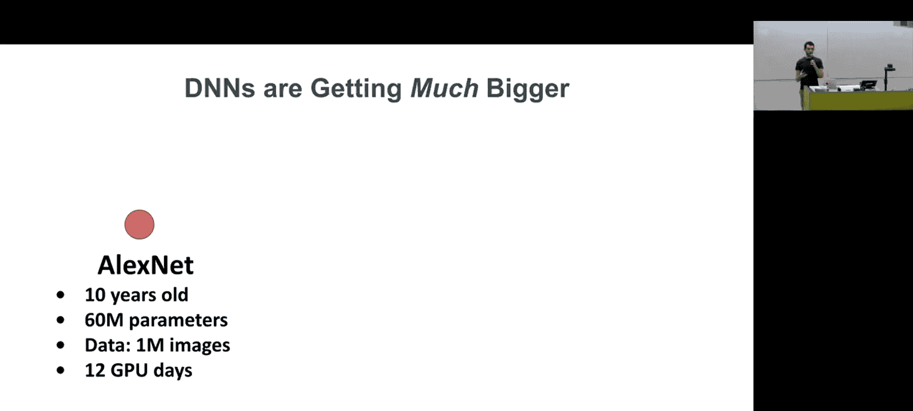

There are many， many orders of magnitude difference in the size of the model。

 the number of computations it takes to train the model， for example， GPT3 requires。

The equivalent of 355 GPU years to train， so if you take one GPU you need 350 years to train that model。

 obviously they take hundreds of GPUs to train it and that makes it a bit more tractable but it's a huge model and that's the trend moving forward models are getting bigger data is getting bigger as well。

There's also a question of sustainability， like the carbon footprint of just training this one model is equivalent to 176 houses。

 so the electricity bill of $176 houses for a whole year or taking a car and driving gets from here to the moon。

 I think 700，000 kilometers and it costs a lot of money too right like it costs about $5 million just for training this like for renting the GPUs and for paying the electricity bill。

So it's definitely not sustainable and GPUs are definitely not the end all answer anymore because these numbers are all based on GPUs right。

 and so we need to really figure out how to get more efficiency out of the hardware。

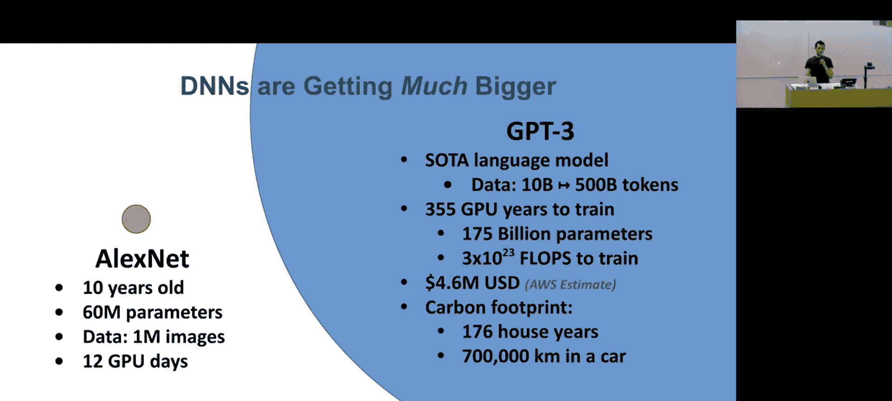

And so when I say hardware what do I mean so there are many kinds of hardware out there。

 but these are the four most used ones or the four most popular ones and so we have these general purpose programmable or software programmable hardware so we have CPUs which we all know and GPs as well so I can write code it gets compiled to these hardware targets right and then we have specialized hardware that's when I construct my own data flow or I construct my own hardware dedicated for a specific application。

And sometimes that hardware that is specialized is still somewhat programmable and you need some programmability there。

 but it not it's usually not yourcomp， it cannot execute any program it is specialized for a very specific class of applications or a very specific single application even right and that's the case with AsIs so application specific integrated circuit and AsIs just means a dedicated chip right？

And then FPGs and FPGAs are these chips where you can program any hardware onto them。

 so they are like Asics but they are programmable so it's the same chip I can download circuit doing an addition operation on it and then I can download another circuit that does multiplication I can download another circuit that does compression or encryption or implement a deep neural network or anything else right and so。

So FPGAs， you can think of them as programmable but programmable hardware circuits or programmable digital hardware circuits。

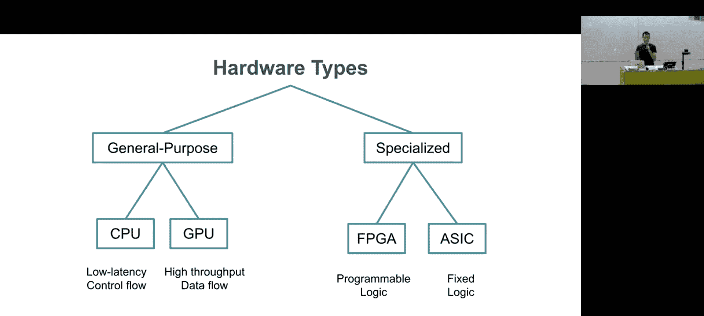

So another thing is that it's no longer sufficient to kind of as we touched upon before to use one kind of chip everywhere so previously you would see CPUs in data centers。

 you would see CPUs in mobile phones， small arm cores， you would see lots of CPUs in cars。

 I actually I chatted with people at Dimler at one point。

 and they told me that they have I think 76 computers。

 or small cores in their car and I mean a couple of them are used for the entertainment system。

 some of them are used for the automatic braking， some of them are used for redundancy just to make sure one of them fails。

 the other one it works， some of them are used for kind of the electric windows just to get the windows up and down and not have them break and things like that so there are so many CPUs in cars as well。

But now as deep learning is kind of perforating all of these systems。

 we actually need a special chip in each one of those。Pla right， and so in data centers today。

 we see Google they're creating their own tensor processing unit for accelerating deep learning。

Companies like Microsoft are integrating FPGs in every data center node they have around the world。

 So this is actually quite a big thing。Facebookacebook just announced they're building， I think。

 like a huge GPU cluster for deep learning research and many companies have GPs obviously in their data centers。

On mobile phones， we have these systems on chip that are low power and part of the chip。

 a big part of the chip is dedicated just for neural processing unit and it's used a lot for the camera functions and video editing speech recognition and things like that so it's a dedicated chip for deep learning on the mobile phones。

And then with cars， we see Tesla implementing their own full cell driving chip NviDdia have。

A dedicated kind of product as well for auto called Xavier。And the trend goes on。

 there are many other companies like Mobile Eye and other companies as well。

 building dedicated chips for self driving cars or with the computer vision part of cell driving cars。

Okay， so。So， so that's， you know。That's why you should be interested and why you should be excited and you should really kind of by now be convinced that there is no other way around it。

 like even if you know our class size is 35 people right now we need 10 times that class size to basically get enough ideas to solve this problem we have deep neural networks which are working really well but to train one of these models we're using know electricity equivalent to 200 houses so it's not sustainable it's not working and the only way around it is by rethinking not just the algorithm and how we train that neural network or the software even but also completely rethinking the hardware underneath as well。

And so by the end of this lecture， you should know a bit about how to go and design a piece of hardware that's much more efficient for deep learning。

So the first learning objective is to kind of be able to calculate important metrics for machine learning hardware。

 so we'll start by just very simple performance metrics and go on to more complex things like roof lines and other kind of analysis plots。

And then a second learning objective is to know how to optimize that hardware。

 okay so now that I have a very simple machine doing accelerating a deep neural network。

 how do I make it even faster and where are the opportunities for research in figuring out how to improve it？

And finally， we want to be able to easily analyze emerging machine learning hardware architectures。

 so if you know if a new startup comes out and says I'm doing it this way， you should be able to say。

 okay， but this is the advantage of doing it this way。

 but you're missing out on that other thing which you're not really leveraging in your architecture。

 so you should be able to comment on different deep learning chips。

 whether it's existing chips or whether it's emerging startups。

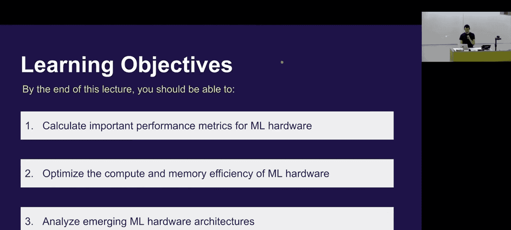

嗯。Okay， I'll pause for 30 seconds if people have any questions。

And then we'll go into the first section。嗯。O。All right， okay。

 so we're starting with these performance metrics and what we want to figure out here is how fast is this chip for a deep learning workload？

And I've been saying flops and flops per second in the past couple of lectures already。

 but here we really kind of need to understand what that means。

 so flops stand for a floating point operations per second right so that is what is the number of operation floating point specifically operations per second that I can perform on this piece of hardware。

And the reason it floating point is that， as you may know deep neural networks started with floating point operations。

 now you will often see just ups without the FL， so you'll just see ups per second。

 especially when evaluating chips for inference where reduced precision is often used so if you see a GPU and it says we're running this neural network in 8 bits。

8 bits is not a floating point format anymore so it's just an up per second。

 it's an integer up per second。嗯。So。You will often also see Max per second and Mac stands for multiply Ac because our primitive operation is this dot product Max is often used because。

Yeah you know it's always multiply and accumulate an adult product that is the smallest unit of computation and so max per second is usually just half the flops per second So if you kind of open the web page for an Nvidia chip and it says you know100terraaxax per second you know that that's 200ter flops per second orterops per second basically。

嗯。Yeah， we already covered that， you know， if it's not floating point。

 it's just called ops per second。And a very important concept here is that chips are actually often labeled with peak flops per second or peakterra ops per second or peak ops per second。

 so what does that mean that means。They just took the number of multipliers and others they have on the chip。

And they multiplied it by the frequency of operation and they gave you a number。

 they said if my chip is fully utilized 100% all of the time， this is how fast it could run。

 this is the number of operations per second it could perform。

And you should always take that number with a grain of salt because。

You never actually hit that number except in very few cases， so for real workloads。

 utilization is never 100%。And so I pasted this equation here for computing the number of operations per second。

 so it's equal to kind of the clock cycle or the speed of operation times the number of PEs and times the number of cycles for each operation so what is a cycle。

 a cycle means the clock cycle or the smallest unit of execution on a computer。And so。

So cycles per second is kind of my clock speed， so if my speed is one gigahertz。

 this is how many cycles I can go through in one second and then how many cycles does it actually take me to perform this operation so if multiplication takes four cycles then I would put a four here cycles per second is one gigahertz and then number of PEs。

And when I say PE， PE means a processing element， and often now in the age of kind of parallel architectures。

 you would have so many of those PEs on your chip so a PE。

 it's not quite a core but it's so obviously on CPUUs you have multiple cores on GPUs you have many coUuda cores。

 and it's basically it corresponds more to a coudDa core and a GPU。

 but you can think of it for the purposes of this equation as the number of multipliers that you have。

 how many multiplications can you do in parallel， that is the number of PEs that you have。Yeah。Okay。

 so that's kind of the compute performance， but like we said for all of our computers。

 we have this compute part of the chip and we have a memory part of the chip and so what are the different metrics related to memory？

So the first one is obviously memory capacity and we briefly touched upon that before as well when we said you know what does it mean for a model not to fit on a GPU。

 well that means that I can't fit you know my training data。

 my activations and my parameters on the external memory attached to that GPU so there is no way of executing it on a single GPU。

And so that's kind of the capacity of the chip connected to my accelerator。

And usually memory is quite plentiful so like I said for desktop computers even now you have I don't know。

 256 gigabyte memory， and so it's quite big， but for high performance memory for very fast memory。

 it's usually quite a bit smaller， so modern GPUs often have on the order of tens of gigabytes usually cap around 32 gigytes of memory。

And then the more important metric， perhaps is the memory bandwidth。

 so that's how fast can I get stuff from external memory onto my chip？

And so that's measured in bytes per second or typically gigabytes per second。

And I'm showing an example here for， I think this is for DDR4 or something where it's 20 gigabytes per second on GPUs this number is much higher。

 maybe 200 gigabytes per second and that's why their memories are much smaller。

And and these are not the only metrics related to memory， of course。

 because while these are specific to external memory， we often have， like I said。

 a memory hierarchy and so I'm showing you know just external memory in this simplified view but as you know we also have an on chip memory。

 things like caches， scratch pads， on chip buffers， Rams， and also registers as well。对。嗯。

So the main analysis tool when putting both compute and memory together is what's called a roofline plot and and roofline plots have been around for a long time。

 but they haven't been that useful for many noncompute heavy tasks。

 so they're more useful when you're kind of pushing your chip to the edge and really running a very high performance application on it。

 which deep learning is so now they're becoming much more relevant when comparing chips to each other or when designing a new chip。

And so what is this roof line plot， what is it， what is it showing us here？

So on the X axis I have this operational intensity and that's a property of my application。

 that's not a property of my hardware。So the thing I'm running on that hardware， the neural network。

 what is the number of operations per byte of that neural network？

So we went through kind of the convolution in the last lecture and we kept counting the number of operations。

 we counted the memory footprint and this operation intensity is basically dividing these number of operations by the number of。

By the memory footprint right what is the operations for each byte of data that I need to load from memory when I bring in one of those filters or one of those parameters from Off chip to the compute chip。

 how many operations do I perform on it basically right so it's a ratio of memory of compute to memory for compute primitive。

And then on the Y axis， I have performance。On a specific hardware chip。

 so what is the achieved operations per second on this chip？

And usually you know when you have a very small operational intensity， so somewhere around here。

 so that means you need to fetch like you know a gigabyte of data from Offip and you do one operation on it and then you throw it back out so this is definitely compute bound so no matter what I do I can't kind of increase my performance beyond this this slanted line because I'm memory bound so this is the maximum performance I can get。

When when memory is the main bottleneck， right， and then as you increase the operational intensity。

So here， for example， you'reing one megabyte from Off chipip and doing 10 operations on it。

And so at this point your limiting factor starts becoming the peak performance of the chip。

 that number I said that we almost never achieve， and so here where I'm just loading a very small thing from off chip。

 and I'm doing many operations on it， then the operations become the bottleneck。

 not the loading from memory。So yeah， so so basically in this part of the roof line。

 we're bandwidth limited， we're memory bandwidth limited。

 and in this part of the roof line we are compute limited。

And so let's take a look at an example workload， so let's say I have a neural network。

 I took the number of operations， I divided it by the size of the parameters and intermediate activations and all of the memory footprint。

And I found that， you know， it fell here on the operational intensity kind of line。And so， I would。

I would kind of draw a vertical line and see where I hit the roof line。

And usually if it hits thislanted part of the roof line， then that means it's memory bound。

And I should mention the slope here。Is equivalent to the memory bandwidth。

 while the line here is equivalent to the peak performance。 So， so this is basically。

The 20 gigabytes per second that I mentioned before。嗯。So。

So I mean and I'm drawing here this again this very simple model of hardware that we have。

 so we have an accelerator， it's connected to external memory and my example workload is memory bound。

 so what do I do at this point if I want to speed up this application。嗯。So。Anyone。Wants to guess。So。

😔，Or does anyone have questions about the roof line so far。

 so this is one of the important concepts that we want to cover in this lecture so make sure you understand it。

嗯。Okay， I'll just continue。So。Okay， someone wrote something。Get better memory。

 make the workload less memory intensive。 Yes， that's exactly what we should do。

 Aman Aman answered faster memory from when he， yes， that it's also correct， so。Good， people are。

 are still with me。 That's good。So I already verbally kind of mentioned what Ops per byte is。

 but here it is for completeness， again it's the kind of the total number of operations that I need to perform divided by the total memory footprint。

 and it's important to kind of know that the memory footprint is not just the parameters。

 but also the activations and intermediate results that are coming out of the neural network。

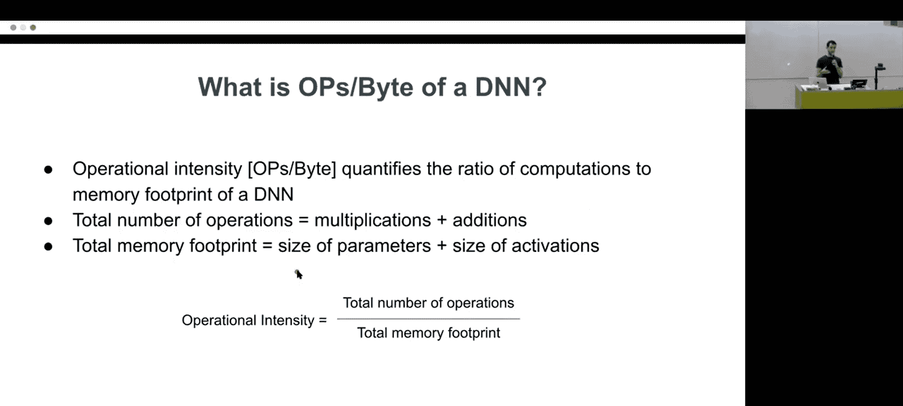

So I I have a question as well， so maybe everyone can now answer。

How can you speed up a memory bound application？嗯。嗯。All。

 can't wait until you guys get here next week。It's， yeah， teaching an empty class is， is weird。

Me too。 Yes， I'm sure I'm sure you also don't like sitting in front of a screen， so。Okay。

 so I think most people answered。And so 14 people said， use a larger memory chip。So。Okay。

 so a memory bound application is one where I cannot load in memory fast enough from external memory。

And what that means is that loading memory is the slow part of my application。

 it's quite slow to get memory from off chip to on chip。

 it's not really speaking to the capacity of the external memory chip because things fit on the external memory chip they're fine。

 but I just can't get them on the compute chip fast enough right so it's not so that's not the answer。

嗯。Use a faster memory chip， of course that's correct。

 so to speed up loading of memory from external memory to on chip。

 I need a faster memory chip so that will get things on my chip faster。And so like I think Aman said。

 we can just replace our DDR3 with GDDR3 or DDR4 or something else。

 so using a faster memory chip with faster external memory bandwidth。

 so instead of 20 gigabytes per second， it would be 140 gigabytes per second or 100 gigabytes per second。

So actually， most people gave that answer， 21 people。

And then answer number three is add more multipliers so of course if I if I need to load one or 10 gigabytes of data from external memory and do one operation on it so that's the example I gave right so we need to load so much things from external memory and do one operation on it adding 100 more multipliers won't help because。

I mean， it will only speed up this compute part of my problem。

 it will not speed up the bottleneck which is loading of memory， and so four people gave that answer。

And then finally use lower numerical precision。So this is an interesting one。

 so this is an example of an algorithmic change or a workload change that can improve my operational intensity。

 so it's no longer。Making my。It's no longer speeding up the roof line itself。

 it's no longer changing the roof line， but it's changing where that application sits on the x axis so that means it can move from being memory bound to compute bound so remember compute intensity or operational intensity is the number of operations so how many operations divided by the memory footprint in terms of bytes。

 so if I use a lower numerical precision， I still actually need to do the same number of operations operations are different but I still need to do the same number。

 but every time I load a fewer number of bytes because if my previous precision was 32 bits。

 I need to load four bytes for each operation but if I go to8 bits I need to load one byte for each operation。

 so I'm actually moving it along the X axis。Here。So Mayor is saying how do you make the memory chip faster and that's a very good question。

 you replace it so you find a different memory chip that is faster and you're connected it to your hardware and obviously it has to be compatible with your hardware as well。

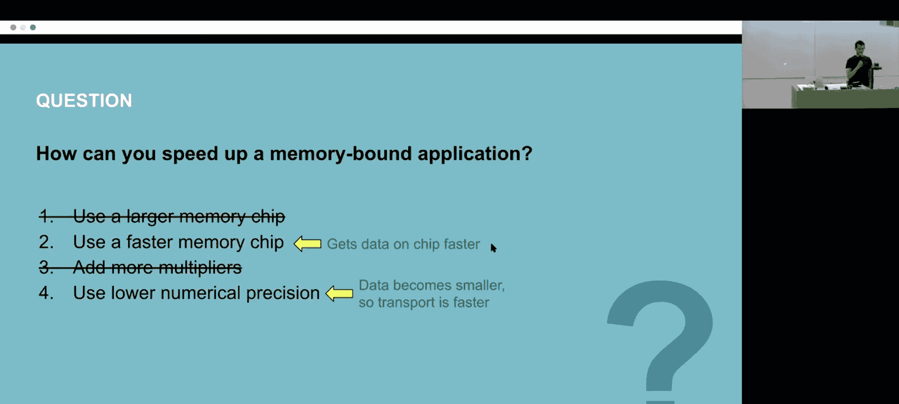

So I think that's what we'll do here so yeah， so this is what I was pointing out with you know reducing precision。

So when you reduce precision you are executing the same number of operations。

 but just the number of bytes are much smaller that you need to load from memory and so operational intensity you're just reducing the thing in the bottom of that fraction。

 you're reducing the number you're dividing bytes so you're increasing the operational intensity and if you're memory bound that just means that corresponds to an increase in。

In performance or you can even move it all the way to be performance bound or compute bound here。嗯。

So the other way of doing it is using a faster memory chip as many people responded as well。

 so my previous chip was that fast， so remember the slope is equal to your external memory bandwidth。

And if you work out kind of the units here it will check out so operations per second divided by operations per byte。

 the operations cancel， bytes are on top， so it's bytes per second it's my memory bandwidth basically so when you have a faster thing it's a bigger number and a more steep slope which means it would kind of change my application from previously being memory bound to potentially being compute bound because my roof line has moved so much。

So here I replaced external memory with a faster one， in this case DDR4。

 which isn't actually much faster， but it's just an example。嗯。Yeah， so I mean， there's a question。

 how does DDR 4 handle increased cycles per second？Compared to DDR3。So。

So DDR 4 can load stuff from external memory faster， so cycles per second。

So cycles per second is kind of the frequency at which your chip runs。

 so I'm actually not sure how the DR force spec is faster。

 it could be the frequency of operation so it could be just it has a faster clock and get stuff on chip faster that way or it could have a wider bus as well。

 or more memory banks or something so that it can load more memory faster。

 more memory and the same clock period so in terms of cycles per second，Which is your frequency。

 it's DDR4 is potentially faster because of a higher frequency。

 but I'm actually just not sure of the spec。Yeah， I hope that answered your question 3。Okay。

 so it does。Okay， so so as I said。In this example here， our example workload is now compute bound。

And so how do you fix a compute bound application？And so now we're not looking at the memory chip anymore。

 but if I want to increase the performance of this application then my only option is to kind of go in and speed up my accelerator somehow so in this case I just I'm giving the example of overclocking your accelerator which people often do with GPus or CPUs so you just make your accelerator faster in this case three it would be also kind of faster cycles per second on the accelerator itself so it can consume all of that data more quickly and do the operations more quickly and so I'm no longer compute bound and if you hit that elusive kind of corner of the roof line than you're kind of you have a perfectly matched application or workload to this hardware that means that this memory speed and this compute capacity exactly matches。

Operal intensity of my application or my workload。And so now it's perfect。Yeah。

So of course I also mentioned before that you know we never actually hit the roof line the roof line is still the theoretical limit of how fast I can run this application on this chip if hardware utilization is 100% So if I'm always using all of the multipliers。

 there is no waste at all， there is no control overhead there is no latency associated with bringing stuff on chip and I can hide all of that latency by overlapping compute and memory and so so everything is perfect in our in this scenario of you know we're actually hitting the roof line and achieving that performance。

 so usually what it will look like is more like this you know I compute the operational intensity of Alexnet and then I measure how fast the trends on the chip and it's usually below the it will usually be quite a bit below the roof line especially on things like CPUUs and maybe even GPUs because it's a general。

urpose chip it has overheads associated with caching with branch prediction。

 like I said with just the compute not fitting my chip I gave the example last time of you know my number of channels is not a multiple of 64 but my number of compute elements on the chip are a multiple of 64 so I'm often not using all of 64 multipliers and so in this case you get some wastage and so on。

So the achieved performance doesn't hit the roof line because of memory access efficiency。

 so another thing about external memory is that if you're loading from random addresses。

 often get you get nowhere near your peak memory bandwidth。

So in the example before I said all memory bandwidth of 20 gigabytes per second。

 I've never actually measured 20 gigabytes per second on a chip。

 I think at Intel when we measured we had some microbenchmarks to measure the efficiency of external memory accesses for a different deep learning workloads and in that case the highest we ever got was 79% and this was a really good number and we celebrated when when we saw that number but usually memory access efficiencies close to 60 or 70% just because you can only ever hit 100% if you are always loading from successive memory addresses so your memory addresses 1。

234，567891011 all the way to kind of the end of the memory if you ever change that if you go from one to 10 and then back to three and then to four so these cannot be coalesced anymore they cannot be grouped into a cache line for example and。

Fettched from off chip together， because the way external memory works is actually when you're loading a byte of data。

 it fetches。Way more than that it fetches I don't know one megabyte of data or something like that all at once and what that means is that it coalesces all of your reads in the memory controller so there is a component called the memory controller it takes memory read requests it coalesces them so it says okay I have these five requests can I now send a request to external memory to bring all of those five pieces of data or not and if they're not in successive memory addresses it will not be able to do it efficiently。

All that's to say， memory access efficiency really limits your peak performance。

 especially when you're memory bound， right？We also mentioned compute utilization， so again。

 if I'm not using every single multiplier on the chip。

 I'll never hit that roof line in terms of peak compute performance。

And finally control flow so if I have any data hazards or control hazards。

 which again is not present all that much in neural networks。

 but if I have any of those then I need to wait and until。

Until I can continue execution and so in that case any complexity in the neural network of topology or lack of parallelism would kind of stall as well and make me kind of below that roof line and so in assignment1 you will go off and plot many of these roof lines you will benchmark many of these applications and hopefully you will really get a feel for the performance of different neural networks on different hardware targets as well so I'm excited about releasing a1 next Monday I think。

And here I'm showing you kind of a real roof line， so that previous one。

 I have this disclaimer here that everything is just randomly plotted。

 but this is a real roof line from the TPU paper， which is the assigned reading of this week。

And so you see here a it's a log log scale， so the differences are actually bigger than it may seem。

And let's look at one of those workloads， so here what they're doing in this paper is that they're plotting different important workloads to Google on this roof line to see how much better they can be compared to a GPU and a CPU。

And then they have their TPU here so all of the stars correspond to the TPU I mean the first thing you'll notice is that all of the stars are actually above the roof lines for the GPU and the CPUU so the authors of this paper are claiming okay。

 we can do way better than these two existing devices by just going to our specialized ASIC called the TPU right？

The other thing is that you this for this single application called MLP zero here。

The operational intensity is actually different for each device。

Which is I thought was interesting right because an application should have the same operational intensity that's that's independent of the chip can you think of why。

This same application or the same workload， this MLP0 has different operational intensities。

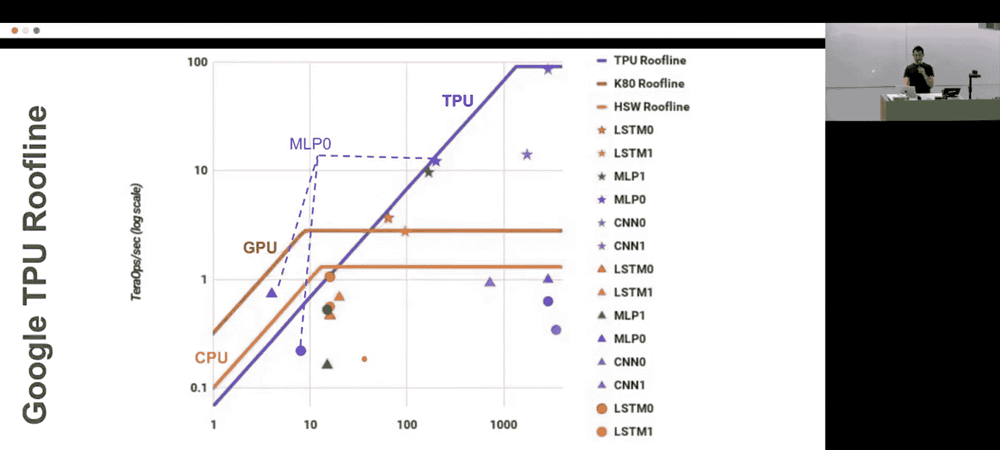

So let me relaunch that poll。嗯。Os。嗯。😊，I I did this before right， Yeah， I got it， yes。Relaunch， okay。

So how can the same neural network have a different operational density on different hardware？嗯。

So what do you think， so put your answer in the poll， Ty。If you can see it。OK。it started off well。

 but I think now answers are all over the place。So yeah， we have 87% of the answer right now and。

So maybe we'll stop here， so。So different support in numerical precision。

 so that that's the main one， right？Basically having， as we said before。

 one of the things that can change your operational intensity is to have different supported precisions and in this case the TU was running that MLP workload at into8 precision and it didn't actually support other precision for it whereas the GPU was running it at FP32 precision and the same for the CPUU and so it isn't really quite a fair comparison I mean the plot looks good but it's important to kind of also focus on those details when looking at a plot like this right like what are my operations and what is the size of my weight or size of my parameters and all of these things。

Other things could affect your operational intensity。

 include kind of whether you have compression coming from an chip off chip memory。

 so sometimes there is integrated kind of compression and I think NVdia published a paper about this where they are trying to implement a compression engine to compress everything coming from external memory and therefore or going out to external memory as well and therefore make better use of that external memory bandwidth so。

So basically， it has to be something that affects my workload to change my operational intensity。

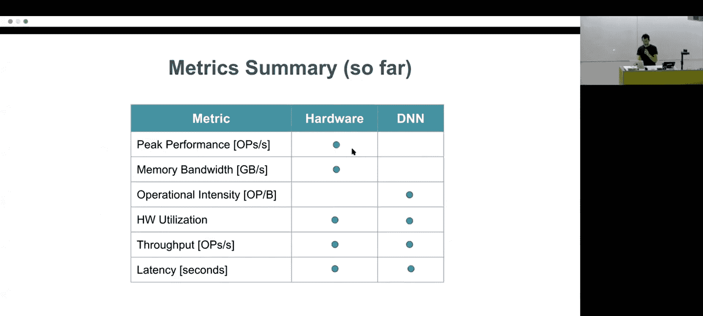

Oh sure yes so we can we can talk about the rest of these as well so so remember the operational intensity is a property of my workload and it's the number。

This works。It's the number of operations。Divided by memory footprint， right。Footprint。So。If。

IfIf that's the equation， then I need to either change the numerator or denominator to change this number。

And if we look at number two or choice number two here where it says different memory bandwidths on each device。

 so this is a property of the device and not the workload and would not change this equation right it would only change kind of the slope of my roof line in the memory bound part。

 so on the X axis the workload would still be in the same place。

And then number three is different number of Ps on each device。 so again。

 that's the property of the memory of the compute chip， it's not a property of the workload。

 so it will not affect this equation again， which is just I take the model and I compute the number of operations I need to perform。

Divided by the number， the memory footprint。 And so in in the case number3。

 this would raise kind of my compute bound part of my roof line。 So it would it would increase。

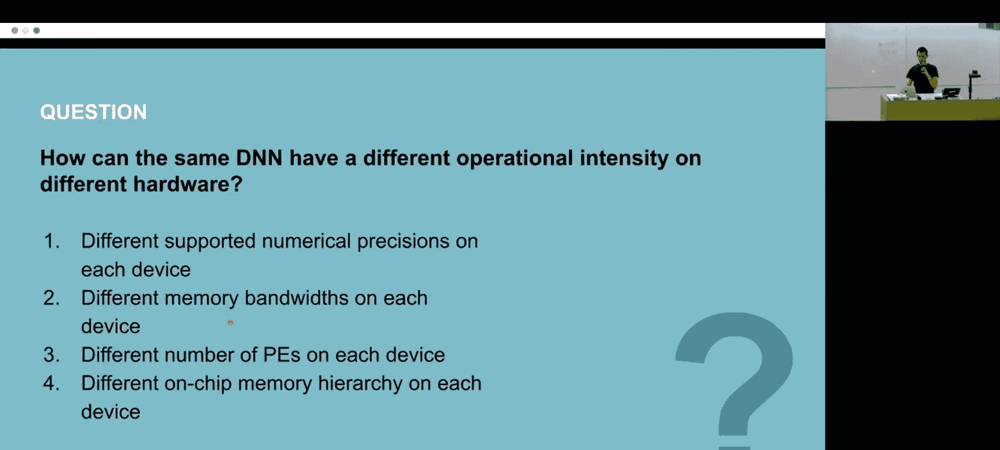

It would， it would raise this part or the the kind of flat part of the roof line because it increases the peak performance。

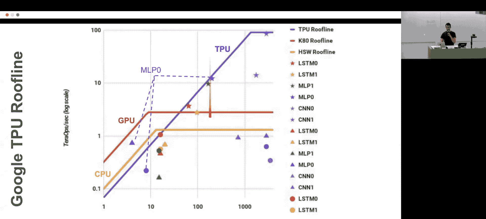

And finally， different on chip memory hierarchy， again， that could speed up my achieved performance。

 right because I'm caching things on chip and I'm getting stuff done faster this way， but again。

 it doesn't affect my workload。And that's why it's fairly important to kind of distinguish between those metrics what actually is affected by my hardware。

 what is affected by my neural network， and what is affected by both。

 and you will see here that the operational intensity which is again the X axis。

 is only a property of the neural network。

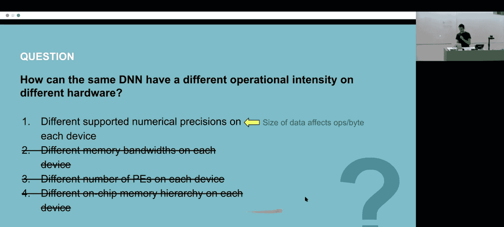

So I need to change my workload itself to be able to change my operational intensity。U。

In terms of hardware metrics， my peak performance and my memory bandwidth。

 these have nothing to do with the neural network right so these are properties of the hardware itself。

 how fast can my compute elements run， how fast is that connection and that memory controller between my computer chip and my memory chip whereas you will see a bunch of other metrics。

That are a property of both the hardware and the neural network， so hardware utilization。

 like I said it depends on the number of multipliers you have on chip and the number of multiplications you need to do so that will come from both your neural network and your hardware the throughput of course it depends on your hardware because it's highly correlated to your peak performance。

 but it also depends on kind of how friendly the you know read accesses are to external memory。

 what are the kind of coalesce all my reads， what is my hardware efficiency and so on。

 so the achieved throughput， while it's correlated to you know your hardware capabilities。

 it also depends on your workload whether your workload is friendly and works well on that hardware or not。

And finally， latency。 So throughput is the number of operations per second。

 So it's achieved performance。 and then latency is how fast I can complete my。MyThe execution。

 so from start to finish how many seconds does that take and again that depends on both the hardware and the neural network。

And so another question from three， so the throughput does depend on D。

 but would we relate it to it when comparing performance of the same DNA over multiple hardware？Yes。

 so ultimately what you care about is those bottom two here。How so throughput is。How fast and well。

 let's start with latency， actually。So latency is how fast I can perform one inference so if this is you know time here and I'm performing in the case of inference let's simplify it let's not talk about training at the moment but for latency is how fast I can do this so I'm getting a request coming in someone is talking in his phone he's saying hey Google what's the weather I need to do kind of respond as fast as possible and so I got that request on the data center it goes on my TPU for example if I'm Google and then a response comes back out after you know in this case 0。

25 seconds and Google are usually very proud of this number you know you see a Google search still tells you this search was done in 0。

1 seconds or something at the top of the page so that's latency that's from the request coming in the response going out while the throughput here is how many of those requests I can process in per second。

And here I can perform four inferences per second， so that's my throughput。

And so to come back to your question three so what I ultimately care about is these latency and this throughput。

 so these are the only metrics from the stuff I talked about in the last slide that actually affects my application and affect my in this case end user experience for kind of Google search or or voice search or whatever it is right and so when comparing between chips。

 this is the number that we care about but obviously when we're designing a chip we want to figure out all of these other numbers because these are kind of the constituents that go into producing that final latency or throughput number so hardware efficiency。

 I need to when designing the chip I need to make sure that my hardware efficiency is really high I need to have a high peak peak throughput because otherwise I have no chance of kind of increasing my performance I always have the ceiling if I have a low peak throughput and so on。

So。I hope that kind of covered what you were asking， but feel free to ask again。嗯。Okay。So by the way。

 I'm happy in this lecture where I'm actually getting a bit more questions so please don't be shy。

 you should stop me and ask questions if anything is unclear。

 I mean that's the whole purpose of the lecture right。

And so so someone may say you know isn't throughput always one divided by latency right and the answer is no because we have something called batching and it's really important for our kind of applications as well and that's when we can run multiple inferences in parallel for example in the case of inference so I'm getting two requests I'm getting two people asking for the weather I'm batching those two requests I'm sticking them both in my GPU and and in this case。

 for example latency is actually a bit longer it's actually a bit higher than my previous latency but my throughput is also higher so throughput equal one over latency that's only true for batch size equals one but if I have batching throughput and latency are no longer related to each other in a direct way batch size has a big role to play as well。

嗯。Okay， so。So we just kind of covered the first part of the lecture here and this is way slower than I actually thought this would be。

 but perhaps it's good to stop here and again ask for any questions so far so what we covered so far is you know straightforward concepts of how do we evaluate。

A compute chip or how do we evaluate an accelerator for deep neural networks right we we really need to take memory and compute into account we have flops per second in terms of compute and gigabytes per second or bytes per second in terms of memory。

But in isolation they don't mean much because we really need to also look at the application and the operational intensity of the application and how it matches to my memory bandwidth and peak throughput and then once we plot that once we put those two things together。

 we have this roofline plot which is a very useful analysis tool。

In both comparing and analyzing DNA accelerators or accelerators in general。And then finally。

 we talked about how。How achieved throughput is never kind of the same as peak throughput and how utilization and other factors come into play as well。

 and also how we can change the application itself to have a better operational intensity that fits a certain application。

And。So if if there are no more questions， perhaps we can。

I went to maybe the first part of hardware efficiency。But then yeah。

 we can we can also go over it again next time， I think we have just 10 minutes left。So。

So yeah so how do we get efficiency out of the hardware and so here we will talk more about how do we again go from CPU to accelerator and this image here is quite striking because what it shows is the energy breakdown of a single addition instruction on a CPU so I have two numbers five and 7。

 I want to add them together to get 12， 5 plus 7 equals 12。And so to do this on a computer。

 where am I spending the energy and it's quite striking because the addition operation itself。

 the adder takes this much energy， this red slither at the end of that bar here and the rest of it is used for other stuff and again it correlates to that chip area that I showed before。

 most of it is using caching， register file accesses， control branch prediction， all of that stuff。

And so。How do we so is that good enough no it's not。

 there is a lot of inefficiency if I want to do an ad I should do just add in the ideal world and so how do I make my hardware more efficient or how do I gain more efficiency compared to that previous thing I showed？

So there are many ways of doing that， and one of them is changing the arithmetic。

So we can use specialized instructions to amortize overhead right so we'll go over that we can use lower precision of course we're already touched upon that a bit we can optimize our memory for memory bound applications this really affects things and there we really want to leverage reuse of data and make sure data locality is achieved so we'll talk about these concepts so locality means the data is always close to my compute when when it needs to be computed。

Ineffectual operations and that means if an operation is a no op， if I'm multiplying by zero。

 I would like to skip that， and so that's one of the current open problems in deep learning hardware。

 how can I effectively skip ineffectual operations？

Then other techniques include kind of model optimizations。

 so changing the workload itself in a fundamental way to be able to better fit the hardware to either reduce the flops so like going from you know VGG to efficient net or something or by changing the model toppology to better fit my hardware。

 so these are model optimization techniques that will'll also cover in this class but not in this specific lecture so we'll talk about it in the next module。

Yeah。So the first technique that I had there was related to arithmetic and it was called amortized overhead and so the idea is that I have these blue bars which are my overhead。

And I'm only doing a very small operation in the end。

And so I need to kind of repeat this overhead every time I do another edition。

 so every time I do an ad I spend all of this you know 25 picojoules on an instruction cache axis。

 I need a new instruction I have register file access I have some control and then I do that addition and then I have another ad like ad instruction coming in and I need to do all of that again but a kind of standard way of improving that is to actually increase what I'm doing with all of this overhead so increase the computation with the same overhead so for a single instruction instead of doing a single ad maybe I'll do a gazillion ads right like I'll do 100 ads or something。

And so that's the first technique and kind of getting around this idea of， you know。

Of of this tax or this overhead that I need to pay every time I do an instruction。

And so here I'm showing the all like from GPUs， what they were doing to get around this is that they defined all of these new instructions。

 so this one is half precision fused multiply add， so they would pay for a single instruction。

 but they would do both multiplication and addition in one instruction。

And so now the energy for that instruction is a bit higher and the overhead is kind of still quite high。

 but then they created a new instruction which takes four of those multiply ads and puts them in a single instruction so now the instruction becomes even more complex so this is half precision dot product for so this is doing a fourway dot product in a single instruction and now my overhead went down from you know 2000%。

 so the blue part is going down not because the blue part is decreasing but because the red part is increasing I'm doing more computation with the same overhead。

 they haven't fundamentally changed GPUs in any way。

 they're just adding these more complex instructions。And by the way。

 the same is being done in CPUs where you have all of those AVX and AVX2 and SSE instructions that are also CD extensions of CPUs。

 CD meaning single instruction， multiple data， and that's the main paradigm in programmable computer chips nowadays。

And then finally they also have now this matrix matrix multiplication。

 so they're multiplying 2 16 by 16 matrices in a single operation they're like why are we doing dot products we just just multiply the whole matrix in a single operation and so now the overhead is actually quite small the energy spent in the computation is a bit more or much more than what I spend in the overhead。

And so so now it's quite efficient， you can't really get much lower than that in terms of overhead。

 especially for a fully programmable device like a GPU。

So James is asking isn't things like AVx 512 becoming more and more like paralyzed vector instructions for GPUs Yes。

 it's becoming very similar so you need to write very kind of specialized code that runs on a single chip and。

And ifVx 512 instructions， they can't quite do 16 by 16 matrix small in a single operation。

 but I think they can definitely do stuff like dot products very efficiently on CPUs。

 but they're converging basically， C extensions of CPUUs and generally how GPUs operate。

 which is also single instruction multiple data。And so that's the first technique and I'll say in the accelerator that we used to that I was working on at Intel。

 the deep learning accelerator， we actually just had a single instruction for convolution so if I have a convolutional layer my instruction looked like convolution and then it happened on the hardware and so obviously it had many kind of parameters so what is the size of the convolution。

 what is the size of activation and so on so it was kind of what we call the VLIW or very long instruction word accelerator but we basically took this idea of amortizing overhead all the way to kind of the limit and we saw what is the biggest coursears coarsest grain operation I can do and that was you know my compute primitive of a deep neural network。

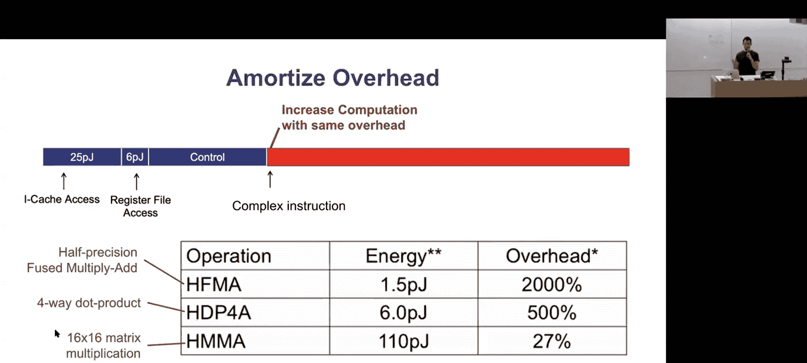

嗯。And maybe I'll stop after this slide but here I'm kind of showing two generations of tensor cores on GPUs and it's kind of showing you the number of instructions that's performing per second so here two things are happening actually the first thing is that they created these tensor cores to do matrix matrix multiplication in a single cycle so here you see you have a 16 by 16 matrix on each side and it's being multiplied in a single cycle to produce another matrix。

Whereas here we're computing one row of this matrix or one column in every cycle and the other change is that we now have an instruction to access these tensor cores to obviously do this matrix matrix multiplication a single cycle。

And if we look at the TPU on an AsI what they did is actually not a 16 by 16 matrix。

 but they have a 256 by 256 matrix multiplication engine so now they single instruction does 256 times 256 operations matrix matrix multiplications at the same time and so moving towards these coarser grain。

Operations is definitely something that's happening quite aggressively in industry。

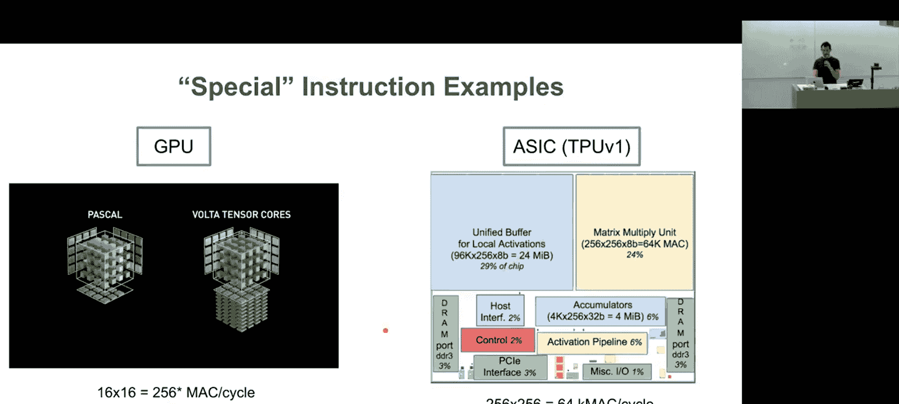

嗯。

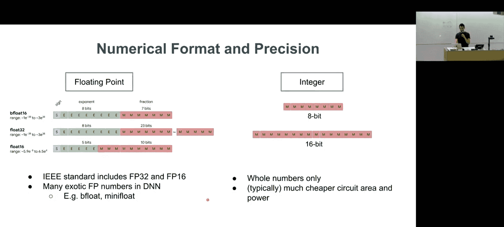

So I will stop here because I think we're out of time。

 but I'm happy again to kind of stick around for extra five minutes if people want to discuss anything。

 you can just unmute and chat or you can type in the chat box if you have any questions。Yeah。

 so yeah thanks for kind of paying attention and coming to class so I'll see everyone next Wednesday and like I said。

 I'll just stick around for another five minutes。

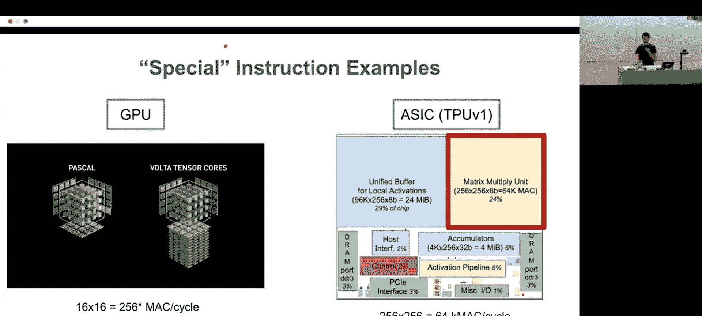