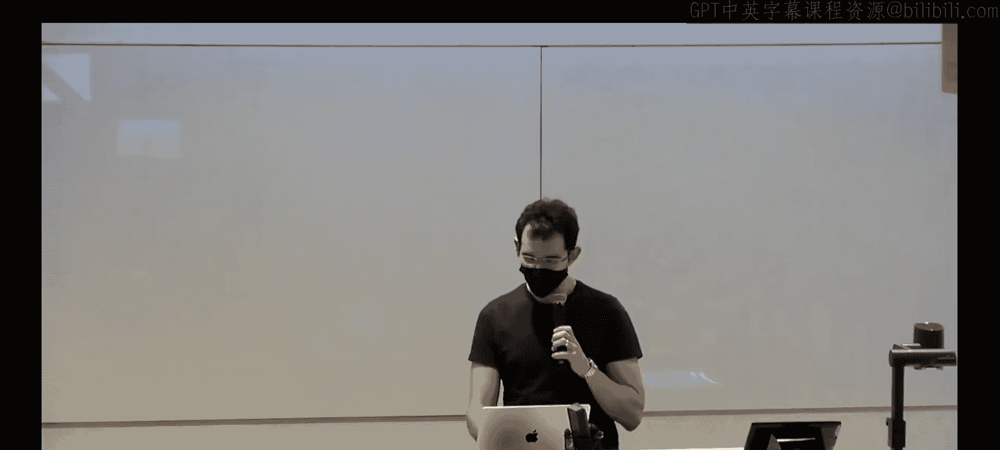
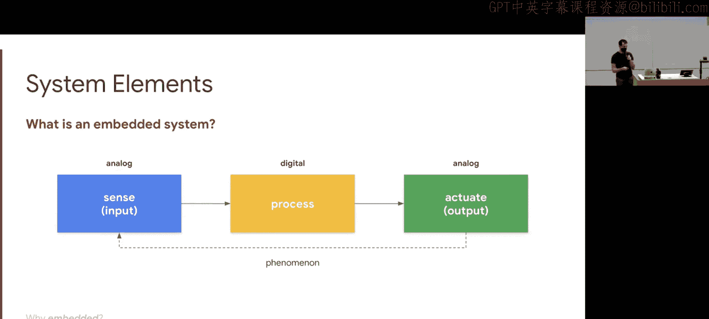
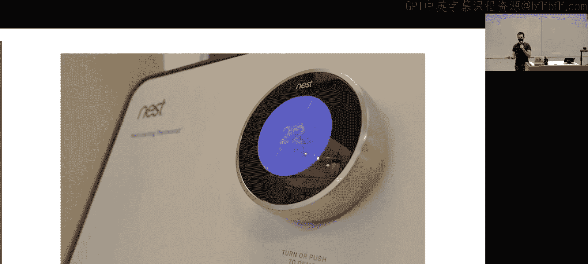
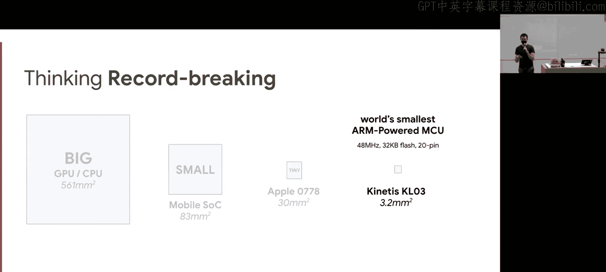
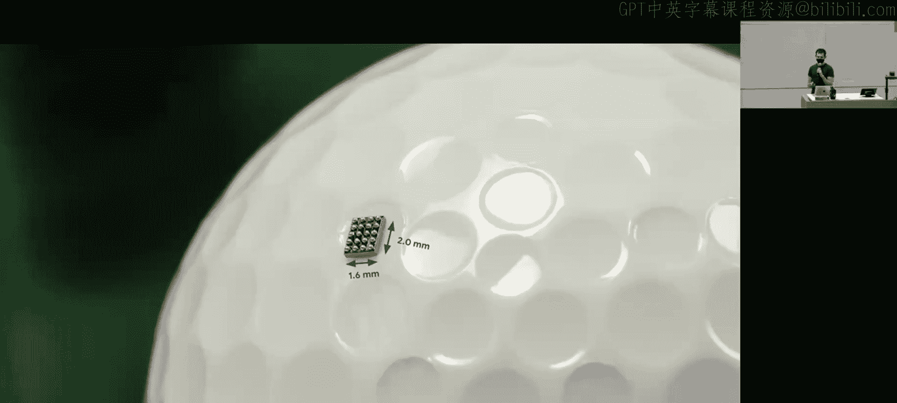
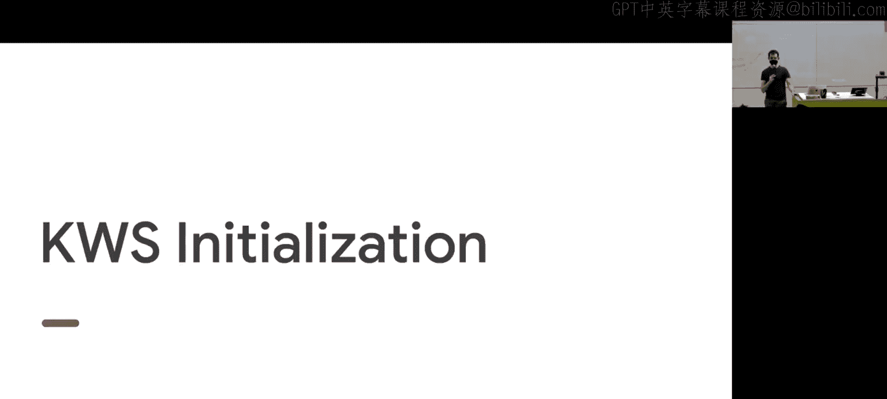

# 康奈尔大学《机器学习硬件和系统｜Cornell ECE 5545 Machine Learning Hardware and Systems》中英字幕 p07 -07-Lecture 6_ TinyML.zh_en -BV1CCqPYSEP5_p7-

Okay， so so this lecture is a bit different。 So so far we've been talking about hardware。

 And if you haven't noticed， there has been a strong focus on data centers and kind of heavy duty hardware that's used to process kind of。

big workloads and that's a personal bias that's because I'm very interested in that kind of hardware。

 but today we' will do kind of a completely different thing where we will talk about kind of the most lightweight computer hardware out there and how we can run machine learning on it。

So it's actually so challenging that people gave it its own name。

 they call it tiny ML and so we'll talk a bit about that today。嗯。

Okay。So how's， how's a1 going， Is it， Is it too difficult or too easy。Like what do people think。

 who thinks it's too hard， for example？No， too easy。It's not too easy。 Okay， okay， that's。

 that's good。 So it's， it's， it's， it's medium。😊，So so the other thing is I put in kind of this discussion poll to decide on a time for the Crebras lecture so they can't do our regular time slot because most of them are on the West Coast and definitely the person who's giving the lecture so they need to do a different time I think starting from 11 a hour time so basically just fill in all the time slots that work for you please try to do that today so that I can get back to them so that they can get back to me and then we'll just change the time of the class for that one time that makes sense。

嗯。Okay， so we'll talk about tiny machine learning and so this lecture is a bit different because I didn't actually create the slides。

 it came from these guys， so this is a professor at Harvard， Prossor Vijay Readddy。

 and then Pete Warden and Lawrence from Google and they basically founded this idea of tiny ML and they wrote the book on it and they created three courses onedX which is like Coursera basically。

To to explain what tiny machine learning is。So they've been very generous and they've given me all of their slides。

 even all of the source material for their slides and their assignments and everything and so that's what this lecture is based on and I've basically compressed three courses of edX into this one lecture so we'll try to go through all of it but if you want kind of if you're very interested in this topic then I'd recommend their courses as well。

嗯。嗯。So what what we'll go over today is three things， it's always three things actually。

 the first one is you know what is tiny ML， why is it called that and why is it different from you know regular ML？

Second thing is you've all or most of you have taken one of those kits here。

 so we'll use that for our second assignment， which is an assignment that would kind of walk through you know a machine learning model from training all the way to deployment on actual hardware the kit you have is the hardware that you're going to use so it's a very kind of constrained kind of hardware a microcontroller and so we'll go over what's in that kit and how to maybe briefly how to use it the rest of it will be in the assignment handout as well。

Like I said you're borrowing these kits after you're done with the assignment， you can give it back。

 you can also keep it for the whole term I don't care and just give it back in the end that's also fine with me and if you're really interested you can buy one I think it's $50 compared from many vendors online。

So and then the third thing we'll talk a bit about tiny ML software。

 which is also quite different from regular software。

 and so we'll talk a bit about how they make it so efficient that it can run on this tiny device。

Okay， so how many people here have taken an embedded systems course？It's good the few hands。

That's good， so basically what is an embedded system？

It's a system in which you have a processor in the middle。

 but you also have these inputs coming in from actual sensors and then the output goes to actuators so this is different from a regular computer right because a regular computer usually is hooked up to an ethernet cable for the inputs or you know a mouse in the keyboard and things like that。

 this is a bit different because it is designed so that it can interact with the world around you。

So so what is an example of an embedded system if you're wearing a Fitbit watch or you know a smartwa that's one example。

 so what are the sensors in this watch for example， what kind of input does it get？啊。

Accelerometer GPS heart rate monitor， for example， yep。

 and then it has a tiny processor much like the one you have with you in this kit and the output is this LCD display obviously。

Another example is kind of a thermostat or a smart thermostat like this nest thermostat。

 so its input comes from you know the rotation when you rotate the nest temperature and humidity sensors。

 so we're already starting to see you know it has many different kinds of sensors at the input right and then the output is kind of a control signal to control the temperature。

So so these microcontrollers are actually ubiquitous they're everywhere and it's easy to kind of not realize that they're in everything you use so this new remote that I got it also has a microcontroller。

 you know your washing machine， your microwave， all of these devices have microcontrollers in them。

Something like the I think this is the Amazon Echo dot。

 this also has a microcontroller in it and this is how it functions。

 so let's open up this box and see what's in it。So it has a few sensors， in this case。

 an area of microphones。To sense the input， it has a processor， which is a small microcontroller。

 I think almost a bit more powerful than the one you have， but basically the same thing。And finally。

 it has a speaker in the output。 So this is actually a very simple system that you know。

That is that can be used to create kind of a new product and open a new domain for。

 you know this market of。You know， home assistant devices or whatever it's gone。

So we've talked about embedded systems but what is tiny ML right so tiny ML is the marriage of embedded systems and machine learning so people think machine learning is very important and you know it will be the new way we write software definitely the new way we make sense of you know inputs coming from different sensors around us in the environment and so putting machine learning on embedded systems is what people call tiny ML。

And so let's talk about this first part， which is sensing the inputs。So traditional machine learning。

 you really focus on two domains right or two different kinds of sensors at least so that you know the microphone。

 a voice or a speech sensor， and then the camera which is an image sensor。

 you also have some other kind of data that is input to your machine learning model but they're not really tied to sensors like you know text or something like that。

And so so that'， you know in traditional ML sensors， that's what you get。

 but you know for embedded devices， you get all of this different wide array of different kind of sensors。

So here you know we still have speech， we have image。

 but we also have you know these three sensors which together are called this inertial measurement unit and these are used for many different applications and they're in every device almost right now like in your phone in your smartwach。

 I think even in this thing that I'm holding because know it senses where the dot is and allows me to move it on the screen。

And so。Basically this is a very important sensor because it can be used for many different applications like movement detection counting the number of steps。

 but it can also replace some traditional sensors like the microphone for example。

 some people have been actually using the inertial measurement unit in those in-ear earbuds like the Samsung earbuds so it has a microphone on the outside but it has an IMU and the inside as well。

 and so if the sound is coming from the outside is too noisy， they actually switch to the IMU。

 they measure the vibrations that they can detect inside your ear and that's how they transmit sound through your earbuds into whoever you're talking to on the phone。

And so some people can use this sensor in a very kind of smart and innovative way。I mean。

 the other very important thing is that even for very small cameras， you get these， you know。

 the smallest camera you can get kind of for under 100 millitts of power。

 but these IM use are like an order of magnitude less power as well。

 so you can put them in these embedded systems without consuming too much power。

One other thing about you know these sensors compared to traditional machine learning sensors is that it's actually harder to interpret or to make sense of all of these inputs so easily。

 so you know for image and whoops。For image and speech。

 you can look at it and make sense of the data or you can listen to it and so on。

 but for IMUs and other embedded sensors it's sometimes a bit harder。

 so interpretability is sometimes an issue when you're looking into that and that's one of the challenges that people face when dealing with those sensors。

Another challenge is what people call sensor drift。So does anyone know what that is？对。Sorry。Yeah。

 so over time， for example these sensors that measure vibration or magnetism or direction or so on they can deteriorate。

 so they would need to be recalibrated for example。

 if you're moving it too much and then something inside the sensor would shift a bit and and then it wouldn't work in the same way so it would always be biased to be pointing in one direction or thinking it's always moving when it's stationary and so on so that's another challenge that people need to deal with as well when thinking about implementing machine learning on those embedded devices。

Yep。So we talked a little bit about sensing the inputs， but now let's talk about the processing。

 which is what we really care about in this case， and which is also presents the main constraint of implementing machine learning on those tiny ML systems。

SoSo far we've been talking about these you know large compute devices in this case a GPU。

 so that's you how big a GPU is in terms of chip area if we draw it to scale to other chips that I'll show later。

 this is how large it would look like， you know it's complex it has many elements on the chip and so on。

And usually the chip area is in the order of， you know， hundreds of millimeterters squared， right。

But then there is something that's smaller than that， which we can also do processing with。

 and that's usually found in your phone with like a 2000 milliampmp battery or something。

And so taking Apple's a12 chip for example， its size is a bit smaller。

 it's about 83 millimeter squared about an order of magnitude smaller about 10 times smaller than you' would get in a high end GPU the power also kind of scales almost in the same way or even a bit more so these GPUs are like 300 watts while those mobile phone processors are closer to 10 watts in power。

And then you know you have your smartwatch and that's kind of the smallest kind of processing that you can do and in this case you have this。

 for example， for the Apple1， they have this S1 chip and this is what we're going to start to call tiny it's about four times or three times smaller than the mobile phone processor and it's about 30 millimeter squared at least for the Apple Watch。

But there's even smaller， so the smallest MCUs are even much smaller than what you can find in something like a smartwatch and so for example。

 this armpowered MCU runs at 48 mehertz it has 32 kilobys of flash and it has 20 pins to interact with the outside world and it's just 3。

2 millimeters， so compared to this largest processor here。

 it's how small it's at least three orders of magnitude smaller or two orders of magnitude smaller。

 so it's 100 times smaller than a GPU。

Right。And so if we put it on a golf ball， that's how big it is。

So that's what we call tiny in this case。

So these MCUs are tiny but there are billions of them so as I said they're everywhere you almost can't detect everywhere they exist and so so the real power is you know you have them everywhere and so if you can do that kind of machine learning processing on them then you can really do something you know。

Fancy or smart intelligent everywhere where these MCs exist。

Another thing is that if we look at the trends of using MCUs， it's not going down。

 it's not decreasing people want to use these MCUs more and more， like I said。

 you know they're creating these new fancy devices like this remote or the Amazon Echo dot or the Google Home Tgi and these all run on these very cheap MCUs because if you look at the price here as well。

嗯。One of those costs less than a dollar。So you go into the Google store and you buy this， you know。

 Google Home thing and you pay $60 and you think that's cheap。

 The thing inside actually costs 75 cents。And it's projected to go down and even become cheaper as the volume of using those devices gets larger and larger and so people think you know this 250 billion number is going to only increase moving forward。

 thus making it more important。Okay。I already talked a bit about power。

 but if we look at these three chips that we saw two slides ago。

 it's missing the Apple Watch one here， but basically what you get is from 300 watts on an Nvidia GPU or  hundreds of watts typically on a large data center chip to 1140 microtts on these much smaller devices。

And so here you know you're definitely not plugging this into a power outlet and you're not using a large battery for it instead you're you know using those button cell batteries。

 for example， and you want it to run for a long time as well。

 you don't want it to run for a day or two and then change the battery。

 you want it to run for a year。And so you can do that at this kind of power envelope as well。

So we talked you know about these NPUs as being ubiquitous being everywhere。

 we talked about how small they are， like the one in the Apple Watch and even the smaller one that we showed。

 we talked about the low power in the hundreds of microwatts or below1 millitt of power。

We talked about the low cost and that's why we think it's going to have a very high demand and that's why we also think it's important to start using this for machine learning as well。

Okay， do people have any questions about this intro of what is， you know。

 tiny machine learning and why you should be interested in it and why it's important？No， okay。

So I know all of you are doing the studio thing right and so keep you tiny EM in mind when you're thinking about creating a product or creating something because you know it's often overlooked。

 you think， oh this is an MCU I can't do much with it but now you actually can do a bunch of things with it and it could be interesting for these kinds of projects as well。

Okay， so you all took these kits in front of you so we will just walk through what's in that kit and yeah for like a chance for you guys to ask any questions about what's in there and how you can use it and stuff feel free to open it up and play around with it。

嗯。Okay， so so like I said for the late commerce as well。

 so we're going to use this kit for our second assignment which will be released next week。

 I believe and then you're borrowing it for that assignment and feel free to give it back afterwards or fine if you keep it until the end of the term I don't care as long as you give it back so。

Okay， so so what MCU is in there， so what you have is something called a nano 33 BLE sense。

 I think BLE stands for Bluetooth or something。Um， but you have， you know。

 this development microcontroller board with a USB cable as well to connect it to your computer and to program it and stuff。

So the MCU inside is based on an arm M4 processor。And so the M series of processors that come from arm are not the ones that you know。

 you have in your phone。 They're the ones destined for these microcontrollers。

 So they're a step smaller and we'll go over the family of micro processors there。

It has one megabytes oflash and 256 kilobytes of RA。So that's a quarter of a megabyte。

That's a good question。These slides are from people from Google。

 so AI enabled means it's compatible with TFL micro， but it's nothing special on the board itself。嗯。

Yeah， like I said， it has a bunch of sensors on it， even though it doesn't really seem like it。

 it has， you know， color， light， proximity sensor， temperature and even humidity sensors on the chip。

It has a Bluetooth module with application adjacent protocol layers。

 I actually have no idea what that line means， but you can look it up if you're interested。

So here is kind of a breakdown of what's on the chip so you have this。

This is the microcontroller right like even in this small board this tiny piece accounts for the microcontroller。

 I don't know how many pins it has， but those pins that come out of it are connected to these various sensors so it has some pins connected to this USB port for programming it has some pins connected to a temperature and humidity sensor。

 a microphone and then obviously the Bluetooth transceiver as well to send and receive wirelessly。

In your kit， you also have this camera module which we're actually so far not using for the assignment。

 but maybe yes I said so far because I may add a small part and the mental model that I have of the assignment in which you apply some of the stuff you do during the assignment and an openend thing where you also play around with the camera module but yeah。

 but it's nice because this camera is' quite small it's 0。

3 megapixels but you can do a lot with it as well you can do like shape detection and classification and things like that。

But you definitely can't you know use it for a self driving car or something like that it's too small and so people have even been just using it as a color sensor in some cases。

 it's like detect red and detect green， detect blue and so so yeah so its it's good that you know even to this tiny microcontroller you can connect a camera but don't expect too much out of it in terms of resolution or even frame per second speed。

You also have this breakout board so the first iteration of this tiny ML kit you actually needed to buy a breadboard Does everyone know what a breadboard is Yes okay so now you don't need a breadboard because they created this thing for you or you can just connect。

The MCU board directly on it and you can connect it to the power source to the USB module to this extra button that they have here and I think a couple of LEDs and also to other peripherals as well。

 those that are included in your kit like the camera and other ones that are not included so it's compatible with a bunch of them。

嗯。So yeah so that's what's included it's kind of bare bones and but it has a lot on it when you look at you know what exactly is on the board and so on。

 what we will use for our assignment is actually the microphone and we use a we will implement a very simple application called waycor detection or keyword spotttting how you look at it but basically it will detect a bunch of words and classify them so if you want to wirelessly turn something on or off or do the volume up volume down so these kind of speech commands youll detect them using this microcontroller and then based on that you will light up an LED obviously in a real use case it wouldn't be lighting up an LED but it would be doing an actual action on an actuator but for our purposes that's what we'll do。

Any questions about the board or？Or we can move on so these are different embedded systems in this case these are the ones that Google actually supports for this Tf light micro framework that we're going to use。

And you know this table just kind of shows the different specs of those chips and situating our own MCU within those so you'll see here the clock speed varies a lot between different MCUs ours is below 100 mehertz so it's 64 megaherz so it's quite low power you do have some more fancy ones I think this one even supports w-fi and stuff where you can go up to 400 megahertz you also have smaller ones which go down to 48 megahertz。

Memory is one of the key issues on microcontrollers， so flash roughly corresponds to a hard disk。

And RA still corresponds to the normal RA or working memory of your device。

 but flash is a bit different compared to a storage device like a hard disk because you still have a parallel interface to it so。

So one thing you should keep in mind about flash， treat it as a hard disk that you can read very quickly from。

 but you can't try too quickly to it， so usually you store your program memory there so things like your operating systems。

 your operating system or your you your machine learning model in this case or the TF flightlight micro framework that will go into flash so that you can read it quickly and do operations using that but then RAM is where you would write intermediate results and do this kind of thing that you do with working memory in general so you don't actually need to copy the program into RAM you can read it straight from the RAM so that's different you know to a traditional computer but whenever you need to write something it will be too slow if you want to write it on flash you you always write it back to RA if that makes sense。

是。So， I mean， this board and this kit is an educational tool。

 but the MCU on it can be used in a product， right？YeahYeah。

 these are all called you know devboards or development boards。

 so they're not all for education strictly， but you can get these boards and try out your application before you kind of solder it onto your production device。

嗯，James。对。So they don't use Tensorflow light， they use Tensorflow light micro so it's actually very different to TFL light you go through TF light and then you do an extra step to create something called a flat buffer which is now deployed to TF light micro Tf light micro is written in Arduino C basically so it's a C++ program yeah that does that make sense。

Yeah， so what what we will actually do is the ML part will still be in Pytororch because I don't want us to kind of keep switching frameworks and then we will do a conversion from Pytorch。

Through Onyx to TF flight and then T to TF then TF light， then Tf flight micro。

 but I' will give you a script to do all of that so you don't have to worry about it and then we convert it to this something called the flat bufferer。

 which I'll talk about more which you put on the MC and then you can deal with the model that way。

Harris。嗯。Yeah。Yeah， that's a great question。 So， I mean， another distinction between， you know。

 we have our high end server devices。 we have our mobile devices。

I've seen training being done on both definitely on the server one。

 there is some federated learning which you'll talk about in later lectures that can be done on mobile phones。

 you cannot do training on MCUs it's very difficult many MCs don't even support floating point operations and just the amount of memory is sequencetrain so I haven't actually seen any kind of training being done on MCUs so far so it's just deployment and people would usually train their model on a GPU or something。

Are you writing your own what sorry？感觉。No， no， you're going to use TF light micro and then I'll just implement a model。

 quantize it and deploy it to the board。Although if you want to write your own framework。

 you're welcome too。O。嗯。So。So these are kind the kind of processor cores that armM offers and like I said these M processors are way down here so they are very simple processors and they're very low power as well so usually in your phone you will have kind of an A9 or an A5 or something here from the arm processor family obviously the way it works is that arm makes the design a company like Qcomm or Apple will take that design。

 put it in a system on chip and then use it in their thing and then they would send it off to a company like TSMC or Intel and they would fabricate the actual chip so arm actually provides the processor core and the instruction set architecture but they don't fabricate the actual chips and this is the same idea with those M processors。

So， in this case。は。I think we， yeah。Yeah it doesn't it doesn't really say who is making this board maybe it's Arduino themselves but basically someone took that arm corere they put it on that MC they decided what pinouts they want to have and then they created the chip through a company like theMC and they put it on the board as well and so so these m processors are the smallest kind of processors in the middle they're used to be these so-called real time processors I don't think they exist anymore but they're somewhere in the middle they're basically maybe their use case。

Was， you know， between mobile and and embedded systems， maybe something like， you know， I don't know。

 maybe fancy smartwaches or something， but I don't think these exist anymore actually or or are being used heavily so。

Yes。So so these M devices， this is kind of a map of what is supported on them。

 so the very small ones just have you know general integer arithmetic and data processing。

 so that's your cortex M0 and M0 plus。AndThen the M3s have these advanced data processing instructions like you know we can do bit manipulations like you can control you can do operations on single bits of your input and things like that so you have basically an extended instruction set and then going to the larger processors you have things like Cindy so you would have you know a fourway multiplication for example multiplying four numbers to four numbers in the same instruction whereas before you had to do it sequentially like one instruction at a time and then finally in the largest M chipIP you would have support for floating point so FPU stands for floating point unit and so in most microprocessors you don't have floating point support but maybe in the largest microprocessors you could have that。

I believe the one we have is the M4。Let me check。Does it say here。Yeah， I'll look it up， but。

But yeah， basically what what you need to know is that you know。

 they really strip down all the features for the lowest power devices。Okay。

 so we talked a bit about the board and now I was going to talk more about embedded system software and how we actually deploy these machine learning models onto the MCU do people have any questions at this point。

 where should I keep going？O。And so you know think of the software as you what sits on top of your hardware to make it work。

 usually you have you know operating systems and then libraries and application。

 but what do you have on an embedded system？And so usually operating systems are things， you know。

 like Microsoft Windows， do you think you can run Microsoft Windows out of an MCU？No， okay。

 you definitely can't run Mac or Linux or even Android。

 but they we have these specialized operating systems which are very simple and basically just they're very thin layer on top of the hardware to allow you to easily program it basically and some people run microcontroller units bare metal。

 bare metal means without an operating system at all right you're just literally programming what happens when you see something on sensor a and what you want to do with it and C code compile it down and then it actuates something right。

How many people have worked with Arduino here， I' seeing some， oh， a lot。 Okay。

 is it at Cornell tech or before。Before， okay， that's good。So yeah， when I was studying this stuff。

 we didn't really have Arduino， so it was a lot more painful actually。

So I'm glad many of you are familiar with it， you know you have this setup loop。

 the setup block and then the loop that keeps running and that's you know another thing about microcontrollers。

 they are designed to be continuously running， you know waiting for a bunch of inputs and actuating a bunch of a bunch of motors or actuators。

嗯。And so our software stack looks like this， so in the operating system layer。

 we're actually going to use it on top of this embed OS。

And then we have the Arduino softwareft Library and then the TFL micro application。

And the key consideration here when thinking about software is your memory usage。

And so here I'm showing what your memory usage would look like for this keyword spotting application。

And so most of it is actually going to be reserved for the audio buffer just to listen to the input speech and buffer it until we can operate on it。

And then you know your model would take up a chunk of that and so making your model as small as possible through things like quantization compression and pruning is all stuff that you will do in this assignment as well to make sure that your model is as small as possible because you really don't have much for it in this case it's like 10 kilobytes or something。

Between。Then you have a piece of that memory that has to be reserved for your application and library and framework code as well。

 which is what's shown in red and blue here。So Tf light micro has been developed by these guys。

 this guy Pete Wden at Google and his team and basically the way it works looks something like this you know you specify exactly which operations you're using so in Tensorflow or in Pytororch you can you have you know a library of hundreds of different primitives that you can use you know convolutions fully connected layers but also you know transpose and。

You know sigmoid and you you have many hundreds of layers。

 but with TF light micro to conserve memory you actually define exactly which layers you want to have support for on this deployment。

 so if you have three different types of layers in your model you specify these three layers and that's it you don't want anything else to be supported。

嗯。Then what you do is or how it works is that you load the model into this Tf light micro interpreter。

 you copy。The model inputs into this input data to be able to run the model。

 so that's where you buffer your speech in some kind of array。

 and then you run the model through and function called invoke。And then finally。

 you get the output of that model and based on the output。

 you do a bunch of steps that you specify in your C code。And so。嗯。Yeah， so。

 so what I mean another slide about what TF light micro is， it's compatible with Tensorflow。

 but like I said we we will actually use it with Pytorch。

 I don't know if if the guys will like us for that， but yeah。

But the key advantage of it is that you know it's already a framework that we can use to deploy models instead of writing that ourselves as I said。

 you know you have very limited operating system support to begin with on microcontrollers and so you definitely don't have you know any built- in you can't compile like normal Pytorch or normal Tensorflow onto this for sure。

 so so having someone write a library for us is a good thing。

It also says here that you don't actually need to have an operating system and you can run it on bare metal。

 which is a cool feature to save， you know that extra piece of。Of memory， basically。So that's good。

And it's designed to be portable currently， I think across those four chips that I've showed。

 but definitely any framework is designed to be portable to be used on different kinds of platforms。

And so how do we actually get the model in there， so that's one of the questions。And you know。

 once you start looking at the code， you'll see that one line where you call get model。

 and that's what gets you the model， but how does it work？

And how is the G models stored or the model stored in this case？

And how it's actually stored is like a bunch of it's basically a byte array。

 so it takes a model defined in you Tensorflow or pytorch that is converted down to TFL and then TFLte micro。

 and then the converter creates this byte array that you simply copy and paste into your code and the interpreter can make sense of this byte array。

 and all of the information of a model including you know the model weights， the type of layers。

 the connection between layers， the activation functions， all of that stuff。

 is stored in this byte array。And so this format， I think is called flat buffer and you can actually read and manipulate this flat buffer in in normal Python code like on your computer if you want to check what's in the model and so on。

 but it's also compatible with the。With the interpreter provided by TFL micro。

 it can be used directly on the board that way。And so the steps for us will be。

 work on the model normally in a machine learning framework like Pythtor or TensorFlow and then produce that flat buffer somehow containing all of the model information。

 and that can be understood by the TF light micro interpretter on the embedded system。嗯。嗯。就。😊。

Yeah so that's a good question whether the framework that you use Pythtorch versus TensorFlow affects the performance of the final thing answer should be no so like I said。

 the way we're going to do conversion is actually through something called onyx and so we will get a pythtorch model converted to onyx and then converted to TFL and then TFL micro and so the only thing that could affect performance is if that conversion is faulty somehow like if something goes wrong and that conversion is usually very finicky the purpose behind onyx is actually to have a unified representation that can easily convert between different machine learning frameworks but it's not perfect like it doesn't always recognize all of the layers some things that are not supported really well and so on and so if something goes wrong in that conversion then it can affect final performance but it shouldn't that shouldn't happen。

What kind of quantization？Yeah， so inte8 is the most common one。

 definitely not all of these microcontrollers support bit manipulations anyways so going below inte8 can be challenging so yeah I think it's mostly in8 and that's what we'll use as well。

Yep。So basically。What what your chip sees is this byte array， it doesn't see anything before that。

So that's the whole model definition， the trained parameters solve in this byte array。

 nothing before that is。Yeah， it' related to the MCU， really so。Yeah， so so like I said， the。

The two places where we can store stuff is flash and SRAM and again reiterating that you know the flash is used for。

Sttoring stuff that you only need to read。 so you can store your model on there。 You can store your。

Program， the framework and so on， but whenever you need to write something it needs to go to RAM and that's a bit different than normal computers like I said before and the reason is because flash takes more time to write but there is a parallel interface and you can read from it quickly on an MTU。

In this case you also see the small E next to flash embedded flash。

 that means it's all on that tiny MCU chip that we saw like the flash and the SRM and the cortex M something processor is all on that small chip。

 there is nothing that is connected through the board。

 although it's not uncommon to see an MCU connected to an external flash unit as well so I've seen that that I've seen it embedded so both cases exist。

O。So I already kind of said why we should really care about memory， but it's basically， you know。

 because of this very constrained memory limit that you have。

And one key consideration here is that it's not just very small memory。

 but you also need to be able to use that small memory for a very long time because again， as I said。

 these microcontrollers， the use case for them， are to be continuously running。

 continuously sensing the environment and continuously doing processing on it and actctuating something like opening a gate or outputting speech or something like that。

And so these kind of products are expected to run for months or years。

 depending on battery and other constraints， and so a very important problem to solve is memory fragmentation。

So what is memory fragmentation and why is it an issue for MCUs？So basically。

 let's say that this is my memory unit。啊。Okay， so and my it kind of works。So， if。If I need to use。

 let's say that， you know。100 kilobytes or something。And my program only needs to use 500。

 so that's a great thing， right？So， you know， I use 500。

That's approximately have and so I'm using that part and then my you know I get another set of inputs and and then I need to use 500 kilobytes again。

 so I free up that memory。And then I use these 500。Kilbytes。 and then， you know。

 a piece of my program needs to use 10 kilobys somewhere。 And so I allocate it here。

 So here's 10 kilobytes。And then I free up this 500 kilobytes。

And then I need to allocate it again and you know okay， it still fits。

 so maybe I put it up here and then I need to allocate this 10 kilobytes again for some control logic or something。

And then I free up this 500 kilobyte and then that's now fragmented memory because now if I try to allocate a contiguous buffer that is off size 500 kilobytes。

 even though I have this space if I add those pieces of free memory up together。

 I can't allocate it anymore so that's called memory fragmentation and that's something that you need to。

Have as a key consideration when。Running these MCs because you need to。

 you need them to run for a very long time， and they have very limited memory， right。So even， yeah。

 so even if there is enough memory overall， sometimes you can't actually run your program in this case。

So so yeah， so I mean we talked a bit about operating systems and how the operating systems at the run of these MTUs are very simple and so the key manifestation of that is actually you don't have a malloc or a new command。

 you can't allocate a new buffer dynamically in your program。

 you have to pre allocatelocate all the buffers that you use。

So you don't have operating system support for that。

 So it's a limited kind of embedded C plus plus instead of just full C plus plus。

So how does it work in TFL micro and that's another advantage of kind of using a framework so not to fall into all of these issues and have them handled by the framework what happens here is that they use something called a tensor arena and so you basically specify a buffer size you give it to the TFL micro application and then it allocates it and manages it so that there is never any fragmentation and you never run over the memory limits and things like that。

And so。So the framework guarantees that it won't allocate from this arena after initialization。

 so there will be no fragmentation will'll kind of allocate exactly where everything goes at initialization and we'll keep it fixed。

It also ensures a clear budget for the memory used by machine learning。

 so you don't need to use something like Maoc or new。

 you don't need to allocate new tensors or new buffers dynamically。啊。So can someone tell me。

 you know， how do you choose the size of the tensor arena？

So that's definitely one question I had when I saw this slide。So。I mean。Any， any thoughts。But a hand。

 a half hand okay。嗯，O。So I mean， as， as okay， you have my dear。Yes。

 definitely yeah so it definitely depends on your model size but it also depends on other things right so things like the interpreter state I have no idea what that is so it's something you know internal to the framework。

😊，And so basically as engineers or at least some of you are engineers。

 the key technique in your toolbox is trial and error， so just give it the biggest number。

 try it out， see how much it actually uses by profiling then go back and make it smaller so that's how you define the arena size so give it it really depends on you know what what operations are in the model the size of this interpreter state which if you don't know exactly how TF flight microworks it's hard to estimate and so basically。

😊，Create as large arena as possible。 run your program and then profile it using some function to find out how many bytes it actually used and then make it smaller again based on that。

 if that makes sense。Okay， so， so I briefly hinted at the fact that， you know。

You have hundreds of machine learning operations and primitives now。

 but you don't need all of those on your MCU while it's running。

And so because we really care about this program size， we have not just limited SRM。

 we also have this limited flash that's limiting us in how big our program can be。So yeah。

 so flash is also a limited resource， so we want to make our binary really small as well。

And so what we do here is that we look at our model。

 and instead of just supporting all of the operations like con3D and 10 H and normalization。

 if we're not using them in the model， we just don't add them。

 So when you're writing the code for your。For your keyword spotting application you will find that you you're only using actually convolutions and max pullinging and relo activations so in something called an up up resolver in Tfite micro you will specify okay these are the supported operations that I want to compile in my binary and that will make your binary size model by how much by almost this much it's almost cutting get in half or removing a third of the memory here so in terms of flash so this could be the deciding factor between something fitting on the MCU flash and not fitting at all it also reduces your RA usage by a little bit but like I said this mainly affects your binary size。

Okay， so。So I'll stop here again and ask if people have questions about kind of the software used in this TFL micro and in general on embedded systems for machine learning。

 if people have any questions or any thoughts about how。How it works or anything at all。Okay。

 not really。Okay， in the rest of this set of slides。

 I actually have like a detailed walkthrough of the keyword spotttting。

 KWS stands for keyword spotttting application architecture。

 and this should really help you in your assignment as well so treat it as documentation of what's going on there and something kind of to go back to I didn't I wasn't going to run through the whole thing in this lecture but maybe because we have like 10 minutes left。

 I will go through it quickly and kind of comment on what's in there。And so you know。

 the machine learning workflow is a long one， especially when you're deploying to a device like an MCU and so in this case you know you。

You collect the data data collection and preprocessing is kind of a key part of machine learning。

 which I haven't personally dealt with that much， but is of key importance， frankly。

 and what makes these ML models work， and then there is。

 you know I need to design this neural network somehow optimize it。

 train it and have it ready to do the actual task。So this is where you will start from in your assignment and you will do this not intensor flow button byytorch。

Then you will evaluate and optimize the model using things like pruning and quantization。

Also in Pytororch， finally， you will convert the model using a script that I give you。

All the way down to TF light micro， and that's how you will deploy the model and make inferences on the actual chip。

And so we'll talk mostly about this model deployment part and what's happening there。

And so as you're probably mostly familiar with Arduino。

 you have this initialization block and then your main loop or your main running of the code。

And so what happens in the main loop for keyword spotting application？

Now we have input coming in from a microphone。We have some feature extraction。

 so usually when your speech data comes in it's an analog waveform of amplitudes of you know what what it's hearing and that's converted to something else before it goes into a machine learning model do people know what that is actually。

So what do you actually process？In a neural network when you are processing speech。

I really can't hear。Sorry。😔，Sample。Sound wave， yes， so you have a sound wave coming in。

 which is kind of。Which is kind of analog right so you can actually put that straight into a machine learning model somehow。

 but people don't do that people usually do some pre processing first。

I'm sorry I may I I don't think I can hear really well。

 but maybe I should give a mic to you guys or something。Yeah， so you're on the right track。

 So so you just said that you know， you create some kind of image out of it。

 which is actually correct so。So there are more hands up， parish。 What what do you think。

Specttrogram， so that's exactly what the image is called， it's a spectrogram。F。Yeah。

So when he said a 50 sampling or frequency domain sampling and。食 think。

Okay yeah exactly so so that's exactly right， I think everyone had the correct answer is you know we go to some kind of sampling of the frequencies in this speech。

 we create what what looks like a 2D image of it called a spectrogram and that's what we actually process so that's what happens kind of in this feature extractor here or the preprocessing step。

😊，Then we run the actual model so that's you know running the neural network based on this preprocessed input。

 and then finally we process the output like what did we actually detect and what are we going to actuate based on what we detected。

So， you know， we go through the microphone。The microphone is here。

 so it's on the actual board itself， so that's convenient because you don't have to connect anything。

Audio provider is what buffers the input speech continuously。

The feature extractor is you know like I said does the preprocessing and this is what it looks like coming in it's a waveform of amplitudes which is converted through some frequency to the frequency domain and then something called I think MFCC spectrograms is what we're going to use ME。

Something。Yeah， I forgot what MFCC stands for。Somewhat S3， do you know。Yeah exactly。

 mal frequency substream components。 So people have found empirically that that works quite well with with neural networks。

 and they're able to extract。Features from it and detect speech in it quite effectively。

And then finally， we're going to run the model， detect what's what's in that speech。

 so in this case you know is it ASS or an no so simple binary classification。

What we're going to do with that detection， you know。Yes。

 no up down and finally what we're going to actuate， which is in this case LED。

So we have two LEDs here， one of them is green and one of them is red。

 and each will correspond to one of the two command。

So so that's roughly what it looks like in the assignment you won't have to actually you know write all of that from scratch。

 so most of the code will be there， we will focus on the machine learning part itself。

 how to prepare the model to run efficiently there and we'll do some profiling of you know how fast it is on the actual board。

 we'll go back and do some pruning and deploy it again and see if that made any difference。

 we'll also go through quantization and how we can improve quantization by something called quantization and aware training so we will not actually focus on the embedded systems part。

 but we'll focus on this part which is the actual model。上。Yeah。

 I think I'll actually stop here because the rest of this is just a lot of code snippets and more details of the assignment itself。

 which I think you can get back to easily once you start on the assignment， but yeah。

 thanks for kind of paying attention and I'm happy to take more questions if people if people have any。

