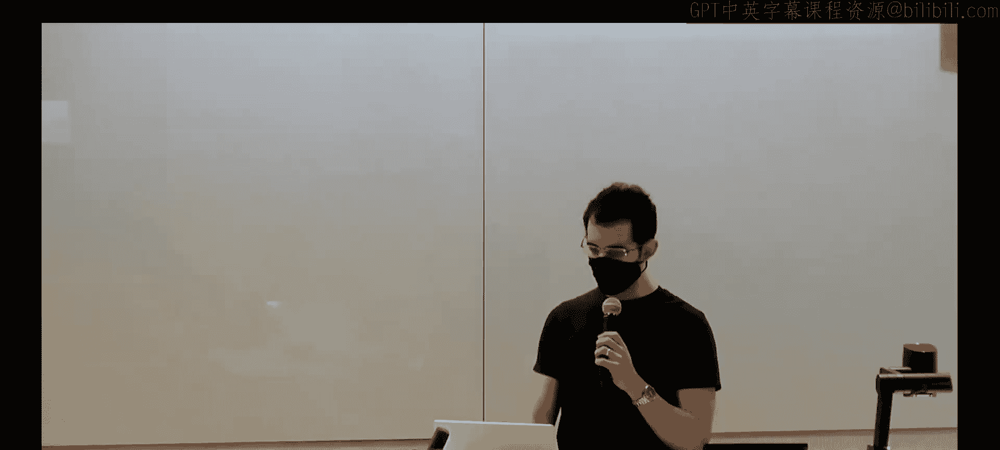
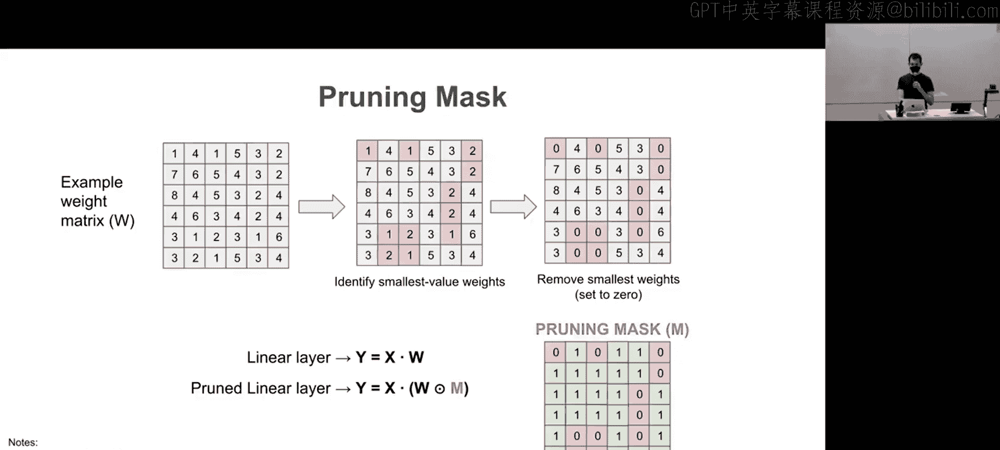
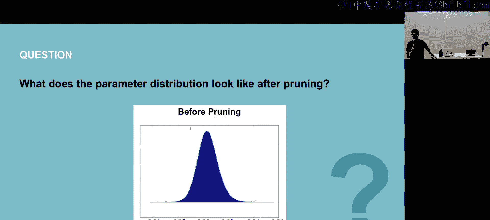
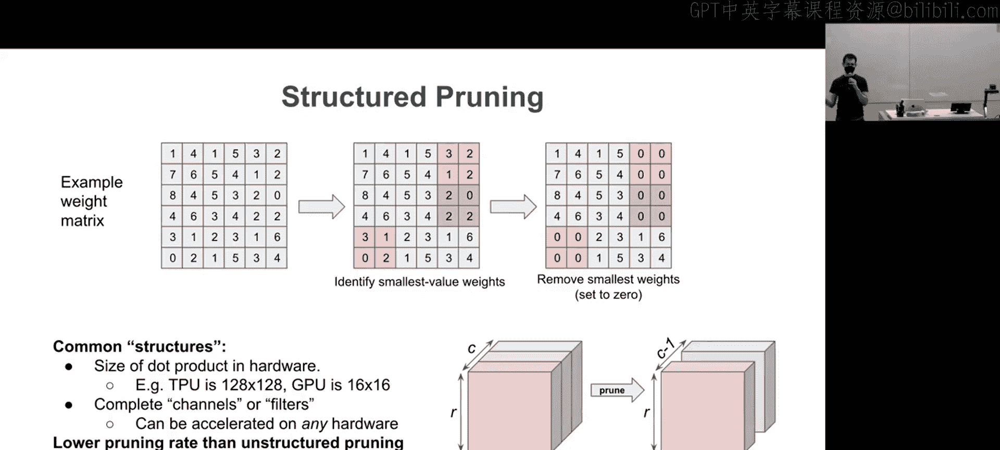
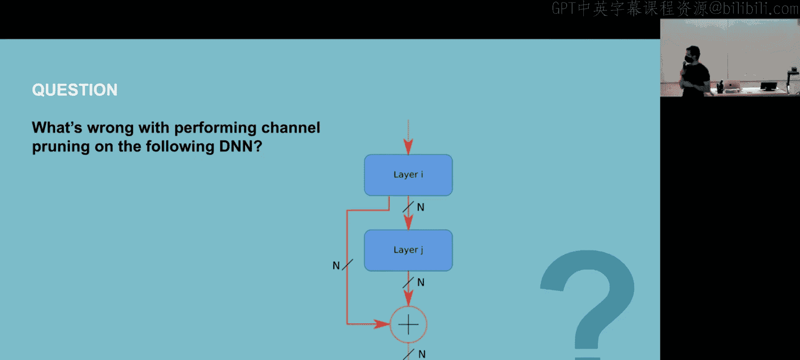
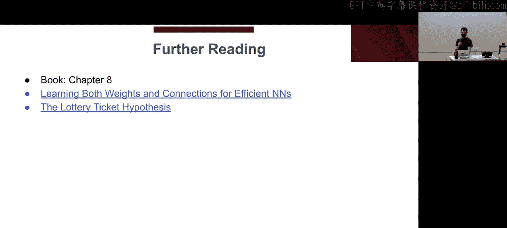

# 康奈尔大学《机器学习硬件和系统｜Cornell ECE 5545 Machine Learning Hardware and Systems》中英字幕 p09 -09-Lecture 8_ Pruning.zh_en -BV1CCqPYSEP5_p9-

Today， we will talk about another technique for making neural networks more efficient。

 It's called pruning。

O。Yeah， so regarding the guest lecture。 So thanks for participating in that poll that I created。

 But our guest speaker decided that he'll wake up early， So he'll wake up at 6，45。

 and he'll attend our normal class time。 So that's good。 So it's this Wednesday。😊，Anyone can attend。

 so if you have colleagues who may be interested， let them know any Cornell student can actually dial into my Zoom session so they can just dial in and check out the lecture they want and people are welcome to come here as well。

嗯。So yeah like I said it's Sean Lee so he's one of the co founders of Crebras and the chief hardware architect。

 so he should have a lot of interesting things to say prepare your questions that's my advice。

I'll release A2 after this lecture， there are a couple of things I need to kind of double check。

 so it may be in a couple of hours or something it might not be immediately after the lecture。

And again， if you don't have a kit yet， just let me know。And come pick one up。And like I was saying。

 if you have questions， go to Ed this question first。

 ask your question there and please also go and answer questions so that's kind of the whole point of that online platform。

Okay， so where are we， we are now optimizing neural networks with general techniques to make them more lightweight。

 and the first thing we looked at， which is quite important， especially for hardware efficiency。

 is quantization， so using a lower numerical precision to make neural networks more efficient。

So today we will talk about pruning and this is another general technique to reduce the amount of computation in a neural network without dropping too much accuracy or by controlling the accuracy drop that you're getting。

 right？And so so while I was kind of putting the slides for this lecture I realized that you know pruning occurred in my own brain。

 so and I mean I always tell you to take these biological analogies with a grain of salt because artificial neural networks are nothing like normal neural networks。

 I think it's a fun fact so when I was born I had 50 trillion synapses in my brain that was multiplied by 20 by the time I was one year old。

And so that's kind of evil genius stage in my life and then it's starting going downhill from there until you know when you reach about 10 or 11 years old。

 they stabilize at about 500 trillion synapses。SoWhat happened between this stage and this stage is you lose almost half of your synapses and that's exactly kind of what pruning is。

 you are trimming away synapses or connections in your neural network that are not important or are not useful anymore。

And so this slide kind of shows you what pruning is， you know， you train a neural network。

 you look at the parameters or at least in the simplest form。

 you look at the parameters of a neural network， and then you just remove P% of those parameters。

So how do you choose those you may choose the ones with the lowest magnitude and there are other methods that will go over as well this is basically what pruning is you go over all of your parameters you say these parameters are going to go into a dot product operation so the smaller they are the less important they are and so I'll just remove the bottom P percent right。

just in terms of terminology， usually we use pruning rate as number of or the percentage of parameters that we will remove sparssity rate as the remaining parameters and in this case your compression ratio will be one divided by your sparsity rate or one divided by one minus pruning rate right and so in this example I'm showing you know we're pruning 75% of the parameters or the weights。

And so we're ending up with 25% which are non zero， and so in this case。

 our expected compression ratio is 4 x， so one divided by 25%。

And our expected speed up should hopefully be close to 4X as well。

 but as we discussed in the hardware lecture， that's very hard to get usually。

 especially with unstructured grooming。Okay， so another piece of terminology is you know what is a pruning mask。

 and so here I'm showing an example weight matrix。And so if we apply our very simple algorithm on it。

 so let's kind of find the smallest P percent of parameters and you know these are the ones here。

 all the ones and the twos are the smallest ones， and then I'll just set them all to zero。

And so if I'm computing a linear layer or a matrix multiplication here。

 I'll multiply my input x by this weight matrix W in pruning。

 we simply add this extra concept of a pruning mask。

 which is all ones with zeros only in the locations where we will want to prune the parameters or where we want to remove them。

And so the equation becomes， you know， the weight matrix element wise multiplied by this pruning mask。

 and then just normally multiplied by the input。And so if you go and you want to actually write this in pytorch。

 that's all you need to do you just you create this new concept of a pruning mask， you multiply it。

And an element wise multiplication with your weight matrix in your operation， you know。

 whether it's a convolution or a fully connected layer， and then you do your operation as normal。

TheThe key thing is you know how do you find these pruning masks so there are various methods for doing that I already hinted at one of them which is just finding the lowest magnitude weights after training and just setting them to zero。

 but there are also other methods that will go over in this lecture。O。

Okay， so a question kind of wake us all up if I'm doing this magnitude pruning and this is my weight distribution before pruning right so it's kind of almost a normal distribution centered around zero in this case。

 what will it look like after pruning？What do you think。The feed goes down， yeah that makes sense。你。

Other guesses。It's interesting， so I said remove the smallest parameters。

 but what a more accurate thing that I should have said was remove the smallest magnitude parameters。

 so you would be right if we're removing the smallest numerical parameters like just the negative ones in this case。

 but if you think about it in a dot product， the negative numbers if they're large。

 they still affect your final result。So we actually want to remove the smallest magnitude parameters。

 so the very small numbers which don't affect your computation that much right so see I see where you're coming from。

So it actually looks kind of funny after pruning， so you got two peaks。

And like when he already kind of hinted at， you kind of remove all the zeros。

 so that's usually what your parameter distribution looks like after pruning。

So to gain kind of a bit of further intuition about pruning。

 some people did an experiment which is quite simple， so they took a very small neural network。

 in this case I think it was three linear layers。And they trained it with just one number so training was just a zero right so if I train this neural network was just zero and then I apply a pruning algorithm。

 so let's say smallest removing the smallest magnitudes， for example。

They found that the parameters in the first linear layer looked like this。So white means they stayed。

 black means they were pruned away。And the more you prune。

 the more the parameters that were being pruned were the ones multiplied by the parts of the image which are not useful。

 so they're basically background pixels。So in this case you know the neural network learned that these parameters aren't that important and so these parameters had very small value and didn't affect my final result that much and that's why removing them doesn't really affect my accuracy so then they kind of repeated it by training with the one digit the two digit five digit all of these and they found the same thing so by just visualizing the parameters in this first linear layer and projecting it kind of on a 2D image they found that they were basically pruning background pixels or pruning the parameters that would be multiplied with background pixels so that's kind of some kind of proof that this method in this case from this paper was pruning unimportant parameters away。

嗯。Okay so I found this image online and I think it kind of summarizes kind of the different things that we need to know about pruning quite well。

 I actually added this branch here because it wasn't there but basically again like quantization。

 the simple concept or the core concept is quite simple right and quantization we're reducing the precision in pruning we're removing parameters that are not useful but there are now so many things related to that science that we need to kind of keep in mind and we need to know how to do basically and so we'll talk about you know what are we going to prune。

So there are different things that we'll talk about there we'll talk about how to prune it so what is my importance metric is it magnitude is it always kind of the magnitude of the parameter or are there other important metrics as well we'll talk about when to prune I already showed you that we can prune after training because by then the magnitudes of the weights have meaning and so we can remove them but can we do before training can we do during training so there are different ways to do there and finally how often so do we just do it once after training or do we do it multiple times kind of gradually。

So we'll talk about all of these things and we'll start with these two ones that have pink arrows on them。

And we'll start kind of with the most most prevalent kind of method of pruning out there and the most successful one so far。

 which is called iterative magnitude pruning。So what I showed before was you you train a neural network to remove the 0% of parameters that have the smallest magnitude。

 with iterative magnitude pruning， we kind of put that algorithm into a loop。

So we keep doing that and every time instead of removing all of the parameters that I want to remove。

 we remove just part of them， so we remove 10% of parameters and then another 10% and so on and and crucially kind of between those pruning iterations。

 we're doing top- up training sometimes called fine tuning so basically this is you know we prune and then we train we prune and then we train and so on。

U。明白。And so empirically， this works really well and intuitively also， it is kind of。

It's giving a chance for the your training algorithm or your optimization algorithm to find。

To both find the parameters that are useless during different stages of pruning。

 but also gives a chance for the parameters to kind of change their values during pruning as well。

 so that works quite well empirically。And so here is an example of some empirical results related to this。

 so the first image I showed had no retraining at all you just you know train once and then you prune your parameters and in this case you we're plotting the accuracy loss so here I'm starting to lose accuracy and this is the percentage of parameters pruned away so typically you'll find these kind of plots where you know there's a cliff basically you keep you you're fine you're not losing any accuracy and then all of a sudden you're losing a lot of accuracy。

And so without tree training， this cliff occurs at 80 to 90% for this example。

 but if you just retrain once， so you train， prune， train again。

 you gain a lot of that accuracy back。For a lot of the sparsity levels right so it's much better。

 you lose less accuracy here compared to the previous ones and are your cliff is later basically can prune more without losing accuracy。

And then taking it a step further， putting this in a loop and kind of doing training three or more times。

 I think in this example it was four times， you gain even more accuracy and you're starting to kind of really improve your accuracy here。

So so this one you can prune up to， I don't know， 96% almost without losing very little accuracy and then kind of you fall off that cliff。

So and and if we think back to our weight distributions and what happens to them during training if we do this iterative magnitude pruning。

 so you know before pruning it looks like this and then after pruning we remove the smallest magnitude parameters。

 but then after retraining you kind of get a smoother distribution again and you start getting back some of those zeros which in the next iteration you're going to prune again because they start becoming you know。

 there are more zeros that are kind of coming in your weights。嗯。Okay， any。

 any questions about this so far？No， this is basically just an observation and just so that you can have intuition about what's going on but it's hard to shoot for a specific shape really。

 usually normalization methods try to maintain that nice kind of distribution centered around zero just so that your numbers don't explode and go everywhere。

 but that's all you're trying to do really。O。So so we talked about you know pruning iterative magnitude pruning and now how do we find those smallest magnitude parameters right and do we go in each layer and find those parameters and prune P percent of them so that would be called local pruning so if I go if this is my neural network I think this is efficient net so if I go to every single layer and say I need to remove p percent of that layer's parameters。

 this would be called local pruning right so as opposed to global pruning in which I look at all of the weights in the neural network I rank them all in one list and then I remove the bottom p percent。

Right so that's distinction between the two and from what I've seen global pruning is quite dominant。

 so most pruning algorithms used in practice are actually using this concept of global pruning and I think it generally works better than local pruning。

And I tried to find a plot for this， but I didn't find the good one。

 but maybe I'll update the slides later with one， but in practice at least what I found it as well when working with pruning is that looking at parameters globally was much better。

But there are some pitfalls with this idea of global pruning right。

 and the main one is called layer collapse。So I'm showing an example here with you know a neural network which has three layers and here are my weights in all of these three layers if I'm choosing a pruning rate of 50% and I'm doing local pruning it's okay so I'm removing 50% of each layer's parameters right so that's fine。

But if I'm doing global pruning， if you notice here the layer two parameters are generally smaller than the other layer parameters。

 so in this case you know I didn't remove anything it's all fine。

 I removed 10 out of my 24 parameters but then as I prune more and more basically I've annihilated layer2 so this is referred to as layer collapse。

And this is one of the pitfalls of kind of or the problems that can occur during global pruning。

And so how do I get rid of this， what is one way of preventing layer collapse？

That's a good question actually， so removing this layer in this case。

 what would happen is I would replace all of the numbers in that layer with zeros。

So the input to this layer will be multiplied by zeros and would disappear right as opposed to。

Setting them all to one and having like a pass through or something。

I want to kind of avoid this pitfall so I mean Harrisish already kind of pointed to okay so we can do something manual and trying to add these hard constraints or these multipliers so some people do that and you can basically put if statements in your code so you can say oh if I'm hitting kind of 98% of that layer then I should stop here the problem is finding that exact threshold and usually these manual constraints don't work that well people have used them successfully but they're usually hand tuneund a bit so so people are trying to move away from that and in general iterative magnitude pruning or iterative pruning in general where you have these training epochs between pruning stages these work quite well in trying to mitigate this layer collapse so basically because you're retraining the weights and you're allowing the weights to kind of jump back up or increase in magnitude based on how many were pruned before usually that。

actually works quite well， but it's not a fool proof way。

And there is kind of some in depth analysis of this idea of layer collapse in this paper。

 So if you're interested you should， you should go and read that one so。

So that's a good question so do you stop after the last pruning stage or the last training stage usually after training so there is usually fine tuning right at the end where yeah you do kind of a final stage of training。

是啊。Okay， so so far we talked about unstructured pruning。

But there is also structured pruning and you should already kind of know why we want to do this。

 it's because our underlying hardware usually doesn't support unstructured pruning。

 you usually have a vector size or a dot product size or a matrix multiplication size that you want to conform to if you want to reduce your actual raw computations happening。

And so common structures there are kind of like I said， the size of your dot product， for example。

 and so you know if you remember the TU has a 128 by 128 matrix small。

 the GPUs now have this 16 by 16 commands so basically usually people try to prune in that way and they write libraries to leverage know sparsity of that nature。

You can also remove complete channels or complete filters from your tensor。So basically。

 if this is what my filter or weight matrix looks like。

 I can remove a whole channel like removing this green channel here。And generally， again。

 I don't have a plot for it， I think， but generally when you move towards more and more structured pruning。

 you're basically adding more constraints to your pruning problem and you're able to prune less without accuracy loss so you lose more accuracy more the larger your structure is and the more rigid it is。

嗯。But I mean the coursearsed the coarser grained you're pruning is usually you can accelerate this on more and more kinds of hardware。

 so if I'm removing channels from my filter for example。

 if this is a convolutional filter or even a fully connected layer and I'm removing a complete channel。

 I can actually accelerate this on any kind of hardware because I can rewrite my model instead of having 16 channels。

 it has 15 channels now and it will just work or it should just work out of the box。

But I mean even with this idea of channel pruning or filter pruning there are still some problems right so if you look at this image here I have a very simple neural network with two layers。

And the output of both layers is being added with an element twice addition at the very end here。

So if I perform just unconstrained， you channel pruning on this kind of structure。

 what is one possible thing that can go wrong？嗯。Yeah。Yeah。Yeah， so n is the number of channels。

 in this case， n is the number of channels of the activation maps coming out of each layer。So you're。

 yeah， I think you're， you're on the right point。能。I'm sorry。Yeah， exactly。

 so so if I prune if I prune more channels from layer I than layer J。

 I can't add them to each other with element twice edition in the end because the shapes of the tensors are no longer the same。

So shape mismatch is one of the key things that can go wrong with channel pruning or some kinds of structured pruning typically。

走。Okay， so so we talked a bit about you know what to prune。

 whether we're doing it locally globally structured or unstructured。

 and we talked a bit about how often so do we do it in kind of one shot or do we do it iteratively and as I said so far global unstructured iterative pruning。

 is the most successful form of pruning so far， but people are trying to make these other things work whether it's for kind of hardware acceleration or for other purposes。

But now let's talk about how to encourage zeroes to show up in your neural network。

 so basically if you train a neural network and you just expect to have a lot of zeroes， that's good。

 but it's not always the case that you have a lot of sparsity that you have a lot of zeros and so how can we encourage that during training other than just looking for the smallest parameters in removing them。

So it turns out there is a very simple way to do that and the way is to add the L1 or L2 norm of your weights to your loss function。

So what is the L1 L2 norm， does everybody know what those are？

Im seeing nods it's good so basically the L1 norm is just summing all the magnitudes of the weight parameters that I have Okay just adding them all up L2 norm is adding the squares and taking the square roots so it's it's another way of kind of finding the total size of those parameters。

And what I'm suggesting here is adding this extra term to your loss function with either your L1 or L2 norm right and so what does this achieve？

Basically， what you're trying to do during training or during back propagation。

 the whole purpose of this loss function is the bigger it is。

 the bigger the gradients that will propagate through your network。

 and it will try to change the network so that you know it moves in the direction of optimizing or minimizing the value of this loss or this error。

So if this loss now is controlled by also the magnitude of the weights。

 then back propagation will try to push those weights to be smaller。Right。Does that make sense？Okay。

 so basically your optimizer and you know the algorithm of back propagation and gradient descent will push the weights into the direction of minimizing this loss function of making this loss function smaller and if the loss function has a sum of all of the weight magnitudes。

 then it will try to make those weight magnitudes smaller as well。

And you will usually find this hyperparameter whenever you're training a neural network。

 so it's called weight decay， and it is what weight factor I put onto this spaifying regularizer in my loss function。

So， yeah， so。So this is how you kind of encourage more zeros to show up in your。

And your neural network。And it's quite empirical whether L1 works better or L2 or something else。

 so you have to kind of try it out so take these results with a bit of a grain of salt。

 but basically what this paper found is that。If you're not doing any retraining。

 L1 norm usually works better。As a sifying regularizer。

When you're doing retraining L2 norm usually works better and so there is no hard rule here。

 I think it's quite empirical， there is also something called Linfinity norm which is basically a max function over all of your weights so're just taking the biggest weight adding it to your loss function there are different kinds of srsifying regularizers as well that you can add to your loss function and it's quite empirical which one works better。

Okay， so now we talked about how to encourage sparssity in a neural network now let's go on to kind of the objective function or what I'm actually using as the importance of each parameter I'll pause for a bit and ask if there are any questions because I feel like I'm going through it a bit too quickly。

嗯。No， everyone is good。O有。's what's your name， sorry？叫明O改。呃。

So sparsity helps pushing the magnitudes of the weights or your parameters to be smaller values。

So usually the smaller they are， the more you can prune。So so indirectly。

 it does help with the sparsity in in your neural network guess。

 it helps push more parameters to zero while optimizing that loss function。

 so it makes your pruning algorithms work better。That makes sense。点。啊。All right。Okay。

 so so far I said， you know， look for the parameters with the smallest magnitudes and remove them。

 but this is actually just a proxy for the importance of the parameter because maybe all of your small magnitude parameters are positive and if you remove them all。

 then you've just introduced a negative bias into your operations and it won't work。

So so the magnitude is not the ultimate importance factor of a parameter and people have tried to find different ways of。

Kind of。Cpturing the importance of each parameter through usually it's called a salency criteria or a pruning criteria or importance criteria that is still kind of acting as a proxy to how important this parameter is。

And so many papers that I've read define this parameter importance or the parameter saliency as the impact that this parameter have。

On the loss function。So what what am I showing here so this is kind of the general formulation that I've seen in a bunch of papers。

😊，The impact on the loss function， so how does my loss function change deelta L where L is my loss function。

 it's parameterized by my weights and my data set， my training data。

So I'm basically subtract my loss when。I have all of my weights。

 so they're multiplied by an all one matrix matrix or factor in this case， more generally。

 and minus you know removing that specific parameter J and then measuring the impact on the loss function。

So if I have a neural network and I pick one parameter。

 I remove it and then I measure how my loss function changes or how my objective function changes。

 this is kind of the ultimate way to measure how important a parameter is， right？

But to do this accurately， what do I need to do？I need to literally go in a neural network with billions of parameters。

 remove one， train that neural network to completion， measure the final loss function。

 and then subtract it from the loss function if I train that network to completion without removing that parameter。

So that's intractable that takes so much time， right？So people。

 basically most of the pruning papers that I've seen are trying to make approximations to this general formulation in order to kind of estimate the impact on the loss function from removing a single parameter gene。

O。And so so one of the first papers that tried to do this is actually kind of released in 1989 so when I was actually one year old and I had all of those synapses in my brain。

 it's called optimal brain damage， so yeah it's a really cool paper name and you will find like 100 other papers that are trying to play around with that name。

 so it's like optimal brain surgeon， optimal brain surgery。

 yeah so anyways but this was one of the papers by An Lan on basically trying to find this importance of parameters based on approximating that that general formulation of you know impact on loss function。

And what he actually arrived at is a saency criteria that has a Hassian within it。

 do people know what the Hasian is？So it's the second order derivative of the loss function with respect to your weights。

And you know， we use the first order derivative， the Jacobian during training because we need the gradients to flow back。

 but the second order derivative， whenever you see it。

 you should just pause because it's actually almost impossible to calculate this， right？

Your second order derivative more like generally looks like this。

 so it needs the derivative with respect to all of the pair of your parameters so if you have a billion parameters this growth quadraically with the size of your parameters and it's really hard to compute for you know normal sized neural networks maybe just for some toy networks but for normal sized it doesn't really work。

But there are some fast methods to compute pieces of that hessian。

And the salency criteria that this paper arrived at looked like this。

 so it had only the diagonal of this Hassian matrix in the saency criteria。

So there are actually fast methods that exist to compute this there are fast methods that exist other to compute other pieces of the Hessian as well and so in this case you know so far we talked about using the weight magnitude as our saency or importance or pruning criteria but now we're using something else and it's a function of the weight value as well。

 but it's also a function of the second order derivative of the loss function with respect to that weight and I won't really go into how he arrived at that it consists of a bunch of approximations and estimates of you know expanding this delta of the loss function whenre removing that weight and they're making a tail series expansion and so on but if you're interested you should go and read the paper but now we have another number which kind of signifies how important my parameter is it's no longer the magnitude but it's something else related to the gradient and there is a family of these gradientbased methods for。

Computing parameter siliency with pruning so。The algorithm here looks a lot like iterative magnitude pruning。

 so you you choose a network， you train it until it's trained with a reasonable accuracy。

 you compute your derivatives and then you compute the assencies。

 you sort the parameters from globally in this case from best to worst。

 you remove the bottom P percent of parameters and then you repeat that again and again so it's iterative global gradient based pruning in this case。

Okay， there's another class of。Kind of pruning criterion that depends on something kind of called information gain or information and I actually don't know that much about it but i'll give an example and some pointers to further reading here。

 but this the whole idea of mutual information is to kind of measure。

How much one variable impacts another variable so in this case one of my variables is the loss function。

 the other variable is the specific weight or parameter and so there is this paper which is written here that tries to find not the importance of my weights or my parameters but the importance of the activation channels so my input tensor gets multiplied by some weights it's called an activation now that's usually I call it and so it's trying to find the impact on the loss function they call it cost function here when removing or keeping this activation channel altogether so it's trying to do structured pruning in this case it's looking at the activations and not the weights。

And then it's trying to compute the impact on the loss function when I just set this activation channel to all zeros or I keep it。

 so how important is this activation channel in this case。So I highlighted this paper because A。

 I think it's well written and B， it's looking at activations instead of weights。

 which is a bit different from everything we said so far。😊，And again。

 after some math and some approximations and Taylor series expansions and removing the higher order terms and so on。

 they arrive at this still gradient based loss function in which they try they attempt to estimate the importance of each parameter channel it actually works pretty well so this paper is from NVDdia I think。

嗯。There is also another concept called Fisher information and there is a paper that I attached here related to that and what Ive found so far and again this is kind of an an expertpert talking about this concept of information in computer science but they basically boil down to gradient based methods there is a theoretical reason for choosing the initial formulation and then it comes down to oh this becomes a gradient based method for finding the importance of parameters。

嗯。Okay。Okay， are there any questions at this point， I know。

No okay so so we talked a bit about you know how to select this salency criterion for for my parameters。

 how to figure out how important each parameter is beyond just taking its magnitude and seeing that's kind of how I'm going to figure it out and they should say this idea of measuring the impact of the loss function。

 whether that parameter exists or not is usually called perturbing that parameter like removing it and keeping it and seeing what the impact of the loss function is。

 so you'll find this term perturbation a lot as well。Okay。

 so now let's talk a bit more about when we want to do that pruning because actually there are a bunch of interesting algorithms here these days that don't necessarily do pruning after training so I mean what we saw so far as you know your train and then you prune once this is usually called post training pruning。

And then another method is just iterative kind of pruning with both train and prune stages that you're repeating again and again。

One thing that I didn't draw here is initialization。

 usually initialize your neural network with some kind of initialization before doing training and before attempting pruning and they are actually a class of pruning methods that now try to prune a neural network before training so they just look at the initializations and they try to figure out which parameters can I remove even before training。

In order to kind of make this network more lightweight。

 obviously this has the advantage of you know you're training a lighter neural network。

 so potentially it can also speed up training not just the deployment or inference later。

But also if I'm only initializing my parameters， then the parameter magnitudes have no meaning right and so how can I actually find a way to figure out which weight is more important than the other so so again a lot of the work here is quite empirical and people have found ways of making it work but it's quite an interesting concept。

And then another concept is called lottery ticket hypothesis and in that case what they're saying is。

You know why does why can we always train a neural network and then prune it and then you know we get a good accuracy afterwards why can't we do that from the start and they found actually a method to capture that information and put it in a randomly initialized neural network and train a sparse network from the start and getting a good accuracy so what that means is you know I have typically I have a dense neural network so it's fully connected nothing is removed here I train it I get for example 90% of accuracy。

And then if I prune that network， I get still 90% because usually you can do pruning without falling off that clip that I showed before。

 so you can prune a lot of your parameters without losing any accuracy。

But if I take the same sparse neural network and I randomly initialize it， so the same one。

 the same structure usually get very poor accuracy accuracy right and so why does that happen what is what is。

You know what is wrong here， And so is there a way to actually take that sparse neural network？

And train it with its you know given sparsity and actually get good accuracy because there is a way to get that good accuracy with that network。

 I just have to go through dense training， but is there a way to do it you know from the beginning and so far the common wisdom was you know you can't train a sparse neural network for optimization you need to have an over parametermatized neural network and that's the best way to do it。

And so what the lottery ticket hypothesis says in that paper。

 which was quite impactful actually from a couple of years ago， is that。

 if you take the same initialization of those surviving nodes here，And put it in that sparse network。

 and you train it， you actually get good accuracy in that case。

So what does this mean so this means I have this dense neural network I'm initializing it to a bunch of values right so you know I'm using some kind of Xavier initialization or something。

I train it。 I remove some parameters。And then I rewind all of those parameters to the initialization value they had here before training。

 so the same values。Okay， and then if I train that sparse network。

 I get good accuracy and why it's called lottery ticket hypothesis， they're saying that， you know。

 within this dense network， you have many lottery tickets。

If you train one of them with the exact initializations of those lottery tickets。

 then you get good accuracy， but if you change that initialization a bit。

 it's messed up and it doesn't give you good accuracy。

And so training a dense neural network effectively just buys you a lot of lottery tickets。

 a lot of potentially winning initializations that can get you good accuracy。

And so that was the hypothesis and they tested it in the paper by kind of very thoroughly investigating this on a bunch of neural networks。

 and they found that， yes， it actually depends on this initialization value a lot。

 and if you do this step of rewinding of a sparse neural network to the initial weights that worked with its dense counterpart。

 then it actually works and gives you good accuracy。Does that make sense， does anyone have questions？

嗯。It's yeah， I mean， it's quite an interesting concept。

And what it enables so far is for us to train sparse neural networks The problem is that in this algorithm we actually need to fully train a dense neural network together get to that winning ticket。

 right Yes three。That's a good question， so shouldn't the neural network be robust to different kinds of initialization？

I mean it's not easy to answer that so should our neural network structure be robust to different initialization I mean previous work has shown that initialization matters a lot and training a neural network and so in general neural networks are not robust to different initializations if you initialize all zeros nothing will train if you initialize to all ones nothing will train if you initialize randomly usually doesn't work that well usually initialize a function of the size of each layer So it's usually in the inverse of the square root of the size of the layer or something like that and so initialization does matter here it's taking it a step further and saying this initial values in that specific structure matters and like I said。

 the work is all empirical as well like there is no。

There is no analysis framework behind it to support that this exactly should work that way。But yeah。

 that's all I can say about it really I don't know beyond that how robust a neural network can actually be to different initialization in this case it's definitely showing that empirically sparse neural networks are not robust to different initialization。

 in fact they need very careful specific initialization that's only found by training the dense neural network in this case。

But yeah， so it's a good question。 if I， if it's the same one。 So is it the same question， So no。

 okay。嗯，O。嗯。So， so people have said， okay， if， if there is a way。

To train sparse neural networks from the onset， let's try to find these winning tickets or try to find these initializations of a sparse network。

in a lightweight way without actually doing you know full training， pruning。

 fine tuning and rewinding to find these winning tickets。

 let's take a randomly initialized neural network and try to do pruning right there to make that work and now there's actually a family of methods that do this。

So Snip grasps inflow， there's one called force there are a bunch of pruning gut initialization methods。

 but actually kind of。You know， get good results in terms of pruning a neural network from scratch at initialization。

 just again by approximating the impact on the loss function and by finding a suitable salency criteria to remove those superfluous or unneed weights。

So people are kind of moving in that direction， usually it's kind of。

 I think it's inspired by the lottery ticket hypothesis work。

 but it's now its own thread of research into this idea of pruning at initialization。

I think the best performing one right now is called synaptic flow。

 so here it's showing the compression ratio it can achieve versus these other methods。

 so less drop in accuracy and more compression ratio。Okay。

 so I think that kind of covers everything in this。

In this slide here there are a few other concepts which I don't have slides for so there's an interesting paper I think I have a link here which does this idea of dynamic network pruning so in normal iterative pruning once you prune a weight it's gone you add a zero to your pruning mask and that weight can't come back where that parameter can't come back in this dynamic network pruning actually relaxes that constraint a bit and allows some of those weights to return。

So that I think that's an interesting concept and instead of for normal iterative magnitude pruning you can usually compress AlexNe by nine times in this case they were able to push the compression ratio to 17 times so it works quite effectively in the empirical world as well。

There's also the idea of runtime pruning and that's quite different from conventional pruning。

 you basically keep your whole network and then based on your input sample you activate just a subset of your network。

 so you're dynamically pruning at runtime the parts of the network that you think will be useless for that specific input or specific image or specific speech sample or something。

And finally， there's this idea of learned pruning masks or learned pruning characteristics。

 and in this case you are trying to co-optimize both your neural network accuracy and an aspect about your pruning algorithm as well。

 so whether it's the percent of parameters that you remove from each layer or kind of the exact pruning mask itself making it into kind of something that you learned during back propagation。

 there is a line of work that does that as well。So here's the further reading， please read it。

And that is all I have。